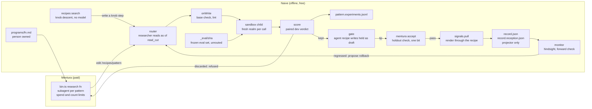
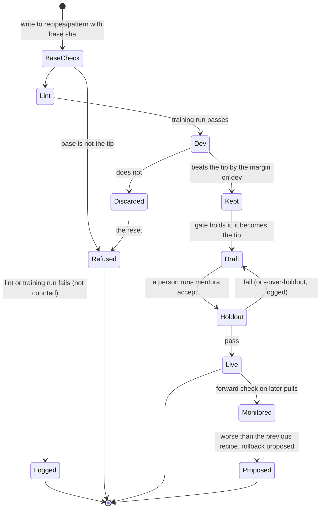

# Autoresearch over venture records

Status: designed, not built. It extends [the signal library design](SIGNAL_LIBRARY_2026-11-06.md). Every noun below is a candidate for the EE-095 term engine and is not admitted.

## The ask

Torian, 2026-11-06 22:22Z: karpathy/autoresearch is what he is trying to accomplish. The filesystem is the GPU. train.py is a `.ts` file, possibly the specific record, where relative signal packages are passed in and noise is stored adjacent, judged by bitemporal factors and traces. program.md belongs to the agents and subagents of the venture's functions and processes. He said yes to architecting it as an extension of the signal library.

## The mapping

| autoresearch | Here |
|---|---|
| `prepare.py`, fixed | Naive: the as-of replay, the sandbox, the scorers, the eval plan, the router hooks. No agent can write them |
| GPU | The filesystem and the router, where every experiment runs |
| `train.py`, edited by the agent | `<pattern>.recipe.ts`: one pure TypeScript module per projected route pattern, beside the records it makes |
| Model weights | The records the recipe renders, written only by the projector |
| Fixed 5-minute budget | A frozen eval plan version: the same as-of points, windows and outcomes for every experiment |
| `val_bpb` | Settled loss, lower is better, computed in code |
| Keep, or `git reset` | The router write lands as a held draft, or is refused |
| `results.tsv` | `<pattern>.experiments.jsonl` beside the recipe, hash-chained, written by the evaluator only |
| `program.md`, edited by the human | `programs/<function>.md` in the venture, person-owned, read over one generic research skill Naive ships |

One change to Torian's mapping: train.py is the recipe that makes the record, not the record itself. The record stays data written only by code, the way weights are the output of `train.py`. A recipe per route pattern covers the single-record case too: `market/rounds.recipe.ts` makes one record, and `competitors/[id]/signals.recipe.ts` makes every competitor's, like a Next.js page file.

## Diagram



One experiment, as a statechart:



## Shape

### The recipe

A recipe exports `hears` (the signal type ranges and named fact references it reads), `knobs` (a JSON object of numbers and short lists), and one synchronous default function. The input is the record route, the `[id]`, `asOf`, every heard signal observed at or before `asOf` in `(time, id)` order with `withdrawn` as known then, the named facts as of `asOf`, and engine-computed bitemporal factors. The output is the record or null, plus exactly one reception per heard signal. There is no previous record, so replay is exact. Record and fact types come from JSON Schema through `naive typegen`.

```ts
export const hears = { signals: ["competitor-funding@^1", "product-launch@^1"], facts: { icp: "foundation/icp.json" } } as const;
export const knobs = { min_rating: "C3", recent_days: 120, launch_weight: 0.25 };
export default function render(input: RecipeInput<typeof hears>, k: typeof knobs): RecipeOutput<CompetitorSignals> { /* pure */ }
```

`naive recipes init` generates the first recipe from the signal types' `projects` data, so a venture without a model starts with the plain fold from the signal library design.

### The sandbox (Naive)

Each evaluation runs in its own child process under Node's permission model, with an environment of only `TZ=UTC`, a memory cap, a wall-time kill, and JSON over stdin and stdout. Every call gets a fresh `vm` realm with string and wasm code generation off. A prelude removes the clock, randomness, `Intl`, `WeakRef`, `SharedArrayBuffer`, `Atomics` and `WebAssembly`. Types are stripped, and a linker refuses every import. Values cross only as strings, so no host object enters the realm, and a fresh realm per call makes module state impossible. Before a run, the source is bounded in size and may not contain a subject id or signal address as a literal. After it, the record must pass its schema and the receptions must cover each heard signal once.

A probe on Node 22.23 ran the example recipe. The clock, randomness, `new Function`, `import`, an endless loop and state carried between calls each failed closed, and 1,000 calls with 40 signals each took 2.3 seconds. Node's docs say `vm` is not a security boundary, so this is layered defence. QuickJS compiled to wasm is the hardening path behind the same interface.

"Runs no library code" from the signal design still holds. A library ships only data. A recipe is venture code, written through the router with provenance by Naive's generator, a person or the venture's own agent, and it runs only in the sandbox. Its only effect is a JSON string that then meets the schema, the gate and provenance. The signal design's sentence becomes: it runs no library code, and runs venture recipes only inside the sandbox.

### As-of reads (Naive)

Naive has no bitemporal store today: provenance lines hold a transaction time and a content hash, not content. A content-addressed store under `.naive/blobs/` keeps the bytes each provenance line names, and `readAsOf(dir, route, t)` returns a record as it was at transaction time t. Signals already carry both times: `time` (valid time, when it happened) and `observed` (transaction time, when it was recorded).

### The metric (graft: only people and producers resolve outcomes)

A projected record type declares `settles` in the data model: horizon, cadence, a loss per field from a closed catalog (`exact`, `set-jaccard`, `abs-scaled`), forecast fields with what resolves them, and minimum counts per window.

- **Prediction.** The record the recipe builds at `asOf = t` from what was observed by t.
- **Settled record.** The reference fold of what is known about valid times up to t once the horizon has passed. Only outcomes from a person (provenance `agent.kind: "person"`, including superseding local signals) or a producer count, and a claim counts as settled once a second producer confirms it or a person states it. An agent's write never resolves anything, so no agent can label its own work.
- **Forecast fields.** A Brier score against whether the resolving event arrived within the window. This also scores the signal design's edge listeners: a proposal is a forecast that a person will act on it, resolved by the person deciding or dismissing it.
- **Settled loss.** The weighted mean over (record, as-of point) rows. With `weights: "cited"`, a record weighs more when provenance and traces show the venture used it before the cut. The forecast set is fixed by the plan, so a recipe that says nothing still pays for every confirmed event. A null record loses every field.

The baseline recipe is the plain fold at t. An experiment wins by anticipating confirmations and retractions, or by forecasting better.

### The eval plan (the fixed budget)

A person runs `naive recipes plan`, which writes `<pattern>.plan.json` and freezes an eval set into `<venture>/_eval/<sha>/`, a folder the router never serves. The set holds the as-of points, a frozen index of every signal about the subjects, each fact's versions, and the settled outcomes. Freezing the index means a library that backfills later cannot leak into a plan version.

```text
 training points | gap h | dev points | gap h | holdout points | h | plan made
                 ^ read_cut: the researcher sees the venture only as of here
```

- **Training:** full feedback from `naive recipes check` (per-row losses, settled and predicted records, noise disagreements).
- **Dev:** one aggregate per write. A keep needs a gain larger than `max(min_gain, 2 x standard error)`, with the error from a block bootstrap seeded by the plan's sha, so a verdict is deterministic. A strictly smaller recipe that is no worse is kept, as autoresearch prefers simpler code.
- **Holdout:** checked only when a person accepts, answered pass or fail (one bit, the Ladder mechanism of Blum and Hardt 2015), with a fixed number of checks per plan version, and never reused. The next version's holdout must start after this one ends.
- **Forward:** after an accept, later points are scored as their horizon passes, against the previous recipe.

The researcher role reads through the router as of `read_cut`: records from the blob store at that instant, no signal observed after it, nothing in `_eval/`. Compute limits fail an experiment but never change its score. The count of dev evaluations per plan version is the budget, derived from the log.

### Keep and discard through the router

A write to `recipes/<pattern>` carries the source and the base sha it was edited from. The router's `onWrite` refuses a stale base, lints, runs training, then scores dev against the tip on paired rows. It appends the experiment line (candidate stored by sha, the trace span named), then a keep goes to the gate, where a package rule holds every agent write to `recipes/**` as a draft that becomes the new tip, and a discard is refused with its verdict. The verdict is computed inside the write, so an agent cannot supply a score. A retried write returns the logged line and spends nothing. A person's write is scored and logged the same way but lands live, because a person decides.

`mentura accept recipes/<pattern>` is the only promotion: it runs the holdout check and refuses on fail unless the person passes `--over-holdout`, which is logged. After it, `monitor` runs on each pull and proposes a rollback decision when forward loss is worse than the previous recipe by the margin. Nothing rolls back on its own.

Traces join the run: the research run is the root span, the file edit a tool span, the router call a call span, and the evaluation a judgment span with score, threshold and outcome. The draft's provenance line and the experiment line both name that span.

### Noise stored beside the record

Each record gets `<record>.reception.json`, written only by the projector: for each heard signal, salient or noise as of the render, the bitemporal stamps (`time`, `observed`, `withdrawn_at`) and factors, and later a hindsight label.

- **Noise has a checked meaning.** A recipe that calls a signal noise must produce a byte-identical record without it. `check` reports every disagreement, and an experiment with one fails. Noise means the record does not depend on the signal, not that the recipe says so.
- **Hindsight.** Once `observed + horizon` has passed, `monitor` compares the loss without the signal to the loss with it and labels it helpful, inert or harmful, with the recipe's sha.
- **Bitemporal factors and traces.** Recipes read, and cannot define, engine-computed factors as of t: lag (transaction time minus valid time), the producer's confirmed and withdrawn share, age, and uptake (how often a person acted on what this record surfaced, from decisions and the traces of the runs behind them).
- **Relative to the consumer.** Two recipes that hear one signal keep two receptions, so a signal can be salient at `competitors/[id]/signals` and noise at `market/rounds`.

Optional probes (graft): with `research.probe_rate` set (default 0, because probes cost attention), a deterministic share of noise receptions is surfaced anyway and marked, and its outcome is weighted by inverse propensity, so a recipe can be scored on signals the current one never surfaced.

### program.md per function

Naive ships one generic research skill (the loop, the rules, how to read the log and `check`), mounted read-only for every researcher. The human-edited program is `programs/<function>.md` in the venture, person-owned (the gate refuses agent writes), with one section per pattern for the subagent that works it. The researcher's role is `<function>-researcher`, derived like the EE-123 function agents: it writes only `recipes/<pattern>` for patterns in packages its function owns, and reads as of the earliest `read_cut` among their plans.

### With no model (graft: knob search)

Everything except proposing new recipe text runs with no model: live rendering on every pull, `init` from data, plans, `check`, scoring, the log, holdout checks, hindsight, forward monitoring and rollback proposals. `naive recipes search <pattern>` also improves recipes without a model: coordinate descent over the recipe's `knobs`, one step each way per knob, each step a normal experiment write, then one holdout check for the best when a person accepts. A model adds only what knobs cannot: new logic, new listeners, new knobs. A person editing a recipe by hand is a full experiment too.

## Goodhart risks

| Risk | What resists it |
|---|---|
| Overfitting dev over many experiments | A count budget per plan version, a margin of twice the bootstrap error, a one-bit holdout with its own budget, a forward check after accept |
| Memorizing subjects or outcomes | Literal ids banned; the researcher never sees dev or holdout outcomes; one recipe serves every subject |
| Hedging forecasts | Brier is a proper scoring rule, so the honest probability scores best |
| Saying nothing | The forecast set is fixed, so silence pays for every confirmed event |
| Labelling its own work | Only people and producers resolve outcomes |
| Moving the goalposts | Plans are person-only, their sha is on every line, scorers are Naive code, the eval set is unrouted |
| Dropping hard rows | Any throw, timeout or invalid output fails the whole experiment |

## Framework versus platform

| Part | Side | Paid |
|---|---|---|
| Recipe contract, sandbox, blob store and as-of reads, eval plans, scorers, router hooks, experiment log, receptions, hindsight, forward monitor, knob search, `check-recipes` | Naive | no |
| Generic research skill; a person or their own agent running the loop over MCP or the CLI on their own subscription | Naive | no |
| The unattended loop (`bin.ts research <function>`), subagents per pattern, spend limits, scheduling, a Grokbot tool | Mentura | yes |
| Programs and seed recipes in kits (`market-intel`), producer track records as a signal type | Mentura | yes |

## Nouns for the term engine

Proposed, not admitted. None is in `ontology.json` today. Avoided: "gate" (phase exit test), "workspace", "validation", "epoch". Reused: eval, evidence, draft, provenance log, and the signal design's reception, criterion, noise and projection.

| Candidate | Draft meaning | Standard |
|---|---|---|
| recipe | The code that makes every record at one route pattern from heard signals and facts as of a time; a kind of projection | training recipe (Karpathy 2019); dbt model |
| experiment | One write of a recipe, scored in code and logged whether kept or discarded | autoresearch; design of experiments (Fisher 1935) |
| experiment log | The append-only, hash-chained list of a recipe's experiments | results.tsv |
| eval plan | A frozen version of windows, horizon, weights and budgets for one recipe | pre-registration (Nosek et al. 2018) |
| eval window | Training, dev, holdout or forward as-of points, separated by the horizon | dev and test sets; purged cross-validation (Lopez de Prado 2018) |
| as-of view | The venture as known at one transaction time | SQL:2011 system time; Snodgrass 1999 |
| settled record | What people and producers established about valid times up to t once the horizon passed | bitemporal data (Snodgrass 1999); forecast verification (Murphy and Winkler) |
| hindsight label | A signal's helpful, inert or harmful effect on a record, by ablation after the horizon | leave-one-out influence (Cook 1977) |
| research program | A function's person-edited instructions for its researcher | program.md; Lakatos 1970 |

Proposed theorems in `packages/naive/lean/Naive/Recipes.lean`: `as_of_no_lookahead`, `windows_purged`, `holdout_unread`, `noise_inert`, `verdict_deterministic`, `agent_never_resolves`.

## Build plan

One item per pull request. It depends on the signal library's schemas, render and pull PRs.

| # | Repo | Item | Verifier |
|---|---|---|---|
| 1 | Naive | Propose the nouns; Lean theorems | `admit.ts --check`, the Lean job |
| 2 | Naive | Blob store and `readAsOf`; provenance writes the blob | an as-of read returns the content at t and nothing later |
| 3 | Naive | Schemas: recipe, eval plan, experiment, reception; `settles` on projected types | `validate.py`, `record-types.ts --check` |
| 4 | Naive | Sandbox child and host with lint | clock, random, import, eval, loop, state, fs and env each fail closed |
| 5 | Naive | Eval sets, outcomes (people and producers only), scoring, `naive recipes plan` and `check` | windows purged; an agent write resolves nothing; verdict identical over two runs |
| 6 | Naive | Router: recipe routes, base sha, `onWrite`, package rule holding agent recipe writes | keep lands as a draft, discard is refused, a retry spends nothing |
| 7 | Naive | `reads_as_of` clamp for researcher roles | no read after `read_cut` or into `_eval/` |
| 8 | Naive | Accept with the holdout check; `monitor` with rollback proposals | pass, fail and override paths; a regression raises a decision |
| 9 | Naive | Signals pull renders through recipes; `init`; reception files with hindsight | two-venture end-to-end test; a second pull writes nothing |
| 10 | Naive | `naive recipes search` (knob descent) and probes | a fixture venture improves with no model |
| 11 | Naive | `check-recipes.ts` in `test.mjs`; generic research skill; person-only programs route | breaks on copies; an agent write to a program is refused |
| 12 | Mentura | Move the Naive pin | `node test.mjs` |
| 13 | Mentura | Researcher spec derived in `function-spec.ts`; `bin.ts research` with limits | offline run with a scripted model keeps, discards and stops at budget |
| 14 | Mentura | Schedule, MCP tool, spend caps; `market-intel` kit | scheduler and kit checks |

## How this design was chosen

Two structurally different candidates were sketched (pstack architect, arena).

- Candidate 1: a recipe is versioned JSON data (listeners, credences, projection, knobs). Naive runs, scores and keeps; outcomes come only from people and producers; Brier at each cutoff; a sealed researcher role; a one-bit holdout; knob search with no model; probes for signals never surfaced.
- Candidate 2: a recipe is a pure TypeScript module run in a sandbox. Every write is an experiment scored inside the router; noise is checked by ablation; settled loss against a reference fold of later data.

Base: candidate 2. It matches Torian's words (train.py as `.ts`), keeps the agent from ever supplying a score because the verdict is computed inside the write, can express learned weights and forecasts that six reducers cannot, and gives noise a checked meaning. Its sandbox was probed on Node 22.

Grafts from candidate 1:

1. Only people and producers resolve outcomes. This fixes candidate 2's weakest point, where truth was Naive's own fold of later data, so a recipe was rewarded for anticipating what the venture would record rather than what turned out true.
2. The one-bit holdout (Ladder), so repeated checks leak at most one bit each.
3. `knobs` and model-free coordinate descent, so a venture with no model still improves its recipes.
4. Proposals scored as forecasts, resolved by a person's decision, which answers candidate 2's open question about edge listeners.
5. Optional probes with inverse propensity weighting.

Rejected from candidate 1: recipes as data only (cannot learn producer reliability or forecast), and a new `vote` reducer (unneeded once recipes are code).

Cross-judge skipped: the arena wants a judge from a non-Claude model family, and this session has only Claude models.

## Young ventures lean on the library

Torian, 2026-11-06 22:59Z: every venture is unique, but ventures are similar, and that is what makes the libraries useful. Even a young venture has a vast amount of research to rely on.

So the unit that learns is not only one venture. A recipe can be researched at two levels:

- **Library level (Mentura).** Producer outcomes (a second producer confirming a claim, or a retraction) are signals the library already holds. Mentura can run the same eval plan, scorer and sandbox against the library's whole history for a market, with no venture data at all, because the settled record of a public subject (a competitor's funding, a launch) needs only producer outcomes. Recipes kept this way ship in kits as seed recipes, with their eval plan and experiment log attached, so a venture can see how they scored.
- **Venture level (Naive).** A young venture starts from the seed recipe for its market. Its own plan scores only what is specific to it: people's outcomes (decisions, corrections) and the facts its predicates read (its ICP, its competitor list). Its experiments tune the seed rather than start from the plain fold, and `monitor` compares the seed with the venture's tip on the venture's own future.

What crosses the boundary stays as in the signal library: a venture reads library signals and seed recipes; nothing about a venture goes to Mentura. Pooling people's outcomes across ventures (which decisions founders acted on) would make seeds better, but it moves venture facts off the venture, so it is opt-in only, under the publication policy (EE-025), with a named channel and a person approving. It is not part of this design.

## Weakest point and open questions

- **Too few outcomes in a young venture.** People and producers may resolve only a few dozen forecasts a quarter, and a default plan for competitors needs about a year to eighteen months of history. This is now narrowed by the section above: the library holds the market's history and seed recipes come pre-tested, so a young venture lacks only its own people's outcomes. The open part is how long until those are enough to beat the seed.
- Should a confirming producer count at a lower rating, or only A to C?
- May a person's standing rule let the holdout check promote without an accept each time?
- Should experiment lines also be evidence records (EE-017), or is the log beside the recipe enough?
- Can a library's `observed` be trusted for history from before the venture subscribed?
- Is "recipe" the right word, or "projection" now that projections are code?
- How long do blobs of private records live, and does `check-private` cover `_eval/`?
