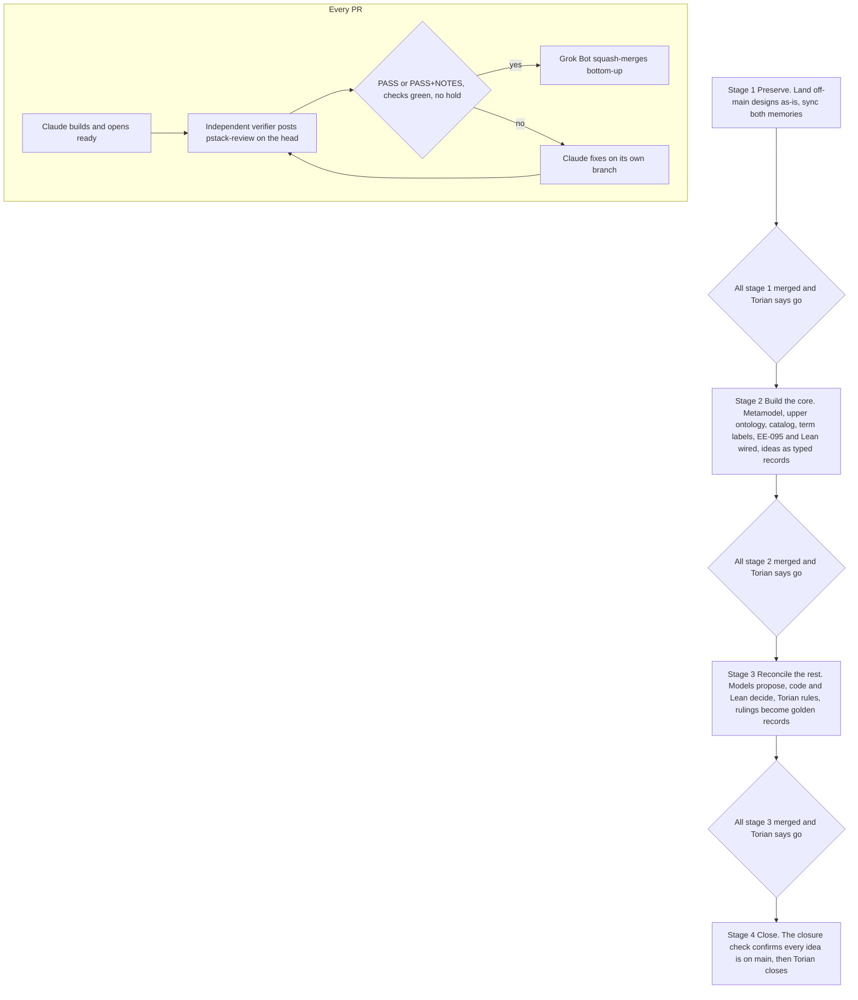
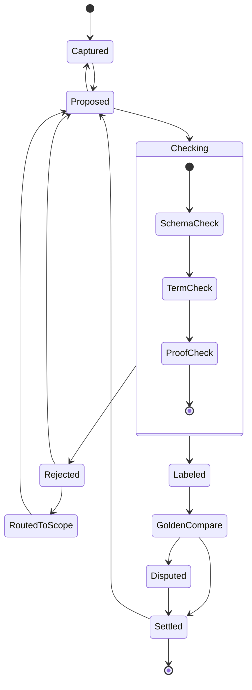

# Naive ontology program plan for Claude

This plan moves every Naive ontology idea onto `main` and then builds the system that labels them. Claude Code runs it in `tchjhnsn/everything-ecosystem` through the Claude GitHub Action, with pstack only.
The rule it enforces is that nothing symbolic bypasses the EE-095 term engine (`schema/terms`) and the Lean proofs (`lean/Naive`).
Stages run in order. Stage 1 preserves, stage 2 builds the core, stage 3 reconciles the rest through it, and stage 4 closes.
PR ids in order are S1-PR0, S1-PR1, S1-PR2, S1-PR3, S1-PR4a, S1-PR4b, S1-PR4c, S1-PR4d, S1-PR5a, S1-PR5b, S1-PR5c, S1-PR5d, S1-PR6, S1-PR7, S1-PR8, S1-PR9, S1-PR10, S2-PR1, S2-PR2, S2-PR3, S2-PR4, S2-PR5, S2-PR6, S2-PR7, S2-PR8, S2-PR9, S3-PR1, S3-PR2, S3-PR3, S3-PR4, S3-PR5, S4-PR1, S4-PR2.

## How to read this

One box is one unit of work. Every box names the evidence that checks it. A nested box is a sub-step of the box above it. Check a box only when its evidence exists, a file, a log line, a screenshot, a test run, or a SHA. The body is a how-to. The appendices explain and record.

The program runs `<pstack>/skills/poteto-mode/playbooks/autopilot-stack.md`. Claude builds each PR, opens it ready, proves it, and stops at merge-ready. Claude never approves and never merges. Grok Bot is the root. It runs the independent verifier for each head and squash-merges bottom-up through the existing gate, which needs a PASS or PASS+NOTES `pstack-review` comment on the current head, green checks and no `hold` label. S1-PR0, S1-PR1, S1-PR2, S1-PR6 and S1-PR7 are Grok Bot's items, and Claude does not touch them.

Tests alone are not sufficient verification. A PR is verified only when its unit, live, and perf boxes are all checked.

`<pstack>` is the folder that holds the installed pstack plugin's `skills/`. In Claude Code, read `<pstack>/docs/harness/claude-code.md` once per run and map each Cursor name through it.

Each Claude run starts from an `@claude` issue or comment by `tchjhnsn`, because `.github/workflows/claude.yml` runs only for that actor. One run does one PR unit. It ends by posting the PR URL and the next unit id on the issue.

## Program checklist

### Arm the program

- [ ] State the protocol and this plan to the operator, then stop. Start execution only on the operator's explicit go. The operator is Torian, and his go arrives as an `@claude` comment on the program issue.
- [ ] Read these from trunk at program start. Re-read them at every tick.
  - [ ] `git show origin/main:docs/design/CLAUDE_HANDOFF_ONTOLOGY_PROGRAM.md`
  - [ ] `git show origin/main:CLAUDE.md`
  - [ ] `git show origin/main:AGENTS.md`
  - [ ] `git show origin/main:.github/workflows/claude.yml`
  - [ ] `git show origin/main:docs/design/ONTOLOGY_LAYERS_2026-11-02.md` once S1-PR1 has merged
  - [ ] Read these from the installed pstack plugin, since pstack is not in this repo.
    - [ ] `<pstack>/skills/poteto-mode/SKILL.md`
    - [ ] `<pstack>/skills/poteto-mode/playbooks/autopilot-stack.md` and `autopilot-full.md`
    - [ ] `<pstack>/skills/poteto-mode/playbooks/opening-a-pr.md` and `shipping.md`
    - [ ] `<pstack>/skills/swarm/SKILL.md`
    - [ ] `control-cli` from `cursor-team-kit` when the run has it. If not, write `Skipped in Claude Code` with the reason and drive the CLI with plain shell commands.
    - [ ] `<pstack>/skills/how`, `architect`, `interrogate`, `show-me-your-work`, `statechart`, `technical-writing`, `unslop` and `no-comments`, plus each principle skill the stage names
- [ ] On the operator's go, arm the audit tick as `/loop 1h` with the tick prompt below. Never leave the cadence to memory. The Claude Action has no `/loop`, so write `Skipped in Claude Code. The Action has no loop.` and Grok Bot, the root, runs the tick.
- [ ] Use this tick prompt, verbatim. "Re-read the execution playbook from trunk. Audit the operation against it and fix drift in this tick. Probe every active lane and judge progress by side effects only. Stand down a stuck lane and dispatch its replacement now. Then post a short status message to the operator in chat only when the audit found a tracked change that no earlier status message reported, such as a PR opened, a code-ready head, a round launched or closed, a verdict, a merge, a stuck agent and the action taken, a blocker added or cleared, or a decision only the operator can make. Name every such change and nothing else. Do not repeat a table, the merged list, or an unchanged blocker. If the audit found none, end the turn with no reply text. Either way, log this tick's row in your decision trail. The row names the items reported, or none."
- [ ] On the operator's hold or stand-down, send every owner a zero-writes order at once. A `hold` label on a PR is that order for its owner.

### Spawn owners

- [ ] Spawn one owner per PR with the full lifecycle the execution playbook names. In the Action, the owner is the Claude run for that unit, and its brief is this plan's section for the unit.
- [ ] Follow this dependency graph. Start dependent work only after its parent merges, or base it on the parent branch when the execution playbook stacks.
  - [ ] S1-PR0 is first and Grok Bot's. S1-PR1 (#174) is already open and independent.
  - [ ] S1-PR2, S1-PR3, S1-PR4a, S1-PR4b, S1-PR4c, S1-PR4d and S1-PR5a branch from `main` after S1-PR0. Their content is independent, but each edits `docs/reviews/2026-11-03-architecture-inventory.md`, so they land one at a time in that order and each regenerates the inventory at merge prep.
  - [ ] S1-PR5b after S1-PR5a. S1-PR5c after S1-PR5b. S1-PR5d after S1-PR5c. Under G9 option A they stack on each other's branches. Under option B each branches from `main`.
  - [ ] S1-PR6 after S1-PR5d. S1-PR7 and S1-PR8 after S1-PR6. S1-PR9 after S1-PR8. Each S1-PR10.k after S1-PR9.
  - [ ] Stage 2 starts only after every stage 1 PR is merged and Torian gives the go. S2-PR1 to S2-PR9 run in order, each after its parent merges.
  - [ ] Stage 3 starts only after every stage 2 PR is merged and Torian gives the go. S3-PR1 to S3-PR4 run in order. Each S3-PR5.k after S3-PR4.
  - [ ] Stage 4 starts only after every stage 3 PR is merged and Torian gives the go. S4-PR2 after S4-PR1.
- [ ] Hold the file boundaries. Stage 1 PRs touch only their preserved files, their sidecars, their trail file and `docs/reviews/2026-11-03-architecture-inventory.md`. Stage 2 PRs touch only `schema/`, `lean/`, `docs/ontology*.json`, `docs/design/`, `docs/decisions/decisions.json`, `purpose/frameworks/idea-map/`, `.github/workflows/lean.yml` and `test.mjs`. Stage 3 and 4 PRs touch only `scripts/`, the idea folder from G16, `docs/reviews/` and `test.mjs`.
- [ ] Hold the review gate. No PR in this program changes an interaction, so none waits for a screenshot and video review in chat.

### Stage skills and the choice each changes

- [ ] Every stage. Restate the goal at the top of each PR's `## Why`. Name each principle used and the choice it changed in the PR body. Run `/deslop` before each commit, `/no-comments` before review, and `/technical-writing` then `/unslop` on every doc and PR body. Keep a decision trail per the show-me-your-work skill in `docs/reviews/ontology-program/trails/<pr-id>.tsv`, one file per PR, so parallel PRs never write the same file, per the separate-before-serializing-shared-state principle.
- [ ] Stage 1. The sequence-verifiable-units principle makes each preserved source its own PR with a `cmp` check. The build-the-lever principle means copies come from `git show` on the source branch and from the coverage script, never by hand. The prove-it-works principle makes `cmp` and `sha256sum` the evidence, not a read-through. The subtract-before-you-add principle keeps preserved files unedited, with the marker in a sidecar instead of front matter.
- [ ] Stage 2. The how, architect and interrogate skills run before the metamodel, in S2-PR1. The foundational-thinking principle puts the EE-095 bypass guard first, in S2-PR2. The model-the-domain and type-system-discipline principles shape term labels and idea records as discriminated unions. The boundary-discipline principle parses `docs/ontology.json` once at load. The redesign-from-first-principles principle extends `founder-idea` and `idea-graph` instead of adding a new idea type. The test-behavior-not-implementation principle makes each test drive a check through its command, not its helpers.
- [ ] Stage 3. The build-the-lever principle makes the import and the reconcile runner scripts. The make-operations-idempotent principle makes both rerunnable to the same end state. The model-the-domain principle encodes the idea lifecycle as the state machine in Appendix E, checked with the statechart skill. The explain-the-number principle governs the agreement report. The never-block-on-the-human principle keeps reversible work moving while rulings wait in the queue.
- [ ] Stage 4. The prove-it-works principle makes closure depend on the closure check output, not on judgment. The outcome-oriented-execution principle accepts that held PRs stay open until then.

### Decision gates Torian owns

Claude does not decide these. When a unit reaches one, Claude posts one decision per issue comment with the options and the default, then moves to the next unblocked unit.

- [x] G1. Functions layout. EE-090 says every venture has a top-level `functions/` folder (N-158). EE-086 says functions are declared in `venture.json` (N-159). Blocks the naive@function scope in S3-PR5. Decided Nov 5 (14:31Z): both, declared then mirrored. `venture.json` declares the functions and is the source of truth, and `functions/` is generated from it and never edited by hand. Recorded as EE-115.
- [ ] G2. Meaning of layer. C-086 reserves layer for the technical sense (N-096). C-080 renames the knowledge layer to source of truth layer (N-095). Blocks S2-PR1 and S2-PR6.
- [x] G3. AI and mentor. C-100 says AI is never a mentor (N-098). EE-046's tagline says a mentor for your journey (N-195). Blocks the naive@governance and naive@purpose scopes in S3-PR5. Decided Nov 5 (14:31Z): mentor means a human. Naive's AI is a coach that works for the mentor and never speaks for a human, so C-100 stands and EE-046's tagline is to be reworded. Recorded as EE-117.
- [ ] G4. Whether EE-095 gets `affects` entries in `docs/decisions/decisions.json`. Blocks S2-PR1.
- [ ] G5. Whether the 13 owner@area scopes stand in for the catalog until S2-PR7 lands. Blocks S2-PR7.
- [x] G6. Whether the 9 mixed-scope ideas are placed right. Blocks their scopes in S3-PR5. Decided Nov 5 (15:57Z) on a decision card: ideas whose scope is mixed go to shared.
- [ ] G7. Whether `framework` is rebased onto `main` before closure. The default is no rebase, since stage 1 preserves its PRs from their own diffs. Blocks S4-PR2.
- [x] G8. The missing `usage.json` and the prototype code (the sandbox `*-vocab.ts` and `*.lean` files) that only Claude's project or the Mac holds. Torian has to supply them. Blocks those rows in S1-PR10. Decided Nov 4: the files were in the shared project folder, so S1-PR10.12 (#202) preserved the whole sandbox folder, `usage.json` included.
- [x] G9. How the framework PRs land as-is. Option A applies each patch onto `main`, which makes its code and its `in-force` decision live. Option B, the default, stores each PR's verbatim patch and metadata under `docs/design/preserved/framework/`, so nothing runs until stage 2 applies it. Torian's rule says as-is and also says no code treats preserved work as live, and only option B meets both. Blocks S1-PR5a to S1-PR5d. Decided Nov 4 (01:22Z) as option B, the default.
- [x] G10. `naive.architecture.json` marks the library, research engine, curation and precog elements confidential, and its rule AK6 forbids sending them to outside models. Option A commits it verbatim. Option B, the default, commits a pointer record with the sha256 and store path, and the bytes stay in the private store. Decided Nov 3 as commit as-is, flagged in FLAGS.tsv.
- [x] G11. `GLOSSARY.agent.md` has one sentence that names the paused civic venture. Option A commits it verbatim. Option B, the default, holds the file until Torian rules, because the rule against naming the paused civic venture and the verbatim rule conflict. Decided Nov 3 as commit as-is, flagged in FLAGS.tsv.
- [x] G12. #162 and #163 cite EE-101, EE-104 and EE-105, which live in #155, #158 and #161, also off `main`. The default preserves those in S1-PR10 units. Under G9 option A they must land before S1-PR5b. Default taken: S1-PR10 units preserve #155, #158 and #161 as patches.
- [x] G13. Where the memory snapshots live. The default is `docs/memory/grok-bot/` and `docs/memory/claude/`, which do not exist yet. Blocks S1-PR7 and S1-PR8. Default taken: `docs/memory/claude/` landed in S1-PR8 (#187).
- [x] G14. Whether Grok Bot may push the sources to branch `preserve/sources-2026-11-03` so Claude can copy them byte for byte, since the Action cannot read Grok Bot's store. The alternative is that Grok Bot writes every stage 1 PR itself. Decided Nov 3 as push every source as-is, confidential files included, each flagged file with a `FLAGS.tsv` row.
- [x] G15. Torian's go to remove the `hold` label from #173. Blocks S1-PR6. Given Nov 4 (03:37Z); #173 landed.
- [x] G16. Where idea records live. `instance/ventures/everything-ecosystem/ideas/` exists on `main` today, and `founder-idea.schema.json` describes `founders/<handle>/ideas/<id>.json`. Blocks S2-PR9 and S3-PR1. Decided Nov 5 (04:42Z): ideas live at `people/<person-id>/ideas/<id>.json`, a top-level `people/<person-id>/` folder replaces `founders/<handle>/`, the handle is a field on the person, and founder is a property the term engine derives. Recorded as EE-114 in S2-PR9.
- [x] G17. Claude's `TERM_LIST_2026-11-01.json` marks 36 of its 340 entries `outside_models: false` (Mentura research-engine areas), and its header says to filter them out before handing the file on. Option A commits it verbatim. Option B, the default, commits it with those 36 entries filtered and records the full file as a pointer plus its hash. Decided Nov 3 as commit as-is, flagged in FLAGS.tsv. All 340 entries are committed unfiltered.

Stage 1 closed on Torian's ruling of Nov 4, 2026 at 18:52Z: "Forget whatever was on the Mac or in the Grokbot memory. Whatever you have access to is what we will continue with." S1-PR7 is dropped, and the ledger rows whose only copy is on the Mac, in Grok Bot's memory or box notes, or in the private store stay on the coverage list as out of reach, not preserved. `node scripts/preservation-coverage.ts` still lists them, so the report stays honest. Stage 2 starts on the same ruling.

### PR mechanics, for every PR

- [ ] Resolve the forge once. Default to `gh`; if `command -v origin` succeeds and Origin can resolve the repository, use `origin pr` for every PR operation. Record any fallback to `gh`. Never require `gt`.
- [ ] Open the PR ready, never draft, per **Opening a PR**. Use the run's built-in PR tool when it has one, else `origin pr create --status open --base <base-branch>` or `gh pr create --base <base-branch>` according to the resolved forge. A stack child targets its parent branch.
- [ ] Run the repo's lint and typecheck once before the PR-facing push, with `npm run lint && npm run typecheck`. Push with hooks on.
- [ ] Run `/deslop` before each commit and `/no-comments` before review.
- [ ] Triage every Bugbot and security-reviewer comment per `../references/bugbot-triage.md`.
- [ ] Rebase onto current trunk before the code-ready report and babysit. Keep that merge base in fix rounds. Rebase again only at merge prep, on a `git merge-tree` conflict with trunk, on a CI failure that comes from a change on trunk, or when a known concurrent change to the same files lands.
- [ ] Title each PR in Conventional Commits form, such as `docs(ontology): preserve Claude's 340-term list`. Open the body with `## Why` restating the goal.
- [ ] Hold these rules on every PR.
  - [ ] Never push to `main`. Never force-push a shared branch. Rebase and `--force-with-lease` only on the PR's own branch, pinned to the SHA last pushed.
  - [ ] Squash only. No `Co-Authored-By` trailer. No secrets and no `.env` files.
  - [ ] No references to the paused civic venture in new text.
  - [ ] Never approve or merge a PR. Never delete `framework`, and never close a PR, before stage 4 confirms its ideas are on `main`.
  - [ ] Torian's Nov 3 ruling to hold nothing back covers the whole program. Confidential Mentura material (pipeline, research engine, discovery records, precog) and files that name the paused civic venture are preserved as-is, never left out and never pointer-only.
  - [ ] Flagged files are committed as-is, per Torian's Nov 3 ruling, and every new file that trips a flag gets a row in `FLAGS.tsv` on `preserve/sources-2026-11-03`.
  - [ ] One item per PR. Every PR targets `main` through review, or its stack parent.
  - [ ] Preserved files stay byte-identical to their source, with `cmp` and `sha256sum` output in the PR body.
  - [ ] Never design a symbolic check that bypasses EE-095 and the Lean proofs.
  - [ ] Plain sentences, no em dashes, and a mermaid diagram for every design.
  - [ ] No new ideas outside this program. Send open questions to Torian as one decision per issue comment.

### Verdict and merge, for every PR

- [ ] A full swarm runs once, at the code-ready head. Another full swarm runs only for new behavior, a redesign, or a large new diff. A rebase, a merge-conflict resolution, or a minor fix gets a single verifier at the new head, and a wording-only change gets none. Run each full swarm per `<pstack>/skills/swarm/SKILL.md`. One gates lane. The ten live lanes from the PR's **Verify, live** block. The perf lane from its **Verify, perf** block. Two or more audit lanes, each with its own focus, that read the diff and the receipts and distrust the PR body. The root audits the receipts in the merge-ready report before the verdict.
- [ ] Judge every finding by the execution playbook's blocking rule. The verdict is clean when none blocks. A failure on trunk behavior in a lane marked `Regression lane against trunk.` is recorded against trunk and does not block the PR. A new head gets a fresh verdict, except for results that stay valid under the patch-id rule in `playbooks/shipping.md`.
- [ ] Claude stops at verified and hands the PR to Grok Bot. Grok Bot lands only the contiguous verified run from the bottom, one squash merge at a time, after comparing `git patch-id` at the verdict SHA with the current head per `playbooks/shipping.md`. It reads each PR back as merged into `main` and reports the branch and the merge SHA.

### Boot recipe, for every live lane

Each live lane runs on its own cloud VM at the PR head. Drive through `control-ui` or `control-cli` from `cursor-team-kit`. Every lane in this program is a CLI lane.

- [ ] `git fetch origin <head-branch> && git checkout <head SHA>`.
- [ ] Run `npm ci`. For Lean lanes, install elan as `.github/workflows/lean.yml` does, then run `cd lean && lake exe cache get`. The lane is ready when `npm ci` exits 0.
- [ ] Deliver input only through `control-cli` commands, or plain shell commands when the run has no control skill. The read-only diagnostics are `git log`, `git diff`, `cmp`, `sha256sum`, `rg` and `node <script> --check`.
- [ ] Save every screenshot to `/tmp/swarm-<pr-id>/worker-<n>/<slug>.png` and return the paths with the report.

## Land this handoff plan and stage the source files (S1-PR0)

**Owner.** Grok Bot. Claude does not open or edit this PR.

**Depends on.** None. It branches from `main` and comes first.

**Files.**

- [ ] Create `docs/design/CLAUDE_HANDOFF_ONTOLOGY_PROGRAM.md` (this file, byte-identical to the copy in Grok Bot's store).
- [ ] Push branch `preserve/sources-2026-11-03` with the verbatim source files and `SHA256SUMS.txt`. This branch is a source carrier, never a PR, and stage 4 retires it.
- [ ] Edit `docs/reviews/2026-11-03-architecture-inventory.md`.

**Build.**

- [ ] Copy this plan into `docs/design/` and regenerate the inventory with `node scripts/architecture-inventory.ts --stdout > docs/reviews/2026-11-03-architecture-inventory.md`.
- [ ] After gate G14 is ruled, extract the stage 1 sources from the Claude export with `extract-export.py` and push them to `preserve/sources-2026-11-03` under their export paths, plus Grok Bot's memory text under `grok-memory/` and its store copies of this plan, the #174 file and the #173 ledger under `grok-store/`.

**You see.**

- [ ] `docs/design/CLAUDE_HANDOFF_ONTOLOGY_PROGRAM.md` is on `main`, and `git ls-tree -r origin/preserve/sources-2026-11-03` lists every source path with a matching `SHA256SUMS.txt` line.

**Verify, unit.** Tests alone are not sufficient verification. A PR is verified only when its unit, live, and perf boxes are all checked.

- [ ] The inventory test passes with the new file counted. Run `node scripts/architecture-inventory-test.ts`.
- [ ] `node <pstack>/skills/poteto-mode/scripts/check-plan.mjs docs/design/CLAUDE_HANDOFF_ONTOLOGY_PROGRAM.md` prints `0 problems`.

**Verify, live.** Tests alone are not sufficient verification. A PR is verified only when its unit, live, and perf boxes are all checked. Ten lanes on `grok-4.7-xhigh-fast` at the PR head, per the boot recipe.

- [ ] Lane 1. Regression lane against trunk. Run `npm ci && node test.mjs` at trunk and at head. Trunk lacks the preserved file, so gate the file's presence plus a full green suite at head. Save `regression-suite.png`. Pass when head passes every group trunk passes and adds no failing group.
- [ ] Lane 2. Run `git fetch origin preserve/sources-2026-11-03` and then `cmp` each preserved file against its source, `grok-store/CLAUDE_HANDOFF_ONTOLOGY_PROGRAM.md`. Save `cmp-bytes.png`. Pass when every `cmp` prints nothing and exits 0.
- [ ] Lane 3. Run `sha256sum` on each preserved file and compare with `SHA256SUMS.txt` on `preserve/sources-2026-11-03`. Save `sha-match.png`. Pass when every hash matches the manifest line for that path.
- [ ] Lane 4. Read the sidecar marker or front matter of each preserved file. Save `sidecar-marker.png`. Pass when it says `status: preserved, not reconciled` and names the source, the sha256, the ledger ids and the date.
- [ ] Lane 5. Prove no code reads the file. Run `rg -l --fixed-strings 'docs/design/CLAUDE_HANDOFF_ONTOLOGY_PROGRAM.md' --glob '!docs/**'`. Save `no-reader.png`. Pass when the output is empty.
- [ ] Lane 6. Run the confidentiality scan `rg -n -i 'confidential|precog|research engine|_private|pol[i]ty' <each preserved file>`. Save `confidential-scan.png`. Pass when the output is empty, or each hit's file has a `FLAGS.tsv` row cited in the PR body.
- [ ] Lane 7. Run `node scripts/architecture-inventory.ts --check` and `node scripts/architecture-inventory-test.ts`. Save `inventory.png`. Pass when both exit 0.
- [ ] Lane 8. Run `git diff --name-only origin/main...HEAD`. Save `diff-scope.png`. Pass when it lists only the files in this section's Files block.
- [ ] Lane 9. Run `npm run lint && npm run typecheck`. Save `lint-types.png`. Pass when both exit 0.
- [ ] Lane 10. Run `git diff --name-only origin/main...HEAD | node schema/check-docs-claims.mjs --code` and `rg -n $'\u2014' <new prose files>`. Save `docs-and-dash.png`. Pass when the first prints nothing or the PR body carries a valid `No docs change:` line, and the second prints nothing.

**Verify, perf.** Tests alone are not sufficient verification. A PR is verified only when its unit, live, and perf boxes are all checked.

- [ ] Metric. Wall time of `node test.mjs`, in seconds, at trunk and at head.
- [ ] Probe. Run `/usr/bin/time -f %e node test.mjs` three times at trunk and three times at head, interleaved trunk, head, trunk, head, trunk, head, on one lane VM after one warm-up run each.
- [ ] Baseline. Record the trunk median and its run-to-run spread first.
- [ ] Rule. Fail when the head median exceeds the trunk median by more than 10 percent or by more than the measured spread, whichever is larger. Explain any gap per the explain-the-number principle before acting on it.

**Review gate.** None. S1-PR0 is not review-gated.

**Merge.**

- [ ] Root's clean verdict at the exact head SHA, posted as a `pstack-review` comment by a verifier that did not write the change.
- [ ] Bugbot triage done, or no Bugbot check on the PR.
- [ ] Rebased onto current trunk after the verdict, patch-id unchanged.
- [ ] Grok Bot owns this PR and Claude does not touch it. Grok Bot squash-merges it bottom-up per `playbooks/shipping.md` with green checks and no `hold` label.

## Preserve the three ontology layers N-047 to N-050 (S1-PR1)

**Owner.** Grok Bot. Already open as #174 at head `fb4bd61`. Claude does not touch it.

**Depends on.** None. Open now as #174, in verification.

**Files.**

- [ ] Create `docs/design/ONTOLOGY_LAYERS_2026-11-02.md` (done in #174).
- [ ] Edit `docs/reviews/2026-11-03-architecture-inventory.md` (five count lines, done in #174).

**Build.**

- [ ] No new work. #174 holds the decision text word for word from Grok Bot memory.

**You see.**

- [ ] #174 reads merged into `main`, and `cmp` of the merged file against the store copy prints nothing.

**Verify, unit.** Tests alone are not sufficient verification. A PR is verified only when its unit, live, and perf boxes are all checked.

- [ ] The full suite passes at head. Run `npm ci && node test.mjs`.

**Verify, live.** Tests alone are not sufficient verification. A PR is verified only when its unit, live, and perf boxes are all checked. Ten lanes on `grok-4.7-xhigh-fast` at the PR head, per the boot recipe.

- [ ] Lane 1. Regression lane against trunk. Run `npm ci && node test.mjs` at trunk and at head. Trunk lacks the preserved file, so gate the file's presence plus a full green suite at head. Save `regression-suite.png`. Pass when head passes every group trunk passes and adds no failing group.
- [ ] Lane 2. Run `git fetch origin preserve/sources-2026-11-03` and then `cmp` each preserved file against its source, `grok-store/ONTOLOGY_LAYERS_2026-11-02.md`. Save `cmp-bytes.png`. Pass when every `cmp` prints nothing and exits 0.
- [ ] Lane 3. Run `sha256sum` on each preserved file and compare with `SHA256SUMS.txt` on `preserve/sources-2026-11-03`. Save `sha-match.png`. Pass when every hash matches the manifest line for that path.
- [ ] Lane 4. Read the sidecar marker or front matter of each preserved file. Save `sidecar-marker.png`. Pass when it says `status: preserved, not reconciled` and names the source, the sha256, the ledger ids and the date.
- [ ] Lane 5. Prove no code reads the file. Run `rg -l --fixed-strings 'docs/design/ONTOLOGY_LAYERS_2026-11-02.md' --glob '!docs/**'`. Save `no-reader.png`. Pass when the output is empty.
- [ ] Lane 6. Run the confidentiality scan `rg -n -i 'confidential|precog|research engine|_private|pol[i]ty' <each preserved file>`. Save `confidential-scan.png`. Pass when the output is empty, or each hit's file has a `FLAGS.tsv` row cited in the PR body.
- [ ] Lane 7. Run `node scripts/architecture-inventory.ts --check` and `node scripts/architecture-inventory-test.ts`. Save `inventory.png`. Pass when both exit 0.
- [ ] Lane 8. Run `git diff --name-only origin/main...HEAD`. Save `diff-scope.png`. Pass when it lists only the files in this section's Files block.
- [ ] Lane 9. Run `npm run lint && npm run typecheck`. Save `lint-types.png`. Pass when both exit 0.
- [ ] Lane 10. Run `git diff --name-only origin/main...HEAD | node schema/check-docs-claims.mjs --code` and `rg -n $'\u2014' <new prose files>`. Save `docs-and-dash.png`. Pass when the first prints nothing or the PR body carries a valid `No docs change:` line, and the second prints nothing.

**Verify, perf.** Tests alone are not sufficient verification. A PR is verified only when its unit, live, and perf boxes are all checked.

- [ ] Metric. Wall time of `node test.mjs`, in seconds, at trunk and at head.
- [ ] Probe. Run `/usr/bin/time -f %e node test.mjs` three times at trunk and three times at head, interleaved trunk, head, trunk, head, trunk, head, on one lane VM after one warm-up run each.
- [ ] Baseline. Record the trunk median and its run-to-run spread first.
- [ ] Rule. Fail when the head median exceeds the trunk median by more than 10 percent or by more than the measured spread, whichever is larger. Explain any gap per the explain-the-number principle before acting on it.

**Review gate.** None. S1-PR1 is not review-gated.

**Merge.**

- [ ] Root's clean verdict at the exact head SHA, posted as a `pstack-review` comment by a verifier that did not write the change.
- [ ] Bugbot triage done, or no Bugbot check on the PR.
- [ ] Rebased onto current trunk after the verdict, patch-id unchanged.
- [ ] Grok Bot owns this PR and Claude does not touch it. Grok Bot squash-merges it bottom-up per `playbooks/shipping.md` with green checks and no `hold` label.

## Preserve the term label decisions N-051 to N-056 (S1-PR2)

**Owner.** Grok Bot writes it, because the text lives only in Grok Bot memory. Claude may take it only when Grok Bot has pushed the source text to the source branch.

**Depends on.** S1-PR0 for the source branch. Independent of S1-PR1.

**Files.**

- [ ] Create `docs/design/TERM_LABELS_2026-11-02.md`.
- [ ] Edit `docs/reviews/2026-11-03-architecture-inventory.md`.

**Build.**

- [ ] Write each decision N-051 to N-056 as a block quote, word for word from Grok Bot memory, with the same front matter shape as #174 and `status: preserved, not reconciled`.
- [ ] Add one mermaid diagram of the four labels scope, origin, grade and designation, per the diagram rule.

**You see.**

- [ ] The six block quotes match the source text exactly. Run `diff <(sed -n 's/^> //p' docs/design/TERM_LABELS_2026-11-02.md) <(git show origin/preserve/sources-2026-11-03:grok-memory/term-labels.txt)`.

**Verify, unit.** Tests alone are not sufficient verification. A PR is verified only when its unit, live, and perf boxes are all checked.

- [ ] The inventory test passes with the new file. Run `node scripts/architecture-inventory-test.ts`.

**Verify, live.** Tests alone are not sufficient verification. A PR is verified only when its unit, live, and perf boxes are all checked. Ten lanes on `grok-4.7-xhigh-fast` at the PR head, per the boot recipe.

- [ ] Lane 1. Regression lane against trunk. Run `npm ci && node test.mjs` at trunk and at head. Trunk lacks the preserved file, so gate the file's presence plus a full green suite at head. Save `regression-suite.png`. Pass when head passes every group trunk passes and adds no failing group.
- [ ] Lane 2. Run `git fetch origin preserve/sources-2026-11-03` and then `cmp` each preserved file against its source, `grok-memory/term-labels.txt`. Save `cmp-bytes.png`. Pass when every `cmp` prints nothing and exits 0.
- [ ] Lane 3. Run `sha256sum` on each preserved file and compare with `SHA256SUMS.txt` on `preserve/sources-2026-11-03`. Save `sha-match.png`. Pass when every hash matches the manifest line for that path.
- [ ] Lane 4. Read the sidecar marker or front matter of each preserved file. Save `sidecar-marker.png`. Pass when it says `status: preserved, not reconciled` and names the source, the sha256, the ledger ids and the date.
- [ ] Lane 5. Prove no code reads the file. Run `rg -l --fixed-strings 'docs/design/TERM_LABELS_2026-11-02.md' --glob '!docs/**'`. Save `no-reader.png`. Pass when the output is empty.
- [ ] Lane 6. Run the confidentiality scan `rg -n -i 'confidential|precog|research engine|_private|pol[i]ty' <each preserved file>`. Save `confidential-scan.png`. Pass when the output is empty, or each hit's file has a `FLAGS.tsv` row cited in the PR body.
- [ ] Lane 7. Run `node scripts/architecture-inventory.ts --check` and `node scripts/architecture-inventory-test.ts`. Save `inventory.png`. Pass when both exit 0.
- [ ] Lane 8. Run `git diff --name-only origin/main...HEAD`. Save `diff-scope.png`. Pass when it lists only the files in this section's Files block.
- [ ] Lane 9. Run `npm run lint && npm run typecheck`. Save `lint-types.png`. Pass when both exit 0.
- [ ] Lane 10. Run `git diff --name-only origin/main...HEAD | node schema/check-docs-claims.mjs --code` and `rg -n $'\u2014' <new prose files>`. Save `docs-and-dash.png`. Pass when the first prints nothing or the PR body carries a valid `No docs change:` line, and the second prints nothing.

**Verify, perf.** Tests alone are not sufficient verification. A PR is verified only when its unit, live, and perf boxes are all checked.

- [ ] Metric. Wall time of `node test.mjs`, in seconds, at trunk and at head.
- [ ] Probe. Run `/usr/bin/time -f %e node test.mjs` three times at trunk and three times at head, interleaved trunk, head, trunk, head, trunk, head, on one lane VM after one warm-up run each.
- [ ] Baseline. Record the trunk median and its run-to-run spread first.
- [ ] Rule. Fail when the head median exceeds the trunk median by more than 10 percent or by more than the measured spread, whichever is larger. Explain any gap per the explain-the-number principle before acting on it.

**Review gate.** None. S1-PR2 is not review-gated.

**Merge.**

- [ ] Root's clean verdict at the exact head SHA, posted as a `pstack-review` comment by a verifier that did not write the change.
- [ ] Bugbot triage done, or no Bugbot check on the PR.
- [ ] Rebased onto current trunk after the verdict, patch-id unchanged.
- [ ] Grok Bot owns this PR and Claude does not touch it. Grok Bot squash-merges it bottom-up per `playbooks/shipping.md` with green checks and no `hold` label.

## Preserve Claude's 340-term list beside main's 199-term list (S1-PR3)

**Owner.** Claude. This is the first unit Claude runs.

**Depends on.** S1-PR0 (plan on `main` and source branch pushed).

**Files.**

- [ ] Create `docs/design/term-harvest/claude-2026-11-03/TERM_LIST_2026-11-01.json`.
- [ ] Create `docs/design/term-harvest/claude-2026-11-03/TERM_LIST_2026-11-01.json.preserved.md`.
- [ ] Edit `docs/reviews/2026-11-03-architecture-inventory.md`.
- [ ] Leave `docs/design/term-harvest/TERM_LIST_2026-11-01.json` unchanged.

**Build.**

- [ ] Run `git show origin/preserve/sources-2026-11-03:project-files/naive-design/term-harvest/TERM_LIST_2026-11-01.json > docs/design/term-harvest/claude-2026-11-03/TERM_LIST_2026-11-01.json`. Do not reformat it.
- [ ] Write the sidecar with `status: preserved, not reconciled`, the source path, the sha256 `3d3450f315851fc3978307ce7c8a36cb390e2a836416fb87660813b78ed9d00b`, ledger row N-001, and one line saying main's 199-term list stays the live seed list.

**You see.**

- [ ] `node -e "console.log(require('./docs/design/term-harvest/claude-2026-11-03/TERM_LIST_2026-11-01.json').terms.length)"` prints `340`, and the same command on main's list prints `199`.

**Verify, unit.** Tests alone are not sufficient verification. A PR is verified only when its unit, live, and perf boxes are all checked.

- [ ] The inventory test passes. Run `node scripts/architecture-inventory-test.ts`.
- [ ] The suite passes. Run `npm ci && node test.mjs`.

**Verify, live.** Tests alone are not sufficient verification. A PR is verified only when its unit, live, and perf boxes are all checked. Ten lanes on `grok-4.7-xhigh-fast` at the PR head, per the boot recipe.

- [ ] Lane 1. Regression lane against trunk. Run `npm ci && node test.mjs` at trunk and at head. Trunk lacks the preserved file, so gate the file's presence plus a full green suite at head. Save `regression-suite.png`. Pass when head passes every group trunk passes and adds no failing group.
- [ ] Lane 2. Run `git fetch origin preserve/sources-2026-11-03` and then `cmp` each preserved file against its source, `project-files/naive-design/term-harvest/TERM_LIST_2026-11-01.json`. Save `cmp-bytes.png`. Pass when every `cmp` prints nothing and exits 0.
- [ ] Lane 3. Run `sha256sum` on each preserved file and compare with `SHA256SUMS.txt` on `preserve/sources-2026-11-03`. Save `sha-match.png`. Pass when every hash matches the manifest line for that path.
- [ ] Lane 4. Read the sidecar marker or front matter of each preserved file. Save `sidecar-marker.png`. Pass when it says `status: preserved, not reconciled` and names the source, the sha256, the ledger ids and the date.
- [ ] Lane 5. Prove no code reads the file. Run `rg -l --fixed-strings 'docs/design/term-harvest/claude-2026-11-03/TERM_LIST_2026-11-01.json' --glob '!docs/**'`. Save `no-reader.png`. Pass when the output is empty.
- [ ] Lane 6. Run the confidentiality scan `rg -n -i 'confidential|precog|research engine|_private|pol[i]ty' <each preserved file>`. Save `confidential-scan.png`. Pass when the output is empty, or each hit's file has a `FLAGS.tsv` row cited in the PR body.
- [ ] Lane 7. Run `node scripts/architecture-inventory.ts --check` and `node scripts/architecture-inventory-test.ts`. Save `inventory.png`. Pass when both exit 0.
- [ ] Lane 8. Run `git diff --name-only origin/main...HEAD`. Save `diff-scope.png`. Pass when it lists only the files in this section's Files block.
- [ ] Lane 9. Run `npm run lint && npm run typecheck`. Save `lint-types.png`. Pass when both exit 0.
- [ ] Lane 10. Run `git diff --name-only origin/main...HEAD | node schema/check-docs-claims.mjs --code` and `rg -n $'\u2014' <new prose files>`. Save `docs-and-dash.png`. Pass when the first prints nothing or the PR body carries a valid `No docs change:` line, and the second prints nothing.

**Verify, perf.** Tests alone are not sufficient verification. A PR is verified only when its unit, live, and perf boxes are all checked.

- [ ] Metric. Wall time of `node test.mjs`, in seconds, at trunk and at head.
- [ ] Probe. Run `/usr/bin/time -f %e node test.mjs` three times at trunk and three times at head, interleaved trunk, head, trunk, head, trunk, head, on one lane VM after one warm-up run each.
- [ ] Baseline. Record the trunk median and its run-to-run spread first.
- [ ] Rule. Fail when the head median exceeds the trunk median by more than 10 percent or by more than the measured spread, whichever is larger. Explain any gap per the explain-the-number principle before acting on it.

**Review gate.** None. S1-PR3 is not review-gated.

**Merge.**

- [ ] Root's clean verdict at the exact head SHA, posted as a `pstack-review` comment with PASS or PASS+NOTES by a verifier that did not write the change.
- [ ] Bugbot triage done, or no Bugbot check on the PR.
- [ ] Rebased onto current trunk after the verdict, patch-id unchanged, inventory regenerated if trunk moved it.
- [ ] Claude stops at merge-ready and never merges. Grok Bot squash-merges bottom-up per `playbooks/shipping.md` once checks are green and the PR has no `hold` label, then reads the PR back as merged into `main`.

## Preserve Claude's venture meta-schema (S1-PR4a)

**Owner.** Claude.

**Depends on.** S1-PR0. Independent of S1-PR3 in content, but lands after it because both edit the inventory.

**Files.**

- [ ] Create `docs/design/preserved/claude-2026-11-03/VENTURE_META_SCHEMA_2026-10-31.md`.
- [ ] Create `docs/design/preserved/claude-2026-11-03/VENTURE_META_SCHEMA_2026-10-31.md.preserved.md`.
- [ ] Edit `docs/reviews/2026-11-03-architecture-inventory.md`.

**Build.**

- [ ] Copy `project-files/naive-design/VENTURE_META_SCHEMA_2026-10-31.md` from `preserve/sources-2026-11-03` with `git show`, unchanged.
- [ ] Write the sidecar with sha256 `02f38f70689994068a3755368559c72dccbc6e2c83f11e55ed0cd0a76c46c896` and ledger row C-028.

**You see.**

- [ ] `wc -c docs/design/preserved/claude-2026-11-03/VENTURE_META_SCHEMA_2026-10-31.md` prints `63059`.

**Verify, unit.** Tests alone are not sufficient verification. A PR is verified only when its unit, live, and perf boxes are all checked.

- [ ] The inventory test passes. Run `node scripts/architecture-inventory-test.ts`.

**Verify, live.** Tests alone are not sufficient verification. A PR is verified only when its unit, live, and perf boxes are all checked. Ten lanes on `grok-4.7-xhigh-fast` at the PR head, per the boot recipe.

- [ ] Lane 1. Regression lane against trunk. Run `npm ci && node test.mjs` at trunk and at head. Trunk lacks the preserved file, so gate the file's presence plus a full green suite at head. Save `regression-suite.png`. Pass when head passes every group trunk passes and adds no failing group.
- [ ] Lane 2. Run `git fetch origin preserve/sources-2026-11-03` and then `cmp` each preserved file against its source, `project-files/naive-design/VENTURE_META_SCHEMA_2026-10-31.md`. Save `cmp-bytes.png`. Pass when every `cmp` prints nothing and exits 0.
- [ ] Lane 3. Run `sha256sum` on each preserved file and compare with `SHA256SUMS.txt` on `preserve/sources-2026-11-03`. Save `sha-match.png`. Pass when every hash matches the manifest line for that path.
- [ ] Lane 4. Read the sidecar marker or front matter of each preserved file. Save `sidecar-marker.png`. Pass when it says `status: preserved, not reconciled` and names the source, the sha256, the ledger ids and the date.
- [ ] Lane 5. Prove no code reads the file. Run `rg -l --fixed-strings 'docs/design/preserved/claude-2026-11-03/VENTURE_META_SCHEMA_2026-10-31.md' --glob '!docs/**'`. Save `no-reader.png`. Pass when the output is empty.
- [ ] Lane 6. Run the confidentiality scan `rg -n -i 'confidential|precog|research engine|_private|pol[i]ty' <each preserved file>`. Save `confidential-scan.png`. Pass when the output is empty, or each hit's file has a `FLAGS.tsv` row cited in the PR body.
- [ ] Lane 7. Run `node scripts/architecture-inventory.ts --check` and `node scripts/architecture-inventory-test.ts`. Save `inventory.png`. Pass when both exit 0.
- [ ] Lane 8. Run `git diff --name-only origin/main...HEAD`. Save `diff-scope.png`. Pass when it lists only the files in this section's Files block.
- [ ] Lane 9. Run `npm run lint && npm run typecheck`. Save `lint-types.png`. Pass when both exit 0.
- [ ] Lane 10. Run `git diff --name-only origin/main...HEAD | node schema/check-docs-claims.mjs --code` and `rg -n $'\u2014' <new prose files>`. Save `docs-and-dash.png`. Pass when the first prints nothing or the PR body carries a valid `No docs change:` line, and the second prints nothing.

**Verify, perf.** Tests alone are not sufficient verification. A PR is verified only when its unit, live, and perf boxes are all checked.

- [ ] Metric. Wall time of `node test.mjs`, in seconds, at trunk and at head.
- [ ] Probe. Run `/usr/bin/time -f %e node test.mjs` three times at trunk and three times at head, interleaved trunk, head, trunk, head, trunk, head, on one lane VM after one warm-up run each.
- [ ] Baseline. Record the trunk median and its run-to-run spread first.
- [ ] Rule. Fail when the head median exceeds the trunk median by more than 10 percent or by more than the measured spread, whichever is larger. Explain any gap per the explain-the-number principle before acting on it.

**Review gate.** None. S1-PR4a is not review-gated.

**Merge.**

- [ ] Root's clean verdict at the exact head SHA, posted as a `pstack-review` comment with PASS or PASS+NOTES by a verifier that did not write the change.
- [ ] Bugbot triage done, or no Bugbot check on the PR.
- [ ] Rebased onto current trunk after the verdict, patch-id unchanged, inventory regenerated if trunk moved it.
- [ ] Claude stops at merge-ready and never merges. Grok Bot squash-merges bottom-up per `playbooks/shipping.md` once checks are green and the PR has no `hold` label, then reads the PR back as merged into `main`.

## Preserve the everything-ecosystem architecture record draft (S1-PR4b)

**Owner.** Claude.

**Depends on.** S1-PR0. Lands after S1-PR4a because both edit the inventory.

**Files.**

- [ ] Create `docs/design/preserved/claude-2026-11-03/architecture/everything-ecosystem.architecture.json`.
- [ ] Create `docs/design/preserved/claude-2026-11-03/architecture/everything-ecosystem.architecture.json.preserved.md`.
- [ ] Edit `docs/reviews/2026-11-03-architecture-inventory.md`.

**Build.**

- [ ] Copy `project-files/naive-design/architecture/everything-ecosystem.architecture.json` from `preserve/sources-2026-11-03`, unchanged.
- [ ] Write the sidecar with sha256 `15f2b801cb6e19558d82be9143a583e33b01e7a672f931c7b443dc358504f73a`, the note that it is an agent draft Torian never confirmed, and ledger rows C-087 and N-003.

**You see.**

- [ ] `node -e "JSON.parse(require('fs').readFileSync('docs/design/preserved/claude-2026-11-03/architecture/everything-ecosystem.architecture.json','utf8'))"` exits 0.

**Verify, unit.** Tests alone are not sufficient verification. A PR is verified only when its unit, live, and perf boxes are all checked.

- [ ] The inventory test passes. Run `node scripts/architecture-inventory-test.ts`.

**Verify, live.** Tests alone are not sufficient verification. A PR is verified only when its unit, live, and perf boxes are all checked. Ten lanes on `grok-4.7-xhigh-fast` at the PR head, per the boot recipe.

- [ ] Lane 1. Regression lane against trunk. Run `npm ci && node test.mjs` at trunk and at head. Trunk lacks the preserved file, so gate the file's presence plus a full green suite at head. Save `regression-suite.png`. Pass when head passes every group trunk passes and adds no failing group.
- [ ] Lane 2. Run `git fetch origin preserve/sources-2026-11-03` and then `cmp` each preserved file against its source, `project-files/naive-design/architecture/everything-ecosystem.architecture.json`. Save `cmp-bytes.png`. Pass when every `cmp` prints nothing and exits 0.
- [ ] Lane 3. Run `sha256sum` on each preserved file and compare with `SHA256SUMS.txt` on `preserve/sources-2026-11-03`. Save `sha-match.png`. Pass when every hash matches the manifest line for that path.
- [ ] Lane 4. Read the sidecar marker or front matter of each preserved file. Save `sidecar-marker.png`. Pass when it says `status: preserved, not reconciled` and names the source, the sha256, the ledger ids and the date.
- [ ] Lane 5. Prove no code reads the file. Run `rg -l --fixed-strings 'docs/design/preserved/claude-2026-11-03/architecture/everything-ecosystem.architecture.json' --glob '!docs/**'`. Save `no-reader.png`. Pass when the output is empty.
- [ ] Lane 6. Run the confidentiality scan `rg -n -i 'confidential|precog|research engine|_private|pol[i]ty' <each preserved file>`. Save `confidential-scan.png`. Pass when the output is empty, or each hit's file has a `FLAGS.tsv` row cited in the PR body.
- [ ] Lane 7. Run `node scripts/architecture-inventory.ts --check` and `node scripts/architecture-inventory-test.ts`. Save `inventory.png`. Pass when both exit 0.
- [ ] Lane 8. Run `git diff --name-only origin/main...HEAD`. Save `diff-scope.png`. Pass when it lists only the files in this section's Files block.
- [ ] Lane 9. Run `npm run lint && npm run typecheck`. Save `lint-types.png`. Pass when both exit 0.
- [ ] Lane 10. Run `git diff --name-only origin/main...HEAD | node schema/check-docs-claims.mjs --code` and `rg -n $'\u2014' <new prose files>`. Save `docs-and-dash.png`. Pass when the first prints nothing or the PR body carries a valid `No docs change:` line, and the second prints nothing.

**Verify, perf.** Tests alone are not sufficient verification. A PR is verified only when its unit, live, and perf boxes are all checked.

- [ ] Metric. Wall time of `node test.mjs`, in seconds, at trunk and at head.
- [ ] Probe. Run `/usr/bin/time -f %e node test.mjs` three times at trunk and three times at head, interleaved trunk, head, trunk, head, trunk, head, on one lane VM after one warm-up run each.
- [ ] Baseline. Record the trunk median and its run-to-run spread first.
- [ ] Rule. Fail when the head median exceeds the trunk median by more than 10 percent or by more than the measured spread, whichever is larger. Explain any gap per the explain-the-number principle before acting on it.

**Review gate.** None. S1-PR4b is not review-gated.

**Merge.**

- [ ] Root's clean verdict at the exact head SHA, posted as a `pstack-review` comment with PASS or PASS+NOTES by a verifier that did not write the change.
- [ ] Bugbot triage done, or no Bugbot check on the PR.
- [ ] Rebased onto current trunk after the verdict, patch-id unchanged, inventory regenerated if trunk moved it.
- [ ] Claude stops at merge-ready and never merges. Grok Bot squash-merges bottom-up per `playbooks/shipping.md` once checks are green and the PR has no `hold` label, then reads the PR back as merged into `main`.

## Preserve the agent glossary (S1-PR4c)

**Owner.** Claude.

**Depends on.** S1-PR0. Gate G11 is decided (commit as-is). Lands after S1-PR4b because both edit the inventory.

**Files.**

- [ ] Create `docs/design/preserved/claude-2026-11-03/prototypes/architecture/GLOSSARY.agent.md`.
- [ ] Create `docs/design/preserved/claude-2026-11-03/prototypes/architecture/README.md`.
- [ ] Create `docs/design/preserved/claude-2026-11-03/prototypes/architecture/GLOSSARY.agent.md.preserved.md`.
- [ ] Edit `docs/reviews/2026-11-03-architecture-inventory.md`.

**Build.**

- [ ] Copy both files from `preserve/sources-2026-11-03`, unchanged. G11 is decided as commit as-is.
- [ ] Write the sidecar with sha256 `0e2694badb3481ac03db7cf78ce4f12df4132f0cf48e7297d0e8ee580b81b30b` for the glossary and `94a44bce68090c27a3dea1a2d0d8ada36143989a210c6c0e34ee77f2ab02789a` for the README, ledger row C-084, and the note that `usage.json` is missing (gate G8).

**You see.**

- [ ] `rg -c '^## ' docs/design/preserved/claude-2026-11-03/prototypes/architecture/GLOSSARY.agent.md` prints the same count as the source file on `preserve/sources-2026-11-03`.

**Verify, unit.** Tests alone are not sufficient verification. A PR is verified only when its unit, live, and perf boxes are all checked.

- [ ] The inventory test passes. Run `node scripts/architecture-inventory-test.ts`.
- [ ] The leaks group still passes. Run `node schema/leaks-test.mjs`.

**Verify, live.** Tests alone are not sufficient verification. A PR is verified only when its unit, live, and perf boxes are all checked. Ten lanes on `grok-4.7-xhigh-fast` at the PR head, per the boot recipe.

- [ ] Lane 1. Regression lane against trunk. Run `npm ci && node test.mjs` at trunk and at head. Trunk lacks the preserved file, so gate the file's presence plus a full green suite at head. Save `regression-suite.png`. Pass when head passes every group trunk passes and adds no failing group.
- [ ] Lane 2. Run `git fetch origin preserve/sources-2026-11-03` and then `cmp` each preserved file against its source, `project-files/naive-design/prototypes/architecture/GLOSSARY.agent.md` `project-files/naive-design/prototypes/architecture/README.md`. Save `cmp-bytes.png`. Pass when every `cmp` prints nothing and exits 0.
- [ ] Lane 3. Run `sha256sum` on each preserved file and compare with `SHA256SUMS.txt` on `preserve/sources-2026-11-03`. Save `sha-match.png`. Pass when every hash matches the manifest line for that path.
- [ ] Lane 4. Read the sidecar marker or front matter of each preserved file. Save `sidecar-marker.png`. Pass when it says `status: preserved, not reconciled` and names the source, the sha256, the ledger ids and the date.
- [ ] Lane 5. Prove no code reads the file. Run `rg -l --fixed-strings 'docs/design/preserved/claude-2026-11-03/prototypes/architecture/GLOSSARY.agent.md' --glob '!docs/**'`. Save `no-reader.png`. Pass when the output is empty.
- [ ] Lane 6. Run the confidentiality scan `rg -n -i 'confidential|precog|research engine|_private|pol[i]ty' <each preserved file>`. Save `confidential-scan.png`. Pass when the output is empty, or each hit's file has a `FLAGS.tsv` row cited in the PR body.
- [ ] Lane 7. Run `node scripts/architecture-inventory.ts --check` and `node scripts/architecture-inventory-test.ts`. Save `inventory.png`. Pass when both exit 0.
- [ ] Lane 8. Run `git diff --name-only origin/main...HEAD`. Save `diff-scope.png`. Pass when it lists only the files in this section's Files block.
- [ ] Lane 9. Run `npm run lint && npm run typecheck`. Save `lint-types.png`. Pass when both exit 0.
- [ ] Lane 10. Run `git diff --name-only origin/main...HEAD | node schema/check-docs-claims.mjs --code` and `rg -n $'\u2014' <new prose files>`. Save `docs-and-dash.png`. Pass when the first prints nothing or the PR body carries a valid `No docs change:` line, and the second prints nothing.

**Verify, perf.** Tests alone are not sufficient verification. A PR is verified only when its unit, live, and perf boxes are all checked.

- [ ] Metric. Wall time of `node test.mjs`, in seconds, at trunk and at head.
- [ ] Probe. Run `/usr/bin/time -f %e node test.mjs` three times at trunk and three times at head, interleaved trunk, head, trunk, head, trunk, head, on one lane VM after one warm-up run each.
- [ ] Baseline. Record the trunk median and its run-to-run spread first.
- [ ] Rule. Fail when the head median exceeds the trunk median by more than 10 percent or by more than the measured spread, whichever is larger. Explain any gap per the explain-the-number principle before acting on it.

**Review gate.** None. S1-PR4c is not review-gated.

**Merge.**

- [ ] Root's clean verdict at the exact head SHA, posted as a `pstack-review` comment with PASS or PASS+NOTES by a verifier that did not write the change.
- [ ] Bugbot triage done, or no Bugbot check on the PR.
- [ ] Rebased onto current trunk after the verdict, patch-id unchanged, inventory regenerated if trunk moved it.
- [ ] Claude stops at merge-ready and never merges. Grok Bot squash-merges bottom-up per `playbooks/shipping.md` once checks are green and the PR has no `hold` label, then reads the PR back as merged into `main`.

## Preserve the Naive architecture record (S1-PR4d)

**Owner.** Claude.

**Depends on.** S1-PR0. Gate G10 is decided (commit as-is). Lands after S1-PR4c because both edit the inventory.

**Files.**

- [ ] Create `docs/design/preserved/claude-2026-11-03/architecture/naive.architecture.json`.
- [ ] Create `docs/design/preserved/claude-2026-11-03/architecture/naive.architecture.json.preserved.md`.
- [ ] Edit `docs/reviews/2026-11-03-architecture-inventory.md`.

**Build.**

- [ ] Commit the file as-is, per the G10 ruling, and cite its `FLAGS.tsv` row in the PR body. The source holds elements marked `"confidential": true` (library, research engine, curation, precog) and rule AK6, which forbids sending them to outside models.
- [ ] Write the sidecar with sha256 `133c4e1b824cbc80afa65939507ef2c41929812cb988aa676b6b86b69011f624`, which matches the `133c4e1b824c` prefix the ledger cites for N-003.

**You see.**

- [ ] `sha256sum` of the committed file starts with `133c4e1b824c`.

**Verify, unit.** Tests alone are not sufficient verification. A PR is verified only when its unit, live, and perf boxes are all checked.

- [ ] The inventory test passes. Run `node scripts/architecture-inventory-test.ts`.

**Verify, live.** Tests alone are not sufficient verification. A PR is verified only when its unit, live, and perf boxes are all checked. Ten lanes on `grok-4.7-xhigh-fast` at the PR head, per the boot recipe.

- [ ] Lane 1. Regression lane against trunk. Run `npm ci && node test.mjs` at trunk and at head. Trunk lacks the preserved file, so gate the file's presence plus a full green suite at head. Save `regression-suite.png`. Pass when head passes every group trunk passes and adds no failing group.
- [ ] Lane 2. Run `git fetch origin preserve/sources-2026-11-03` and then `cmp` each preserved file against its source, `project-files/naive-design/architecture/naive.architecture.json`. Save `cmp-bytes.png`. Pass when every `cmp` prints nothing and exits 0.
- [ ] Lane 3. Run `sha256sum` on each preserved file and compare with `SHA256SUMS.txt` on `preserve/sources-2026-11-03`. Save `sha-match.png`. Pass when every hash matches the manifest line for that path.
- [ ] Lane 4. Read the sidecar marker or front matter of each preserved file. Save `sidecar-marker.png`. Pass when it says `status: preserved, not reconciled` and names the source, the sha256, the ledger ids and the date.
- [ ] Lane 5. Prove no code reads the file. Run `rg -l --fixed-strings 'docs/design/preserved/claude-2026-11-03/architecture/naive.architecture.json' --glob '!docs/**'`. Save `no-reader.png`. Pass when the output is empty.
- [ ] Lane 6. Run the confidentiality scan `rg -n -i 'confidential|precog|research engine|_private|pol[i]ty' <each preserved file>`. Save `confidential-scan.png`. Pass when the output is empty, or each hit's file has a `FLAGS.tsv` row cited in the PR body.
- [ ] Lane 7. Run `node scripts/architecture-inventory.ts --check` and `node scripts/architecture-inventory-test.ts`. Save `inventory.png`. Pass when both exit 0.
- [ ] Lane 8. Run `git diff --name-only origin/main...HEAD`. Save `diff-scope.png`. Pass when it lists only the files in this section's Files block.
- [ ] Lane 9. Run `npm run lint && npm run typecheck`. Save `lint-types.png`. Pass when both exit 0.
- [ ] Lane 10. Run `git diff --name-only origin/main...HEAD | node schema/check-docs-claims.mjs --code` and `rg -n $'\u2014' <new prose files>`. Save `docs-and-dash.png`. Pass when the first prints nothing or the PR body carries a valid `No docs change:` line, and the second prints nothing.

**Verify, perf.** Tests alone are not sufficient verification. A PR is verified only when its unit, live, and perf boxes are all checked.

- [ ] Metric. Wall time of `node test.mjs`, in seconds, at trunk and at head.
- [ ] Probe. Run `/usr/bin/time -f %e node test.mjs` three times at trunk and three times at head, interleaved trunk, head, trunk, head, trunk, head, on one lane VM after one warm-up run each.
- [ ] Baseline. Record the trunk median and its run-to-run spread first.
- [ ] Rule. Fail when the head median exceeds the trunk median by more than 10 percent or by more than the measured spread, whichever is larger. Explain any gap per the explain-the-number principle before acting on it.

**Review gate.** None. S1-PR4d is not review-gated.

**Merge.**

- [ ] Root's clean verdict at the exact head SHA, posted as a `pstack-review` comment with PASS or PASS+NOTES by a verifier that did not write the change.
- [ ] Bugbot triage done, or no Bugbot check on the PR.
- [ ] Rebased onto current trunk after the verdict, patch-id unchanged, inventory regenerated if trunk moved it.
- [ ] Claude stops at merge-ready and never merges. Grok Bot squash-merges bottom-up per `playbooks/shipping.md` once checks are green and the PR has no `hold` label, then reads the PR back as merged into `main`.

## Preserve framework PR #157 (EE-103, typed ontology relations and the generated noun graph) (S1-PR5a)

**Owner.** Claude.

**Depends on.** S1-PR0 and gate G9. First of the four framework units.

**Files.**

- [ ] Create `docs/design/preserved/framework/pr-157/pr-157.patch` (the PR's own diff against `framework`, verbatim).
- [ ] Create `docs/design/preserved/framework/pr-157/pr-157.json` (number, title, body, head SHA, base, file list).
- [ ] Create `docs/design/preserved/framework/pr-157/PRESERVED.md` (status line, head SHA, sha256 of the patch, ledger ids).
- [ ] Edit `docs/reviews/2026-11-03-architecture-inventory.md`.
- [ ] Under G9 option A instead, apply the patch onto `main` on a new branch `preserve/framework-pr-157`, keep the decision entry, and add `preserved, not reconciled` to its note.

**Build.**

- [ ] Run `gh pr diff 157 > docs/design/preserved/framework/pr-157/pr-157.patch` and `gh pr view 157 --json number,title,body,headRefOid,baseRefName,files > docs/design/preserved/framework/pr-157/pr-157.json`. Never push to `framework` or to the PR's branch.
- [ ] Leave #157 open. Stage 4 closes it only after the closure check confirms its ideas are on `main`.

**You see.**

- [ ] `git apply --check docs/design/preserved/framework/pr-157/pr-157.patch` on a scratch checkout of the PR's base SHA exits 0, which proves the stored patch is the PR's real diff.

**Verify, unit.** Tests alone are not sufficient verification. A PR is verified only when its unit, live, and perf boxes are all checked.

- [ ] `cmp <(gh pr diff 157) docs/design/preserved/framework/pr-157/pr-157.patch` prints nothing.
- [ ] The suite passes. Run `npm ci && node test.mjs`.

**Verify, live.** Tests alone are not sufficient verification. A PR is verified only when its unit, live, and perf boxes are all checked. Ten lanes on `grok-4.7-xhigh-fast` at the PR head, per the boot recipe.

- [ ] Lane 1. Regression lane against trunk. Run `npm ci && node test.mjs` at trunk and at head. Trunk lacks the preserved file, so gate the file's presence plus a full green suite at head. Save `regression-suite.png`. Pass when head passes every group trunk passes and adds no failing group.
- [ ] Lane 2. Run `git fetch origin preserve/sources-2026-11-03` and then `cmp` each preserved file against its source, the output of `gh pr diff 157` at the head SHA recorded in `pr-157.json`. Save `cmp-bytes.png`. Pass when every `cmp` prints nothing and exits 0.
- [ ] Lane 3. Run `sha256sum` on each preserved file and compare with `SHA256SUMS.txt` on `preserve/sources-2026-11-03`. Save `sha-match.png`. Pass when every hash matches the manifest line for that path.
- [ ] Lane 4. Read the sidecar marker or front matter of each preserved file. Save `sidecar-marker.png`. Pass when it says `status: preserved, not reconciled` and names the source, the sha256, the ledger ids and the date.
- [ ] Lane 5. Prove no code reads the file. Run `rg -l --fixed-strings 'docs/design/preserved/framework/pr-157/pr-157.patch' --glob '!docs/**'`. Save `no-reader.png`. Pass when the output is empty.
- [ ] Lane 6. Run the confidentiality scan `rg -n -i 'confidential|precog|research engine|_private|pol[i]ty' <each preserved file>`. Save `confidential-scan.png`. Pass when the output is empty, or each hit's file has a `FLAGS.tsv` row cited in the PR body.
- [ ] Lane 7. Run `node scripts/architecture-inventory.ts --check` and `node scripts/architecture-inventory-test.ts`. Save `inventory.png`. Pass when both exit 0.
- [ ] Lane 8. Run `git diff --name-only origin/main...HEAD`. Save `diff-scope.png`. Pass when it lists only the files in this section's Files block.
- [ ] Lane 9. Run `npm run lint && npm run typecheck`. Save `lint-types.png`. Pass when both exit 0.
- [ ] Lane 10. Run `git diff --name-only origin/main...HEAD | node schema/check-docs-claims.mjs --code` and `rg -n $'\u2014' <new prose files>`. Save `docs-and-dash.png`. Pass when the first prints nothing or the PR body carries a valid `No docs change:` line, and the second prints nothing.

**Verify, perf.** Tests alone are not sufficient verification. A PR is verified only when its unit, live, and perf boxes are all checked.

- [ ] Metric. Wall time of `node test.mjs`, in seconds, at trunk and at head. Under G9 option A, also time the new groups the patch adds.
- [ ] Probe. Run `/usr/bin/time -f %e node test.mjs` three times at trunk and three times at head, interleaved trunk, head, trunk, head, trunk, head, on one lane VM after one warm-up run each.
- [ ] Baseline. Record the trunk median and its run-to-run spread first.
- [ ] Rule. Fail when the head median exceeds the trunk median by more than 10 percent or by more than the measured spread, whichever is larger. Explain any gap per the explain-the-number principle before acting on it.

**Review gate.** None. S1-PR5a is not review-gated.

**Merge.**

- [ ] Root's clean verdict at the exact head SHA, posted as a `pstack-review` comment with PASS or PASS+NOTES by a verifier that did not write the change.
- [ ] Bugbot triage done, or no Bugbot check on the PR.
- [ ] Rebased onto current trunk after the verdict, patch-id unchanged, inventory regenerated if trunk moved it.
- [ ] Claude stops at merge-ready and never merges. Grok Bot squash-merges bottom-up per `playbooks/shipping.md` once checks are green and the PR has no `hold` label, then reads the PR back as merged into `main`.

## Preserve framework PR #163 (EE-107, change verbs, tiers and vocabulary objects) (S1-PR5b)

**Owner.** Claude.

**Depends on.** S1-PR5a.

**Files.**

- [ ] Create `docs/design/preserved/framework/pr-163/pr-163.patch` (the PR's own diff against `framework`, verbatim).
- [ ] Create `docs/design/preserved/framework/pr-163/pr-163.json` (number, title, body, head SHA, base, file list).
- [ ] Create `docs/design/preserved/framework/pr-163/PRESERVED.md` (status line, head SHA, sha256 of the patch, ledger ids).
- [ ] Edit `docs/reviews/2026-11-03-architecture-inventory.md`.
- [ ] Under G9 option A instead, apply the patch onto `main` on a new branch `preserve/framework-pr-163`, keep the decision entry, and add `preserved, not reconciled` to its note.

**Build.**

- [ ] Run `gh pr diff 163 > docs/design/preserved/framework/pr-163/pr-163.patch` and `gh pr view 163 --json number,title,body,headRefOid,baseRefName,files > docs/design/preserved/framework/pr-163/pr-163.json`. Never push to `framework` or to the PR's branch.
- [ ] Leave #163 open. Stage 4 closes it only after the closure check confirms its ideas are on `main`.

**You see.**

- [ ] `git apply --check docs/design/preserved/framework/pr-163/pr-163.patch` on a scratch checkout of the PR's base SHA exits 0, which proves the stored patch is the PR's real diff.

**Verify, unit.** Tests alone are not sufficient verification. A PR is verified only when its unit, live, and perf boxes are all checked.

- [ ] `cmp <(gh pr diff 163) docs/design/preserved/framework/pr-163/pr-163.patch` prints nothing.
- [ ] The suite passes. Run `npm ci && node test.mjs`.

**Verify, live.** Tests alone are not sufficient verification. A PR is verified only when its unit, live, and perf boxes are all checked. Ten lanes on `grok-4.7-xhigh-fast` at the PR head, per the boot recipe.

- [ ] Lane 1. Regression lane against trunk. Run `npm ci && node test.mjs` at trunk and at head. Trunk lacks the preserved file, so gate the file's presence plus a full green suite at head. Save `regression-suite.png`. Pass when head passes every group trunk passes and adds no failing group.
- [ ] Lane 2. Run `git fetch origin preserve/sources-2026-11-03` and then `cmp` each preserved file against its source, the output of `gh pr diff 163` at the head SHA recorded in `pr-163.json`. Save `cmp-bytes.png`. Pass when every `cmp` prints nothing and exits 0.
- [ ] Lane 3. Run `sha256sum` on each preserved file and compare with `SHA256SUMS.txt` on `preserve/sources-2026-11-03`. Save `sha-match.png`. Pass when every hash matches the manifest line for that path.
- [ ] Lane 4. Read the sidecar marker or front matter of each preserved file. Save `sidecar-marker.png`. Pass when it says `status: preserved, not reconciled` and names the source, the sha256, the ledger ids and the date.
- [ ] Lane 5. Prove no code reads the file. Run `rg -l --fixed-strings 'docs/design/preserved/framework/pr-163/pr-163.patch' --glob '!docs/**'`. Save `no-reader.png`. Pass when the output is empty.
- [ ] Lane 6. Run the confidentiality scan `rg -n -i 'confidential|precog|research engine|_private|pol[i]ty' <each preserved file>`. Save `confidential-scan.png`. Pass when the output is empty, or each hit's file has a `FLAGS.tsv` row cited in the PR body.
- [ ] Lane 7. Run `node scripts/architecture-inventory.ts --check` and `node scripts/architecture-inventory-test.ts`. Save `inventory.png`. Pass when both exit 0.
- [ ] Lane 8. Run `git diff --name-only origin/main...HEAD`. Save `diff-scope.png`. Pass when it lists only the files in this section's Files block.
- [ ] Lane 9. Run `npm run lint && npm run typecheck`. Save `lint-types.png`. Pass when both exit 0.
- [ ] Lane 10. Run `git diff --name-only origin/main...HEAD | node schema/check-docs-claims.mjs --code` and `rg -n $'\u2014' <new prose files>`. Save `docs-and-dash.png`. Pass when the first prints nothing or the PR body carries a valid `No docs change:` line, and the second prints nothing.

**Verify, perf.** Tests alone are not sufficient verification. A PR is verified only when its unit, live, and perf boxes are all checked.

- [ ] Metric. Wall time of `node test.mjs`, in seconds, at trunk and at head. Under G9 option A, also time the new groups the patch adds.
- [ ] Probe. Run `/usr/bin/time -f %e node test.mjs` three times at trunk and three times at head, interleaved trunk, head, trunk, head, trunk, head, on one lane VM after one warm-up run each.
- [ ] Baseline. Record the trunk median and its run-to-run spread first.
- [ ] Rule. Fail when the head median exceeds the trunk median by more than 10 percent or by more than the measured spread, whichever is larger. Explain any gap per the explain-the-number principle before acting on it.

**Review gate.** None. S1-PR5b is not review-gated.

**Merge.**

- [ ] Root's clean verdict at the exact head SHA, posted as a `pstack-review` comment with PASS or PASS+NOTES by a verifier that did not write the change.
- [ ] Bugbot triage done, or no Bugbot check on the PR.
- [ ] Rebased onto current trunk after the verdict, patch-id unchanged, inventory regenerated if trunk moved it.
- [ ] Claude stops at merge-ready and never merges. Grok Bot squash-merges bottom-up per `playbooks/shipping.md` once checks are green and the PR has no `hold` label, then reads the PR back as merged into `main`.

## Preserve framework PR #164 (EE-107, vocabulary objects, shapes and the parent check) (S1-PR5c)

**Owner.** Claude.

**Depends on.** S1-PR5b.

**Files.**

- [ ] Create `docs/design/preserved/framework/pr-164/pr-164.patch` (the PR's own diff against `framework`, verbatim).
- [ ] Create `docs/design/preserved/framework/pr-164/pr-164.json` (number, title, body, head SHA, base, file list).
- [ ] Create `docs/design/preserved/framework/pr-164/PRESERVED.md` (status line, head SHA, sha256 of the patch, ledger ids).
- [ ] Edit `docs/reviews/2026-11-03-architecture-inventory.md`.
- [ ] Under G9 option A instead, apply the patch onto `main` on a new branch `preserve/framework-pr-164`, keep the decision entry, and add `preserved, not reconciled` to its note.

**Build.**

- [ ] Run `gh pr diff 164 > docs/design/preserved/framework/pr-164/pr-164.patch` and `gh pr view 164 --json number,title,body,headRefOid,baseRefName,files > docs/design/preserved/framework/pr-164/pr-164.json`. Never push to `framework` or to the PR's branch.
- [ ] Leave #164 open. Stage 4 closes it only after the closure check confirms its ideas are on `main`.

**You see.**

- [ ] `git apply --check docs/design/preserved/framework/pr-164/pr-164.patch` on a scratch checkout of the PR's base SHA exits 0, which proves the stored patch is the PR's real diff.

**Verify, unit.** Tests alone are not sufficient verification. A PR is verified only when its unit, live, and perf boxes are all checked.

- [ ] `cmp <(gh pr diff 164) docs/design/preserved/framework/pr-164/pr-164.patch` prints nothing.
- [ ] The suite passes. Run `npm ci && node test.mjs`.

**Verify, live.** Tests alone are not sufficient verification. A PR is verified only when its unit, live, and perf boxes are all checked. Ten lanes on `grok-4.7-xhigh-fast` at the PR head, per the boot recipe.

- [ ] Lane 1. Regression lane against trunk. Run `npm ci && node test.mjs` at trunk and at head. Trunk lacks the preserved file, so gate the file's presence plus a full green suite at head. Save `regression-suite.png`. Pass when head passes every group trunk passes and adds no failing group.
- [ ] Lane 2. Run `git fetch origin preserve/sources-2026-11-03` and then `cmp` each preserved file against its source, the output of `gh pr diff 164` at the head SHA recorded in `pr-164.json`. Save `cmp-bytes.png`. Pass when every `cmp` prints nothing and exits 0.
- [ ] Lane 3. Run `sha256sum` on each preserved file and compare with `SHA256SUMS.txt` on `preserve/sources-2026-11-03`. Save `sha-match.png`. Pass when every hash matches the manifest line for that path.
- [ ] Lane 4. Read the sidecar marker or front matter of each preserved file. Save `sidecar-marker.png`. Pass when it says `status: preserved, not reconciled` and names the source, the sha256, the ledger ids and the date.
- [ ] Lane 5. Prove no code reads the file. Run `rg -l --fixed-strings 'docs/design/preserved/framework/pr-164/pr-164.patch' --glob '!docs/**'`. Save `no-reader.png`. Pass when the output is empty.
- [ ] Lane 6. Run the confidentiality scan `rg -n -i 'confidential|precog|research engine|_private|pol[i]ty' <each preserved file>`. Save `confidential-scan.png`. Pass when the output is empty, or each hit's file has a `FLAGS.tsv` row cited in the PR body.
- [ ] Lane 7. Run `node scripts/architecture-inventory.ts --check` and `node scripts/architecture-inventory-test.ts`. Save `inventory.png`. Pass when both exit 0.
- [ ] Lane 8. Run `git diff --name-only origin/main...HEAD`. Save `diff-scope.png`. Pass when it lists only the files in this section's Files block.
- [ ] Lane 9. Run `npm run lint && npm run typecheck`. Save `lint-types.png`. Pass when both exit 0.
- [ ] Lane 10. Run `git diff --name-only origin/main...HEAD | node schema/check-docs-claims.mjs --code` and `rg -n $'\u2014' <new prose files>`. Save `docs-and-dash.png`. Pass when the first prints nothing or the PR body carries a valid `No docs change:` line, and the second prints nothing.

**Verify, perf.** Tests alone are not sufficient verification. A PR is verified only when its unit, live, and perf boxes are all checked.

- [ ] Metric. Wall time of `node test.mjs`, in seconds, at trunk and at head. Under G9 option A, also time the new groups the patch adds.
- [ ] Probe. Run `/usr/bin/time -f %e node test.mjs` three times at trunk and three times at head, interleaved trunk, head, trunk, head, trunk, head, on one lane VM after one warm-up run each.
- [ ] Baseline. Record the trunk median and its run-to-run spread first.
- [ ] Rule. Fail when the head median exceeds the trunk median by more than 10 percent or by more than the measured spread, whichever is larger. Explain any gap per the explain-the-number principle before acting on it.

**Review gate.** None. S1-PR5c is not review-gated.

**Merge.**

- [ ] Root's clean verdict at the exact head SHA, posted as a `pstack-review` comment with PASS or PASS+NOTES by a verifier that did not write the change.
- [ ] Bugbot triage done, or no Bugbot check on the PR.
- [ ] Rebased onto current trunk after the verdict, patch-id unchanged, inventory regenerated if trunk moved it.
- [ ] Claude stops at merge-ready and never merges. Grok Bot squash-merges bottom-up per `playbooks/shipping.md` once checks are green and the PR has no `hold` label, then reads the PR back as merged into `main`.

## Preserve framework PR #162 (EE-106, Naive as the symbolic system of record that runs agents) (S1-PR5d)

**Owner.** Claude.

**Depends on.** S1-PR5c, and gate G12, since its decision cites EE-101, EE-104 and EE-105, which are off main.

**Files.**

- [ ] Create `docs/design/preserved/framework/pr-162/pr-162.patch` (the PR's own diff against `framework`, verbatim).
- [ ] Create `docs/design/preserved/framework/pr-162/pr-162.json` (number, title, body, head SHA, base, file list).
- [ ] Create `docs/design/preserved/framework/pr-162/PRESERVED.md` (status line, head SHA, sha256 of the patch, ledger ids).
- [ ] Edit `docs/reviews/2026-11-03-architecture-inventory.md`.
- [ ] Under G9 option A instead, apply the patch onto `main` on a new branch `preserve/framework-pr-162`, keep the decision entry, and add `preserved, not reconciled` to its note.

**Build.**

- [ ] Run `gh pr diff 162 > docs/design/preserved/framework/pr-162/pr-162.patch` and `gh pr view 162 --json number,title,body,headRefOid,baseRefName,files > docs/design/preserved/framework/pr-162/pr-162.json`. Never push to `framework` or to the PR's branch.
- [ ] Leave #162 open. Stage 4 closes it only after the closure check confirms its ideas are on `main`.

**You see.**

- [ ] `git apply --check docs/design/preserved/framework/pr-162/pr-162.patch` on a scratch checkout of the PR's base SHA exits 0, which proves the stored patch is the PR's real diff.

**Verify, unit.** Tests alone are not sufficient verification. A PR is verified only when its unit, live, and perf boxes are all checked.

- [ ] `cmp <(gh pr diff 162) docs/design/preserved/framework/pr-162/pr-162.patch` prints nothing.
- [ ] The suite passes. Run `npm ci && node test.mjs`.

**Verify, live.** Tests alone are not sufficient verification. A PR is verified only when its unit, live, and perf boxes are all checked. Ten lanes on `grok-4.7-xhigh-fast` at the PR head, per the boot recipe.

- [ ] Lane 1. Regression lane against trunk. Run `npm ci && node test.mjs` at trunk and at head. Trunk lacks the preserved file, so gate the file's presence plus a full green suite at head. Save `regression-suite.png`. Pass when head passes every group trunk passes and adds no failing group.
- [ ] Lane 2. Run `git fetch origin preserve/sources-2026-11-03` and then `cmp` each preserved file against its source, the output of `gh pr diff 162` at the head SHA recorded in `pr-162.json`. Save `cmp-bytes.png`. Pass when every `cmp` prints nothing and exits 0.
- [ ] Lane 3. Run `sha256sum` on each preserved file and compare with `SHA256SUMS.txt` on `preserve/sources-2026-11-03`. Save `sha-match.png`. Pass when every hash matches the manifest line for that path.
- [ ] Lane 4. Read the sidecar marker or front matter of each preserved file. Save `sidecar-marker.png`. Pass when it says `status: preserved, not reconciled` and names the source, the sha256, the ledger ids and the date.
- [ ] Lane 5. Prove no code reads the file. Run `rg -l --fixed-strings 'docs/design/preserved/framework/pr-162/pr-162.patch' --glob '!docs/**'`. Save `no-reader.png`. Pass when the output is empty.
- [ ] Lane 6. Run the confidentiality scan `rg -n -i 'confidential|precog|research engine|_private|pol[i]ty' <each preserved file>`. Save `confidential-scan.png`. Pass when the output is empty, or each hit's file has a `FLAGS.tsv` row cited in the PR body.
- [ ] Lane 7. Run `node scripts/architecture-inventory.ts --check` and `node scripts/architecture-inventory-test.ts`. Save `inventory.png`. Pass when both exit 0.
- [ ] Lane 8. Run `git diff --name-only origin/main...HEAD`. Save `diff-scope.png`. Pass when it lists only the files in this section's Files block.
- [ ] Lane 9. Run `npm run lint && npm run typecheck`. Save `lint-types.png`. Pass when both exit 0.
- [ ] Lane 10. Run `git diff --name-only origin/main...HEAD | node schema/check-docs-claims.mjs --code` and `rg -n $'\u2014' <new prose files>`. Save `docs-and-dash.png`. Pass when the first prints nothing or the PR body carries a valid `No docs change:` line, and the second prints nothing.

**Verify, perf.** Tests alone are not sufficient verification. A PR is verified only when its unit, live, and perf boxes are all checked.

- [ ] Metric. Wall time of `node test.mjs`, in seconds, at trunk and at head. Under G9 option A, also time the new groups the patch adds.
- [ ] Probe. Run `/usr/bin/time -f %e node test.mjs` three times at trunk and three times at head, interleaved trunk, head, trunk, head, trunk, head, on one lane VM after one warm-up run each.
- [ ] Baseline. Record the trunk median and its run-to-run spread first.
- [ ] Rule. Fail when the head median exceeds the trunk median by more than 10 percent or by more than the measured spread, whichever is larger. Explain any gap per the explain-the-number principle before acting on it.

**Review gate.** None. S1-PR5d is not review-gated.

**Merge.**

- [ ] Root's clean verdict at the exact head SHA, posted as a `pstack-review` comment with PASS or PASS+NOTES by a verifier that did not write the change.
- [ ] Bugbot triage done, or no Bugbot check on the PR.
- [ ] Rebased onto current trunk after the verdict, patch-id unchanged, inventory regenerated if trunk moved it.
- [ ] Claude stops at merge-ready and never merges. Grok Bot squash-merges bottom-up per `playbooks/shipping.md` once checks are green and the PR has no `hold` label, then reads the PR back as merged into `main`.

## Land the merged ledger of both audits (S1-PR6)

**Owner.** Grok Bot. It is #173, held and draft. Claude does not touch it.

**Depends on.** S1-PR5d, and gate G15.

**Files.**

- [ ] Create `docs/reviews/2026-11-03-preservation/merged-ledger.md` (done in #173).

**Build.**

- [ ] Grok Bot rebases #173 onto `main`, marks it ready, and updates any row whose repo status changed in S1-PR1 to S1-PR5d.

**You see.**

- [ ] Every row that S1-PR1 to S1-PR5d landed reads `on main` with its new path.

**Verify, unit.** Tests alone are not sufficient verification. A PR is verified only when its unit, live, and perf boxes are all checked.

- [ ] The suite passes. Run `npm ci && node test.mjs`.

**Verify, live.** Tests alone are not sufficient verification. A PR is verified only when its unit, live, and perf boxes are all checked. Ten lanes on `grok-4.7-xhigh-fast` at the PR head, per the boot recipe.

- [ ] Lane 1. Regression lane against trunk. Run `npm ci && node test.mjs` at trunk and at head. Trunk lacks the preserved file, so gate the file's presence plus a full green suite at head. Save `regression-suite.png`. Pass when head passes every group trunk passes and adds no failing group.
- [ ] Lane 2. Run `git fetch origin preserve/sources-2026-11-03` and then `cmp` each preserved file against its source, `grok-store/merged-ledger.md`. Save `cmp-bytes.png`. Pass when every `cmp` prints nothing and exits 0.
- [ ] Lane 3. Run `sha256sum` on each preserved file and compare with `SHA256SUMS.txt` on `preserve/sources-2026-11-03`. Save `sha-match.png`. Pass when every hash matches the manifest line for that path.
- [ ] Lane 4. Read the sidecar marker or front matter of each preserved file. Save `sidecar-marker.png`. Pass when it says `status: preserved, not reconciled` and names the source, the sha256, the ledger ids and the date.
- [ ] Lane 5. Prove no code reads the file. Run `rg -l --fixed-strings 'docs/reviews/2026-11-03-preservation/merged-ledger.md' --glob '!docs/**'`. Save `no-reader.png`. Pass when the output is empty.
- [ ] Lane 6. Run the confidentiality scan `rg -n -i 'confidential|precog|research engine|_private|pol[i]ty' <each preserved file>`. Save `confidential-scan.png`. Pass when the output is empty, or each hit's file has a `FLAGS.tsv` row cited in the PR body.
- [ ] Lane 7. Run `node scripts/architecture-inventory.ts --check` and `node scripts/architecture-inventory-test.ts`. Save `inventory.png`. Pass when both exit 0.
- [ ] Lane 8. Run `git diff --name-only origin/main...HEAD`. Save `diff-scope.png`. Pass when it lists only the files in this section's Files block.
- [ ] Lane 9. Run `npm run lint && npm run typecheck`. Save `lint-types.png`. Pass when both exit 0.
- [ ] Lane 10. Run `git diff --name-only origin/main...HEAD | node schema/check-docs-claims.mjs --code` and `rg -n $'\u2014' <new prose files>`. Save `docs-and-dash.png`. Pass when the first prints nothing or the PR body carries a valid `No docs change:` line, and the second prints nothing.

**Verify, perf.** Tests alone are not sufficient verification. A PR is verified only when its unit, live, and perf boxes are all checked.

- [ ] Metric. Wall time of `node test.mjs`, in seconds, at trunk and at head.
- [ ] Probe. Run `/usr/bin/time -f %e node test.mjs` three times at trunk and three times at head, interleaved trunk, head, trunk, head, trunk, head, on one lane VM after one warm-up run each.
- [ ] Baseline. Record the trunk median and its run-to-run spread first.
- [ ] Rule. Fail when the head median exceeds the trunk median by more than 10 percent or by more than the measured spread, whichever is larger. Explain any gap per the explain-the-number principle before acting on it.

**Review gate.** None. S1-PR6 is not review-gated.

**Merge.**

- [ ] Root's clean verdict at the exact head SHA, posted as a `pstack-review` comment by a verifier that did not write the change.
- [ ] Bugbot triage done, or no Bugbot check on the PR.
- [ ] Rebased onto current trunk after the verdict, patch-id unchanged.
- [ ] Grok Bot owns this PR and Claude does not touch it. Grok Bot squash-merges it bottom-up per `playbooks/shipping.md` with green checks and no `hold` label.

## Sync Grok Bot's Naive memory into the repo (S1-PR7)

**Dropped.** Torian ruled on Nov 4, 2026 that the program continues with what Claude can reach. Grok Bot's memory export is not coming, so this PR is not built.

**Owner.** Grok Bot writes it, because only Grok Bot can read its memory.

**Depends on.** S1-PR6, and gate G13 for the folder.

**Files.**

- [ ] Create `docs/memory/grok-bot/NAIVE_MEMORY_2026-11-03.md`.
- [ ] Edit `docs/reviews/2026-11-03-architecture-inventory.md`.

**Build.**

- [ ] Write every Naive and ontology fact from Grok Bot memory verbatim, one block quote per fact with its date and ledger id. Confidential Mentura facts are written verbatim too, and the file gets a `FLAGS.tsv` row for each flag it trips.

**You see.**

- [ ] The count of block quotes equals the count of Naive facts in Grok Bot's memory export, recorded in the PR body.

**Verify, unit.** Tests alone are not sufficient verification. A PR is verified only when its unit, live, and perf boxes are all checked.

- [ ] The leaks group passes. Run `node schema/leaks-test.mjs`.

**Verify, live.** Tests alone are not sufficient verification. A PR is verified only when its unit, live, and perf boxes are all checked. Ten lanes on `grok-4.7-xhigh-fast` at the PR head, per the boot recipe.

- [ ] Lane 1. Regression lane against trunk. Run `npm ci && node test.mjs` at trunk and at head. Trunk lacks the preserved file, so gate the file's presence plus a full green suite at head. Save `regression-suite.png`. Pass when head passes every group trunk passes and adds no failing group.
- [ ] Lane 2. Run `git fetch origin preserve/sources-2026-11-03` and then `cmp` each preserved file against its source, `grok-memory/naive-facts.md`. Save `cmp-bytes.png`. Pass when every `cmp` prints nothing and exits 0.
- [ ] Lane 3. Run `sha256sum` on each preserved file and compare with `SHA256SUMS.txt` on `preserve/sources-2026-11-03`. Save `sha-match.png`. Pass when every hash matches the manifest line for that path.
- [ ] Lane 4. Read the sidecar marker or front matter of each preserved file. Save `sidecar-marker.png`. Pass when it says `status: preserved, not reconciled` and names the source, the sha256, the ledger ids and the date.
- [ ] Lane 5. Prove no code reads the file. Run `rg -l --fixed-strings 'docs/memory/grok-bot/NAIVE_MEMORY_2026-11-03.md' --glob '!docs/**'`. Save `no-reader.png`. Pass when the output is empty.
- [ ] Lane 6. Run the confidentiality scan `rg -n -i 'confidential|precog|research engine|_private|pol[i]ty' <each preserved file>`. Save `confidential-scan.png`. Pass when the output is empty, or each hit's file has a `FLAGS.tsv` row cited in the PR body.
- [ ] Lane 7. Run `node scripts/architecture-inventory.ts --check` and `node scripts/architecture-inventory-test.ts`. Save `inventory.png`. Pass when both exit 0.
- [ ] Lane 8. Run `git diff --name-only origin/main...HEAD`. Save `diff-scope.png`. Pass when it lists only the files in this section's Files block.
- [ ] Lane 9. Run `npm run lint && npm run typecheck`. Save `lint-types.png`. Pass when both exit 0.
- [ ] Lane 10. Run `git diff --name-only origin/main...HEAD | node schema/check-docs-claims.mjs --code` and `rg -n $'\u2014' <new prose files>`. Save `docs-and-dash.png`. Pass when the first prints nothing or the PR body carries a valid `No docs change:` line, and the second prints nothing.

**Verify, perf.** Tests alone are not sufficient verification. A PR is verified only when its unit, live, and perf boxes are all checked.

- [ ] Metric. Wall time of `node test.mjs`, in seconds, at trunk and at head.
- [ ] Probe. Run `/usr/bin/time -f %e node test.mjs` three times at trunk and three times at head, interleaved trunk, head, trunk, head, trunk, head, on one lane VM after one warm-up run each.
- [ ] Baseline. Record the trunk median and its run-to-run spread first.
- [ ] Rule. Fail when the head median exceeds the trunk median by more than 10 percent or by more than the measured spread, whichever is larger. Explain any gap per the explain-the-number principle before acting on it.

**Review gate.** None. S1-PR7 is not review-gated.

**Merge.**

- [ ] Root's clean verdict at the exact head SHA, posted as a `pstack-review` comment by a verifier that did not write the change.
- [ ] Bugbot triage done, or no Bugbot check on the PR.
- [ ] Rebased onto current trunk after the verdict, patch-id unchanged.
- [ ] Grok Bot owns this PR and Claude does not touch it. Grok Bot squash-merges it bottom-up per `playbooks/shipping.md` with green checks and no `hold` label.

## Sync Claude's project memory notes into the repo (S1-PR8)

**Owner.** Claude.

**Depends on.** S1-PR6, and gate G13 for the folder.

**Files.**

- [ ] Create `docs/memory/claude/` with every `memory/*.md` file from export chunks 2 to 6, verbatim, confidential files included.
- [ ] Create `docs/memory/claude/PRESERVED.md` with one line per file (path, sha256, ledger ids, and the file's flags from `FLAGS.tsv`).
- [ ] Edit `docs/reviews/2026-11-03-architecture-inventory.md`.

**Build.**

- [ ] Copy each file from `preserve/sources-2026-11-03` with `git show`, unchanged, including confidential files and files that name the paused civic venture. Cite each flagged file's `FLAGS.tsv` row in the PR body.

**You see.**

- [ ] `ls docs/memory/claude/*.md | wc -l`, minus `PRESERVED.md`, equals the `memory/` line count in `SHA256SUMS.txt`, which is 78.

**Verify, unit.** Tests alone are not sufficient verification. A PR is verified only when its unit, live, and perf boxes are all checked.

- [ ] The leaks group passes. Run `node schema/leaks-test.mjs`.

**Verify, live.** Tests alone are not sufficient verification. A PR is verified only when its unit, live, and perf boxes are all checked. Ten lanes on `grok-4.7-xhigh-fast` at the PR head, per the boot recipe.

- [ ] Lane 1. Regression lane against trunk. Run `npm ci && node test.mjs` at trunk and at head. Trunk lacks the preserved file, so gate the file's presence plus a full green suite at head. Save `regression-suite.png`. Pass when head passes every group trunk passes and adds no failing group.
- [ ] Lane 2. Run `git fetch origin preserve/sources-2026-11-03` and then `cmp` each preserved file against its source, `each `memory/*.md` path`. Save `cmp-bytes.png`. Pass when every `cmp` prints nothing and exits 0.
- [ ] Lane 3. Run `sha256sum` on each preserved file and compare with `SHA256SUMS.txt` on `preserve/sources-2026-11-03`. Save `sha-match.png`. Pass when every hash matches the manifest line for that path.
- [ ] Lane 4. Read the sidecar marker or front matter of each preserved file. Save `sidecar-marker.png`. Pass when it says `status: preserved, not reconciled` and names the source, the sha256, the ledger ids and the date.
- [ ] Lane 5. Prove no code reads the file. Run `rg -l --fixed-strings 'docs/memory/claude/' --glob '!docs/**'`. Save `no-reader.png`. Pass when the output is empty.
- [ ] Lane 6. Run the confidentiality scan `rg -n -i 'confidential|precog|research engine|_private|pol[i]ty' <each preserved file>`. Save `confidential-scan.png`. Pass when the output is empty, or each hit's file has a `FLAGS.tsv` row cited in the PR body.
- [ ] Lane 7. Run `node scripts/architecture-inventory.ts --check` and `node scripts/architecture-inventory-test.ts`. Save `inventory.png`. Pass when both exit 0.
- [ ] Lane 8. Run `git diff --name-only origin/main...HEAD`. Save `diff-scope.png`. Pass when it lists only the files in this section's Files block.
- [ ] Lane 9. Run `npm run lint && npm run typecheck`. Save `lint-types.png`. Pass when both exit 0.
- [ ] Lane 10. Run `git diff --name-only origin/main...HEAD | node schema/check-docs-claims.mjs --code` and `rg -n $'\u2014' <new prose files>`. Save `docs-and-dash.png`. Pass when the first prints nothing or the PR body carries a valid `No docs change:` line, and the second prints nothing.

**Verify, perf.** Tests alone are not sufficient verification. A PR is verified only when its unit, live, and perf boxes are all checked.

- [ ] Metric. Wall time of `node test.mjs`, in seconds, at trunk and at head.
- [ ] Probe. Run `/usr/bin/time -f %e node test.mjs` three times at trunk and three times at head, interleaved trunk, head, trunk, head, trunk, head, on one lane VM after one warm-up run each.
- [ ] Baseline. Record the trunk median and its run-to-run spread first.
- [ ] Rule. Fail when the head median exceeds the trunk median by more than 10 percent or by more than the measured spread, whichever is larger. Explain any gap per the explain-the-number principle before acting on it.

**Review gate.** None. S1-PR8 is not review-gated.

**Merge.**

- [ ] Root's clean verdict at the exact head SHA, posted as a `pstack-review` comment with PASS or PASS+NOTES by a verifier that did not write the change.
- [ ] Bugbot triage done, or no Bugbot check on the PR.
- [ ] Rebased onto current trunk after the verdict, patch-id unchanged, inventory regenerated if trunk moved it.
- [ ] Claude stops at merge-ready and never merges. Grok Bot squash-merges bottom-up per `playbooks/shipping.md` once checks are green and the PR has no `hold` label, then reads the PR back as merged into `main`.

## Add the preservation coverage check (S1-PR9)

**Owner.** Claude.

**Depends on.** S1-PR8.

**Files.**

- [ ] Create `scripts/preservation-coverage.ts`.
- [ ] Create `scripts/preservation-coverage-test.ts`.
- [ ] Edit `test.mjs` (one group).
- [ ] Edit the README next to `scripts/` if one exists, else write a `No docs change:` line with the reason in the PR body.

**Build.**

- [ ] `scripts/preservation-coverage.ts` parses `docs/reviews/2026-11-03-preservation/merged-ledger.md` and the `main` tree, then prints one line per ledger row whose idea text has no copy on `main`, grouped by source. `--check` exits 1 when any row is uncovered, confidential rows included.
- [ ] The data shape is one typed row per ledger id with `id`, `source`, `pointer`, `onMain` and `flags`, parsed once at the boundary per the boundary-discipline principle.

**You see.**

- [ ] `node scripts/preservation-coverage.ts` prints the uncovered rows grouped by source. The count equals the ledger's rows not yet safely on main minus the rows S1-PR1 to S1-PR8 landed.

**Verify, unit.** Tests alone are not sufficient verification. A PR is verified only when its unit, live, and perf boxes are all checked.

- [ ] The coverage test gains a row with a copy on main that reads covered and one without that reads uncovered. Run `node scripts/preservation-coverage-test.ts`.

**Verify, live.** Tests alone are not sufficient verification. A PR is verified only when its unit, live, and perf boxes are all checked. Ten lanes on `grok-4.7-xhigh-fast` at the PR head, per the boot recipe.

- [ ] Lane 1. Regression lane against trunk. Run `npm ci && node test.mjs` at trunk and at head. Trunk lacks the new behavior, so gate the behavior the diff adds plus a full green suite at head. Save `regression-suite.png`. Pass when head passes every group trunk passes and the new group passes.
- [ ] Lane 2. Run `node scripts/preservation-coverage.ts` at head. Save `coverage-run.png`. Pass when it exits 0 and prints rows grouped by source.
- [ ] Lane 3. Run `node scripts/preservation-coverage.ts --check` at head. Save `coverage-check.png`. Pass when it exits 1 and names each uncovered row.
- [ ] Lane 4. Run `node scripts/preservation-coverage.ts` twice and `diff` the outputs. Save `rerun-same.png`. Pass when the diff is empty.
- [ ] Lane 5. Grep the output for flagged rows. Save `flagged-rows.png`. Pass when each flagged row is reported like any other row and prints its flags.
- [ ] Lane 6. Add a scratch file holding one row's verbatim text and rerun. Save `fixture-covered.png`. Pass when that row moves to covered.
- [ ] Lane 7. Run `node scripts/preservation-coverage-test.ts`. Save `unit-test.png`. Pass when it exits 0.
- [ ] Lane 8. Run `npm ci && node test.mjs`. Save `suite.png`. Pass when every group passes.
- [ ] Lane 9. Run `npm run lint && npm run typecheck`. Save `lint-types.png`. Pass when both exit 0.
- [ ] Lane 10. Run `git diff --name-only origin/main...HEAD`. Save `diff-scope.png`. Pass when it lists only the Files block paths.

**Verify, perf.** Tests alone are not sufficient verification. A PR is verified only when its unit, live, and perf boxes are all checked.

- [ ] Metric. Wall time of `node test.mjs` at trunk and at head, plus the absolute time of `node scripts/preservation-coverage.ts`, which trunk does not have.
- [ ] Probe. Run `/usr/bin/time -f %e node test.mjs` three times per side, interleaved, after one warm-up run each. Time `node scripts/preservation-coverage.ts` alone with `/usr/bin/time -f %e` three times at head.
- [ ] Baseline. Record the trunk median and its run-to-run spread first.
- [ ] Rule. Fail when the head suite median exceeds the trunk median plus 10 percent plus 2 seconds, or when `node scripts/preservation-coverage.ts` alone takes more than 2 seconds at its median. Do not claim a ratio for the new work, since trunk has no such run.

**Review gate.** None. S1-PR9 is not review-gated.

**Merge.**

- [ ] Root's clean verdict at the exact head SHA, posted as a `pstack-review` comment with PASS or PASS+NOTES by a verifier that did not write the change.
- [ ] Bugbot triage done, or no Bugbot check on the PR.
- [ ] Rebased onto current trunk after the verdict, patch-id unchanged, inventory regenerated if trunk moved it.
- [ ] Claude stops at merge-ready and never merges. Grok Bot squash-merges bottom-up per `playbooks/shipping.md` once checks are green and the PR has no `hold` label, then reads the PR back as merged into `main`.

## Land each remaining off-main source, one source per PR (S1-PR10)

**Owner.** Claude for exported sources. Grok Bot for sources only in its store.

**Depends on.** S1-PR9. Each S1-PR10.k is independent in content and lands one at a time because of the inventory.

**Files.**

- [ ] Create the verbatim copy of one source under `docs/design/preserved/claude-2026-11-03/` or `docs/design/preserved/<origin>/`, with its `.preserved.md` sidecar.
- [ ] Edit `docs/reviews/2026-11-03-architecture-inventory.md`.

**Build.**

- [ ] Take the next source group from `node scripts/preservation-coverage.ts`. Copy it with `git show` from `preserve/sources-2026-11-03`, unchanged. Confidential sources are copied as-is too, and each flagged file's `FLAGS.tsv` row is cited in the PR body.
- [ ] Stop when `node scripts/preservation-coverage.ts --check` exits 0. Rows only on the Mac or only in Claude's project wait on gate G8. EE-101, EE-102, EE-104 and EE-105 (#155, #156, #158, #161) land here per gate G12.

**You see.**

- [ ] Each merged S1-PR10.k shrinks the `node scripts/preservation-coverage.ts` output by exactly its rows.

**Verify, unit.** Tests alone are not sufficient verification. A PR is verified only when its unit, live, and perf boxes are all checked.

- [ ] `node scripts/preservation-coverage.ts` lists this unit's rows before the change and not after. Run it on both sides.

**Verify, live.** Tests alone are not sufficient verification. A PR is verified only when its unit, live, and perf boxes are all checked. Ten lanes on `grok-4.7-xhigh-fast` at the PR head, per the boot recipe.

- [ ] Lane 1. Regression lane against trunk. Run `npm ci && node test.mjs` at trunk and at head. Trunk lacks the preserved file, so gate the file's presence plus a full green suite at head. Save `regression-suite.png`. Pass when head passes every group trunk passes and adds no failing group.
- [ ] Lane 2. Run `git fetch origin preserve/sources-2026-11-03` and then `cmp` each preserved file against its source, the source path that the coverage output names. Save `cmp-bytes.png`. Pass when every `cmp` prints nothing and exits 0.
- [ ] Lane 3. Run `sha256sum` on each preserved file and compare with `SHA256SUMS.txt` on `preserve/sources-2026-11-03`. Save `sha-match.png`. Pass when every hash matches the manifest line for that path.
- [ ] Lane 4. Read the sidecar marker or front matter of each preserved file. Save `sidecar-marker.png`. Pass when it says `status: preserved, not reconciled` and names the source, the sha256, the ledger ids and the date.
- [ ] Lane 5. Prove no code reads the file. Run `rg -l --fixed-strings '<preserved file path>' --glob '!docs/**'`. Save `no-reader.png`. Pass when the output is empty.
- [ ] Lane 6. Run the confidentiality scan `rg -n -i 'confidential|precog|research engine|_private|pol[i]ty' <each preserved file>`. Save `confidential-scan.png`. Pass when the output is empty, or each hit's file has a `FLAGS.tsv` row cited in the PR body.
- [ ] Lane 7. Run `node scripts/architecture-inventory.ts --check` and `node scripts/architecture-inventory-test.ts`. Save `inventory.png`. Pass when both exit 0.
- [ ] Lane 8. Run `git diff --name-only origin/main...HEAD`. Save `diff-scope.png`. Pass when it lists only the files in this section's Files block.
- [ ] Lane 9. Run `npm run lint && npm run typecheck`. Save `lint-types.png`. Pass when both exit 0.
- [ ] Lane 10. Run `git diff --name-only origin/main...HEAD | node schema/check-docs-claims.mjs --code` and `rg -n $'\u2014' <new prose files>`. Save `docs-and-dash.png`. Pass when the first prints nothing or the PR body carries a valid `No docs change:` line, and the second prints nothing.

**Verify, perf.** Tests alone are not sufficient verification. A PR is verified only when its unit, live, and perf boxes are all checked.

- [ ] Metric. Wall time of `node test.mjs`, in seconds, at trunk and at head.
- [ ] Probe. Run `/usr/bin/time -f %e node test.mjs` three times at trunk and three times at head, interleaved trunk, head, trunk, head, trunk, head, on one lane VM after one warm-up run each.
- [ ] Baseline. Record the trunk median and its run-to-run spread first.
- [ ] Rule. Fail when the head median exceeds the trunk median by more than 10 percent or by more than the measured spread, whichever is larger. Explain any gap per the explain-the-number principle before acting on it.

**Review gate.** None. S1-PR10 is not review-gated.

**Merge.**

- [ ] Root's clean verdict at the exact head SHA, posted as a `pstack-review` comment with PASS or PASS+NOTES by a verifier that did not write the change.
- [ ] Bugbot triage done, or no Bugbot check on the PR.
- [ ] Rebased onto current trunk after the verdict, patch-id unchanged, inventory regenerated if trunk moved it.
- [ ] Claude stops at merge-ready and never merges. Grok Bot squash-merges bottom-up per `playbooks/shipping.md` once checks are green and the PR has no `hold` label, then reads the PR back as merged into `main`.

## Record the reconciled ontology core design (S2-PR1)

**Owner.** Claude. Starts only after every stage 1 PR is merged and Torian gives the go.

**Depends on.** All of stage 1, Torian's go, and gates G2 and G4.

**Files.**

- [ ] Create `docs/design/ONTOLOGY_CORE_<date>.md` with mermaid diagrams.
- [ ] Edit `docs/decisions/decisions.json` (one new decision entry).

**Build.**

- [ ] Run the how skill over `schema/terms/`, `lean/Naive/`, `docs/ontology.json`, `schema/check-nouns.mjs` and `schema/ontology-gate.ts`. Then run the architect skill to sketch the metamodel, upper ontology, catalog and term-label types with `not implemented` bodies.
- [ ] Pick one version of each ontology design from the preserved files (#174, S1-PR2, S1-PR3, S1-PR4a to S1-PR4d, S1-PR5a to S1-PR5d). Record each pick and the loser in the design doc.
- [ ] Run the interrogate skill on the sketch. Keep only findings a run proved.

**You see.**

- [ ] The design doc names, for each of the four core parts, the winning source file, the rejected alternative and the EE-095 and Lean hook it uses.

**Verify, unit.** Tests alone are not sufficient verification. A PR is verified only when its unit, live, and perf boxes are all checked.

- [ ] The decisions groups pass with the new entry. Run `node schema/decision-index-test.mjs` and `npm ci && node test.mjs`.

**Verify, live.** Tests alone are not sufficient verification. A PR is verified only when its unit, live, and perf boxes are all checked. Ten lanes on `grok-4.7-xhigh-fast` at the PR head, per the boot recipe.

- [ ] Lane 1. Regression lane against trunk. Run `npm ci && node test.mjs` at trunk and at head. Trunk lacks the new behavior, so gate the behavior the diff adds plus a full green suite at head. Save `regression-suite.png`. Pass when head passes every group trunk passes and the new group passes.
- [ ] Lane 2. Run the decisions groups of the suite on the new entry. Save `decision-valid.png`. Pass when they pass.
- [ ] Lane 3. Render every mermaid block in the design doc with `npx -y @mermaid-js/mermaid-cli -i <block>.mmd -o <block>.png`. Save `mermaid-render.png`. Pass when every block renders.
- [ ] Lane 4. Grep the doc for each preserved path from stage 1. Save `sources-cited.png`. Pass when each ontology source is cited as winner or loser.
- [ ] Lane 5. Grep the doc for `schema/terms` and `lean/Naive` in each part. Save `ee095-hook.png`. Pass when all four parts name both.
- [ ] Lane 6. Read the interrogate findings appendix. Save `interrogate-log.png`. Pass when each finding has a command and its output.
- [ ] Lane 7. Compare each design choice with the ledger rows. Save `no-new-idea.png`. Pass when every choice traces to a ledger id.
- [ ] Lane 8. Run `rg -n $'\u2014' docs/design/ONTOLOGY_CORE_*.md`. Save `dash-scan.png`. Pass when it prints nothing.
- [ ] Lane 9. Run `npm run lint && npm run typecheck`. Save `lint-types.png`. Pass when both exit 0.
- [ ] Lane 10. Run `git diff --name-only origin/main...HEAD`. Save `diff-scope.png`. Pass when it lists only the Files block paths.

**Verify, perf.** Tests alone are not sufficient verification. A PR is verified only when its unit, live, and perf boxes are all checked.

- [ ] Metric. Wall time of `node test.mjs`, in seconds, at trunk and at head.
- [ ] Probe. Run `/usr/bin/time -f %e node test.mjs` three times at trunk and three times at head, interleaved trunk, head, trunk, head, trunk, head, on one lane VM after one warm-up run each.
- [ ] Baseline. Record the trunk median and its run-to-run spread first.
- [ ] Rule. Fail when the head median exceeds the trunk median by more than 10 percent or by more than the measured spread, whichever is larger. Explain any gap per the explain-the-number principle before acting on it.

**Review gate.** None. S2-PR1 is not review-gated.

**Merge.**

- [ ] Root's clean verdict at the exact head SHA, posted as a `pstack-review` comment with PASS or PASS+NOTES by a verifier that did not write the change.
- [ ] Bugbot triage done, or no Bugbot check on the PR.
- [ ] Rebased onto current trunk after the verdict, patch-id unchanged, inventory regenerated if trunk moved it.
- [ ] Claude stops at merge-ready and never merges. Grok Bot squash-merges bottom-up per `playbooks/shipping.md` once checks are green and the PR has no `hold` label, then reads the PR back as merged into `main`.

## Fail the suite when a symbolic check bypasses EE-095 (S2-PR2)

**Owner.** Claude.

**Depends on.** S2-PR1. It is scaffold, so it lands before the rest of stage 2 and guards it.

**Files.**

- [ ] Create `schema/terms/bypass-guard-test.ts`.
- [ ] Edit `test.mjs` (one group).
- [ ] Edit `schema/README.md`.

**Build.**

- [ ] The test holds a registry of every symbolic check, meaning each `check-*` script and gate that decides membership, relation or label. It fails when one neither imports `schema/terms/engine.ts` nor calls `schema/terms/admit.ts`, or names no Lean theorem.
- [ ] Confirm that `node schema/terms/admit.ts --check` is already a `test.mjs` group, as it is on `main` today, and keep it.

**You see.**

- [ ] A scratch `schema/check-scratch.mjs` that decides membership without the engine makes `node schema/terms/bypass-guard-test.ts` exit 1 and name that file.

**Verify, unit.** Tests alone are not sufficient verification. A PR is verified only when its unit, live, and perf boxes are all checked.

- [ ] The guard test gains a passing case for a check wired through the engine and a failing case for one that is not. Run `node schema/terms/bypass-guard-test.ts`.

**Verify, live.** Tests alone are not sufficient verification. A PR is verified only when its unit, live, and perf boxes are all checked. Ten lanes on `grok-4.7-xhigh-fast` at the PR head, per the boot recipe.

- [ ] Lane 1. Regression lane against trunk. Run `npm ci && node test.mjs` at trunk and at head. Trunk lacks the new behavior, so gate the behavior the diff adds plus a full green suite at head. Save `regression-suite.png`. Pass when head passes every group trunk passes and the new group passes.
- [ ] Lane 2. Run `node schema/terms/bypass-guard-test.ts` at head. Save `guard-green.png`. Pass when it exits 0.
- [ ] Lane 3. Add a scratch check that skips the engine and rerun. Save `guard-red.png`. Pass when it exits 1 and names the scratch file.
- [ ] Lane 4. Run `node schema/terms/admit.ts --check`. Save `admit-check.png`. Pass when it exits 0.
- [ ] Lane 5. Run `node schema/terms/engine-test.ts`. Save `engine-test.png`. Pass when it exits 0.
- [ ] Lane 6. Run `cd lean && lake exe cache get && lake build`. Save `lean-build.png`. Pass when the build succeeds.
- [ ] Lane 7. List every `schema/check-*` file and compare with the guard registry. Save `registry-complete.png`. Pass when no symbolic check is missing.
- [ ] Lane 8. Run `npm ci && node test.mjs`. Save `suite.png`. Pass when every group passes.
- [ ] Lane 9. Run `npm run lint && npm run typecheck`. Save `lint-types.png`. Pass when both exit 0.
- [ ] Lane 10. Run `git diff --name-only origin/main...HEAD`. Save `diff-scope.png`. Pass when it lists only the Files block paths.

**Verify, perf.** Tests alone are not sufficient verification. A PR is verified only when its unit, live, and perf boxes are all checked.

- [ ] Metric. Wall time of `node test.mjs` at trunk and at head, plus the absolute time of `node schema/terms/bypass-guard-test.ts`, which trunk does not have.
- [ ] Probe. Run `/usr/bin/time -f %e node test.mjs` three times per side, interleaved, after one warm-up run each. Time `node schema/terms/bypass-guard-test.ts` alone with `/usr/bin/time -f %e` three times at head.
- [ ] Baseline. Record the trunk median and its run-to-run spread first.
- [ ] Rule. Fail when the head suite median exceeds the trunk median plus 10 percent plus 2 seconds, or when `node schema/terms/bypass-guard-test.ts` alone takes more than 2 seconds at its median. Do not claim a ratio for the new work, since trunk has no such run.

**Review gate.** None. S2-PR2 is not review-gated.

**Merge.**

- [ ] Root's clean verdict at the exact head SHA, posted as a `pstack-review` comment with PASS or PASS+NOTES by a verifier that did not write the change.
- [ ] Bugbot triage done, or no Bugbot check on the PR.
- [ ] Rebased onto current trunk after the verdict, patch-id unchanged, inventory regenerated if trunk moved it.
- [ ] Claude stops at merge-ready and never merges. Grok Bot squash-merges bottom-up per `playbooks/shipping.md` once checks are green and the PR has no `hold` label, then reads the PR back as merged into `main`.

## Tie the Lean proofs to the TypeScript term engine in CI (S2-PR3)

**Owner.** Claude.

**Depends on.** S2-PR2.

**Files.**

- [ ] Edit `.github/workflows/lean.yml` so its paths add `schema/terms/**` and `docs/ontology.json`.
- [ ] Create `schema/terms/lean-agreement-test.ts`.
- [ ] Edit `test.mjs` (one group).
- [ ] Edit `lean/README.md`.

**Build.**

- [ ] `lean-agreement-test.ts` reads the Lean theorem names that `schema/terms/admitted.json` cites. It fails when a cited theorem is missing from `lean/Naive/*.lean`, or a Lean concept has no admitted term.

**You see.**

- [ ] A PR that touches only `schema/terms/` now starts the `lean` workflow, and removing a cited theorem name makes the agreement test exit 1.

**Verify, unit.** Tests alone are not sufficient verification. A PR is verified only when its unit, live, and perf boxes are all checked.

- [ ] The agreement test gains one passing case and one case with a missing theorem. Run `node schema/terms/lean-agreement-test.ts`.

**Verify, live.** Tests alone are not sufficient verification. A PR is verified only when its unit, live, and perf boxes are all checked. Ten lanes on `grok-4.7-xhigh-fast` at the PR head, per the boot recipe.

- [ ] Lane 1. Regression lane against trunk. Run `npm ci && node test.mjs` at trunk and at head. Trunk lacks the new behavior, so gate the behavior the diff adds plus a full green suite at head. Save `regression-suite.png`. Pass when head passes every group trunk passes and the new group passes.
- [ ] Lane 2. Run `node schema/terms/lean-agreement-test.ts`. Save `agreement-green.png`. Pass when it exits 0.
- [ ] Lane 3. Rename one cited theorem in a scratch copy and rerun. Save `agreement-red.png`. Pass when it exits 1 and names the theorem.
- [ ] Lane 4. Run `cd lean && lake exe cache get && lake build`. Save `lean-build.png`. Pass when the build succeeds.
- [ ] Lane 5. Read `.github/workflows/lean.yml` at head. Save `workflow-paths.png`. Pass when its paths list includes `schema/terms/**`.
- [ ] Lane 6. Read the PR's checks list. Save `ci-trigger.png`. Pass when the `lean` workflow ran on this PR.
- [ ] Lane 7. Run `node schema/terms/admit.ts --check`. Save `admit-check.png`. Pass when it exits 0.
- [ ] Lane 8. Run `npm ci && node test.mjs`. Save `suite.png`. Pass when every group passes.
- [ ] Lane 9. Run `npm run lint && npm run typecheck`. Save `lint-types.png`. Pass when both exit 0.
- [ ] Lane 10. Run `git diff --name-only origin/main...HEAD`. Save `diff-scope.png`. Pass when it lists only the Files block paths.

**Verify, perf.** Tests alone are not sufficient verification. A PR is verified only when its unit, live, and perf boxes are all checked.

- [ ] Metric. Wall time of `node test.mjs` at trunk and at head, plus the absolute time of `node schema/terms/lean-agreement-test.ts`, which trunk does not have.
- [ ] Probe. Run `/usr/bin/time -f %e node test.mjs` three times per side, interleaved, after one warm-up run each. Time `node schema/terms/lean-agreement-test.ts` alone with `/usr/bin/time -f %e` three times at head.
- [ ] Baseline. Record the trunk median and its run-to-run spread first.
- [ ] Rule. Fail when the head suite median exceeds the trunk median plus 10 percent plus 2 seconds, or when `node schema/terms/lean-agreement-test.ts` alone takes more than 2 seconds at its median. Do not claim a ratio for the new work, since trunk has no such run.

**Review gate.** None. S2-PR3 is not review-gated.

**Merge.**

- [ ] Root's clean verdict at the exact head SHA, posted as a `pstack-review` comment with PASS or PASS+NOTES by a verifier that did not write the change.
- [ ] Bugbot triage done, or no Bugbot check on the PR.
- [ ] Rebased onto current trunk after the verdict, patch-id unchanged, inventory regenerated if trunk moved it.
- [ ] Claude stops at merge-ready and never merges. Grok Bot squash-merges bottom-up per `playbooks/shipping.md` once checks are green and the PR has no `hold` label, then reads the PR back as merged into `main`.

## Generate Lean concepts from docs/ontology.json (S2-PR4)

**Owner.** Claude.

**Depends on.** S2-PR3.

**Files.**

- [ ] Create `schema/terms/gen-concepts.ts`.
- [ ] Create `lean/Naive/Generated/Ontology.lean` (generated).
- [ ] Edit `lean/Naive.lean` (one import).
- [ ] Edit `test.mjs` (a freshness group).
- [ ] Edit `lean/README.md`.

**Build.**

- [ ] `gen-concepts.ts` writes one Lean `Concept` per noun in `docs/ontology.json`. Its `--check` fails when the committed file differs from a fresh run, the same way `schema/check-nouns.mjs --md` guards `docs/ontology.md`.

**You see.**

- [ ] `node schema/terms/gen-concepts.ts --check` exits 0, and editing one noun in `docs/ontology.json` makes it exit 1 until regenerated.

**Verify, unit.** Tests alone are not sufficient verification. A PR is verified only when its unit, live, and perf boxes are all checked.

- [ ] A test case regenerates from a two-noun fixture and asserts both concepts appear. Run `node schema/terms/gen-concepts.ts --check`.

**Verify, live.** Tests alone are not sufficient verification. A PR is verified only when its unit, live, and perf boxes are all checked. Ten lanes on `grok-4.7-xhigh-fast` at the PR head, per the boot recipe.

- [ ] Lane 1. Regression lane against trunk. Run `npm ci && node test.mjs` at trunk and at head. Trunk lacks the new behavior, so gate the behavior the diff adds plus a full green suite at head. Save `regression-suite.png`. Pass when head passes every group trunk passes and the new group passes.
- [ ] Lane 2. Run `node schema/terms/gen-concepts.ts --check`. Save `gen-fresh.png`. Pass when it exits 0.
- [ ] Lane 3. Edit one noun in a scratch copy of `docs/ontology.json` and rerun. Save `gen-stale.png`. Pass when it exits 1.
- [ ] Lane 4. Run `cd lean && lake exe cache get && lake build`. Save `lean-build.png`. Pass when the generated file builds.
- [ ] Lane 5. Run the generator twice and then `git diff --exit-code`. Save `idempotent.png`. Pass when the second run changes nothing.
- [ ] Lane 6. Count nouns in `docs/ontology.json` and concepts in the generated file. Save `noun-count.png`. Pass when the counts match.
- [ ] Lane 7. Run `node schema/terms/bypass-guard-test.ts`. Save `guard.png`. Pass when it exits 0.
- [ ] Lane 8. Run `npm ci && node test.mjs`. Save `suite.png`. Pass when every group passes.
- [ ] Lane 9. Run `npm run lint && npm run typecheck`. Save `lint-types.png`. Pass when both exit 0.
- [ ] Lane 10. Run `git diff --name-only origin/main...HEAD`. Save `diff-scope.png`. Pass when it lists only the Files block paths.

**Verify, perf.** Tests alone are not sufficient verification. A PR is verified only when its unit, live, and perf boxes are all checked.

- [ ] Metric. Wall time of `node test.mjs` at trunk and at head, plus the absolute time of `node schema/terms/gen-concepts.ts --check`, which trunk does not have.
- [ ] Probe. Run `/usr/bin/time -f %e node test.mjs` three times per side, interleaved, after one warm-up run each. Time `node schema/terms/gen-concepts.ts --check` alone with `/usr/bin/time -f %e` three times at head.
- [ ] Baseline. Record the trunk median and its run-to-run spread first.
- [ ] Rule. Fail when the head suite median exceeds the trunk median plus 10 percent plus 3 seconds, or when `node schema/terms/gen-concepts.ts --check` alone takes more than 3 seconds at its median. Do not claim a ratio for the new work, since trunk has no such run.

**Review gate.** None. S2-PR4 is not review-gated.

**Merge.**

- [ ] Root's clean verdict at the exact head SHA, posted as a `pstack-review` comment with PASS or PASS+NOTES by a verifier that did not write the change.
- [ ] Bugbot triage done, or no Bugbot check on the PR.
- [ ] Rebased onto current trunk after the verdict, patch-id unchanged, inventory regenerated if trunk moved it.
- [ ] Claude stops at merge-ready and never merges. Grok Bot squash-merges bottom-up per `playbooks/shipping.md` once checks are green and the PR has no `hold` label, then reads the PR back as merged into `main`.

## Add the ontology metamodel in JSON Schema (S2-PR5)

**Owner.** Claude.

**Depends on.** S2-PR4.

**Files.**

- [ ] Create `schema/ontology-metamodel.schema.json`.
- [ ] Create `schema/ontology-metamodel-test.ts`.
- [ ] Edit `docs/ontology.json` only where it must conform.
- [ ] Edit `test.mjs` (one group).
- [ ] Edit `schema/README.md`.

**Build.**

- [ ] Write the metamodel per N-048, with SKOS and OWL names in a `mappings` table. Models may only propose change lines that validate against it.
- [ ] State in the PR body that changing the metamodel is a one-way-door amend.

**You see.**

- [ ] `docs/ontology.json` validates against `schema/ontology-metamodel.schema.json`, and a change line with an unknown key is rejected.

**Verify, unit.** Tests alone are not sufficient verification. A PR is verified only when its unit, live, and perf boxes are all checked.

- [ ] The metamodel test gains a valid change line and an invalid one. Run `node schema/ontology-metamodel-test.ts`.

**Verify, live.** Tests alone are not sufficient verification. A PR is verified only when its unit, live, and perf boxes are all checked. Ten lanes on `grok-4.7-xhigh-fast` at the PR head, per the boot recipe.

- [ ] Lane 1. Regression lane against trunk. Run `npm ci && node test.mjs` at trunk and at head. Trunk lacks the new behavior, so gate the behavior the diff adds plus a full green suite at head. Save `regression-suite.png`. Pass when head passes every group trunk passes and the new group passes.
- [ ] Lane 2. Validate `docs/ontology.json` against the metamodel. Save `validate-ontology.png`. Pass when it is valid.
- [ ] Lane 3. Validate a change line with an unknown key. Save `reject-bad-line.png`. Pass when it is rejected with the key named.
- [ ] Lane 4. Read the `mappings` table. Save `skos-owl-map.png`. Pass when every metamodel class names a SKOS or OWL term or says none.
- [ ] Lane 5. Run `node schema/check-nouns.mjs --md`. Save `nouns-md.png`. Pass when it exits 0.
- [ ] Lane 6. Run `cd lean && lake exe cache get && lake build`. Save `lean-build.png`. Pass when the build succeeds.
- [ ] Lane 7. Run `node schema/terms/bypass-guard-test.ts`. Save `guard.png`. Pass when it exits 0.
- [ ] Lane 8. Run `npm ci && node test.mjs`. Save `suite.png`. Pass when every group passes.
- [ ] Lane 9. Run `npm run lint && npm run typecheck`. Save `lint-types.png`. Pass when both exit 0.
- [ ] Lane 10. Run `git diff --name-only origin/main...HEAD`. Save `diff-scope.png`. Pass when it lists only the Files block paths.

**Verify, perf.** Tests alone are not sufficient verification. A PR is verified only when its unit, live, and perf boxes are all checked.

- [ ] Metric. Wall time of `node test.mjs` at trunk and at head, plus the absolute time of `node schema/ontology-metamodel-test.ts`, which trunk does not have.
- [ ] Probe. Run `/usr/bin/time -f %e node test.mjs` three times per side, interleaved, after one warm-up run each. Time `node schema/ontology-metamodel-test.ts` alone with `/usr/bin/time -f %e` three times at head.
- [ ] Baseline. Record the trunk median and its run-to-run spread first.
- [ ] Rule. Fail when the head suite median exceeds the trunk median plus 10 percent plus 2 seconds, or when `node schema/ontology-metamodel-test.ts` alone takes more than 2 seconds at its median. Do not claim a ratio for the new work, since trunk has no such run.

**Review gate.** None. S2-PR5 is not review-gated.

**Merge.**

- [ ] Root's clean verdict at the exact head SHA, posted as a `pstack-review` comment with PASS or PASS+NOTES by a verifier that did not write the change.
- [ ] Bugbot triage done, or no Bugbot check on the PR.
- [ ] Rebased onto current trunk after the verdict, patch-id unchanged, inventory regenerated if trunk moved it.
- [ ] Claude stops at merge-ready and never merges. Grok Bot squash-merges bottom-up per `playbooks/shipping.md` once checks are green and the PR has no `hold` label, then reads the PR back as merged into `main`.

## Add the upper ontology mapped to BFO (S2-PR6)

**Owner.** Claude.

**Depends on.** S2-PR5 and gate G2.

**Files.**

- [ ] Edit `docs/ontology.json` (top categories and `broader` links).
- [ ] Create `lean/Naive/Upper.lean`.
- [ ] Create `schema/terms/upper-test.ts`.
- [ ] Edit `test.mjs` (one group).
- [ ] Edit `lean/README.md`.

**Build.**

- [ ] Add Naive's top categories per N-049, each with a BFO mapping. Every noun reaches exactly one top category through `broader`.
- [ ] Prove in `Upper.lean` that `broader` has no cycle and gives one top category per noun, and check the same in code through the term engine.

**You see.**

- [ ] Removing one `broader` link in a scratch copy makes `node schema/terms/upper-test.ts` exit 1 and name the orphan noun.

**Verify, unit.** Tests alone are not sufficient verification. A PR is verified only when its unit, live, and perf boxes are all checked.

- [ ] The upper test gains a case for a noun with two top categories and one for an orphan. Run `node schema/terms/upper-test.ts`.

**Verify, live.** Tests alone are not sufficient verification. A PR is verified only when its unit, live, and perf boxes are all checked. Ten lanes on `grok-4.7-xhigh-fast` at the PR head, per the boot recipe.

- [ ] Lane 1. Regression lane against trunk. Run `npm ci && node test.mjs` at trunk and at head. Trunk lacks the new behavior, so gate the behavior the diff adds plus a full green suite at head. Save `regression-suite.png`. Pass when head passes every group trunk passes and the new group passes.
- [ ] Lane 2. Run `node schema/terms/upper-test.ts`. Save `one-top.png`. Pass when every noun has exactly one top category.
- [ ] Lane 3. Remove one `broader` link in a scratch copy and rerun. Save `orphan.png`. Pass when it exits 1 and names the noun.
- [ ] Lane 4. Read each top category. Save `bfo-map.png`. Pass when each names a BFO class.
- [ ] Lane 5. Run `cd lean && lake exe cache get && lake build`. Save `lean-proof.png`. Pass when `Upper.lean` builds with no `sorry`.
- [ ] Lane 6. Run `node schema/terms/lean-agreement-test.ts`. Save `agreement.png`. Pass when it exits 0.
- [ ] Lane 7. Run `node schema/terms/bypass-guard-test.ts`. Save `guard.png`. Pass when it exits 0.
- [ ] Lane 8. Run `npm ci && node test.mjs`. Save `suite.png`. Pass when every group passes.
- [ ] Lane 9. Run `npm run lint && npm run typecheck`. Save `lint-types.png`. Pass when both exit 0.
- [ ] Lane 10. Run `git diff --name-only origin/main...HEAD`. Save `diff-scope.png`. Pass when it lists only the Files block paths.

**Verify, perf.** Tests alone are not sufficient verification. A PR is verified only when its unit, live, and perf boxes are all checked.

- [ ] Metric. Wall time of `node test.mjs` at trunk and at head, plus the absolute time of `node schema/terms/upper-test.ts`, which trunk does not have.
- [ ] Probe. Run `/usr/bin/time -f %e node test.mjs` three times per side, interleaved, after one warm-up run each. Time `node schema/terms/upper-test.ts` alone with `/usr/bin/time -f %e` three times at head.
- [ ] Baseline. Record the trunk median and its run-to-run spread first.
- [ ] Rule. Fail when the head suite median exceeds the trunk median plus 10 percent plus 2 seconds, or when `node schema/terms/upper-test.ts` alone takes more than 2 seconds at its median. Do not claim a ratio for the new work, since trunk has no such run.

**Review gate.** None. S2-PR6 is not review-gated.

**Merge.**

- [ ] Root's clean verdict at the exact head SHA, posted as a `pstack-review` comment with PASS or PASS+NOTES by a verifier that did not write the change.
- [ ] Bugbot triage done, or no Bugbot check on the PR.
- [ ] Rebased onto current trunk after the verdict, patch-id unchanged, inventory regenerated if trunk moved it.
- [ ] Claude stops at merge-ready and never merges. Grok Bot squash-merges bottom-up per `playbooks/shipping.md` once checks are green and the PR has no `hold` label, then reads the PR back as merged into `main`.

## Add the catalog of name@function scopes (S2-PR7)

**Owner.** Claude.

**Depends on.** S2-PR6 and gate G5.

**Files.**

- [ ] Create `schema/ontology-catalog.schema.json`.
- [ ] Create `docs/ontology-catalog.json`.
- [ ] Create `schema/terms/catalog-test.ts`.
- [ ] Edit `test.mjs` (one group).
- [ ] Edit `schema/README.md`.

**Build.**

- [ ] Write one catalog entry per name@function scope with owner, status and imports, per N-050. Code checks that imports are acyclic and that every term is defined or imported, and it fails closed.
- [ ] A missing term routes to its owning scope as an open item. It is never coined.

**You see.**

- [ ] A scratch import cycle makes `node schema/terms/catalog-test.ts` exit 1 and print the cycle, and an undefined term prints its owning scope.

**Verify, unit.** Tests alone are not sufficient verification. A PR is verified only when its unit, live, and perf boxes are all checked.

- [ ] The catalog test gains an acyclic case, a cycle case and an undefined-term case. Run `node schema/terms/catalog-test.ts`.

**Verify, live.** Tests alone are not sufficient verification. A PR is verified only when its unit, live, and perf boxes are all checked. Ten lanes on `grok-4.7-xhigh-fast` at the PR head, per the boot recipe.

- [ ] Lane 1. Regression lane against trunk. Run `npm ci && node test.mjs` at trunk and at head. Trunk lacks the new behavior, so gate the behavior the diff adds plus a full green suite at head. Save `regression-suite.png`. Pass when head passes every group trunk passes and the new group passes.
- [ ] Lane 2. Validate `docs/ontology-catalog.json` against its schema. Save `catalog-valid.png`. Pass when it is valid.
- [ ] Lane 3. Add a scratch import cycle and run the catalog test. Save `cycle.png`. Pass when it exits 1 and prints the cycle.
- [ ] Lane 4. Reference a scratch term that no scope defines. Save `undefined-term.png`. Pass when it exits 1 and names the owning scope.
- [ ] Lane 5. Delete the catalog file in a scratch checkout and run the test. Save `fail-closed.png`. Pass when it exits 1, not 0.
- [ ] Lane 6. Run `cd lean && lake exe cache get && lake build`. Save `lean-build.png`. Pass when the build succeeds.
- [ ] Lane 7. Run `node schema/terms/bypass-guard-test.ts`. Save `guard.png`. Pass when it exits 0.
- [ ] Lane 8. Run `npm ci && node test.mjs`. Save `suite.png`. Pass when every group passes.
- [ ] Lane 9. Run `npm run lint && npm run typecheck`. Save `lint-types.png`. Pass when both exit 0.
- [ ] Lane 10. Run `git diff --name-only origin/main...HEAD`. Save `diff-scope.png`. Pass when it lists only the Files block paths.

**Verify, perf.** Tests alone are not sufficient verification. A PR is verified only when its unit, live, and perf boxes are all checked.

- [ ] Metric. Wall time of `node test.mjs` at trunk and at head, plus the absolute time of `node schema/terms/catalog-test.ts`, which trunk does not have.
- [ ] Probe. Run `/usr/bin/time -f %e node test.mjs` three times per side, interleaved, after one warm-up run each. Time `node schema/terms/catalog-test.ts` alone with `/usr/bin/time -f %e` three times at head.
- [ ] Baseline. Record the trunk median and its run-to-run spread first.
- [ ] Rule. Fail when the head suite median exceeds the trunk median plus 10 percent plus 2 seconds, or when `node schema/terms/catalog-test.ts` alone takes more than 2 seconds at its median. Do not claim a ratio for the new work, since trunk has no such run.

**Review gate.** None. S2-PR7 is not review-gated.

**Merge.**

- [ ] Root's clean verdict at the exact head SHA, posted as a `pstack-review` comment with PASS or PASS+NOTES by a verifier that did not write the change.
- [ ] Bugbot triage done, or no Bugbot check on the PR.
- [ ] Rebased onto current trunk after the verdict, patch-id unchanged, inventory regenerated if trunk moved it.
- [ ] Claude stops at merge-ready and never merges. Grok Bot squash-merges bottom-up per `playbooks/shipping.md` once checks are green and the PR has no `hold` label, then reads the PR back as merged into `main`.

## Add the term labels scope, origin, grade and designation to the term engine (S2-PR8)

**Owner.** Claude.

**Depends on.** S2-PR7.

**Files.**

- [ ] Edit `schema/terms/terms.ts` and `schema/terms/engine.ts`.
- [ ] Edit `schema/terms/admitted.json`.
- [ ] Edit `lean/Naive/Terms.lean`.
- [ ] Edit `schema/terms/engine-test.ts`.
- [ ] Edit `schema/README.md`.

**Build.**

- [ ] Encode the labels from S1-PR2 as a discriminated union in `terms.ts`, so an illegal label pair cannot be built, per the type-system-discipline principle.
- [ ] Check the 10 percent cap on operationally coined and borrowed terms, with proper names excluded, and check that `adopted` carries a quoted source definition.

**You see.**

- [ ] Admitting a scratch term labeled `adopted` with no source quote makes `node schema/terms/admit.ts --check` exit 1.

**Verify, unit.** Tests alone are not sufficient verification. A PR is verified only when its unit, live, and perf boxes are all checked.

- [ ] `engine-test.ts` gains cases for the cap, the adopted rule and a proper name with two referents. Run `node schema/terms/engine-test.ts`.

**Verify, live.** Tests alone are not sufficient verification. A PR is verified only when its unit, live, and perf boxes are all checked. Ten lanes on `grok-4.7-xhigh-fast` at the PR head, per the boot recipe.

- [ ] Lane 1. Regression lane against trunk. Run `npm ci && node test.mjs` at trunk and at head. Trunk lacks the new behavior, so gate the behavior the diff adds plus a full green suite at head. Save `regression-suite.png`. Pass when head passes every group trunk passes and the new group passes.
- [ ] Lane 2. Run `node schema/terms/admit.ts --check`. Save `admit-green.png`. Pass when it exits 0.
- [ ] Lane 3. Admit a scratch `adopted` term with no quote. Save `adopted-rule.png`. Pass when it exits 1.
- [ ] Lane 4. Push coined terms past 10 percent in a scratch copy. Save `cap.png`. Pass when it exits 1 and prints the share.
- [ ] Lane 5. Give a scratch proper name two referents. Save `proper-name.png`. Pass when it exits 1.
- [ ] Lane 6. Run `cd lean && lake exe cache get && lake build`. Save `lean-build.png`. Pass when the build succeeds.
- [ ] Lane 7. Run `node schema/terms/lean-agreement-test.ts`. Save `agreement.png`. Pass when it exits 0.
- [ ] Lane 8. Run `npm ci && node test.mjs`. Save `suite.png`. Pass when every group passes.
- [ ] Lane 9. Run `npm run lint && npm run typecheck`. Save `lint-types.png`. Pass when both exit 0.
- [ ] Lane 10. Run `git diff --name-only origin/main...HEAD`. Save `diff-scope.png`. Pass when it lists only the Files block paths.

**Verify, perf.** Tests alone are not sufficient verification. A PR is verified only when its unit, live, and perf boxes are all checked.

- [ ] Metric. Wall time of `node test.mjs` at trunk and at head, plus the absolute time of `node schema/terms/admit.ts --check`, which trunk does not have.
- [ ] Probe. Run `/usr/bin/time -f %e node test.mjs` three times per side, interleaved, after one warm-up run each. Time `node schema/terms/admit.ts --check` alone with `/usr/bin/time -f %e` three times at head.
- [ ] Baseline. Record the trunk median and its run-to-run spread first.
- [ ] Rule. Fail when the head suite median exceeds the trunk median plus 10 percent plus 3 seconds, or when `node schema/terms/admit.ts --check` alone takes more than 3 seconds at its median. Do not claim a ratio for the new work, since trunk has no such run.

**Review gate.** None. S2-PR8 is not review-gated.

**Merge.**

- [ ] Root's clean verdict at the exact head SHA, posted as a `pstack-review` comment with PASS or PASS+NOTES by a verifier that did not write the change.
- [ ] Bugbot triage done, or no Bugbot check on the PR.
- [ ] Rebased onto current trunk after the verdict, patch-id unchanged, inventory regenerated if trunk moved it.
- [ ] Claude stops at merge-ready and never merges. Grok Bot squash-merges bottom-up per `playbooks/shipping.md` once checks are green and the PR has no `hold` label, then reads the PR back as merged into `main`.

## Make ideas typed records on the existing idea schemas (S2-PR9)

**Owner.** Claude.

**Depends on.** S2-PR8 and gate G16.

**Files.**

- [ ] Edit `schema/founder-idea.schema.json`.
- [ ] Edit `schema/idea-graph.schema.json`.
- [ ] Edit `purpose/frameworks/idea-map/graph.mjs`.
- [ ] Edit `purpose/frameworks/idea-map/test.mjs`.
- [ ] Edit `purpose/frameworks/idea-map/README.md`.

**Build.**

- [ ] Extend `founder-idea.schema.json` with `importance`, typed `relations` and `scope`. Relations use the standard names from #157 with SKOS, PROV-O, DCMI, AIF and IBIS mappings. Scope attaches through one of `creates`, `amends`, `appends_to` or `derives_from`. Do not create a new idea type.
- [ ] Extend the `idea-graph.schema.json` edges with a `relation` field, keep `builds_on` as one relation value, and route every relation check through the term engine.

**You see.**

- [ ] An example idea with a `contradicts` relation and an `amends` scope validates, and one with an unknown relation name is rejected.

**Verify, unit.** Tests alone are not sufficient verification. A PR is verified only when its unit, live, and perf boxes are all checked.

- [ ] `purpose/frameworks/idea-map/test.mjs` gains a typed-edge case and a rejected-relation case. Run `node purpose/frameworks/idea-map/test.mjs`.

**Verify, live.** Tests alone are not sufficient verification. A PR is verified only when its unit, live, and perf boxes are all checked. Ten lanes on `grok-4.7-xhigh-fast` at the PR head, per the boot recipe.

- [ ] Lane 1. Regression lane against trunk. Run `npm ci && node test.mjs` at trunk and at head. Trunk lacks the new behavior, so gate the behavior the diff adds plus a full green suite at head. Save `regression-suite.png`. Pass when head passes every group trunk passes and the new group passes.
- [ ] Lane 2. Validate an example idea with relations and scope. Save `idea-valid.png`. Pass when it is valid.
- [ ] Lane 3. Validate one with an unknown relation name. Save `idea-bad-rel.png`. Pass when it is rejected.
- [ ] Lane 4. Run `node purpose/frameworks/idea-map/graph.mjs` on the example map. Save `graph-builds.png`. Pass when edges carry a `relation` field.
- [ ] Lane 5. Rebuild the graph twice. Save `hash-stable.png`. Pass when the root hash is the same.
- [ ] Lane 6. Validate every existing idea file under `schema/examples/workspace/founders/`. Save `old-ideas.png`. Pass when they still validate.
- [ ] Lane 7. Run `node schema/terms/bypass-guard-test.ts`. Save `guard.png`. Pass when it exits 0.
- [ ] Lane 8. Run `npm ci && node test.mjs`. Save `suite.png`. Pass when every group passes.
- [ ] Lane 9. Run `npm run lint && npm run typecheck`. Save `lint-types.png`. Pass when both exit 0.
- [ ] Lane 10. Run `git diff --name-only origin/main...HEAD`. Save `diff-scope.png`. Pass when it lists only the Files block paths.

**Verify, perf.** Tests alone are not sufficient verification. A PR is verified only when its unit, live, and perf boxes are all checked.

- [ ] Metric. Wall time of `node test.mjs` at trunk and at head, plus the absolute time of `node purpose/frameworks/idea-map/test.mjs`, which trunk does not have.
- [ ] Probe. Run `/usr/bin/time -f %e node test.mjs` three times per side, interleaved, after one warm-up run each. Time `node purpose/frameworks/idea-map/test.mjs` alone with `/usr/bin/time -f %e` three times at head.
- [ ] Baseline. Record the trunk median and its run-to-run spread first.
- [ ] Rule. Fail when the head suite median exceeds the trunk median plus 10 percent plus 2 seconds, or when `node purpose/frameworks/idea-map/test.mjs` alone takes more than 2 seconds at its median. Do not claim a ratio for the new work, since trunk has no such run.

**Review gate.** None. S2-PR9 is not review-gated.

**Merge.**

- [ ] Root's clean verdict at the exact head SHA, posted as a `pstack-review` comment with PASS or PASS+NOTES by a verifier that did not write the change.
- [ ] Bugbot triage done, or no Bugbot check on the PR.
- [ ] Rebased onto current trunk after the verdict, patch-id unchanged, inventory regenerated if trunk moved it.
- [ ] Claude stops at merge-ready and never merges. Grok Bot squash-merges bottom-up per `playbooks/shipping.md` once checks are green and the PR has no `hold` label, then reads the PR back as merged into `main`.

## Import the merged ledger as idea records (S3-PR1)

**Owner.** Claude. Starts only after every stage 2 PR is merged and Torian gives the go.

**Depends on.** All of stage 2 and Torian's go.

**Files.**

- [ ] Create `scripts/import-ledger.ts`.
- [ ] Create `scripts/import-ledger-test.ts`.
- [ ] Create one idea record per ledger row in the folder that gate G16 sets.
- [ ] Edit `test.mjs` (one group).

**Build.**

- [ ] `import-ledger.ts` reads the ledger once and writes one record per `mid`, with the verbatim text unchanged and status and importance left as proposals. Rerunning converges to the same files, per the make-operations-idempotent principle.
- [ ] Confidential rows are imported in full, with their text taken unchanged from `grok-store/merged-ledger.full.md` on `preserve/sources-2026-11-03`, and each flagged record file gets a `FLAGS.tsv` row.

**You see.**

- [ ] `ls <ideas folder> | wc -l` prints 218, and a second run leaves `git status` clean.

**Verify, unit.** Tests alone are not sufficient verification. A PR is verified only when its unit, live, and perf boxes are all checked.

- [ ] The import test gains a two-row fixture, a rerun case and a confidential-row case. Run `node scripts/import-ledger-test.ts`.

**Verify, live.** Tests alone are not sufficient verification. A PR is verified only when its unit, live, and perf boxes are all checked. Ten lanes on `grok-4.7-xhigh-fast` at the PR head, per the boot recipe.

- [ ] Lane 1. Regression lane against trunk. Run `npm ci && node test.mjs` at trunk and at head. Trunk lacks the new behavior, so gate the behavior the diff adds plus a full green suite at head. Save `regression-suite.png`. Pass when head passes every group trunk passes and the new group passes.
- [ ] Lane 2. Run the import and count records. Save `count.png`. Pass when there are 218 records.
- [ ] Lane 3. Run the import twice and then `git status --porcelain`. Save `rerun.png`. Pass when the second run changes nothing.
- [ ] Lane 4. Compare five random records' text with the ledger. Save `verbatim.png`. Pass when each matches byte for byte.
- [ ] Lane 5. Open each confidential record. Save `confidential.png`. Pass when its text matches `merged-ledger.full.md` byte for byte and it has a `FLAGS.tsv` row.
- [ ] Lane 6. Validate every record against `schema/founder-idea.schema.json`. Save `schema.png`. Pass when all are valid.
- [ ] Lane 7. Run `node schema/terms/bypass-guard-test.ts`. Save `guard.png`. Pass when it exits 0.
- [ ] Lane 8. Run `npm ci && node test.mjs`. Save `suite.png`. Pass when every group passes.
- [ ] Lane 9. Run `npm run lint && npm run typecheck`. Save `lint-types.png`. Pass when both exit 0.
- [ ] Lane 10. Run `git diff --name-only origin/main...HEAD`. Save `diff-scope.png`. Pass when it lists only the Files block paths.

**Verify, perf.** Tests alone are not sufficient verification. A PR is verified only when its unit, live, and perf boxes are all checked.

- [ ] Metric. Wall time of `node test.mjs` at trunk and at head, plus the absolute time of `node scripts/import-ledger.ts`, which trunk does not have.
- [ ] Probe. Run `/usr/bin/time -f %e node test.mjs` three times per side, interleaved, after one warm-up run each. Time `node scripts/import-ledger.ts` alone with `/usr/bin/time -f %e` three times at head.
- [ ] Baseline. Record the trunk median and its run-to-run spread first.
- [ ] Rule. Fail when the head suite median exceeds the trunk median plus 10 percent plus 5 seconds, or when `node scripts/import-ledger.ts` alone takes more than 5 seconds at its median. Do not claim a ratio for the new work, since trunk has no such run.

**Review gate.** None. S3-PR1 is not review-gated.

**Merge.**

- [ ] Root's clean verdict at the exact head SHA, posted as a `pstack-review` comment with PASS or PASS+NOTES by a verifier that did not write the change.
- [ ] Bugbot triage done, or no Bugbot check on the PR.
- [ ] Rebased onto current trunk after the verdict, patch-id unchanged, inventory regenerated if trunk moved it.
- [ ] Claude stops at merge-ready and never merges. Grok Bot squash-merges bottom-up per `playbooks/shipping.md` once checks are green and the PR has no `hold` label, then reads the PR back as merged into `main`.

## Add the golden record format for Torian's rulings (S3-PR2)

**Owner.** Claude.

**Depends on.** S3-PR1.

**Files.**

- [ ] Create `schema/golden-ruling.schema.json`.
- [ ] Create `docs/reviews/ontology-golden/README.md`.
- [ ] Edit `test.mjs` (one group).

**Build.**

- [ ] A ruling records the idea id, the field (status, importance, relation or scope), Torian's value, the issue comment URL and the date. Only Torian's rulings enter this folder.

**You see.**

- [ ] A sample ruling validates, and one without the comment URL is rejected.

**Verify, unit.** Tests alone are not sufficient verification. A PR is verified only when its unit, live, and perf boxes are all checked.

- [ ] A schema test case covers a valid and an invalid ruling. Run `npm ci && node test.mjs`.

**Verify, live.** Tests alone are not sufficient verification. A PR is verified only when its unit, live, and perf boxes are all checked. Ten lanes on `grok-4.7-xhigh-fast` at the PR head, per the boot recipe.

- [ ] Lane 1. Regression lane against trunk. Run `npm ci && node test.mjs` at trunk and at head. Trunk lacks the new behavior, so gate the behavior the diff adds plus a full green suite at head. Save `regression-suite.png`. Pass when head passes every group trunk passes and the new group passes.
- [ ] Lane 2. Validate a sample ruling. Save `ruling-valid.png`. Pass when it is valid.
- [ ] Lane 3. Validate a ruling without the comment URL. Save `ruling-no-url.png`. Pass when it is rejected.
- [ ] Lane 4. Validate a ruling with an unknown field. Save `fields-closed.png`. Pass when it is rejected.
- [ ] Lane 5. Read the folder README. Save `readme.png`. Pass when it says only Torian's rulings go here.
- [ ] Lane 6. Render the README diagram with mermaid-cli. Save `mermaid.png`. Pass when it renders.
- [ ] Lane 7. Run `rg -n $'\u2014'` on the new files. Save `dash-scan.png`. Pass when it prints nothing.
- [ ] Lane 8. Run `npm ci && node test.mjs`. Save `suite.png`. Pass when every group passes.
- [ ] Lane 9. Run `npm run lint && npm run typecheck`. Save `lint-types.png`. Pass when both exit 0.
- [ ] Lane 10. Run `git diff --name-only origin/main...HEAD`. Save `diff-scope.png`. Pass when it lists only the Files block paths.

**Verify, perf.** Tests alone are not sufficient verification. A PR is verified only when its unit, live, and perf boxes are all checked.

- [ ] Metric. Wall time of `node test.mjs`, in seconds, at trunk and at head.
- [ ] Probe. Run `/usr/bin/time -f %e node test.mjs` three times at trunk and three times at head, interleaved trunk, head, trunk, head, trunk, head, on one lane VM after one warm-up run each.
- [ ] Baseline. Record the trunk median and its run-to-run spread first.
- [ ] Rule. Fail when the head median exceeds the trunk median by more than 10 percent or by more than the measured spread, whichever is larger. Explain any gap per the explain-the-number principle before acting on it.

**Review gate.** None. S3-PR2 is not review-gated.

**Merge.**

- [ ] Root's clean verdict at the exact head SHA, posted as a `pstack-review` comment with PASS or PASS+NOTES by a verifier that did not write the change.
- [ ] Bugbot triage done, or no Bugbot check on the PR.
- [ ] Rebased onto current trunk after the verdict, patch-id unchanged, inventory regenerated if trunk moved it.
- [ ] Claude stops at merge-ready and never merges. Grok Bot squash-merges bottom-up per `playbooks/shipping.md` once checks are green and the PR has no `hold` label, then reads the PR back as merged into `main`.

## Add the reconcile runner that gates model proposals through EE-095 and Lean (S3-PR3)

**Owner.** Claude.

**Depends on.** S3-PR2.

**Files.**

- [ ] Create `scripts/reconcile-ideas.ts`.
- [ ] Create `scripts/reconcile-ideas-test.ts`.
- [ ] Edit `test.mjs` (one group).

**Build.**

- [ ] The runner reads proposed change lines, validates each against the metamodel, checks terms through the engine and the Lean agreement test, and moves each idea through the states in Appendix E. A state machine holds the states, per the model-the-domain principle. Check the model with the statechart skill first.
- [ ] A disagreement with a golden ruling, or a proposal with no ruling, becomes one queue line for Torian. Claude posts one decision per issue comment and never rules.

**You see.**

- [ ] A fixture with one valid proposal, one schema-invalid proposal and one with a missing term ends in Labeled, Captured and RoutedToScope.

**Verify, unit.** Tests alone are not sufficient verification. A PR is verified only when its unit, live, and perf boxes are all checked.

- [ ] The runner test drives each transition in Appendix E once. Run `node scripts/reconcile-ideas-test.ts`.

**Verify, live.** Tests alone are not sufficient verification. A PR is verified only when its unit, live, and perf boxes are all checked. Ten lanes on `grok-4.7-xhigh-fast` at the PR head, per the boot recipe.

- [ ] Lane 1. Regression lane against trunk. Run `npm ci && node test.mjs` at trunk and at head. Trunk lacks the new behavior, so gate the behavior the diff adds plus a full green suite at head. Save `regression-suite.png`. Pass when head passes every group trunk passes and the new group passes.
- [ ] Lane 2. Run the runner on a valid fixture line. Save `valid-proposal.png`. Pass when the idea reaches Labeled.
- [ ] Lane 3. Run it on a schema-invalid line. Save `invalid-proposal.png`. Pass when the idea returns to Captured with the reason.
- [ ] Lane 4. Run it on a line with an undefined term. Save `missing-term.png`. Pass when the idea reaches RoutedToScope with the owning scope.
- [ ] Lane 5. Add a matching ruling and rerun. Save `golden-match.png`. Pass when the idea reaches Settled.
- [ ] Lane 6. Add a differing ruling and rerun. Save `golden-differ.png`. Pass when the idea is Disputed and one queue line appears.
- [ ] Lane 7. Run `node schema/terms/bypass-guard-test.ts`. Save `no-bypass.png`. Pass when it exits 0 with the runner registered.
- [ ] Lane 8. Run the runner twice. Save `rerun.png`. Pass when the second run changes nothing.
- [ ] Lane 9. Run `npm ci && node test.mjs`. Save `suite.png`. Pass when every group passes.
- [ ] Lane 10. Run `npm run lint && npm run typecheck`. Save `lint-types.png`. Pass when both exit 0.

**Verify, perf.** Tests alone are not sufficient verification. A PR is verified only when its unit, live, and perf boxes are all checked.

- [ ] Metric. Wall time of `node test.mjs` at trunk and at head, plus the absolute time of `node scripts/reconcile-ideas.ts` on the 218 records, which trunk does not have.
- [ ] Probe. Run `/usr/bin/time -f %e node test.mjs` three times per side, interleaved, after one warm-up run each. Time `node scripts/reconcile-ideas.ts` on the 218 records alone with `/usr/bin/time -f %e` three times at head.
- [ ] Baseline. Record the trunk median and its run-to-run spread first.
- [ ] Rule. Fail when the head suite median exceeds the trunk median plus 10 percent plus 30 seconds, or when `node scripts/reconcile-ideas.ts` on the 218 records alone takes more than 30 seconds at its median. Do not claim a ratio for the new work, since trunk has no such run.

**Review gate.** None. S3-PR3 is not review-gated.

**Merge.**

- [ ] Root's clean verdict at the exact head SHA, posted as a `pstack-review` comment with PASS or PASS+NOTES by a verifier that did not write the change.
- [ ] Bugbot triage done, or no Bugbot check on the PR.
- [ ] Rebased onto current trunk after the verdict, patch-id unchanged, inventory regenerated if trunk moved it.
- [ ] Claude stops at merge-ready and never merges. Grok Bot squash-merges bottom-up per `playbooks/shipping.md` once checks are green and the PR has no `hold` label, then reads the PR back as merged into `main`.

## Report agreement between gated labels and the golden records (S3-PR4)

**Owner.** Claude.

**Depends on.** S3-PR3, plus enough of Torian's rulings that he accepts the sample.

**Files.**

- [ ] Create `scripts/agreement-report.ts`.
- [ ] Create `docs/reviews/ontology-golden/AGREEMENT_<date>.md` (generated).
- [ ] Edit `test.mjs` (a freshness group).

**Build.**

- [ ] Measure how often Labeled matches Torian's ruling, per field, with and without the symbolic checks. Report the count, the spread across scopes and what limits the number, per the explain-the-number principle. This is the research result, neural proposals gated by formal proofs.

**You see.**

- [ ] The report prints agreement per field with its sample size, and `--check` fails when the committed report differs from a fresh run.

**Verify, unit.** Tests alone are not sufficient verification. A PR is verified only when its unit, live, and perf boxes are all checked.

- [ ] A fixture with known matches gives the known agreement. Run `node scripts/agreement-report.ts --check`.

**Verify, live.** Tests alone are not sufficient verification. A PR is verified only when its unit, live, and perf boxes are all checked. Ten lanes on `grok-4.7-xhigh-fast` at the PR head, per the boot recipe.

- [ ] Lane 1. Regression lane against trunk. Run `npm ci && node test.mjs` at trunk and at head. Trunk lacks the new behavior, so gate the behavior the diff adds plus a full green suite at head. Save `regression-suite.png`. Pass when head passes every group trunk passes and the new group passes.
- [ ] Lane 2. Run the report on a fixture with 3 of 4 matches. Save `fixture-known.png`. Pass when it prints 75 percent for that field.
- [ ] Lane 3. Run `node scripts/agreement-report.ts --check`. Save `fresh.png`. Pass when it exits 0.
- [ ] Lane 4. Edit one ruling and run the check again. Save `stale.png`. Pass when it exits 1.
- [ ] Lane 5. Read the report. Save `sample-size.png`. Pass when every number shows its sample size.
- [ ] Lane 6. Read the limits section. Save `limiter.png`. Pass when it names what bounds the number.
- [ ] Lane 7. Read the report. Save `before-after.png`. Pass when it shows agreement with and without the symbolic checks.
- [ ] Lane 8. Run `npm ci && node test.mjs`. Save `suite.png`. Pass when every group passes.
- [ ] Lane 9. Run `npm run lint && npm run typecheck`. Save `lint-types.png`. Pass when both exit 0.
- [ ] Lane 10. Run `git diff --name-only origin/main...HEAD`. Save `diff-scope.png`. Pass when it lists only the Files block paths.

**Verify, perf.** Tests alone are not sufficient verification. A PR is verified only when its unit, live, and perf boxes are all checked.

- [ ] Metric. Wall time of `node test.mjs` at trunk and at head, plus the absolute time of `node scripts/agreement-report.ts`, which trunk does not have.
- [ ] Probe. Run `/usr/bin/time -f %e node test.mjs` three times per side, interleaved, after one warm-up run each. Time `node scripts/agreement-report.ts` alone with `/usr/bin/time -f %e` three times at head.
- [ ] Baseline. Record the trunk median and its run-to-run spread first.
- [ ] Rule. Fail when the head suite median exceeds the trunk median plus 10 percent plus 10 seconds, or when `node scripts/agreement-report.ts` alone takes more than 10 seconds at its median. Do not claim a ratio for the new work, since trunk has no such run.

**Review gate.** None. S3-PR4 is not review-gated.

**Merge.**

- [ ] Root's clean verdict at the exact head SHA, posted as a `pstack-review` comment with PASS or PASS+NOTES by a verifier that did not write the change.
- [ ] Bugbot triage done, or no Bugbot check on the PR.
- [ ] Rebased onto current trunk after the verdict, patch-id unchanged, inventory regenerated if trunk moved it.
- [ ] Claude stops at merge-ready and never merges. Grok Bot squash-merges bottom-up per `playbooks/shipping.md` once checks are green and the PR has no `hold` label, then reads the PR back as merged into `main`.

## Apply settled labels, one scope per PR (S3-PR5)

**Owner.** Claude.

**Depends on.** S3-PR4. Each S3-PR5.k is independent and covers one ontology scope.

**Deferred.** Torian's 2026-11-05 16:22Z card chose "Defer rulings, go to stage 4". Labels stay as proposals until a later ruling session, and stage 4 starts without S3-PR5.

**Files.**

- [ ] Edit the idea records of one scope only.

**Build.**

- [ ] Apply only labels in the Settled state. Disputed ideas wait for Torian's ruling. Gates G1, G3 and G6 are ruled before their scopes run.

**You see.**

- [ ] After the PR, `node scripts/reconcile-ideas.ts` reports no Labeled-but-unsettled ideas in that scope.

**Verify, unit.** Tests alone are not sufficient verification. A PR is verified only when its unit, live, and perf boxes are all checked.

- [ ] The runner test still passes. Run `node scripts/reconcile-ideas-test.ts`.

**Verify, live.** Tests alone are not sufficient verification. A PR is verified only when its unit, live, and perf boxes are all checked. Ten lanes on `grok-4.7-xhigh-fast` at the PR head, per the boot recipe.

- [ ] Lane 1. Regression lane against trunk. Run `npm ci && node test.mjs` at trunk and at head. Trunk lacks the new behavior, so gate the behavior the diff adds plus a full green suite at head. Save `regression-suite.png`. Pass when head passes every group trunk passes and the new group passes.
- [ ] Lane 2. Run `git diff --name-only origin/main...HEAD`. Save `scope-only.png`. Pass when only that scope's records changed.
- [ ] Lane 3. Run the runner in report mode. Save `settled-only.png`. Pass when every changed idea is Settled.
- [ ] Lane 4. Read each changed record. Save `rulings-cited.png`. Pass when each label cites its ruling URL.
- [ ] Lane 5. Validate the changed records. Save `schema.png`. Pass when all are valid.
- [ ] Lane 6. Run `node schema/terms/bypass-guard-test.ts`. Save `guard.png`. Pass when it exits 0.
- [ ] Lane 7. Run `node scripts/agreement-report.ts --check` after regenerating. Save `agreement.png`. Pass when it exits 0.
- [ ] Lane 8. Run `cd lean && lake exe cache get && lake build`. Save `lean-build.png`. Pass when the build succeeds.
- [ ] Lane 9. Run `npm ci && node test.mjs`. Save `suite.png`. Pass when every group passes.
- [ ] Lane 10. Run `npm run lint && npm run typecheck`. Save `lint-types.png`. Pass when both exit 0.

**Verify, perf.** Tests alone are not sufficient verification. A PR is verified only when its unit, live, and perf boxes are all checked.

- [ ] Metric. Wall time of `node test.mjs`, in seconds, at trunk and at head.
- [ ] Probe. Run `/usr/bin/time -f %e node test.mjs` three times at trunk and three times at head, interleaved trunk, head, trunk, head, trunk, head, on one lane VM after one warm-up run each.
- [ ] Baseline. Record the trunk median and its run-to-run spread first.
- [ ] Rule. Fail when the head median exceeds the trunk median by more than 10 percent or by more than the measured spread, whichever is larger. Explain any gap per the explain-the-number principle before acting on it.

**Review gate.** None. S3-PR5 is not review-gated.

**Merge.**

- [ ] Root's clean verdict at the exact head SHA, posted as a `pstack-review` comment with PASS or PASS+NOTES by a verifier that did not write the change.
- [ ] Bugbot triage done, or no Bugbot check on the PR.
- [ ] Rebased onto current trunk after the verdict, patch-id unchanged, inventory regenerated if trunk moved it.
- [ ] Claude stops at merge-ready and never merges. Grok Bot squash-merges bottom-up per `playbooks/shipping.md` once checks are green and the PR has no `hold` label, then reads the PR back as merged into `main`.

## Add the closure check that every idea from open PRs and framework is on main (S4-PR1)

**Owner.** Claude. Starts only after every stage 3 PR is merged and Torian gives the go.

**Depends on.** All of stage 3 and Torian's go.

**Files.**

- [ ] Create `scripts/closure-check.ts`.
- [ ] Create `scripts/closure-check-test.ts`.
- [ ] Edit `test.mjs` (one group).

**Build.**

- [ ] For each open PR and for `framework`, list the ideas its diff carries through the idea records, and confirm each has a settled record on `main`. Print one line per PR or branch with `safe to close` or the missing ideas. The script is read-only.

**You see.**

- [ ] `node scripts/closure-check.ts` prints one line per open PR and per branch, with `safe to close` only where every idea is on `main`.

**Verify, unit.** Tests alone are not sufficient verification. A PR is verified only when its unit, live, and perf boxes are all checked.

- [ ] The test gains a PR with every idea on main and one with a missing idea. Run `node scripts/closure-check-test.ts`.

**Verify, live.** Tests alone are not sufficient verification. A PR is verified only when its unit, live, and perf boxes are all checked. Ten lanes on `grok-4.7-xhigh-fast` at the PR head, per the boot recipe.

- [ ] Lane 1. Regression lane against trunk. Run `npm ci && node test.mjs` at trunk and at head. Trunk lacks the new behavior, so gate the behavior the diff adds plus a full green suite at head. Save `regression-suite.png`. Pass when head passes every group trunk passes and the new group passes.
- [ ] Lane 2. Run the check. Save `all-listed.png`. Pass when every open PR and `framework` has a line.
- [ ] Lane 3. Remove one idea record in a scratch checkout. Save `missing-idea.png`. Pass when its PR line names the missing idea.
- [ ] Lane 4. Read the `framework` line. Save `framework.png`. Pass when it names each framework PR and its ideas.
- [ ] Lane 5. Run the check and then `git status --porcelain`. Save `read-only.png`. Pass when it changes nothing.
- [ ] Lane 6. Grep the script for close or delete forge calls. Save `no-close.png`. Pass when none exist.
- [ ] Lane 7. Run `node schema/terms/bypass-guard-test.ts`. Save `guard.png`. Pass when it exits 0.
- [ ] Lane 8. Run `npm ci && node test.mjs`. Save `suite.png`. Pass when every group passes.
- [ ] Lane 9. Run `npm run lint && npm run typecheck`. Save `lint-types.png`. Pass when both exit 0.
- [ ] Lane 10. Run `git diff --name-only origin/main...HEAD`. Save `diff-scope.png`. Pass when it lists only the Files block paths.

**Verify, perf.** Tests alone are not sufficient verification. A PR is verified only when its unit, live, and perf boxes are all checked.

- [ ] Metric. Wall time of `node test.mjs` at trunk and at head, plus the absolute time of `node scripts/closure-check.ts`, which trunk does not have.
- [ ] Probe. Run `/usr/bin/time -f %e node test.mjs` three times per side, interleaved, after one warm-up run each. Time `node scripts/closure-check.ts` alone with `/usr/bin/time -f %e` three times at head.
- [ ] Baseline. Record the trunk median and its run-to-run spread first.
- [ ] Rule. Fail when the head suite median exceeds the trunk median plus 10 percent plus 30 seconds, or when `node scripts/closure-check.ts` alone takes more than 30 seconds at its median. Do not claim a ratio for the new work, since trunk has no such run.

**Review gate.** None. S4-PR1 is not review-gated.

**Merge.**

- [ ] Root's clean verdict at the exact head SHA, posted as a `pstack-review` comment with PASS or PASS+NOTES by a verifier that did not write the change.
- [ ] Bugbot triage done, or no Bugbot check on the PR.
- [ ] Rebased onto current trunk after the verdict, patch-id unchanged, inventory regenerated if trunk moved it.
- [ ] Claude stops at merge-ready and never merges. Grok Bot squash-merges bottom-up per `playbooks/shipping.md` once checks are green and the PR has no `hold` label, then reads the PR back as merged into `main`.

## Record the closure list for Torian (S4-PR2)

**Owner.** Claude writes the record. Torian, or Grok Bot on his explicit go, closes PRs and retires branches. Claude never closes or deletes.

**Depends on.** S4-PR1 and gate G7.

**Files.**

- [ ] Create `docs/reviews/<date>-closure.md` from `node scripts/closure-check.ts`.

**Build.**

- [ ] List each PR and branch that reads `safe to close`, with its idea records on `main`. List the rest with what blocks them.

**You see.**

- [ ] The record lists `framework`, `preserve/sources-2026-11-03` and every open PR, each with a verdict line.

**Verify, unit.** Tests alone are not sufficient verification. A PR is verified only when its unit, live, and perf boxes are all checked.

- [ ] The record matches a fresh run. Run `node scripts/closure-check.ts > /tmp/c.md && diff /tmp/c.md docs/reviews/<date>-closure.md`.

**Verify, live.** Tests alone are not sufficient verification. A PR is verified only when its unit, live, and perf boxes are all checked. Ten lanes on `grok-4.7-xhigh-fast` at the PR head, per the boot recipe.

- [ ] Lane 1. Regression lane against trunk. Run `npm ci && node test.mjs` at trunk and at head. Trunk lacks the new behavior, so gate the behavior the diff adds plus a full green suite at head. Save `regression-suite.png`. Pass when head passes every group trunk passes and the new group passes.
- [ ] Lane 2. Diff the record against a fresh run. Save `fresh.png`. Pass when the diff is empty.
- [ ] Lane 3. Compare the record with `gh pr list --state open`. Save `every-pr.png`. Pass when every open PR appears.
- [ ] Lane 4. Find the `framework` line. Save `framework.png`. Pass when it reads safe to close or names what blocks it.
- [ ] Lane 5. Find the `preserve/sources-2026-11-03` line. Save `source-branch.png`. Pass when it reads safe to retire only after S1-PR10 is done.
- [ ] Lane 6. Read the PR's commits and the repo's PR list. Save `no-action.png`. Pass when Claude closed or deleted nothing.
- [ ] Lane 7. Render the record diagram. Save `mermaid.png`. Pass when it renders.
- [ ] Lane 8. Run `rg -n $'\u2014'` on the record. Save `dash-scan.png`. Pass when it prints nothing.
- [ ] Lane 9. Run `npm ci && node test.mjs`. Save `suite.png`. Pass when every group passes.
- [ ] Lane 10. Run `npm run lint && npm run typecheck`. Save `lint-types.png`. Pass when both exit 0.

**Verify, perf.** Tests alone are not sufficient verification. A PR is verified only when its unit, live, and perf boxes are all checked.

- [ ] Metric. Wall time of `node test.mjs`, in seconds, at trunk and at head.
- [ ] Probe. Run `/usr/bin/time -f %e node test.mjs` three times at trunk and three times at head, interleaved trunk, head, trunk, head, trunk, head, on one lane VM after one warm-up run each.
- [ ] Baseline. Record the trunk median and its run-to-run spread first.
- [ ] Rule. Fail when the head median exceeds the trunk median by more than 10 percent or by more than the measured spread, whichever is larger. Explain any gap per the explain-the-number principle before acting on it.

**Review gate.** None. S4-PR2 is not review-gated.

**Merge.**

- [ ] Root's clean verdict at the exact head SHA, posted as a `pstack-review` comment with PASS or PASS+NOTES by a verifier that did not write the change.
- [ ] Bugbot triage done, or no Bugbot check on the PR.
- [ ] Rebased onto current trunk after the verdict, patch-id unchanged, inventory regenerated if trunk moved it.
- [ ] Claude stops at merge-ready and never merges. Grok Bot squash-merges bottom-up per `playbooks/shipping.md` once checks are green and the PR has no `hold` label, then reads the PR back as merged into `main`.

## Close the program

- [ ] Every box above is checked with its evidence.
- [ ] Reply to the operator with the report the execution playbook names. List each PR with its verdict, the merged ones with branch and merge SHA, each gate with Torian's ruling, and the closure record path.

## Appendix A. Prototype evidence

These runs happened on Grok Bot's box on 2026-11-03. No branch holds them yet, and S1-PR0 pushes the sources.

- `extract-export.py` read the export's `===== FILE` headers by declared byte size and wrote six files. Each size matched its header. The hashes are in the table below.
- Claude's term list holds 340 terms, and main's `docs/design/term-harvest/TERM_LIST_2026-11-01.json` holds 199, with the same `_about` text. The two share a filename, so S1-PR3 puts Claude's copy in a subfolder.
- The Naive architecture record hashes to `133c4e1b824c...`, the prefix the ledger cites for N-003. That confirms it is the cited draft.
- A keyword scan found `"confidential": true` elements in `naive.architecture.json` and one sentence naming the paused civic venture in `GLOSSARY.agent.md`. The other four files had no confidential markers. That scan is why gates G10 and G11 exist.
- Read through the GitHub connector on 2026-11-03, `test.mjs` on `main` already runs `node schema/terms/admit.ts --check` and `node schema/terms/engine-test.ts`. Stage 2 keeps them and adds the bypass guard. `.github/workflows/lean.yml` triggers only on `lean/**`, which S2-PR3 fixes.
- #174 had to change five count lines in `docs/reviews/2026-11-03-architecture-inventory.md`, because `scripts/architecture-inventory-test.ts` compares the committed review with a fresh run. Every stage 1 PR therefore regenerates it.
- #162 and #163 cite EE-101, EE-104 and EE-105. #157 holds EE-103 with status `in-force` and changes code in `schema/ontology-gate.ts` and `test.mjs`. That is why gates G9 and G12 exist.

| sha256 | bytes | export path |
|---|---|---|
| `02f38f70689994068a3755368559c72dccbc6e2c83f11e55ed0cd0a76c46c896` | 63059 | `project-files/naive-design/VENTURE_META_SCHEMA_2026-10-31.md` |
| `15f2b801cb6e19558d82be9143a583e33b01e7a672f931c7b443dc358504f73a` | 26349 | `project-files/naive-design/architecture/everything-ecosystem.architecture.json` |
| `133c4e1b824cbc80afa65939507ef2c41929812cb988aa676b6b86b69011f624` | 54069 | `project-files/naive-design/architecture/naive.architecture.json` |
| `0e2694badb3481ac03db7cf78ce4f12df4132f0cf48e7297d0e8ee580b81b30b` | 76987 | `project-files/naive-design/prototypes/architecture/GLOSSARY.agent.md` |
| `94a44bce68090c27a3dea1a2d0d8ada36143989a210c6c0e34ee77f2ab02789a` | 667 | `project-files/naive-design/prototypes/architecture/README.md` |
| `3d3450f315851fc3978307ce7c8a36cb390e2a836416fb87660813b78ed9d00b` | 53741 | `project-files/naive-design/term-harvest/TERM_LIST_2026-11-01.json` |

These stay unproven until a lane runs them.

- Whether each framework PR's patch applies cleanly to `main`, which matters only under G9 option A.
- Whether `schema/check-docs-claims.mjs --code` treats a preserved JSON file under `docs/` as code.
- Whether the leaks group flags the civic-venture sentence in `GLOSSARY.agent.md`.
- The write flag of `scripts/architecture-inventory.ts`. Only `--check` and `--stdout` were read, so the plan regenerates with `--stdout >`.

## Appendix B. Alternatives rejected

- Front matter on each preserved file, as #174 did. It breaks byte identity for files Grok Bot did not write, so a sidecar `.preserved.md` file carries the marker instead.
- Retargeting #157, #162, #163 and #164 onto `main`. That drags every other `framework` commit along and rewrites shared branches, so S1-PR5 copies each PR's own diff.
- One big preservation PR. It breaks the one item per PR rule and hides which source failed `cmp`.
- A new idea record type. Torian said ideas already are a record type, so S2-PR9 extends `founder-idea` and `idea-graph`.
- Building the system before preserving. The designs it is built from would still be scattered.
- Vercel Blob for sources. Torian kept the repo as the source of truth, with blobs only for large binaries behind a pointer record.

## Appendix C. Risks

- Inventory conflicts. Every stage 1 PR edits `docs/reviews/2026-11-03-architecture-inventory.md`. Owners regenerate it at merge prep, and Grok Bot lands them one at a time.
- Claude cannot reach Grok Bot's store. If G14 is refused, Grok Bot writes every stage 1 PR, and Claude starts at stage 2.
- The Action has no `/loop` and needs a `tchjhnsn` comment to start each run. Grok Bot runs the tick, and each run ends by naming the next unit.
- Confidential leakage. Confidential sources are preserved as-is in the private repo, per Torian's Nov 3 ruling. The scan lane runs on every preserved file, every hit has a `FLAGS.tsv` row, and FLAGS.tsv lists what to remove or redact before any public mirror.
- Dangling decision ids. #162 and #163 cite EE-101, EE-104 and EE-105. G12 decides their order.
- A preserved file mistaken for live design. The sidecar status line and the no-reader lane guard against it until stage 2 reconciles it.
- Stale ledger counts. S1-PR9 recomputes coverage from `main` instead of trusting the ledger's figure of 141 rows.

## Appendix D. Links and reading list

- Read before editing. `CLAUDE.md`, `AGENTS.md`, `docs/ontology.json`, `docs/ontology.md`, `schema/terms/`, `lean/README.md`, `lean/Naive/Concept.lean`, `lean/Naive/Terms.lean`, `schema/founder-idea.schema.json`, `schema/idea-graph.schema.json`, `purpose/frameworks/idea-map/`, `docs/design/NAIVE_SYSTEMS_2026-11-01.md`, `docs/reviews/2026-11-02-five-step-review.md` and `verification/write-chain/`.
- The how skill runs before S2-PR1, S2-PR8 and S2-PR9. The interrogate skill runs on S2-PR1, S2-PR5, S2-PR9 and S3-PR3. The statechart skill checks the idea lifecycle before S3-PR3.
- Each PR keeps its trail in `docs/reviews/ontology-program/trails/<pr-id>.tsv` per `<pstack>/skills/show-me-your-work/SKILL.md`.
- The open PRs this plan names are #155, #156, #157, #158, #161, #162, #163, #164, #173 and #174.

## Appendix E. Idea record statechart

S3-PR3 implements these states. Each arrow is one transition that the runner test drives once.

| from | to | when |
|---|---|---|
| Captured | Proposed | a model proposes status, importance, relations and scope |
| Proposed | Checking | the change line is schema-valid |
| Proposed | Captured | the change line is not schema-valid |
| SchemaCheck | TermCheck | the line fits the metamodel |
| TermCheck | ProofCheck | every term is defined or imported through EE-095 |
| ProofCheck | end of Checking | Lean agrees with the code |
| Checking | Rejected | any check fails |
| Rejected | Proposed | a retry carries the reason |
| Rejected | RoutedToScope | a term is missing |
| RoutedToScope | Proposed | the owning scope defines the term |
| Checking | Labeled | all checks pass |
| Labeled | GoldenCompare | a golden ruling exists for that field |
| GoldenCompare | Settled | the label matches Torian's ruling |
| GoldenCompare | Disputed | the label differs |
| Disputed | Settled | Torian rules, and the ruling becomes golden |
| Settled | Proposed | an upstream idea changes its hash |
| Settled | end | the idea is dropped or shelved |
