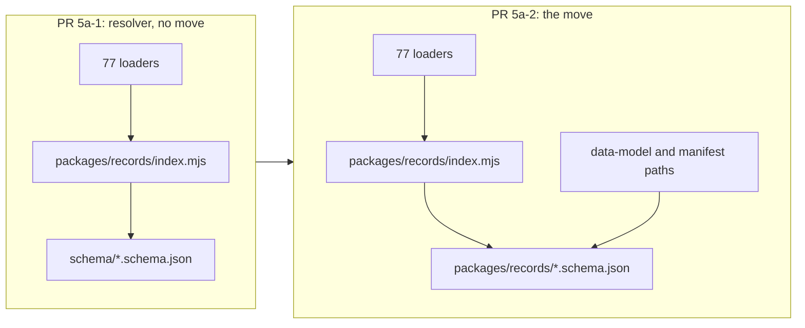

# Extracting the record types: packages/records

Monorepo rebuild, stage 3, step 5a (plan: https://claude.ai/artifact/KRc8UgzycnhQBY6dj4YpAX). Written 2026-11-05.

## Where this sits

The plan's pull request order is: workspaces (#223), the dependency check (#224), `packages/core` (#227), then `packages/store`, then records, terms, engine, checks and the apps, one per pull request. The router inversion (#235 to #242) came between core and store and left no import cycle between units.

Step 4, `packages/store`, waits. The store kernel (`knowledge/store/kernel.ts`) does not exist on main yet: it is added by #220, the master architecture record, which waits on Torian. Moving the connectors alone would conflict with that pull request. So the next step is 5a, the record types, which nothing open touches.

## What moves

`packages/records` is data plus its generator, with no import of any other unit:

| Today | After |
|---|---|
| `schema/*.schema.json` (104 files) | `packages/records/*.schema.json` |
| `schema/data-model.json` | `packages/records/data-model.json` |
| `schema/types/records.d.ts` | `packages/records/types/records.d.ts` |
| `schema/record-types.ts` and `schema/record-types-test.ts` | `packages/records/record-types.ts` and its test |

`schema/validate.py`, the `check-*` checkers and the code that reads records stay in `schema/` until the checks and engine steps.

## The problem: JSON has no re-export

The core step used one-line shims at the old paths, so no importer changed in the same pull request. A JSON file cannot re-export another, so that does not work here. The blast radius, counted on main at 4065ade:

- 77 code files (45 in `schema/`, 18 in `interface/`, 5 in `scripts/`, 4 in `platform/`, 2 in `purpose/`, one each in `console/`, `site/` and `packages/`) read a schema file or the data model by path. Most build the path from the repository root and the folder name `schema`.
- `schema/data-model.json` names each record's schema as a repository path, `schema/<name>.schema.json`, 300 times. 14 venture package manifests under `library/packages/`, `operations/operating-rules.json`, `knowledge/freshness.json`, `beta/capabilities.json` and two schemas do the same.
- 8 TypeScript modules import types from `./types/records.d.ts`.
- `schema/validate.py` globs `schema/*.schema.json` and keeps only data-model rows whose schema starts with `schema/`.
- `package.json` `files` ships `schema/`; it must also ship `packages/`.

## The design: one resolver, then one move

- **PR 5a-1, the resolver.** Add `packages/records/index.mjs`, which imports nothing in the repository. It exports `RECORDS` (the folder that holds the record types), `schemaFile(name)`, `dataModelFile()`, `readSchema(name)` and `readDataModel()`, plus `recordPath(path)`, which maps a stored path such as `schema/venture.schema.json` to the file. Every one of the 77 loaders goes through it. Nothing moves, so the suite proves the loaders are equivalent. `schema/validate.py` gets the same mapping in Python. A small test pins that every `schema/*.schema.json` resolves and that no code outside the resolver builds a schema path from the folder name (a check, so a new loader cannot bypass it).
- **PR 5a-2, the move.** `git mv` the files listed above, point `RECORDS` at the new folder, rewrite the stored paths (`schema/` to `packages/records/`) in the data model, the manifests and the docs with one codemod, and add `packages/` to `files`. The TypeScript imports change to the new path. `recordPath` keeps accepting the old prefix for one release, so a venture or a branch that still names `schema/x.schema.json` resolves; `check-data-model` warns on the old prefix.
- **Dependency check.** `packages/records` becomes a unit below everything else, beside `packages/core`. Nothing in it imports another unit, and the check fails if anything does.

## Choices and why

- **A resolver before the move.** Moving 104 files and editing 77 loaders and 300 strings in one pull request is not reviewable, and a missed loader fails only at runtime on the path it reads. Splitting it means each pull request has one kind of change, and the second is mechanical.
- **Keep reading the old prefix for one release.** Stored paths are records. Ventures outside this repository may hold them, and rewriting their records is an upgrade, not a refactor. A warning plus a later upgrade migration is the safe order.
- **The generator moves with the types.** `record-types.ts` derives `records.d.ts` from the schemas and nothing else, so it belongs with them, and its `--check` keeps them in step.
- **`validate.py` stays.** It is a check over records, so it moves with the checks step.

## What would make this wrong

- If a published venture pins framework schema paths in its own files beyond the data-model rows, the old prefix must be kept longer than one release. Step 5a-2 lists every stored path it rewrites, so this shows up in review.
- If #220 lands first and its store kernel declares `stores` in `data-model.json`, 5a-2 rebases over it; the kernel reads the data model through the resolver once 5a-1 is in.

## Status

| Step | Change | Status |
|---|---|---|
| 5a-1 | Resolver, every loader through it, the bypass check | not built |
| 5a-2 | Move the record types, rewrite stored paths, old prefix read for one release | not built |
| 4 | `packages/store` | waits for #220 |
