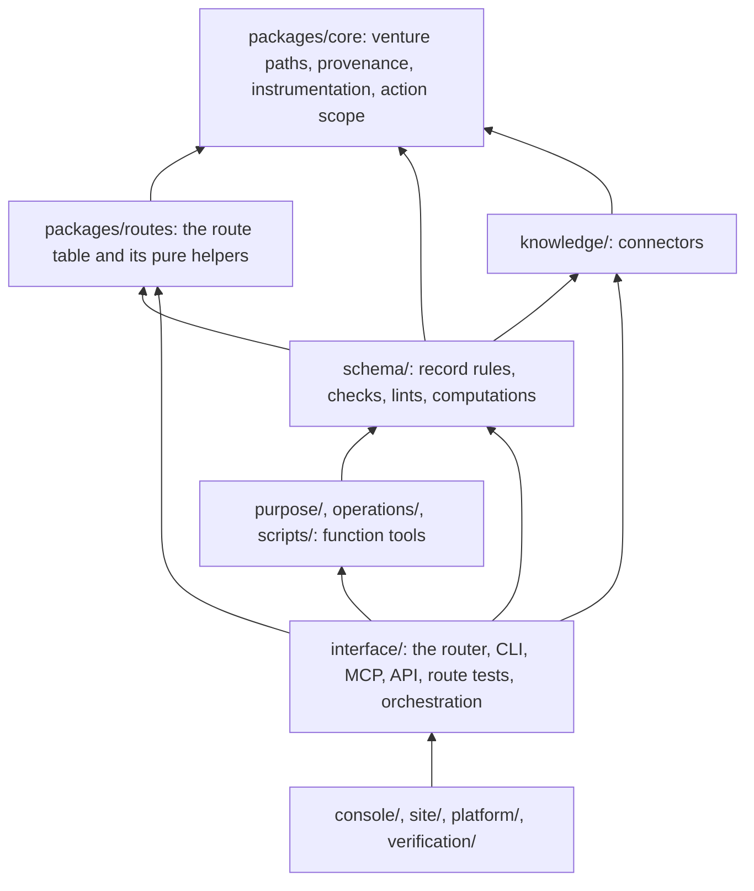

# Breaking the import cycle: the router inversion

Monorepo rebuild, stage 2 (PR 3c onward). Plan: https://claude.ai/artifact/KRc8UgzycnhQBY6dj4YpAX. Written 2026-11-05.

## Goal

The monorepo standard needs units that import each other without cycles. The rule is checked by `scripts/dependency-rules.ts`, which lists today's cycle as known and lets the list only shrink. After PR 3b (#227) one cycle remains: interface, knowledge, operations, purpose, schema and scripts.

The target layering, from the bottom up:

An arrow points from the importer to what it imports. Nothing points down to up.

## Why the cycle exists

The router imports about 25 modules from `schema/` (the gate, the decision files, caching, freshness, staleness, the lint suites and the brand). Before this PR, 34 modules in `schema/` imported the router back. There are two kinds of import:

1. **Reading the route table.** 11 of the 34 used only `routes`, `resolve`, `glob`, `files` or `gateOf`. These are pure functions over `schema/data-model.json` and the manifests, and nothing in them needs the router.
2. **Running a route.** The rest call the router's `call` (or `judge`). These are route tests and five orchestration modules: `triggers`, `setup`, `migrate-venture`, `releases` and `model-steps`.

The route table itself imported `schema/` for its command lists (the brand, the ten lint suites and the cache) and for the per-action memo. So it could not move until those moved too.

## The steps

Each step is one pull request, and each one ends with the dependency check green.

| Step | What moves | Edges it removes | Status |
|---|---|---|---|
| 1 (PR 3c) | Route table to `packages/routes/routes.mjs`; command lists to `packages/routes/commands.mjs`; memo to `packages/core/action-scope.mjs`. The router and the schema modules re-export, so no importer breaks. | schema to interface 42 to 32 (11 schema modules, plus 5 in knowledge, platform and site); the route table no longer imports schema | this PR |
| 2 | Route tests: the `schema/*-test` files that drive routes through `call`, the MCP server or the HTTP API move to `interface/tests/`, under the same names. | about 25 of the remaining 32 | not built |
| 3 | Orchestration: `triggers`, `setup`, `migrate-venture`, `releases` and `model-steps` compose routes, so they move to `interface/` with their callers updated. Shims at the old paths would import interface again, so there are none. `packages/core/provenance.mjs` spawns `schema/triggers.mjs` by path, and that path changes with it. | the rest of schema to interface | not built |
| 4 | Small helpers: `interface/kit-boundary.mjs`, `interface/release-card.mjs` and the adapters refresh go down a layer or are passed in. The function tools' back-edges go too: `schema/activity.mjs` to `scripts/`, `schema/packages.mjs` to `purpose/`, `schema/publish-lint.mjs` to `operations/`, and `knowledge/connectors/eval.mjs` to the router. | the last edges | not built |
| 5 | `scripts/dependency-rules.json` lists no known cycle, and the check forbids any. | | not built |

## Choices and why

- **Move rather than inject in step 1.** The route table needs no runtime state from the router. Moving it is a cut along a seam that already exists, and the router's re-export keeps every importer working. Injection would add a registration step for no gain.
- **Command lists are data.** Each lint suite's commands are fixed route, script and note triples. As data under `packages/routes` they can be listed without loading the lint code. Each module re-exports its own list, so its importers do not change.
- **Tests move to the router in step 2.** A test that runs a route through `call` tests the router and the module together. It belongs above both, as a dependency of the interface.
- **Orchestration moves up in step 3.** These modules compose routes. That is the interface's job, and moving them is honest about where they sit. Passing `call` in would still leave their command-line entry points importing the router.

## What this PR proves

- The route table is identical: `routes()` from the router at this head is byte for byte the same JSON as on main.
- `node scripts/dependency-rules.ts --graph` shows schema to interface at 32 (was 42) and knowledge to interface at 1 (was 2). The cycle has the same members, so the known list is unchanged.
- The full suite passes.
