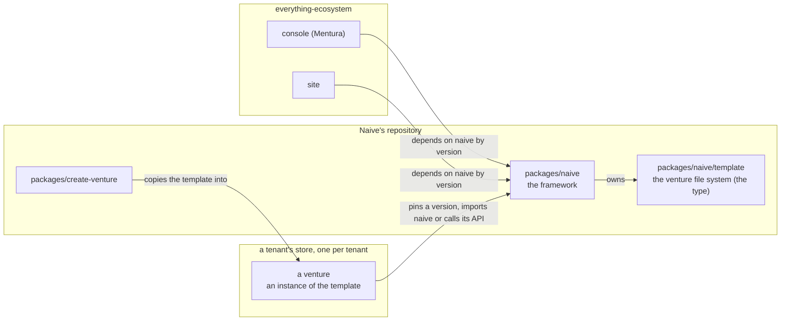
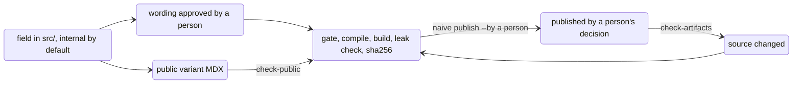

# Naive: its own repository, its layout and the refactor plan

Monorepo rebuild, stage 3. Decision EE-118. Agreed with Torian in the master architecture thread on 2026-11-05 (20:16Z to 22:36Z). Checked against main at 115e4ee.

## The ontology

Naive is to a venture what Next.js is to a Next.js app. Naive is the framework. The venture file system is the type Naive defines, kept inside Naive as its template. Each real venture is an instance of that type and lives in its tenant's own store, outside the product repository. The noun for Naive is framework, never package, because package already means a venture package (EE-070, EE-071).



## Where Naive sits

Naive has its own repository, a standard monorepo like vercel/next.js (Torian, 22:36Z: "next is its own").

```
naive repository
  packages/naive/            the framework
  packages/create-venture/   npm create venture, published on its own
  docs/  test/  tooling/

everything-ecosystem (this repository)
  console/                   Mentura's console; depends on naive
  platform/                  Mentura's library; depends on naive
  site/                      docs and marketing site; depends on naive
  docs/                      company docs and decisions
```

Code outside Naive reaches it only through the exports in `packages/naive/package.json`, by version. Internal moves inside Naive then never touch Mentura or the site.

## The Naive layout

Inside its repository, Naive is one package, laid out like the Next.js package. Something becomes its own package only when it ships or is used separately, which today is true of `create-venture` alone.

```
packages/naive/
  package.json             exports map, bin
  bin/naive                CLI entry
  src/
    interfaces/            cli, mcp, api, harness adapters
    router/                router, routes, reads, writes, orchestration
    records/               schemas, data model, generated types, examples
    functions/             one module per function, with its skills and templates
    engine/                docket, decisions, gate, freshness, upgrades, publish
    checks/                checks and lints
    terms/                 EE-095 term engine and the ontology
    store/                 connector contract, filesystem connector, store kernel
    core/                  venture paths, provenance
  lean/                    proofs
  library/                 the venture packages and their catalog
  template/                the venture file system
  test/
```

## The venture file system

Two levels, like `src/` and `public/` in Next.js. `src/` holds what the venture knows and does: one folder per function of the 13, each present even when empty, with the venture packages that function owns nested inside it. `public/` holds the static files the venture hands out unchanged, with the register `public/assets.json`.

```
<venture>/
  venture.json             the venture: identity, functions and packages
  naive.config.json        pins the Naive version (naive.version)
  src/
    strategy/              foundation/, validation/
    products/              product/, engineering/
    marketing-and-sales/   marketing/, customers/, deals/
    supply-chain/
    service-delivery/      operations/
    customer-service/
    human-capital/         people/, cofounder/
    it/
    finance/               finance/, fund/, money/
    assets/
    risk-and-compliance/   legal/, counsel/
    external-relationships/ relationships/, investor/, investors/, partner/
    capabilities/
  public/
```

`decisions/`, `evidence/` and `raw/` belong to no single function: every function writes decisions and evidence, and raw is unsorted input. They stay at the venture root beside `src/` until decided otherwise. Torian noted that MAD may be nested in the products function or others; that is not decided.

A venture never holds copies of Naive's skills, templates or rules. It pins a Naive version (`naive.config.json`) and imports Naive or calls it through the CLI, MCP server or local API, so an upgrade reaches every venture at once.

## The route from src to public

Two routes, both built today. A static file enters `public/` with a register entry naming its source and license (`schema/check-assets.mjs`). A record never leaves `src/`: a field reaches the world only when a person approves its wording (`schema/visibility.mjs`) or through a public variant written as its own MDX (`schema/check-public.mjs`), then a build that gates, compiles, builds, checks for leaks and records each output's sha256, then a publish decision a person makes (`schema/publish.mjs`). A changed source record makes a live artifact stale (`schema/check-artifacts.mjs`). Approved builds land in `.release/publish/`, as Next.js builds into `.next/`.



## What main has against this design

| Design | Main at 115e4ee |
|---|---|
| Naive in its own repository, one package | Spread over schema/, interface/, packages/, knowledge/, purpose/, operations/, evidence/, governance/, library/ and lean/, with no import cycle between them since stage 2 |
| 13 function modules | None. Functions appear only as the `department` field of venture packages; 10 of 22 packages have one |
| Template folder | None. `schema/init-venture.mjs` builds a venture in code with a top-level folder per package |
| Imports through exports | console/, platform/, site/ and verification/ import Naive by relative path (7, 21, 8 and 14 import lines) |
| Ventures in tenant stores | `instance/` is in the repository |

## Refactor plan

One pull request each, in order. Step 2 landed first, in this repository (#249). The split into Naive's own repository is step 3 and comes before the rest, because every later step then happens in the right repository.

```mermaid
flowchart LR
  p1["1 lock the design<br/>EE-118, this doc"] --> p2["2 create-venture<br/>to packages/"]
  p2 --> p3["3 new Naive repo:<br/>extract Naive's folders<br/>with history"]
  p3 --> p4["4 everything-ecosystem<br/>depends on naive,<br/>removes the copies"]
  p4 --> p5["5 in Naive: move into<br/>packages/naive/src,<br/>bottom of the graph first"]
  p5 --> p6["6 library into<br/>packages/naive/library"]
  p6 --> p7["7 the 13 function modules"]
  p7 --> p8["8 template, init-venture<br/>writes src/ and public/,<br/>upgrade with route aliases"]
  p8 --> p9["9 instance/ out to<br/>our tenant store"]
  p9 --> p10["10 READMEs from the layout"]
```



- Step 3 needs Torian to create the repository; agents cannot create one. The extraction keeps each file's history (git filter-repo over Naive's folders: schema/, interface/, packages/, knowledge/, purpose/, operations/, evidence/, governance/, frameworks/, library/, agents/, beta/, lean/ and the tests and checks that cover them).
- Step 4 replaces the 50 relative imports from console/, platform/, site/ and verification/ with imports of `naive`.
- Step 5 moves core, records, terms with lean, store, engine, checks, router with routes, then interfaces. The dependency check's units become `packages/naive/src/*`, so the order inside Naive stays checked.
- Step 7 empties the six layer folders: each skill, template and framework goes to the function module that owns it.
- Step 8 adds an upgrade migration for existing ventures. Old paths resolve through route aliases for one release.
- Pull request 246 (the records move under the earlier plan) is superseded by step 5.

## What would make this wrong

- If a published venture imports Naive files by path, step 3's exports must keep those paths working for a release.
- If a function owns no package and no skill, its module is still written, because a function exists even when empty (EE-115).
