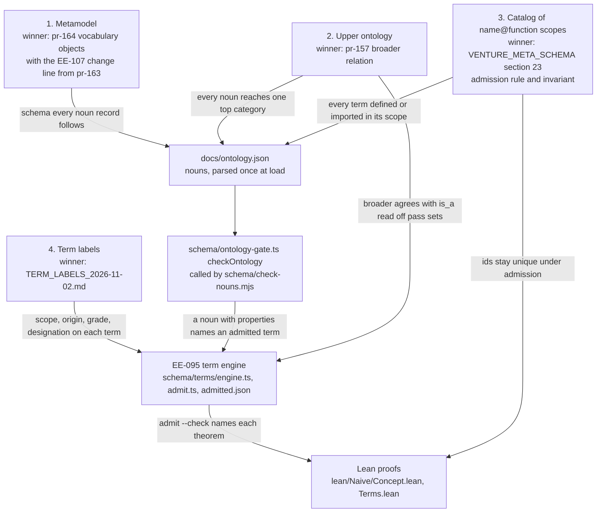
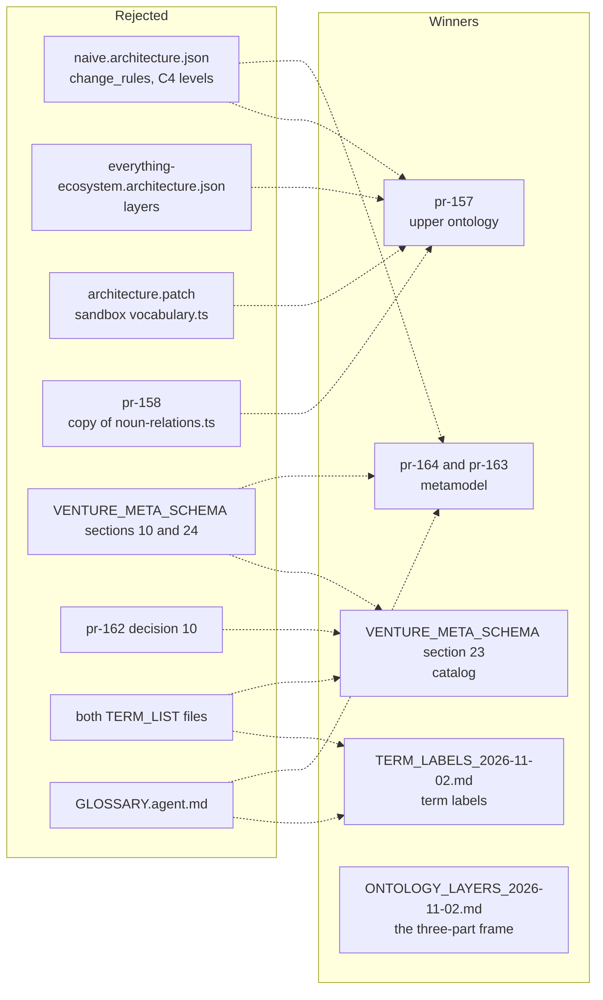

# Naive ontology core, with one winner for each of four parts

This design picks one preserved version for each of the four parts of Naive's ontology core and says how each part goes through the EE-095 term engine (`schema/terms/`) and the Lean proofs (`lean/Naive/`). It is unit S2-PR1 of the plan in `docs/design/CLAUDE_HANDOFF_ONTOLOGY_PROGRAM.md`. It records choices only. It adds no code, and every choice traces to a row of the merged ledger, `docs/reviews/2026-11-03-preservation/merged-ledger.md` (ids N-NNN).

The goal is the plan's rule that nothing symbolic bypasses EE-095 and the Lean proofs (ledger N-188). The problem it solves is that stage 1 preserved several rival designs for the same parts, side by side and unreconciled. Stage 2 cannot build until one version of each part is chosen.



## Gate status

- **G4 is decided.** Torian ruled "Yes, add affects entries" on 2026-11-04 at 18:58Z. EE-095 now carries `affects` entries in `docs/decisions/decisions.json`. They name the files it governs: `schema/terms/engine.ts`, `schema/terms/admit.ts`, `schema/terms/admitted.json`, `schema/terms/terms.ts`, `lean/Naive/Concept.lean`, `lean/Naive/Terms.lean`, `.github/workflows/lean.yml` and `schema/ontology-gate.ts`. Each path exists on `main` at `dba7420`. The idea that decisions carry typed `affects` is ledger N-146.
- **G2 is withdrawn and no longer blocks.** Torian withdrew the question at 19:05Z on 2026-11-04. "Layer" is a general word whose meaning depends on its scope, and it may be a proper name. The term engine settles it, and it may need no definition. That run is pending in a separate unit. This design picks neither C-086 (ledger N-096, "layer" reserved for the technical sense) nor C-080 (ledger N-095, rename the knowledge layer). It uses "layer" only in the plan's existing ontology wording, for the metamodel, the upper ontology and the catalog (ledger N-047). It makes no claim about the seven groupings that EE-013 calls layers. The facts the term engine run needs are in finding F5.
- **Stage 1 is closed.** Torian's ruling of 2026-11-04 at 18:52Z, recorded by PR #203, closed stage 1 on what Claude can reach. Sources that only Grok Bot's memory or Torian's Mac hold are not in this design.

## How the current pieces work

This section is the how pass over the five places the plan names. All five exist on `main` at `dba7420`.

**Overview.** Two separate systems meet at one join. `docs/ontology.json` lists 112 nouns (13 retired). `schema/check-nouns.mjs` reads it and calls `checkOntology` in `schema/ontology-gate.ts`. The term engine in `schema/terms/` defines terms as properties checked on facts and writes `schema/terms/admitted.json`. The join is the noun field `term`. When a noun lists `properties`, `checkOntology` requires `term` to name an admitted term and every non-permission property of that term to be listed. Today one noun uses it (`founder appointment`).

**Key concepts.**

- A term (`Term<F>` in `schema/terms/engine.ts`) is a list of properties, each a pure check over the facts of one record at one level (membership, relationship, encounter). No check may read the label.
- Admission (`schema/terms/admit.ts`) freezes each term by hash, checks it is a valid test, cross-runs it against every term at its level, reads the relation off the two pass sets (equal, is_a, has_a_kind, overlap, disjoint, inconclusive), and confirms each named Lean theorem is present in `lean/Naive`.
- A noun record in `docs/ontology.json` has `noun`, `level`, `meaning`, `standard`, `status`, `function` and `handoff_type`, and some have `capabilities`, `term`, `properties`, `required_touches`, `replaced_by` and `retired_pattern`. The file has no metamodel. Its top-level keys are `version`, `note`, `check` and `nouns`.
- A scoped sense is a noun named `name@function`. `checkScopes` in `schema/ontology-gate.ts` checks the suffix is a department id, that it matches `function`, and that no bare noun sits beside a scoped one. Two nouns use it today (`customer@marketing-and-sales`, `customer@finance`).

**How it works.** `node test.mjs` runs `schema/check-nouns.mjs` (group "nouns"), `schema/ontology-gate-test.ts`, `schema/terms/engine-test.ts` and `schema/terms/admit.ts --check`. The Lean proofs build in the separate `lean` workflow. `lean/Naive/Concept.lean` defines a concept as named decidable properties, with `IsA`, `Disjoint` and `refine_isA`. `lean/Naive/Terms.lean` mirrors the engine's relation as `relationOf` and proves that admitting an id keeps a vocabulary's ids unique (`admit_preserves_nodup`, `admitAll_nodup`). Its comment cites "Admission (section 23)", which is section 23 of the preserved venture meta-schema.

**Where things live.**

| Path | Holds |
|---|---|
| `schema/terms/engine.ts` | `Term`, `run`, `relation`, `freeze`, `validTest`, `passSet` |
| `schema/terms/admit.ts` | the admission pipeline and its `--check` mode |
| `schema/terms/terms.ts`, `levels.ts` | the admitted terms and the facts and case generators per level |
| `schema/terms/admitted.json` | the generated admission record |
| `lean/Naive/Concept.lean`, `Terms.lean`, `Founder.lean` | the core-Lean proofs (`StandingRules.lean` uses Mathlib and is a separate root) |
| `docs/ontology.json` | the nouns |
| `schema/check-nouns.mjs` | the retired-noun scan, the reference check and the membership gate CLI |
| `schema/ontology-gate.ts` | `checkOntology`, `checkScopes`, `decidePackage` (gates G1 to G5, where G5 runs the engine over facts) |

**Gotchas.** The Lean check in admission matches a theorem name by regular expression, so it does not prove the theorem builds (finding F1). The `lean` workflow runs only on changes under `lean/` (finding F7). A new Lean file builds only if `lean/Naive.lean` imports it (finding F6).

## The four parts

Each part below gives the winner, the rejected alternatives, the EE-095 hook, the Lean hook, the unit that builds it, and the ledger rows each choice traces to. The sketches follow the architect skill: the caller's usage first, then types, with `not implemented` bodies. They live only in this document, because the S2-PR1 Files block allows only this file and `docs/decisions/decisions.json`.

### 1. Metamodel

**Winner.** `docs/design/preserved/framework/pr-164/pr-164.patch`, the vocabulary objects of EE-107 item 7. Every noun, verb and kind is an object with a stable id, a class (`noun`, `verb` or `kind`) and a JSON Schema shape. Its decision text is in `docs/design/preserved/framework/pr-163/pr-163.patch`, which also defines the change line the metamodel validates: one verb (`create`, `amend`, `delete`), one kind, one noun, and a tier that is the maximum of four scores. Ledger rows N-048, N-114 and N-119.

**Why it wins.** N-048 says the metamodel is written in JSON Schema and that models only propose schema-valid change lines below it. pr-164 is the only preserved design whose shapes are JSON Schema, and pr-163 is the only one that defines a change line. Both are EE-107, so the shape and the change line come from one decision.

**What is dropped from the winner.** pr-164's separate check, `schema/check-vocabulary.mjs`. The 2026-11-02 five-step review (`docs/reviews/2026-11-02-five-step-review.md`, step 2) names #164 and #157 as parallel vocabulary checks, and N-188 forbids a symbolic check that bypasses EE-095. EE-107 item 7 itself says the check grows from `schema/check-nouns.mjs`, so the metamodel check runs inside `checkOntology`, which already imports the engine.

**Rejected.**

- `docs/design/preserved/claude-2026-11-03/architecture/naive.architecture.json`, its `change_rules` (`vocabulary`, `append`, `amend`, `not_a_change`). Ledger N-003. Its verbs overlap with each other and do not form the exhaustive three-verb set N-114 records.
- `docs/design/preserved/claude-2026-11-03/VENTURE_META_SCHEMA_2026-10-31.md`, section 10, the draft whole-venture schema. Ledger N-010. It is a schema for venture records, not for the ontology's nouns.
- `docs/design/preserved/claude-2026-11-03/prototypes/architecture/GLOSSARY.agent.md`, its entry format (`id: noun:x`, `level`, `scope`, `status`). Ledger N-001. It is a generated view with free-text fields, not a schema.

**EE-095 hook.** A vocabulary object whose shape lists properties names an admitted term in `schema/terms/admitted.json`, through the `term` join `checkOntology` already enforces in `schema/ontology-gate.ts`. A change line that adds a term reaches the vocabulary only through `schema/terms/admit.ts`.

**Lean hook.** `admit_preserves_nodup` and `admitAll_nodup` in `lean/Naive/Terms.lean`. Object ids stay unique under any sequence of admissions. This is invariant I1 of the venture meta-schema's section 23 (ledger N-010).

**Built by.** S2-PR5 (`schema/ontology-metamodel.schema.json`, with the SKOS and OWL `mappings` table from N-048). Changing the metamodel is a one-way-door amend (N-048).

```ts
// Usage (S2-PR5): validate a proposed change line before any write.
const line: ChangeLine = { verb: "amend", kind: "rename", noun: "customer@finance", tier: tierOf(scores) };
const problems = checkChangeLine(metamodel, line); // [] or the unknown key named

type VocabularyClass = "noun" | "verb" | "kind";
type VocabularyObject = { id: string; class: VocabularyClass; shape: JsonSchema; term?: AdmittedTermId };
type Verb = "create" | "amend" | "delete";
type Tier = "low" | "costly" | "one_way_door";
type TierScores = Record<"severity" | "reversibility" | "time_to_detect" | "blast_radius", number>;
type ChangeLine = { verb: Verb; kind: string; noun: string; tier: Tier };

function tierOf(scores: TierScores): Tier { throw new Error("not implemented"); }
function checkChangeLine(metamodel: Metamodel, line: ChangeLine): string[] { throw new Error("not implemented"); }
```

### 2. Upper ontology

**Winner.** `docs/design/preserved/framework/pr-157/pr-157.patch`, EE-103's typed relations in `schema/noun-relations.ts`. They are a closed set (`broader`, `narrower`, `related`, `part-of`, `derived-from`), stated on a noun's `relations` in `docs/ontology.json`, with `broader` and `part-of` checked for cycles. Ledger rows N-049 and N-127.

**Why it wins.** N-049 says every noun traces to exactly one top category through `broader`. pr-157 is the only preserved source that implements `broader` over `docs/ontology.json`. Finding F2 shows what it lacks: it accepts a noun with two broader parents and a noun with none. S2-PR6 adds the exactly-one-top check.

**Top categories.** This design does not pick them, since that would be a new idea. The seed is the BFO proposals already on `main` in `docs/design/NAIVE_SYSTEMS_2026-11-01.md` (ledger N-149): a record is an information content entity, a function is a realizable entity, and identity sits under continuant. EE-108 says the BFO mapping is still open.

**Rejected.**

- `docs/design/preserved/claude-2026-11-03/prototypes/architecture-folder/architecture.patch`, the sandbox `vocabulary.ts` with C4 levels joined by `part_of` and a Lean proof that the tree has one root. Ledger N-002. `part_of` is containment between software elements, and N-049 names `broader`, which is a category relation.
- `docs/design/preserved/claude-2026-11-03/architecture/naive.architecture.json`, its element levels (24 container, 20 component, 16 context). Ledger N-003. Same reason: C4 levels place software, not nouns.
- `docs/design/preserved/claude-2026-11-03/architecture/everything-ecosystem.architecture.json`, its nine `layers` groupings as top-level buckets. Ledger N-003. They are folder groupings, and the word "layer" waits on the term engine run (G2 status above).
- `docs/design/preserved/framework/pr-158/pr-158.patch`, its copy of `schema/noun-relations.ts`. Ledger N-070. EE-104 builds on #157 and changes a noun, not the category design. Its noun change is stage 3 work.

**EE-095 hook.** The check lives in `schema/terms/` (`schema/terms/upper-test.ts`, per S2-PR6). Where both ends of a `broader` link name admitted terms at one level, the relation `schema/terms/admit.ts` records in `schema/terms/admitted.json` must be `is_a` or `equal`. EE-095 says relations between terms are read off pass sets, and the sandbox `vocabulary.ts` (N-002) reads `is_a` the same way.

**Lean hook.** `lean/Naive/Upper.lean` (S2-PR6) proves that on any finite hierarchy, `broader` with no cycle, no orphan and no noun reaching two top categories gives one top category per noun (`upper_one_top_of_checks`). That the real `broader` meets those checks is the code's job (`schema/terms/upper-test.ts`). It uses `IsA` and `refine_isA` from `lean/Naive/Concept.lean`. `lean/Naive.lean` must import it (finding F6).

**Built by.** S2-PR6.

```ts
// Usage (S2-PR6): one top category per live noun, or the orphan and the double parent named.
const tops = topCategoryOf(nouns); // Map<noun, top> or problems
type Broader = { from: NounName; to: NounName };
type UpperResult = { kind: "ok"; top: Map<NounName, TopCategory> } | { kind: "problems"; orphans: NounName[]; twoTops: NounName[]; cycles: NounName[][] };

function topCategoryOf(nouns: readonly NounRecord[]): UpperResult { throw new Error("not implemented"); }
function broaderAgreesWithEngine(link: Broader, admitted: AdmittedRecord): boolean { throw new Error("not implemented"); }
```

### 3. Catalog of name@function scopes

**Winner.** `docs/design/preserved/claude-2026-11-03/VENTURE_META_SCHEMA_2026-10-31.md`, section 23: an admission rule plus an invariant, so each admission checks one term against what exists. Its invariants I2 (a definition uses only admitted or imported terms) and I4 (no silent shadowing) are the catalog's "defined or imported, fail-closed" rule. The scope key is `name@function`, as EE-089, `checkScopes` and EE-103's scoped-sense rule in pr-157 already use it. Ledger rows N-010, N-050, N-127 and N-142.

**Why it wins.** N-050 asks for acyclic imports and terms that are defined or imported, checked fail-closed. Section 23 is the only preserved design that states that rule as an invariant kept by admission, and `lean/Naive/Terms.lean` already proves its first case. The catalog follows the stored fact in N-050: one catalog file lists every scope with owner, status and imports. `docs/design/ONTOLOGY_LAYERS_2026-11-02.md` records that the ledger's digest says one file per scope instead.

**Rejected.**

- The same file's section 24, the scope chain (library core, industry, market, venture, function, module) with overlays and rebase-style replay. Ledger N-010. Its scopes are not `name@function`, and replay needs versioned branches, which N-121 rules out for now.
- `docs/design/preserved/framework/pr-162/pr-162.patch`, EE-106 decision 10, each organization extends the vocabulary with its own SKOS terms. Ledger N-113. An organization is a tenant scope (EE-105 is off `main`), not a function scope.
- `docs/design/term-harvest/claude-2026-11-03/TERM_LIST_2026-11-01.json`, its `collides_with` ids such as `kernel@os` and `function@math`. Ledger N-001. Those suffixes name outside domains, not functions.

**EE-095 hook.** The catalog check lives in `schema/terms/` (`schema/terms/catalog-test.ts`, per S2-PR7). A term a scope defines with properties is an admitted term in `schema/terms/admitted.json`. A missing term routes to its owning scope as an open item and is never coined (N-050).

**Lean hook.** `admit_preserves_nodup` and `admitAll_nodup` in `lean/Naive/Terms.lean` keep term ids unique per scope under admission. S2-PR7's Files block adds no Lean file, so acyclic imports are checked in code only. A Lean proof of acyclic imports is not planned.

**Built by.** S2-PR7 (`schema/ontology-catalog.schema.json`, `docs/ontology-catalog.json`). Gate G5 decides whether the 13 owner@area scopes stand in until then.

```ts
// Usage (S2-PR7): every term used in a scope is defined there or imported, and imports do not cycle.
const result = checkCatalog(catalog, nouns);
type ScopeId = `${string}@${string}`;
type CatalogEntry = { scope: ScopeId; owner: DepartmentId; status: "proposed" | "in-force" | "retired"; imports: ScopeId[] };
type CatalogResult = { kind: "ok" } | { kind: "problems"; cycles: ScopeId[][]; undefinedTerms: { term: string; owningScope: ScopeId }[] };

function checkCatalog(catalog: readonly CatalogEntry[], nouns: readonly NounRecord[]): CatalogResult { throw new Error("not implemented"); }
```

### 4. Term labels

**Winner.** `docs/design/TERM_LABELS_2026-11-02.md`, which puts four labels on every glossary term. Scope is the `name@function` subject field. Origin is computed from the SKOS mapping (adopted, adapted, narrowed, broadened, borrowed, operationally coined). Grade is the source authority (standard, convention or none, with siblings). Designation follows ISO 1087:2019 (term, proper-name, appellation, symbol reserved). Operationally coined and borrowed terms count toward a 10 percent cap, and proper names and appellations do not. Origin is "adopted" only with a quoted source definition. Ledger rows N-051 to N-056.

**Why it wins.** It is Torian's decision record for the labels, and no other preserved source carries origin, grade or designation. Finding F4 shows the cap needs designation at once: 11 of 99 live nouns cite `ours` (11.1 percent), and 8 (8.1 percent) once the three proper names N-052 names are left out.

**Rejected.**

- `docs/design/term-harvest/claude-2026-11-03/TERM_LIST_2026-11-01.json` (340 terms) and `docs/design/term-harvest/TERM_LIST_2026-11-01.json` (199 terms on `main`), their `subject` and `collides_with` fields. Ledger N-001. `subject` is a free subject-field name such as "Proof and logic", not a `name@function` scope, and neither list has origin, grade or designation.
- `docs/design/preserved/claude-2026-11-03/prototypes/architecture/GLOSSARY.agent.md`, its "Must hold: standard ..." line and its status field. Ledger N-001 and N-044. The standard is free text with no typed SKOS match, which N-056 requires.
- The phrase "scoped sense" in EE-103 (`docs/design/preserved/framework/pr-157/pr-157.patch`). Ledger N-051 drops it. Part 3 keeps pr-157's rule for when a function gets its own sense and calls the label "scope".

**EE-095 hook.** The labels are fields of `Term` in `schema/terms/engine.ts`, typed as a discriminated union in `schema/terms/terms.ts`, so an illegal combination cannot be built. One example is origin `adopted` without a quoted source definition (N-054). `schema/terms/admit.ts --check` checks the cap, the adopted quote and the one referent of a proper name. Labels sit on the term, not on the facts, so they do not break the engine's rule that no check reads the label.

**Lean hook.** `lean/Naive/Terms.lean` (S2-PR8) gains the designation and origin types and proves that proper names and appellations never count toward the cap (N-053, N-055).

**Built by.** S2-PR8.

```ts
// Usage (S2-PR8): a term carries its labels, and admit --check enforces the cap.
const labels: Labels = { designation: "term", scope: "customer@finance", origin: { kind: "adopted", quote: "<the source's definition>" }, grade: "standard" };

type Grade = "standard" | "regulatory" | "codified" | "convention" | "seminal" | "none";
type Origin =
  | { kind: "adopted"; quote: string }
  | { kind: "adapted" | "narrowed" | "broadened" | "borrowed" | "operationally-coined" };
type Common = { scope: ScopeId; origin: Origin; grade: Grade };
type Labels =
  | (Common & { designation: "term" })
  | (Common & { designation: "proper-name" | "appellation"; referent: string; instanceOf: string });

function coinedShare(terms: readonly Labels[]): number { throw new Error("not implemented"); }
```

## Two shapes compared

The architect skill asks for at least two whole-shape candidates. Both use the winners above. They differ in where each part's data lives.

- **Shape A, one file per part.** The metamodel in `schema/ontology-metamodel.schema.json`, `broader` links on noun records in `docs/ontology.json`, the catalog in `docs/ontology-catalog.json`, and labels on `Term` in `schema/terms/terms.ts`. This is the layout of plan units S2-PR5 to S2-PR8.
- **Shape B, everything on the noun record.** Labels, scope metadata and imports all as fields of each noun in `docs/ontology.json`, with pr-164's `schema/vocabulary.json` for verbs and kinds.

Screened against `design-red-flags.md` in the architect skill:

| Red flag | Shape A | Shape B |
|---|---|---|
| Hand-synced list | The catalog lists scopes and nouns carry `@function` suffixes. The catalog check must fail when a suffix has no entry. | Scope owner and imports repeat on every noun of a scope. |
| Split ownership | Labels on the term, nouns in `docs/ontology.json`, joined by `term`, the join that exists today. | Labels on the noun, but properties stay on the term in `schema/terms/terms.ts`, so a term's facts and its labels have two owners. |
| Two ways to do one task | One: change lines through the metamodel. | Two: `docs/ontology.json` and `schema/vocabulary.json` both define vocabulary objects. |

**Synthesis.** Shape A wins, with one rule taken from the comparison. The catalog check derives the set of scopes from the noun suffixes and fails when the catalog and the suffixes disagree. It matches the plan's Files blocks, so no plan unit changes.



## Every stage 1 source, cited

Each ontology source from stage 1 is a winner or a loser above. The rest are listed with the reason they are not ontology sources.

| Stage 1 unit | Path | Role in this design |
|---|---|---|
| S1-PR1 (#174) | `docs/design/ONTOLOGY_LAYERS_2026-11-02.md` | Winner for the frame: three parts, metamodel first (N-047 to N-050, N-188) |
| S1-PR2 | `docs/design/TERM_LABELS_2026-11-02.md` | Winner, part 4 |
| S1-PR3 | `docs/design/term-harvest/claude-2026-11-03/TERM_LIST_2026-11-01.json` | Loser, parts 3 and 4 |
| S1-PR3 (main's list beside it) | `docs/design/term-harvest/TERM_LIST_2026-11-01.json` | Loser, part 4 |
| S1-PR4a | `docs/design/preserved/claude-2026-11-03/VENTURE_META_SCHEMA_2026-10-31.md` | Winner, part 3 (section 23). Loser, part 1 (section 10) and part 3 (section 24) |
| S1-PR4b | `docs/design/preserved/claude-2026-11-03/architecture/everything-ecosystem.architecture.json` | Loser, part 2 |
| S1-PR4c | `docs/design/preserved/claude-2026-11-03/prototypes/architecture/GLOSSARY.agent.md` | Loser, parts 1 and 4 |
| S1-PR4d | `docs/design/preserved/claude-2026-11-03/architecture/naive.architecture.json` | Loser, parts 1 and 2 |
| S1-PR5a | `docs/design/preserved/framework/pr-157/pr-157.patch` | Winner, part 2. Its scope rule keys part 3. Its "scoped sense" phrase loses in part 4 |
| S1-PR5b | `docs/design/preserved/framework/pr-163/pr-163.patch` | Winner, part 1 (decision text and change line) |
| S1-PR5c | `docs/design/preserved/framework/pr-164/pr-164.patch` | Winner, part 1 (vocabulary objects). Its separate check is dropped |
| S1-PR5d | `docs/design/preserved/framework/pr-162/pr-162.patch` | Loser, part 3 |
| S1-PR10.8 | `docs/design/preserved/framework/pr-158/pr-158.patch` | Loser, part 2 |
| S1-PR10.12 | `docs/design/preserved/claude-2026-11-03/prototypes/architecture-folder/architecture.patch` | Loser, part 2 |
| S1-PR10.5, 10.6, 10.7 | `docs/design/preserved/framework/pr-155/`, `pr-156/`, `pr-161/` | Not an ontology source: model and code roles (EE-101), provenance coordination (EE-102), accounts and tenancy (EE-105) |
| S1-PR10.9, 10.10, 10.11 | `docs/design/preserved/framework/pr-130/`, `pr-41/`, `pr-34/` | Not an ontology source: discovery workflow, venture layout move, Mentura agent design |
| S1-PR10.1, 10.2, 10.3, 10.4 | `docs/design/preserved/claude-2026-11-03/artifacts/`, `mentura-discovery/`, `mentura-playbooks/`, ledger marks | Not an ontology source in this design. Confidential Mentura items are cited by path only |
| S1-PR6, S1-PR8 | `docs/reviews/2026-11-03-preservation/merged-ledger.md`, `docs/memory/claude/` | The trace for every choice (ledger) and memory notes whose ontology rows the ledger already carries |

## Appendix A. Interrogate findings

The interrogate skill keeps only findings a run proved. Skipped in Claude Code. The multi-model fan-out did not run. This builder session has no subagent tool, so the builder ran one adversarial pass itself against `main` at `dba7420`. That is weaker than the skill asks, and a verifier on another model should repeat it.

**F1. Admission accepts a Lean theorem that exists only inside a comment.** In a scratch copy of `schema/terms` and `lean/Naive`, add a theorem name only inside a block comment and name it from a term.

```sh
printf '\n/- theorem only_in_a_comment : True := trivial -/\n' >> lean/Naive/Terms.lean
sed -i 's/lean: \["coFounder_isA_founder"\],/lean: ["coFounder_isA_founder", "only_in_a_comment"],/' schema/terms/terms.ts
node schema/terms/admit.ts > /dev/null; node schema/terms/admit.ts --check; echo "exit=$?"
```

Output: `exit=0`. The intent (N-188) needs a named theorem to be proved. So every Lean hook above counts only once `lake build` passes and S2-PR3 ties the proofs to the engine, never on `admit.ts --check` alone.

**F2. The upper ontology winner accepts two broader parents and a noun with none.** Run pr-157's `relationErrors` from `schema/noun-relations.ts`, extracted with `git apply --include='schema/noun-relations.ts'` into a scratch folder.

```text
two broader parents: []
noun with no broader: []
broader cycle: ["docs/ontology.json: a and b: broader and narrower point both ways"]
three-noun broader cycle: ["docs/ontology.json: broader cycle: a -> b -> c -> a"]
```

N-049 needs exactly one top category per noun. S2-PR6 must add that check. The cycle check works.

**F3. The winning patches do not apply whole to `main`.** `git apply --check docs/design/preserved/framework/pr-157/pr-157.patch` prints `error: patch failed: schema/README.md:26` and exits 1. pr-164 fails the same way at `schema/README.md:27`. With `--include` for the new modules only (`schema/noun-relations.ts`, `schema/vocabulary.ts`, `schema/vocabulary.json`), both exit 0. S2-PR5 and S2-PR6 port the new modules and rewrite the edits to existing files.

**F4. The 10 percent cap fails on today's nouns unless designation exists.**

```text
live 99, ours 11 (11.1%), ours without the N-052 proper names 8 (8.1%)
fields that could carry designation: 0
```

From a `node -e` count over `docs/ontology.json`. N-055 leaves proper names out of the cap, and no noun has a designation field yet. S2-PR8 must add designation before it turns the cap on.

**F5. Facts for the pending term engine run on "layer".** `node -e` over `docs/ontology.json` prints the noun `layer` with standard `ours` and meaning "One of the six: purpose, knowledge, operations, evidence, governance, interface". EE-013 in `docs/decisions/decisions.json` says "Layer means only the system's seven layers". The noun field `level` holds those same grouping names: `system,venture,purpose,knowledge,operations,evidence,governance,interface,function`. So "six" and "seven" already disagree, and the word "level" is already a field. This design picks no answer (G2 status above).

**F6. A new Lean file builds only if something imports it.** `cat lean/Naive.lean` prints three imports (`Naive.Concept`, `Naive.Founder`, `Naive.Terms`), and `lean/lakefile.toml` has `roots = ["Naive", "Naive.StandingRules"]`. `lean/Naive/Upper.lean` must be imported from `lean/Naive.lean`, or the S2-PR6 proof never runs.

**F7. The Lean workflow skips engine changes.** `grep -n paths .github/workflows/lean.yml` prints `paths: ["lean/**", ".github/workflows/lean.yml"]` and `paths: ["lean/**"]`. A pull request that changes only `schema/terms/engine.ts` does not build the proofs. S2-PR3 owns that tie.

**Dropped.** None. Each finding above was rerun once to confirm its output.
