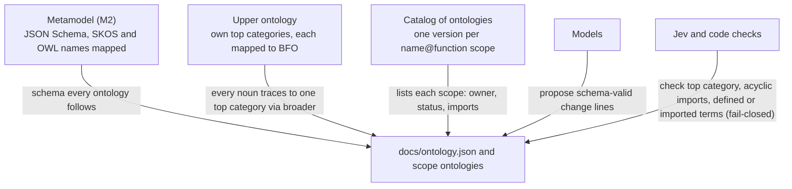

# Naive ontology layers: metamodel, upper ontology, catalog

This file preserves four decisions Torian made on Nov 2, 2026. Until now they lived only in Grok Bot's memory. Each blockquote is one of Grok Bot's stored memory facts, copied character for character. They are Grok Bot's records of Torian's decisions, not his own words. The preservation audit (PR #173) lists shorter digests of these facts. Where a row is only a shorter wording, the stored fact below is the fuller record. It is not yet reconciled with main. Only the architecture inventory check reads this file's first 1200 characters. Nothing reads the decision text. `docs/ontology.json`, EE-089, EE-095 and EE-103 have not been checked against it. Reconciling it is a separate, later step.

## 1. Three layers (ledger N-047)

> As of Nov 2, 2026, Torian decided Naive's ontology uses three separate layers: a metamodel (M2 schema that docs/ontology.json follows), an upper ontology (shared top categories), and a catalog of ontologies (metadata per name@function scope), planned one at a time at both the neural and symbolic levels, starting with the metamodel.

## 2. Metamodel (ledger N-048)

> As of Nov 2, 2026, Torian decided Naive's ontology metamodel is written in JSON Schema, with SKOS and OWL names mapped in; models only propose schema-valid change lines below it, and changing the metamodel is a one-way-door amend.

## 3. Upper ontology (ledger N-049)

> As of Nov 2, 2026, Torian decided Naive's upper ontology is a small set of its own top categories, each mapped to BFO; every noun traces to exactly one top category via broader (code-checked), and models propose a noun's top category for Jev to check.

## 4. Catalog of ontologies (ledger N-050)

> As of Nov 2, 2026, Torian decided Naive's catalog of ontologies gives each name@function scope its own version, listed in one catalog file with owner, status and imports; code checks imports are acyclic and terms are defined or imported (fail-closed), and models route missing terms to the owning scope rather than coining.

N-050 says "one versioned catalog file per name@function scope". The stored fact above says the scopes are listed in one catalog file. The two differ in how many catalog files there are.

## Standing constraint (ledger N-188)

> As of Nov 2, 2026, Torian's emphatic technical strategy for Naive: the symbolic layer is verified in code AND proven in Lean (EE-095 term engine, lean/Naive, lean CI). Everything symbolic must be built with this in mind; never design a symbolic check (e.g. declared-label membership) that bypasses the EE-095 properties and Lean proofs.

The ledger records an earlier, shorter form of this constraint (N-188, Oct 31, 2026): "Symbolic layer verified in code and proven in Lean through EE-095; never bypass". The blockquote above is the fuller fact Grok Bot stored on Nov 2.

## Where related pieces live today (for the reconcile step)

- `docs/reviews/2026-11-02-five-step-review.md` step 1 names these layers as kept but on hold.
- `docs/ontology.json` has no metamodel. Its keys are version, note, check and nouns.
- Identity sits under continuant in `docs/design/NAIVE_SYSTEMS_2026-11-01.md`. That file says mapping Naive's kinds to BFO classes is still to do. The same file proposes a BFO mapping for function and a BFO mapping for record.
- The `broader` relation exists only in open PR #157 on `framework`.
- Scoping exists in EE-089 (term@scope), `schema/glossary.schema.json`, and the EE-103 scoped-sense rule in PR #157.
- No catalog file or catalog check exists yet.
