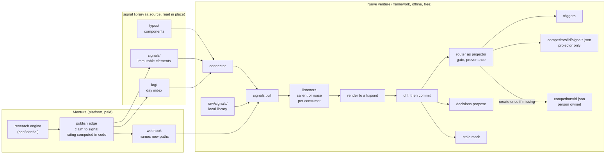
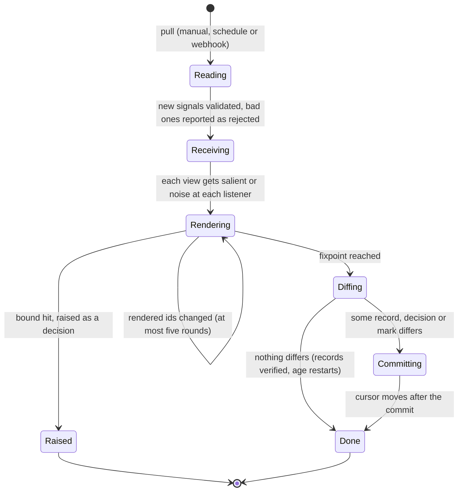

# Signal library

Status: designed, not built. Nothing in this document exists in code yet. Every noun below is a candidate for the EE-095 term engine and is not admitted.

## The ask

Torian, 2026-11-06:

- A signal library is a separate feature of Mentura, maybe paid. Mentura's agents do the market research (for example, that a competitor raised a seed round), and a venture's agents connect to the library instead of researching it themselves.
- The library is always sending out signals as modules, so a venture can keep building records with no model at all, as a long-running deterministic system.
- Signals may be components. Noise is likely a property or a gate somewhere. What is a high value signal at one endpoint or process may be noise at another.

## The design in one paragraph

A signal type is a component: a typed, versioned definition with props, parts it composes, and a projection that says, as data, how it folds into records. A signal is an element of a type: immutable, dated, content-addressed and rated. A signal library is a source that holds types and signals in a fixed layout and is read in place. A listener joins a signal type to one consumer (a record route, a frame or a decision) and carries that consumer's criterion. Noise is not a field of a signal. It is the outcome of one signal at one listener, so the same signal can be salient at one consumer and noise at another in the same venture. A pull reads new signals, decides salient or noise per listener, renders projected records to a fixpoint, diffs them against the venture and commits only the difference through the router, so the gate, provenance and triggers apply. No model is called anywhere on this path.

## How a founder sees it

Without the paid library, a founder or their own agent records a signal locally:

```sh
naive signals emit competitor-funding --venture ledgerly \
  --props '{"org":{"name":"Acme Robotics","domain":"acme.example"},"round":{"stage":"seed","amount":3000000,"currency":"USD"}}'
naive signals pull --venture ledgerly
naive signals explain <signal id> --venture ledgerly
```

`explain` prints one line per listener: salient at `track-competitors` (it records what the market did), salient at `rival-raised` (it bears on when to raise, so it proposes a decision), and noise at `large-rounds-in-market` (that frame only cares about rounds of ten million or more), with the failed predicate named.

With the paid library, the founder lists Mentura's library as a source with `carries: "signals"` in `knowledge/sources.json` and confirms it by name, because reading it tells Mentura which signal types the venture hears. Nothing else changes: the same pull, the same listeners, the same records. Push delivery makes the pull run when Mentura publishes.

## Diagram



The pull, as a statechart:



## Shape

### Components, the React mapping

| React | Signals |
|---|---|
| Component definition | Signal type: `id`, semver `version`, `props` (JSON Schema), `composes`, `projects`, `freshness.max_age`, worked `cases` |
| Element | Signal: `id`, `type` (`id@major.minor`), `producer`, `subject`, `time`, `observed`, `props`, `rating`, `cites`, and at most one of `retracts` or `supersedes` |
| Children | `composes`: `competitor-funding` composes `organization` at `org` and `funding-event` at `round` |
| `render()` | `projects`: a fold into records from six fixed reducers (`set`, `first`, `max`, `min`, `union`, `append` with `unique_by`) |
| Mount point | Listener: consumer, the type range it hears, its criterion, and what happens |
| Pure render versus effect | `then: project` (level, reads no clock) versus `propose` and `revalidate` (edge, may judge age against now) |
| Reconciliation | Render to a fixpoint, diff, commit only changed records |
| Component library | Signal library: a source with `carries: "signals"` |

Signal envelope names follow CloudEvents 1.0, except that CloudEvents `source` is `producer` (Naive already uses source for a knowledge source) and `data` is `props`. The id is the first 24 hex characters of sha256 over the canonical JSON of every other field, so an address names fixed content and anyone can check immutability offline. The rating is the NATO Admiralty code: source reliability A to F and information credibility 1 to 6.

A listener for a part's type hears every composite that has that part, so a listener for `organization@^1` hears the `org` part of every `competitor-funding` signal. Shared parts own shared fields, and `check-signals` refuses a second type that claims one.

### Library layout

```text
library.json                                      id, title, publisher, contract: naive-signal-library@1, license
types/<id>/<version>.signal.json                  the components
signals/<type>/<subject>/<yyyy-mm-dd>-<id>.json   the elements, immutable
log/<type>/<yyyy-mm-dd>.jsonl                     append-only day index
```

`library.json` lists no types; they are whatever `types/` holds. Naive's own packages are the implicit library `naive` (open types only), and the venture's `raw/signals/` is the implicit local library (signals only).

### Noise belongs to the pair, not the signal

```ts
type Reception =
  | { kind: "salient"; listener: string; view: View; facts: string[] }
  | { kind: "noise"; listener: string; view: View; failed: { predicate: string; why: string }[] };
```

`receive(view, listener, facts, now)` is plain code: rating bounds, accepted producer prefixes, age (edge listeners only), then every predicate, reporting every failure. Predicate operands are literals, one field of one record read through the router (`{ read: "foundation/icp.json#markets" }`), or the ids of projected records (`{ ids: "competitors" }`). Every fact a predicate reads is cited in the write's `derived_from`, so changing the ICP makes the records it admitted stale through the existing on-demand freshness.

This answers "noise is a property or a gate somewhere": it is the outcome of a gate, but the gate sits on each listener, not on the signal. The word "gate" is not used for it, because the ontology's gate is a phase exit test. The candidate noun is "criterion".

### Where listeners come from

A venture keeps no subscription list. Listeners merge from four places, exactly like triggers: `naive.config.json` `listeners` (a same-id listener replaces any other), each installed package's `listeners`, each frame's `listens`, and each listed kit's `listeners`; `listeners_off` turns one off. The types a pull reads are derived from the listeners. Adding a frame that listens is subscribing.

### Derivation, deterministic and replayable

1. Touched records: a new signal names the subject, a cited signal was withdrawn, or a cited fact file changed since the last projector write. The provenance log answers all three, so there is no second index.
2. Render: withdraw retracted and superseded signals, evaluate level listeners, group salient views by record, fold in `(time, id)` order, and render again until the projected ids stop changing (at most five rounds; level predicates on projected ids are monotone, so it converges). Then evaluate edge listeners once.
3. Diff: an unchanged record is verified (`freshness.verify`), not rewritten. An existing proposal id or stale mark is skipped. Diffing after a commit gives an empty commit.
4. Commit: each record write is one router call as agent `projector` with `derived_from` set to the cited signal addresses and fact files. Proposals go through `decisions.propose`; marks through `stale.mark`.

`naive signals replay` re-renders every projected record from what it cites and reports drift. A crash halfway is safe: the cursor moves only after the commit.

### Records people own and records the projector owns (graft)

Candidate 2 made a projected record type writable only by the projector, so nobody could hand edit a competitor. Candidate 1 kept the competitor a person's master record that a projection may create but never overwrite. The synthesis keeps both, with one writer per file:

- `competitors/<id>.json` is the person's master record (name, domain, notes, stance). The projector creates it once when it is missing, from the `organization` part, and never writes it again.
- `competitors/<id>/signals.json` is projector only (`writer: "projection"` in the data model; the gate refuses every other actor). It holds what signals say: funding, launches, `first_seen`, `last_seen`, and `support` (`supported` or `withdrawn`).
- A person corrects what a signal says by emitting a superseding signal locally, which the fold honours. A person corrects anything else by editing the master record.

### Freshness and retraction

- A signal is a fact with a date and never expires from a record. The projected file ages by its record type's profile (`competitor`: `research`, stale after 90 days) and is verified when a pull re-renders it unchanged.
- News expires per consumer: a type's `freshness.max_age` is the default age bound for edge listeners; a listener overrides it. Projection never reads the clock.
- Retraction is a new signal (`retracts` or `supersedes`), accepted only from the same producer or from a person in the local library. Records citing the withdrawn address re-render without it. An open decision it raised is withdrawn; a decided one gets a follow-up `<id>-retracted` proposal. Library sources are never frozen into a release.

### What it does not do

It calls no model. It copies no library signal into the venture. It runs no library code, because projections are data. It sends no venture fact to Mentura, so Mentura knows which types a venture reads and never which signals mattered. It never overwrites a record a person owns. It deletes nothing. It does not let a trigger hear a signal directly; triggers hear what a projection wrote.

## Framework versus platform

| Part | Side | Paid |
|---|---|---|
| Signal type, signal, listener and library schemas; the layout contract | Naive | no |
| `engine/signals.ts` (pull, explain, replay, report, library contract) and the pure `engine/signals/render.ts` | Naive | no |
| The local library and `naive signals emit` | Naive | no |
| Open signal types and default listeners in Naive packages (the `competitors` package) | Naive | no |
| Any self-hosted or third-party library read through the filesystem connector | Naive | no |
| Mentura's library: research agents, adapters, verification, ratings, watchlists | Mentura | yes, by tier |
| Mentura-only signal types (data that Naive runs once entitled) | Mentura | yes |
| Push delivery and the hosted daily pull | Mentura | yes |
| Tuned listener presets (a `market-intel` kit) | Mentura | yes |

The research engine stays behind `platform/signals/publish.mjs`, which turns a verified claim into a signal and computes its rating in code. A leak test proves no cell id, factor, verdict name, spend or venture crosses that edge. The framework never needs the paid part: an end-to-end test with only local signals proves it.

## Nouns for the term engine

Proposed, not admitted. Each goes through `packages/naive/src/terms/` (define, freeze, verify, cross-run, label) with theorems in `packages/naive/lean/Naive/Signals.lean`, recorded as proposed until Torian decides.

| Candidate | Draft meaning | Standard |
|---|---|---|
| signal | An immutable, content-addressed, dated statement that something happened outside the venture, an element of one signal type | Shannon 1948; CloudEvents 1.0 |
| signal type | A typed, versioned definition of one kind of signal: props, parts, projection, default age bound | React component definition (convention); CloudEvents `type` |
| signal library | A source that publishes signal types and signals in the `naive-signal-library@1` layout | component library, package registry |
| listener | The edge between a signal type and one consumer: what it hears, its criterion, what happens | W3C DOM event listener |
| criterion | The consumer's own threshold that sorts a heard signal into salient or noise | Green and Swets 1966, signal detection theory |
| noise | A heard signal whose criterion fails at that listener; a relation, never a property of the signal | Green and Swets 1966 |
| projection | The deterministic fold of a record from the signals salient for it | event sourcing projection (Fowler; Young) |
| Admiralty rating | Source reliability A to F and information credibility 1 to 6 | NATO STANAG 2511 |
| competitor | A company serving the same customers with an offering that can replace the venture's | Porter 1980 |

The term engine needs a new level, `reception` (one signal arriving at one listener). The label-blind verify then shows the design's claim: no property over the signal's facts alone defines noise. Proposed theorems: `Naive.Signals.noise_relative`, `Naive.Signals.noise_salient_partition`, `Naive.Signals.withdraw_monotone`, `Naive.Signals.reconcile_idempotent`, `Naive.Signals.part_heard`.

"Signal library" stays tentative, as Torian said. "Component" stays a metaphor in docs. There is no "subscription" noun, because subscribing is derived from listeners.

## Build plan

One item per pull request. Naive's land first; Mentura moves its pin in its own pull request.

| # | Repo | Item | Verifier |
|---|---|---|---|
| 1 | Naive | Propose the nouns and the `reception` level; prove the five theorems | `admit.ts --check`, the Lean job |
| 2 | Naive | Schemas: signal type, signal, listener, library, competitor; `writer` in the data model; `carries` in the source map; `listens` on frames; `listeners` in config and packages | `validate.py`, `record-types.ts --check` |
| 3 | Naive | Pure `engine/signals/render.ts` with the types' cases as tests; private-folder rule | cases render; outside import fails `dependency-rules.ts` |
| 4 | Naive | Projector-only rule in the gate and access | a person's write to `competitors/x/signals.json` is refused with the emit hint |
| 5 | Naive | `engine/signals.ts`, routes and CLI over local and filesystem libraries | two-venture end-to-end test; a second pull writes nothing |
| 6 | Naive | The `competitors` package with open types and listeners | package checks |
| 7 | Naive | `check-signals.ts` in `test.mjs` | breaks on copies |
| 8 | Mentura | Move the Naive pin | `node test.mjs` |
| 9 | Mentura | `platform/signals/publish.mjs` with the leak test | leak test |
| 10 | Mentura | `mentura-signals` connector with entitlement and read metering | connector contract suite |
| 11 | Mentura | Webhooks call `pull` for signal sources; hosted daily pull | webhook test |
| 12 | Mentura | Research engine library mode with watchlists | research tests |
| 13 | Naive, Mentura | `listeners` in kits; the `market-intel` kit | kit checks |

## How this design was chosen

Two structurally different candidates were sketched (pstack architect, arena).

- Candidate 1: signals are CloudEvents stream records copied into data packages (`_streams/signals/`), Naive scores them at intake, and noise is a consumer's gate rule (`salience_below` with a new `skip` outcome) or a trigger filter. Projections become derived triggers (`ensure`, `propose`, `summarize`).
- Candidate 2: signals are components read in place, noise is a reception per (signal, listener) pair, and a pure fold renders projected records.

Base: candidate 2. It matches both of Torian's framings directly (signals as components, noise relative to the consumer), copies nothing into the venture, needs no change to the streams rule (P-32), keeps triggers the only way to run a step, and gives exact replay.

Grafts from candidate 1:

1. A person still owns the master record; the projector only creates it once and writes its own file beside it (above).
2. Listing a paid library needs the founder to confirm it by name, because reading it reveals which types the venture hears.

Rejected from candidate 1: copying every signal, noise included, into every venture; a single weighted salience score per route (one score cannot be salient for records and noise for a decision at once); a new gate outcome.

Cross-judge skipped: the arena wants a judge from a non-Claude model family, and this session has only Claude models.

Found while grounding, separate from this design: the hand lists of data packages allowed to keep `_streams/` (structure check P-32) name customers, investors and money but not `deals`. It is its own fix.

## Open questions

- Name: "signal library" or another, and "listener" or "receiver", "criterion" or "threshold". The term engine settles these with Torian.
- The billing unit: library tier, signal types, or reads.
- Whether opt-in targeted research (Mentura researches subjects a venture names) is a publication under EE-025, with a named channel and a person approving.
- Whether facts derived from a licensed library may leave the venture in a release.
- Whether a venture pins library type versions in `naive.config.json`, as it pins packages.
- Whether `competitors` is its own data package or lives in a strategy package.
