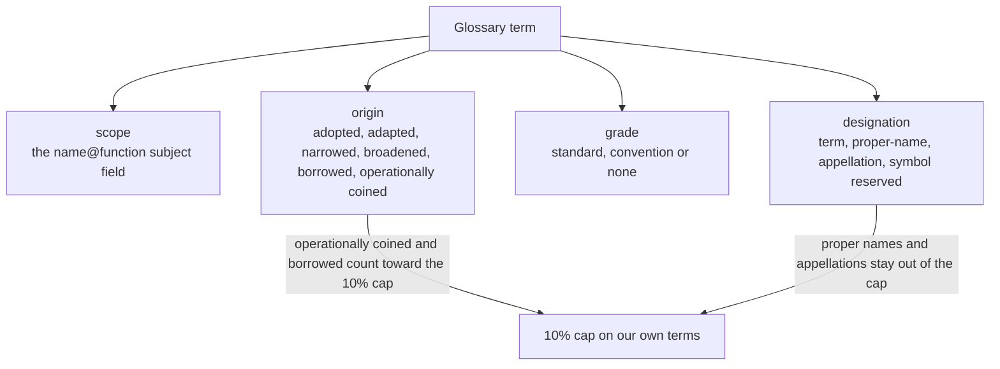

# Naive glossary term labels: scope, origin, grade and designation

This file preserves six decisions Torian made on Nov 2, 2026 about the labels a Naive glossary term carries. Until now they lived only in Grok Bot's memory. Each blockquote is one of Grok Bot's stored memory facts, copied character for character from `grok-memory/term-labels.txt` on the branch `preserve/sources-2026-11-03`. They are Grok Bot's records of Torian's decisions, not his own words. It is not yet reconciled with main: nothing reads the decision text, and the glossary, `docs/ontology.json` and the term engine have not been checked against it. Reconciling it is a separate, later step.

## 1. Three labels: scope, origin and grade (ledger N-051, Grok audit M5)

> As of Nov 2, 2026, Torian decided Naive glossary terms carry three labels: scope (the name@function subject field), origin (a past participle computed from the SKOS mapping: adopted, adapted, narrowed, broadened, borrowed, operationally coined) and grade (source authority: standard with regulatory and codified siblings, convention with seminal sibling, or none). "Scoped sense" and "invention" are dropped, and terms of our own are "operationally coined" (still rare, under the cap).

Recorded in Grok Bot's profile memory on 2026-11-03.

## 2. A fourth label: designation (ledger N-052, Grok audit M6)

> As of Nov 2, 2026, Torian decided Naive glossary terms carry a fourth label, designation (ISO 1087:2019: term, proper-name, appellation, symbol reserved). Everything Ecosystem, Product Anatomy and Succession Matrix are proper names, each checked to have exactly one referent and linked by instance_of; proper names stay out of the 10% cap.

Recorded in Grok Bot's profile memory on 2026-11-03.

## 3. Designation of product, venture and company names (ledger N-053, Grok audit M7)

> As of Nov 2, 2026, Torian decided in the Naive glossary that product names have designation appellation, while venture and company names have designation proper-name; both stay out of the 10% cap.

Recorded in Grok Bot's profile memory on 2026-11-03.

## 4. When origin is "adopted" (ledger N-054, Grok audit M8)

> As of Nov 2, 2026, Torian decided a Naive glossary term's origin is "adopted" only when the source's definition is quoted; without a quote it is "adapted".

Recorded in Grok Bot's profile memory on 2026-11-03.

## 5. What counts toward the 10% cap (ledger N-055, Grok audit M9)

> As of Nov 2, 2026, Torian decided operationally coined and borrowed Naive glossary terms count toward the 10% cap on our own terms, and proper names do not.

Recorded in Grok Bot's profile memory on 2026-11-03.

## 6. Standards first, and how intake checks a draft (ledger N-056, Grok audit M10)

> As of Nov 2, 2026, Torian decided Naive glossary terms prefer standards, accept conventions, and allow inventions only rarely; intake pulls candidate terms from cited standards and a draft fails unless its standard resolves to a reference record with a typed SKOS match (exact, close, or deliberate difference with reason). He wants sibling grades considered, using Thinking, Fast and Slow (System 1/System 2) as an example of inventions that became conventions.

Recorded in Grok Bot's profile memory on 2026-11-02.
