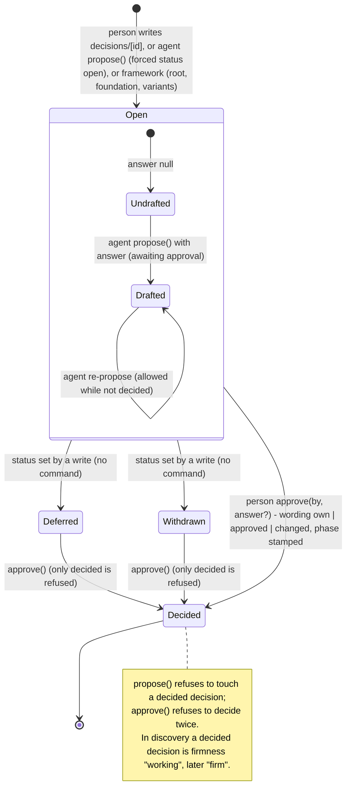
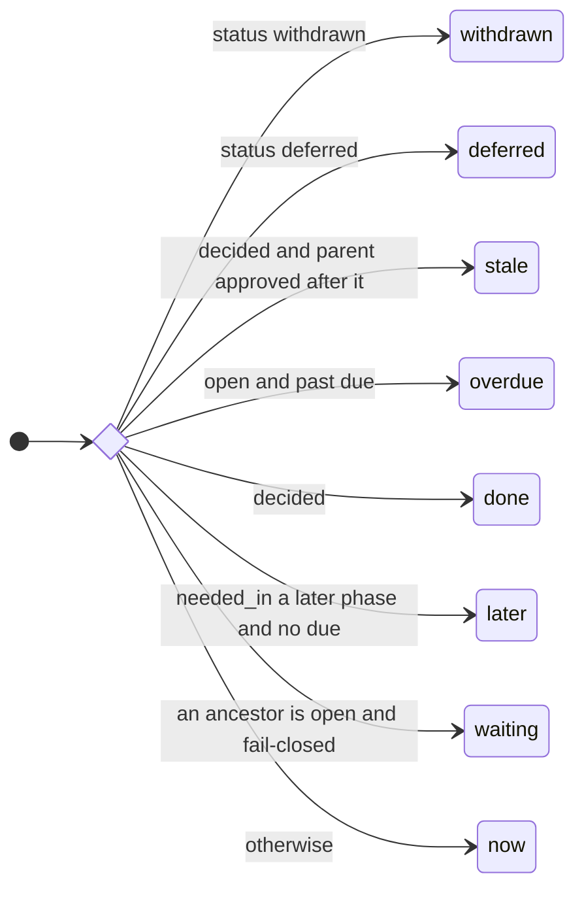

# Decisions

Source: `schema/decisions.mjs` (`decisions`, `propose`, `approve`, `holding`, `locked`, `actionFor`), `schema/decision-record.schema.json`, `schema/gate-drafts.mjs` (variants decisions), `interface/cli/mentura.mjs` (`propose`, `decide`).

The task brief names the states open -> drafted -> decided. The code stores four statuses (`open`, `decided`, `deferred`, `withdrawn`); "drafted" is not a status but `open` with an agent-written `answer` (`awaiting: "approval"`). The chart shows both the stored status and the derived `render`.

Derived render (computed every read, in this priority order):

Effects on other machines

- `waiting`, `stale`, or `open` + `fail-closed` on a record -> `holding()` turns an agent's write of that record into a draft (record-write chart, DecisionHold).
- Any status other than `decided`/`withdrawn` with `unlocks` -> `locked()` refuses agent writes and runs on those routes.
- A held write with variants creates a `variants-*` decision (`boundary: fail-open`); `settle()` approves it on accept.
