# Venture development lifecycle

Source: `schema/lifecycle.mjs` (`lifecycle`, `meet`, `advance`), `schema/freshness.mjs` `phase`, `purpose/frameworks/product-anatomy/phases.json`, `interface/cli/naive.mjs` (`naive phase`), `interface/cli/freshness.mjs` (`mentura phase`).

```mermaid
stateDiagram-v2
    direction LR
    [*] --> discovery: naive init
    discovery --> validation: gate "Problem-solution fit"
    validation --> beachhead: gate "Product-market fit: retention holds"
    beachhead --> scale: gate "Repeatability"
    scale --> platform: gate "Market leadership with healthy margins"
    platform --> [*]: "Others build on it" (last phase)

    validation --> discovery: back, needs --reason
    beachhead --> discovery: back, needs --reason
    scale --> discovery: back, needs --reason
    platform --> discovery: back, needs --reason
    note right of discovery
        Any backward move is allowed with --reason (not only to discovery).
        Skipping forward needs --override.
    end note
```

The gate inside each phase:

```mermaid
stateDiagram-v2
    [*] --> NoCriteria: telos has no exit_criteria for this phase
    NoCriteria --> Unmet: person writes exit criteria in foundation/telos
    Unmet --> Unmet: meet(id) by a person, others still unmet
    Unmet --> Ready: meet() of the last criterion (met = at, by, evidence)
    Ready --> Advancing: advance(next) by a person
    Unmet --> Advancing: advance(next, --override why)
    NoCriteria --> Advancing: advance(next, --override why)
    Advancing --> Refused: actor is an agent / not a phase / same phase / venture.json fails schema
    Advancing --> NextPhase: freshness.phase() writes venture.json, provenance, a phase event
    NextPhase --> [*]: per-phase-profile records go stale; core product scaffolded when leaving discovery
```



Notes

- Exit criteria live per venture in the telos, not in `phases.json`. A phase with no criteria is never `ready`; it can only be left with `--override`.
- `meet()` and `advance()` refuse an agent; an agent can only propose.
