# Port (plan -> apply)

Source: `schema/port-venture.mjs` (`planOne`, `plan`, `apply`, `trace`), `interface/cli/naive.mjs` (`naive port`).

```mermaid
stateDiagram-v2
    [*] --> Planning: naive port <folder> --venture <dir> [--to]
    Planning --> Error: not a directory / no venture.json / venture inside folder
    Planning --> Move: checks pass
    Planning --> Leave: dest exists / dest inside source / other disk / source id taken / another item uses id or dest
    Move --> Leave: founder edits action to leave
    Leave --> Move: founder edits action back (rechecked only at apply)
    Move --> Move: re-plan same folder replaces the item
    Move --> Applying: --apply --confirm port

    state Applying {
        [*] --> Precheck: every move item checked before any moves
        Precheck --> Aborted: source gone / inode or device changed / dest exists / source id in sources.json / busy without --even-if-busy
        Precheck --> Renaming: all items pass
        Renaming --> Renaming: rename, add read-only filesystem source, provenance "port", mark done, rewrite plan
    }
    Applying --> Done: item.done = timestamp
    Aborted --> Move: nothing moved; write the plan again
    Done --> [*]
    Leave --> [*]
    Error --> [*]
```

Plan item lifecycle (one item per source folder in `<venture>/.release/port-plan.json`):

Every run (plan or apply, success or error) writes `.release/port-trace.json`; with `LANGSMITH_API_KEY` set it uploads it.

Warnings are carried on the item but do not change its state: linked worktree, worktrees pointing at the old path, uncommitted changes, symlinks into the folder, processes inside it.
