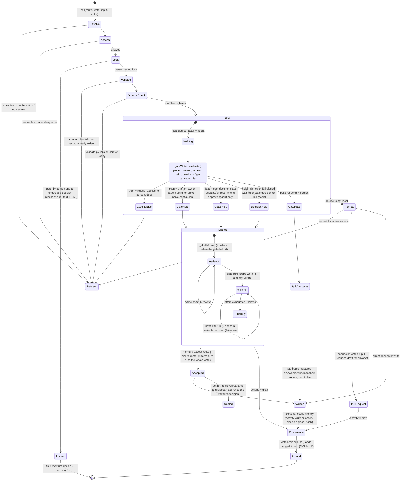

# Record write flow

Source: `interface/router.mjs` `callInAction` (write branch), `interface/gate-hooks.mjs`, `schema/gate.mjs` `evaluate`, `schema/gate-drafts.mjs`, `schema/decisions.mjs` `holding`/`locked`, `interface/cli/mentura.mjs` `accept`.

Notes

- A person is never held, only refused (`gateWrite` returns null for a person unless the verdict is `refuse`). Locks (`locked()`) also skip persons.
- Order matters: the schema check runs before any gate, so a refused or held write never reaches storage.
- Accept is a second full write with `actor: "person"`: the draft is re-validated and re-gated, so a rule that refuses persons also blocks acceptance.
- Remote sources skip `holding()` and `gateWrite()` entirely (`!remote` guards). A gated record mastered in GitHub is never held by the local gate; only the pull request holds it.
