# Releases (build, add, start, export)

Source: `schema/releases.mjs` (`survey`, `build`, `add`, `exportRelease`), `schema/build-release.mjs`, `schema/start-release.mjs`, `schema/release-read.mjs`.

Release lifecycle:

```mermaid
stateDiagram-v2
    [*] --> NoRelease
    NoRelease --> Surveying: naive build
    Surveying --> Blocked: an open package needs a record that is an unconfirmed agent write, a waiting draft, or changed since confirmed; or a check fails
    Blocked --> Surveying: confirm / accept / rewrite (fix commands named), build again
    Surveying --> DryRun: --dry-run (manifest returned, nothing written)
    Surveying --> Released: write .release/ (release.json, records/, card.json) + provenance "release"
    Released --> Surveying: naive build (full rebuild, new release id)
    Released --> Released: --add <collection item route> (C-18), new release id, rest untouched
    Released --> Serving: naive start (127.0.0.1, read-only, re-reads manifest per request)
    Released --> Exported: --export <out> (plain files, no holes)
    NoRelease --> NoRelease: naive start / --add refused, "build one first"
```

How each venture file is classified during the survey:

```mermaid
stateDiagram-v2
    direction LR
    state kind <<choice>>
    [*] --> kind
    kind --> NotShipped: idea-dump, raw, venture-package, provenance, _private, _drafts, notes
    kind --> Hole: open or deferred decision, money-account, data-stream, attribute mastered elsewhere, live command (H-4)
    kind --> Frozen: confirmed by a person and sha256 unchanged since; decided decision
    kind --> Blocker: unconfirmed or changed, required by an open package
    kind --> LeftOut: unconfirmed, not required by an open package; withdrawn decision
```

