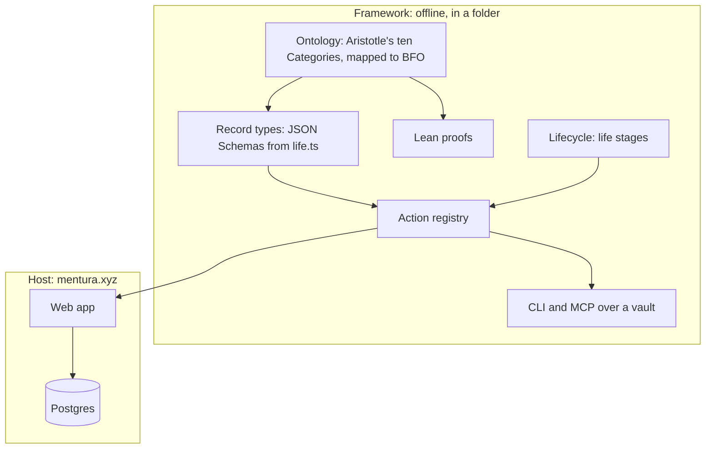

# Reflect as a framework for a life

Status: proposed on 2026-11-19 and being built one PR at a time. Built: steps 1 and 2, the ontology with its check, and a JSON Schema for every life record kind. Not built: steps 3 to 5, and nothing reads the schemas yet.

Torian asked for this on 2026-11-19: "I would actually like to build reflect also as a framework for personal and life aspect such as we built it for ventures; this time using aristotle for our formal ontologies." On the decision card he chose to give Reflect its own ontology and checker in Naive's file format, so it can move onto the shared kernel once that is lifted out of Naive.

## The split

Naive is a framework for ventures and Mentura hosts it. Reflect is built the same way for a person:

- **The framework** is everything that works offline in a folder, with no account and no named vendor. That covers record types, the ontology, checks, Lean proofs, the `reflect` CLI and an MCP server over a vault, and the life stages as the lifecycle. It lives in `packages/core`, `packages/cli` and `lean/`.
- **The host** is the web app at mentura.xyz. It keeps the same records in Postgres and adds sign-in, sharing and outside services.

Personal life stays outside the Everything Ecosystem (EE-009), so the framework stays in this repository.

## The ontology

The ontology is `packages/core/src/terms/ontology.json`, in Naive's format (`packages/naive/src/terms/ontology.json` in tchjhnsn/naive): `top_categories`, each with a BFO class and IRI, and `nouns`, each with a meaning, a standard, a status and `broader`. Reflect's nouns have `app` where Naive's have `function`, and `kinds`, the life record kinds about each noun.

**The top categories are Aristotle's ten Categories** (*Categories* 4, 1b25-2a4, in Ackrill's translation). BFO (ISO/IEC 21838-2) is the standard upper ontology and is itself realist in Aristotle's line, so each category cites the BFO class closest to it:

| Category | Greek | BFO class | Life examples |
|---|---|---|---|
| substance | ousia | independent continuant | a person, a friend, a household, a meal |
| quantity | poson | quality | income, a budget, body measures |
| quality | poion | specifically dependent continuant | a virtue, a craft, health, an interest |
| relation | pros ti | relational quality | an end, citizenship, standing, a duty |
| place | pou | site | where one lives |
| time | pote | temporal region | none yet |
| position | keisthai | quality | none yet |
| having | echein | role | a need (a privation), a credential, an estate plan |
| doing | poiein | process | work, a purchase, a choice, a date |
| being affected | paschein | process | a life change |

Three readings of Aristotle shaped the mapping:

- A need is filed under having, because a need is a privation, the lack of a having (*Categories* 10, 12a26).
- A choice is filed under doing, because choice is the origin of action (*Nicomachean Ethics* VI.2, 1139a31).
- An end is filed under relation, because it is that for the sake of which (*Physics* II.3).

Good itself is not one category. It is said in as many ways as being (*Nicomachean Ethics* I.6, 1096a23), so the three kinds of goods became a separate field in step 2: each noun names its `good` (body, external or soul) and its `community` (person, union, household, village or polis), and the check refuses any other value (G1 and C1).

A noun names what a record is about, not the record. Naive learned this the hard way (EE-125): its `product` noun had named the card rather than the thing.

**The check** is `checkOntology` in `packages/core/src/terms/ontology.ts`, tested in `ontology.test.ts`. Its rules carry Naive's names:

- U1: no broader cycles.
- U3: no orphans.
- U4: every noun reaches exactly one category.
- B1: each BFO class matches its IRI.
- K1: every life kind is listed by exactly one noun.
- K2: every listed kind exists.

It also refuses top categories that are not Aristotle's ten. U2, a top category with something broader, cannot happen in this format. `categoryOfKind(app, kind)` gives the category of any life record kind.

What is not built yet:

- Records that are themselves information, such as journal entries, reflections and the chat, are not in the ontology. Aristotle classifies beings and has no category for information. A written record is an artifact whose content is speech, which he counts as a discrete quantity (*Categories* 6, 4b23). BFO files it as a generically dependent continuant. This needs a ruling before those records join.
- The term engine, which in Naive checks each term's properties label-blind, has not been copied. The check above is structural only.

## Build order

One PR each:

1. **The ontology and its check.** Built.
2. **A JSON Schema for each record type,** generated from `life.ts` and `life-body.ts`. Each type carries its noun, its category, its kind of good (body, external or soul, *Nicomachean Ethics* I.8, 1098b12) and its community (person, union, household, village or polis, *Politics* I.2). Built: `packages/core/src/life-schemas.ts` derives them and `pnpm schemas` in `web/` writes them to `packages/core/schemas/life/<app>.<kind>.schema.json` (`--check` fails on a stale file).

   How goods and communities were assigned:
   - Goods follow the apps' grouping in `REFLECT_UI_2026-11-12.md`: Body and Home are goods of the body, and the rest are external.
   - Virtue, craft, interest, preference and end are goods of the soul even though Work and Legacy keep them, because the goods of the soul are its virtues and activities (1098b14).
   - Home's money and property (budget, belongings, purchases, life changes) are external, because Aristotle counts wealth as an external good (1099a31-b2).
   - Communities (*Politics* I.2): the union is the couple (seeking a mate, dates, 1252a26). The household meets everyday wants: needs, meals, firearms, ways of getting around, belongings, purchases, the basket, income, the budget, life changes and the estate plan (1252b13). The village is the colony of the household: relatives beyond it, and the place one lives (1252b17). The polis holds work, credentials, ventures, friends and friend groups, admired people, citizenship, standing, duties and elections, since friendship and exchange hold the city together (*Nicomachean Ethics* VIII.1, 1155a22; V.5, 1132b33). The rest belong to the person alone.
   - Step 1 named `home:card` a payment card. It is a Home card, a small card shown on Home for a time (`src/home-cards.ts`), so its noun is now `home card`, an artifact, external and the person's.
3. **Lean proofs,** with no Mathlib, following NTS and Naive:
   - every noun has exactly one category;
   - `serves` links between intents and ends form no cycle (*Nicomachean Ethics* I.2: the chain of ends cannot go on without limit);
   - every chosen means reaches a stated telos;
   - the communities nest.
4. **The action registry moved from `web/` into core,** so the CLI and an MCP server over a vault get the same routes as the app, the way Naive's router serves its CLI, MCP and API.
5. **The life stages as the framework's lifecycle,** like Naive's phases: the Ventures of a Lifetime statechart in `packages/core/src/lifetime.ts`, with soft gates (decided 2026-11-12).
