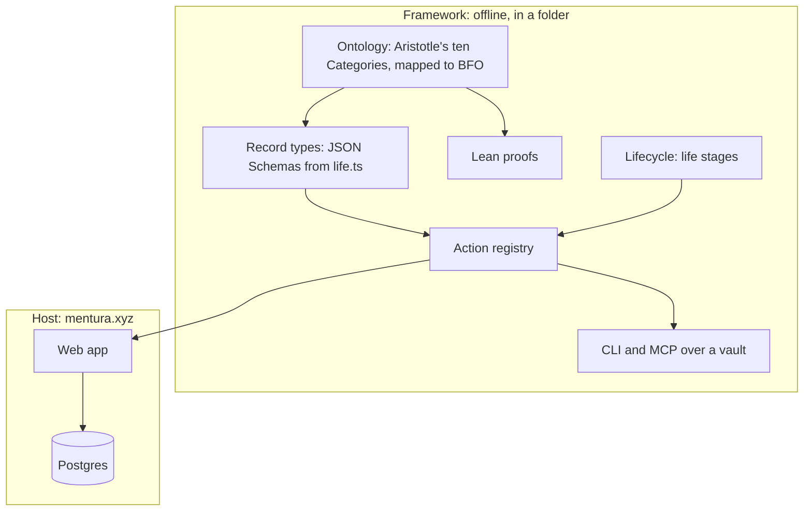
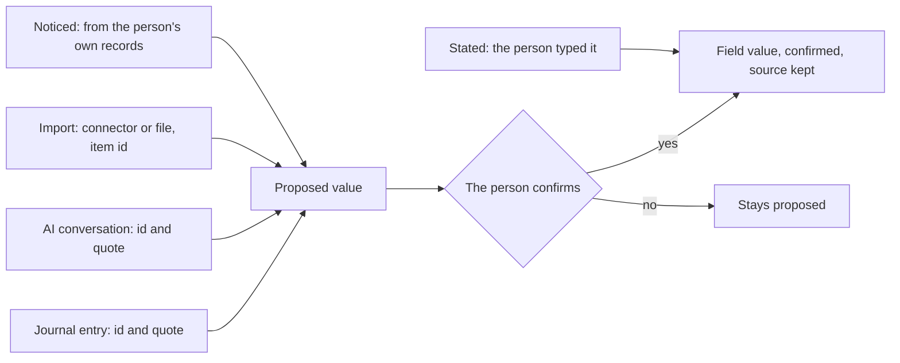
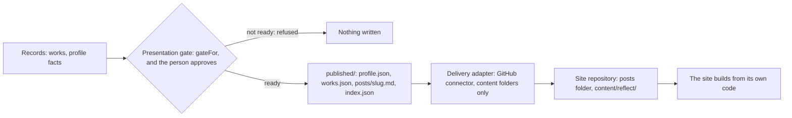

# Reflect as a framework for a life

Status: proposed on 2026-11-19 and built one PR at a time. Built: steps 1 to 5, the ontology with its check, a JSON Schema for every life record kind, the Lean proofs, the action registry and runner in core (`src/registry.ts`, `reflect actions`, `reflect act`, `reflect mcp` over a vault), the life stages as the lifecycle (`src/lifecycle.ts`, `reflect stage`), and the presentation gate in core, the CLI and the web app's site publish, with what passes it written as files to `published/` (step 6: `src/presentation.ts`, `src/published.ts`, `reflect present`, `reflect publish`, `publish_to_site`). Built on 2026-11-20: a JSON Schema for the person record, and sources as a closed enumeration for every field value (see "Sources of a value"). Not built: most of the app's actions are still declared in `web/` (only the journal's four moved, because their stores have a files host), and the audit of the app's stored life records (`pnpm check:life` in `web/`) was run on the dev database on 2026-11-20 (234 of 234 stored bodies pass) and not yet on production. A vault's three life kinds (friends, groups and offices) are checked by `reflect check`, and the web app checks every kind's body against its schema before each write and on each read (`web/src/server/life-validate.ts`).

Torian asked for this on 2026-11-19: "I would actually like to build reflect also as a framework for personal and life aspect such as we built it for ventures; this time using aristotle for our formal ontologies." On the decision card he chose to give Reflect its own ontology and checker in Naive's file format, so it can move onto the shared kernel once that is lifted out of Naive.

## The split

Naive is a framework for ventures and Mentura hosts it. Reflect is built the same way for a person:

- **The framework** is everything that works offline in a folder, with no account and no named vendor. That covers record types, the ontology, checks, Lean proofs, the `reflect` CLI and an MCP server over a vault, and the life stages as the lifecycle. It lives in `packages/core`, `packages/cli` and `lean/`.
- **The host** is the web app at mentura.xyz. It keeps the same records in Postgres and adds sign-in, sharing and outside services.

Personal life stays outside the Everything Ecosystem (EE-009), so the framework stays in this repository.

## The ontology

The ontology is `packages/core/src/terms/ontology.json`, in Naive's format (`packages/naive/src/terms/ontology.json` in tchjhnsn/naive): `top_categories`, each with a BFO class and IRI, and `nouns`, each with a meaning, a standard, a status and `broader`. Reflect's nouns have `app` where Naive's have `function`, and `kinds`, the life record kinds about each noun.

**The top categories are Aristotle's ten Categories** (*Categories* 4, 1b25-2a4, in Ackrill's translation). BFO (ISO/IEC 21838-2) is the standard upper ontology and is itself realist in Aristotle's line, so each category cites the BFO class closest to it:

| Category | Greek | BFO class | Life examples |
|---|---|---|---|
| substance | ousia | independent continuant | a person, a friend, a household, a meal |
| quantity | poson | quality | income, a budget, body measures |
| quality | poion | specifically dependent continuant | a virtue, a craft, health, an interest |
| relation | pros ti | relational quality | an end, citizenship, standing, a duty |
| place | pou | site | where one lives |
| time | pote | temporal region | none yet |
| position | keisthai | quality | none yet |
| having | echein | role | a need (a privation), a credential, an estate plan |
| doing | poiein | process | work, a purchase, a choice, a date |
| being affected | paschein | process | a life change |

Three readings of Aristotle shaped the mapping:

- A need is filed under having, because a need is a privation, the lack of a having (*Categories* 10, 12a26).
- A choice is filed under doing, because choice is the origin of action (*Nicomachean Ethics* VI.2, 1139a31).
- An end is filed under relation, because it is that for the sake of which (*Physics* II.3).

Good itself is not one category. It is said in as many ways as being (*Nicomachean Ethics* I.6, 1096a23), so the three kinds of goods became a separate field in step 2: each noun names its `good` (body, external or soul) and its `community` (person, union, household, village or polis), and the check refuses any other value (G1 and C1).

A noun names what a record is about, not the record. Naive learned this the hard way (EE-125): its `product` noun had named the card rather than the thing.

**The check** is `checkOntology` in `packages/core/src/terms/ontology.ts`, tested in `ontology.test.ts`. Its rules carry Naive's names:

- U1: no broader cycles.
- U3: no orphans.
- U4: every noun reaches exactly one category.
- B1: each BFO class matches its IRI.
- K1: every life kind is listed by exactly one noun.
- K2: every listed kind exists.

It also refuses top categories that are not Aristotle's ten. U2, a top category with something broader, cannot happen in this format. `categoryOfKind(app, kind)` gives the category of any life record kind.

Records that are themselves information, such as journal entries, reflections, AI conversations and imports, are not nouns. Torian ruled on 2026-11-20 (04:15Z) that they are where a field gets its data from: sources of field values, not nouns in the life ontology. Aristotle classifies beings and has no category for information. A written record is speech set down, which he counts as a discrete quantity (*Categories* 6, 4b23), but it is about the person rather than a part of their life. BFO files it as a generically dependent continuant (BFO_0000031) and IAO as an information content entity. The ontology lists them under `sources`, outside the ten Categories, and two rules check it:

- S1: no noun shares a name with a record listed under sources.
- S2: the sources' BFO class is generically dependent continuant.

What is not built yet:

- The term engine, which in Naive checks each term's properties label-blind, has not been copied. The check above is structural only.

## Sources of a value

A field's value comes from somewhere. Every value Reflect keeps, in a life record or in the person record, names one source from a closed set, `SOURCE_KINDS` in `packages/core/src/value-source.ts`. The words follow W3C PROV: the value was derived from the source (`prov:wasDerivedFrom`), and it is the person's once they confirm it.

| Kind | What it is | What it carries |
|---|---|---|
| `stated` | the person typed it into the field | nothing more |
| `journal` | a journal entry | the entry's id and the words quoted from it |
| `conversation` | a conversation with an AI | the conversation's id and the words quoted from it |
| `import` | a connector or an uploaded file | its name and the item's id there |
| `noticed` | Reflect proposed it from the person's own records | the ids of those records |

A stated value is confirmed from the start. Every other source starts proposed and stays proposed until the person confirms it. Confirming never changes the source. `lean/Reflect/Sources.lean` proves that every kind other than stated starts proposed.

- **In a life record,** a body may carry `_sources`, an object from a declared field key to its source. Every life schema declares it and shares one source schema as `$defs.source`. The name starts with an underscore because it is data about the body, not a field: no field key starts with one (the generator refuses such a key), so it cannot clash. An `x-` name was rejected because `x-` belongs to a schema's own annotations, such as `x-reflect`, not to the records the schema describes. A field with no source was typed by the person. `reflect check` checks `_sources` in a vault's friend, group and office notes, where it is one line of JSON in the front matter.
- **In the person record,** every fact, relationship and hold has a source. Its JSON Schema is `packages/core/schemas/person.schema.json`, generated from `PersonState` by `pnpm schemas` in `web/` (`--check` fails when it is stale). It carries noun person, category substance, an external good and the person's community. A vault's `person.json` holds only the person's id and name, and the files host keeps no facts, relationships or holds (the web app keeps them in Postgres), so `reflect check` validates them only when a `person.json` holds them. The tests validate the schema against fixtures.
- **Older values still read:** a missing source is stated, person.ts's old `fromJournal` is journal, and the interest model's told and imported are stated and import. No database migration was needed: the app's person tables already store `stated`, and interest records keep their text.
- **Choices:** every field of kind `choice` in `life.ts` emits `enum` with its option ids, and a test checks it.

Not built:

- No path writes a non-stated source yet. Nothing proposes a value from a journal entry, a conversation, an import or what Reflect noticed, and the app shows no Confirm. The types, schemas, checks and proof are ready for it.
- The web app's life record write path does not yet check `_sources`; schema validation there is a separate change.
- New interest records are still written with source `told` in the app (`web/src/server/actions/interests.ts`), which reads as stated. The interest record's levels and its source are text fields, not choices: making them choices would refuse records already stored with older values.
- The person record in Postgres stores the source as one word, with no entry id or quote.

## Build order

One PR each:

1. **The ontology and its check.** Built.
2. **A JSON Schema for each record type,** generated from `life.ts` and `life-body.ts`. Each type carries its noun, its category, its kind of good (body, external or soul, *Nicomachean Ethics* I.8, 1098b12) and its community (person, union, household, village or polis, *Politics* I.2). Built: `packages/core/src/life-schemas.ts` derives them and `pnpm schemas` in `web/` writes them to `packages/core/schemas/life/<app>.<kind>.schema.json` (`--check` fails on a stale file). `reflect check` validates a vault's life records against them (`packages/core/src/life-check.ts`), and the `life_schema` action returns one kind's schema to the CLI, a vault's MCP server and the app's.

   How goods and communities were assigned:
   - Goods follow the apps' grouping in `REFLECT_UI_2026-11-12.md`: Body and Home are goods of the body, and the rest are external.
   - Virtue, craft, interest, preference and end are goods of the soul even though Work and Legacy keep them, because the goods of the soul are its virtues and activities (1098b14).
   - Home's money and property (budget, belongings, purchases, life changes) are external, because Aristotle counts wealth as an external good (1099a31-b2).
   - Communities (*Politics* I.2): the union is the couple (seeking a mate, dates, 1252a26). The household meets everyday wants: needs, meals, firearms, ways of getting around, belongings, purchases, the basket, income, the budget, life changes and the estate plan (1252b13). The village is the colony of the household: relatives beyond it, and the place one lives (1252b17). The polis holds work, credentials, ventures, friends and friend groups, admired people, citizenship, standing, duties and elections, since friendship and exchange hold the city together (*Nicomachean Ethics* VIII.1, 1155a22; V.5, 1132b33). The rest belong to the person alone.
   - Step 1 named `home:card` a payment card. It is a Home card, a small card shown on Home for a time (`src/home-cards.ts`), so its noun is now `home card`, an artifact, external and the person's.
3. **Lean proofs,** built, with no Mathlib, following NTS and Naive:
   - every noun has exactly one category;
   - `serves` links between intents and ends form no cycle (*Nicomachean Ethics* I.2: the chain of ends cannot go on without limit);
   - every chosen means reaches a stated telos;
   - the communities nest.

   Built in `lean/` (see `lean/README.md`): the ontology is generated into Lean from `ontology.json` by `scripts/ontology-lean.ts` with a certificate the kernel checks by `decide`; serves links and choices are abstract models with checkers whose success gives well-foundedness, no cycle and a telos for every choice; the communities form a strict total order. Not built: generating a plan from a person's records and checking it, which waits for step 2. `.github/workflows/lean.yml` runs `lake build` and the generated file's staleness check in CI.
4. **The action registry moved from `web/` into core,** so the CLI and an MCP server over a vault get the same routes as the app, the way Naive's router serves its CLI, MCP and API.
5. **The life stages as the framework's lifecycle,** like Naive's phases: the Ventures of a Lifetime statechart in `packages/core/src/lifetime.ts`, with soft gates (decided 2026-11-12).
6. **The presentation gate,** built in core, the CLI and the web app's site publish, with its output as files (`published/`); see below for what is not built. Torian asked on 2026-11-19: "how should a man present himself before others given any given circumstance?" He wants the context of the public viewing asked whenever anything enters public view, in person or online, with Aristotle, Dale Carnegie and C. S. Lewis as his teachers. He sees it as the personal form of Naive's publication gate (EE-025), so it is modelled on that gate.

## Step 6: the presentation gate

### What Aristotle gives

- **Fittingness.** *To prepon* (*Rhetoric* III.7): what is said and how it is said should fit the speaker, the subject and the audience.
- **The six circumstances of an action** (*Nicomachean Ethics* III.1, 1111a3-6): who acts, what is done, about what or to whom, by what means, for what end, and how. *Nicomachean Ethics* II.6 (1106b21) puts the mean the same way: at the right time, about the right things, toward the right people, for the right end, and in the right way.
- **The occasion.** *Rhetoric* I.3 gives three kinds: deliberating about the future, judging the past, and praise or ceremony.
- **Ethos** (*Rhetoric* II.1): the audience trusts good sense, good character and goodwill. Carnegie's principles mostly concern goodwill. Lewis's chapter on pride in *Mere Christianity* ("The Great Sin") is Aristotle's boaster seen from the other side.
- **The virtues of social life** (*Nicomachean Ethics* IV.6-9), each a mean:
  - friendliness, between flattery and quarrelsomeness;
  - truthfulness about oneself, between boasting and false modesty;
  - wit, between buffoonery and boorishness;
  - a sense of shame.

  Greatness of soul (IV.3) adds the measure for honour.
- **Two empty categories filled.** Position (how one carries oneself) and having (what one wears or carries) are the categories that cover in-person presentation.

### What Naive already has

Naive's publication policy (`publication-policy.schema.json` in tchjhnsn/naive) gives every channel:
- a destination;
- an audience;
- guidelines;
- rules for who may publish what, with a person always approving;
- checks;
- a preview.

### What the personal version adds

It has no field for the end (the purpose) or for the speaker's role. Those are the two the personal version needs.

### The design

- **A personal publication policy** in Naive's format: `presentation-policy.json` in the vault, shaped like Naive's publication policy, and kept as Reflect's own copy as decided for the ontology.
  - Its channels are the person's own: the personal site (tcjcafe.com through Settings, Your site, Your own site on GitHub), the Reflect profile, social accounts, email, and **in person**, a channel with no destination URL.
  - The approver is always the person.
- **Two new fields on a channel's rule:**
  - `role`: the speaker's role there, such as founder, friend, citizen or son.
  - `end`: what the appearance is for.
- **A presentation record** (noun `presentation`, category doing) for each appearance. It holds:
  - the channel;
  - the six circumstances;
  - the occasion kind;
  - the audience, with the person's relation to them;
  - the virtue at stake, and the two faults it sits between;
  - afterwards, how it went.
- **The gate itself.** A publishing action held by the runner (`holds` in `packages/core/src/registry.ts`) stays held until its presentation record names the end, the role and the audience, and the person approves it. An agent may draft and check, but it never approves, as in Naive.
- **Shared with Naive.** `end` and `role` are proposed for Naive's channel rules too, as Naive's own change in its own PR. A venture speaks as someone for some end as well.

### Built

- **The policy:** `packages/core/src/presentation.ts` (`PresentationPolicy`, `parsePresentationPolicy`, `checkPresentationPolicy`, `defaultPolicy`) and `packages/core/schemas/presentation-policy.schema.json`. It keeps Naive's keys, adds `role` and `end` to each rule, has the `in-person` kind with no destination, and refuses any approver but the person. The default has the personal site, the Reflect profile, social, email and in person.
- **The record:** noun `presentation` under doing in `packages/core/src/terms/ontology.json`, with no life kinds (it is not a life record kind), so K1 and K2 hold unchanged; good of the soul, community polis. `Presentation` and `packages/core/schemas/presentation.schema.json` hold the channel, the six circumstances, the occasion, the audience with the relation, the virtue with its two faults and the afterward. A vault keeps it at `presentations/<id>.json` through `packages/core/src/files-presentations.ts`, and `reflect check` checks it.
- **The gate:** `gateFor(policy, record, channelId)` is ready or names the missing items (the end, the role, the audience, a channel rule that matches). In `packages/core/src/registry.ts` an action declared with `publishes: <channel>` is always held, from any source, with the gate in its preview; `approveChange` runs it only when the gate is ready and the approver is the person (an agent source is refused with `person-only`).
- **Drafting and checking:** vault actions `draft_presentation` and `check_presentation`, and `reflect present <channel>`, `reflect present check <id>` and `reflect present after <id>`.

### Reflect outputs files

Torian decided on 2026-11-20 (03:16Z, "Files out, no site code") that Reflect does not build websites. Reflect controls the gate for content about the person, and its output is JSON and Markdown files, the way headless Naive outputs records. A site, such as tcjcafe.com (a Next.js blog in its own repository, designed with Virtu), reads those files. The site's code is written in its own repository, with Claude Code or Virtu, and never from Reflect.

- **The folder:** `published/profile.json` holds the public profile facts the person approved; `published/posts/<slug>.md` holds one post, Markdown with YAML front matter (title, date, updated, slug, summary, kind, tags when there are any, the presentation record and its channel); `published/index.json` is the manifest, each file with its sha256, the presentation record, the channel, when it was approved and `approved_by: "person"`. JSON Schemas: `packages/core/schemas/published-index.schema.json`, `published-post.schema.json` and `published-profile.schema.json`.
- **Works by their end (2026-11-20):** Torian decided, in the founder scholarship thread at 04:32Z and 04:35Z, that the personal site reads the person's works from Reflect, sorted by Making, Knowing and Doing. A work is sorted by its end (Nicomachean Ethics VI.4; Metaphysics VI.1): making has a product as its end, knowing truth, doing the action itself. Research is knowing. Writing goes by its end: an essay or story is making (section writing), a paper that establishes a finding is knowing (section research). Projects is a section of making. A vault keeps each work at `making/<id>.json`, `knowing/<id>.json` or `doing/<id>.json` (`packages/core/src/works-by-end.ts`, `work-record.schema.json`), with its title, section, disclosure, summary, sources (each a connector and a URL: GitHub, Etsy, Behance, Substack, the reading list, the calendar), status, last activity, foreshadow line, pinned and links. `publishWorks` writes `published/works.json` (`published-works.schema.json`), and the site's repository keeps it at `content/reflect/works.json`. A public work goes out in full; a foreshadowed one as its end, section and one line, with no id or title; a private one never. `lean/Reflect/Works.lean` proves those three. `reflect work` keeps a work and `reflect publish works` asks to publish them.
- **Only through the gate:** `publishPost`, `publishProfile` and `publishWorks` in `packages/core/src/published.ts` ask `gateFor` first and refuse with `not-presented`; a host writes only a publication they made. Unpublish takes the file and its manifest entry out, with no gate, since it removes content.
- **In a vault:** the vault action `publish_files` (`publishes: "personal-site"`) writes a post from one of the person's Markdown works (an essay, letter, plan or memoir, never the journal) or the profile; `unpublish_files` takes one out. `reflect publish <work.md>`, `reflect publish profile`, `reflect publish list` and `reflect unpublish <slug>` run them. A publish is held, and the person approves it with `reflect approve <change id>` (source `cli`, which is not an agent source); `reflect decline` declines one. `reflect check` checks `published/` against the schemas and the manifest's hashes.
- **In the app:** `publish_to_site` builds the post file and the manifest with the same core functions, so the app and a vault write the same bytes for the same work, record and approval (a test checks this).
- **Delivery is content only:** the app commits only the `published/` files into the site's repository: posts into the posts folder that linking found (`findPostsPlace`), `profile.json` and `index.json` into a data folder, `content/reflect/` unless the person names another. Any other path is refused (`contentPath`, `insideContent`).
- **No site code from Reflect:** `site_edit` is gone, `site_files` only reads, and a `connector_act` write to the linked site repository is refused with a message saying the site's code lives in its own repository. `publishesIf` and the default policy's "site owner" rule, which only those used, are gone. The "Your own site" plugin's skill reads and explains the site and never offers to change it.

- **The site publish in the web app:** the work's Publish (its post on the person's site, the post file and manifest delivered to the repository linked for tcjcafe.com, and the email to subscribers) is the registry action `publish_to_site`, with `publishes: "personal-site"` and its record named in the input field `presentation`. The app keeps presentation records and the policy in `person_fact`, with no migration (`web/src/server/presentation-store.ts`), offers `draft_presentation` and `check_presentation` on chat and MCP, and its host in `web/src/server/actions/run.ts` has a gate. The Publish sheet drafts the record (the role and end from the channel's rules, the audience, the six circumstances under a fold), shows the gate's answer, and the person's tap approves the publish (source `page`). A request from the chat or MCP waits in Ask for the person's Send.
### Not built

- In the app, the work's Publish is gated and a `connector_act` write to the site repository through GitHub is refused. These still reach the public without the gate: Push to GitHub and Deploy in Settings, Your site, the site editor's pages, and the Reflect profile. A `connector_act` write that reaches the site some other way (through Vercel, or a GitHub write that names the repository in an argument other than `owner` with `repo`, `repo`, `repository` or `full_name`) is not refused. Unpublish is not gated: it removes content. Undo of Unpublish puts the post back on Reflect only; the repository gets it again with Publish.
- The app writes no `profile.json`: its profile goes out on the Reflect profile, which is not gated. Only a vault writes `published/profile.json`.
- Works in the app: the app has no works records yet and writes no `works.json`. Filling a work's status and last activity from its sources (GitHub, Etsy, the calendar) is not built; the person sets them.
- Delivering a vault's `published/` to a site's repository from the CLI: the person commits the folder, or the site reads it where it is.
- Editing the presentation policy in the app. The app uses the default policy and writes it on the first draft.
- Approving a held change from the vault's MCP server: only the person approves, at the terminal (`reflect approve`) or in the app.
- The Naive proposal: `end` and `role` on Naive's channel rules, as Naive's own PR.
- Running each channel's checks: they are reviews the person reads, listed by `reflect present check`.
- The first test is tcjcafe.com. The founder scholarship thread is auditing it against the six circumstances.
