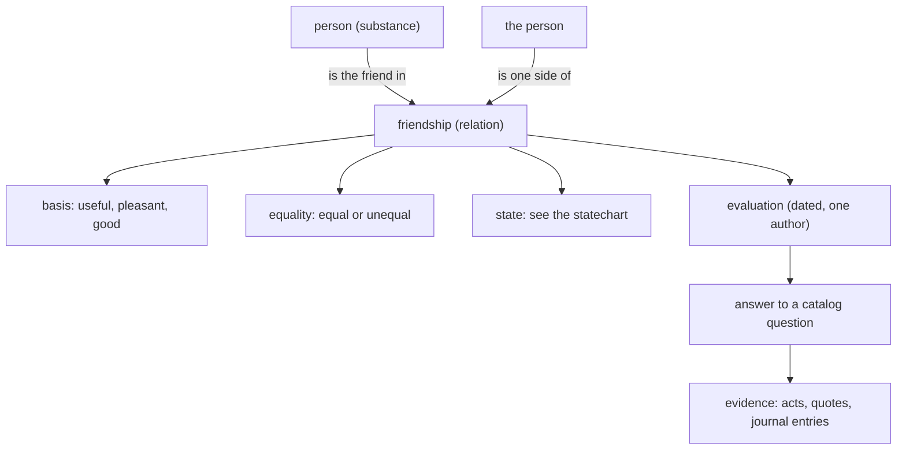
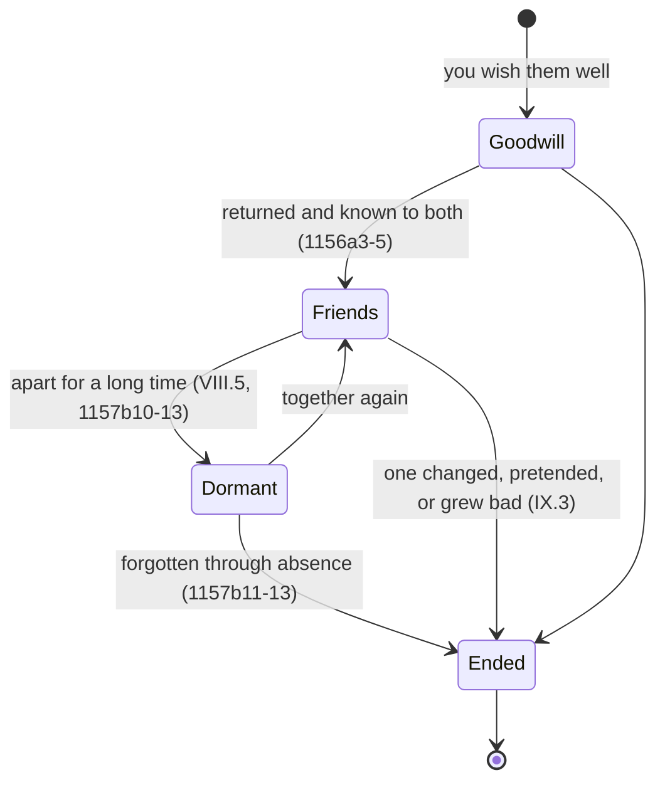

# Friendship: an ontology and an evaluation tool

Torian, 2026-11-21 16:34Z: "a formal ontology of friendships and loves using pstack. It should begin with a discussion first. What I'm looking for is a tool for evaluating and clarifying friendships. That should include questions to be asked when evaluating a friendship. Use the chapters from Aristotle's Ethics."

This is the design. Steps 1 to 4 are built (Torian, 16:57Z, "Agree, build steps 1 to 4"; see "Built" at the end); steps 5 to 7 are not. Each point says Decided (Torian said so) or Proposed (my recommendation, standing until he says otherwise). Designed with pstack's architect skill: trace what the change touches, sketch two shapes, pick the one where each piece of state has one owner.

Bekker references are checked at the page and column against Rackham's translation (Loeb 1934) as Perseus serves it by Bekker page: `node scripts/check-bekker.ts` finds words of each cited passage on its page (25 of 25 on 2026-11-21). Line numbers within a column are the standard edition's and are not machine-checked, since the translation does not carry them.

## Decided so far

- **Where it lives (16:48Z, card).** In Reflect, inside the Friends app. NTS may later model goodwill as an inner state. Concord, the friendship of fellow citizens (IX.6, 1167a22-b16), belongs to Village and polis.
- **Private first, then shared (16:51Z).** A person evaluates a friendship privately. After that private reflection they may invite the friend to evaluate it too, and both see the two sets of answers.
- **Aristotle is the base; other traditions are separate schemes mapped to it (16:51Z and 16:54Z, card).** C. S. Lewis's *The Four Loves* is one scheme. The Christian adaptation (Aquinas and Aelred of Rievaulx) is another. Each maps onto Aristotle's concepts where they agree and names where they depart.
- **Out of scope here (16:51Z).** Torian wants a course on ethics and politics. It is its own piece of work, not part of this design.

## What it touches today

- `packages/core/src/life.ts`, app `friends`: kind `friend` (name, how you met, why you call them a friend, shared habits, `kind` as Utility, Pleasure or Virtue citing NE VIII, how often you mean to see them; states acquaintance, friend, close friend, drifted; acts time together, called or wrote) and kind `group` (states visiting to leading, act attended).
- `packages/core/src/terms/ontology.json`: noun `friend`, meaning "a person one wishes well for their own sake, known to wish it back (NE VIII.2, 1155b31-1156a5)", broader `person`, category substance, good external, community polis. There is no noun for friendship itself.
- `packages/core/src/quotes.ts`: SKOS concept schemes and Web Annotation tags, the pattern for closed vocabularies with a cited source.
- The question catalog (`REFLECT_SYSTEM_2026-11-12.md`, Decided): expected questions ship as defaults the person can add to and hide.
- The private and shared split (`sides.ts`, `audience.ts`): Home is private, Village and polis is shared.

## The two shapes

**Shape A: more fields on the friend.** Put basis, equality and state on the existing `friend` record and keep answers as fields too.

**Shape B: friendship is its own record.** The friend stays a person (substance). The friendship between the person and the friend becomes a record under relation (pros ti). Evaluations are dated records that answer catalog questions with evidence.

**Proposed: shape B.** A friend is a who; a friendship is a relation between two people. Aristotle files them in different categories, and so does BFO (an object versus a relational quality). Shape A mixes them, and then breaks on three things the design needs: one person can be in more than one kind of friendship over time (IX.3, a friendship of pleasure that became one of virtue), the shared view needs a record both people stand in, and the same evaluation applies beyond friends (kin, spouses and fellow citizens are all philia in VIII.9-12). With B, each fact has one owner: the friend record owns who they are, the friendship record owns the relation, an evaluation owns what one person answered on one day.

## The ontology

New nouns (Proposed), in Naive's format like the rest of `ontology.json`:

| Noun | Category | BFO class | Meaning and source |
|---|---|---|---|
| friendship | relation | relational quality | Goodwill returned and known to both, for the sake of the useful, the pleasant or the good (VIII.2, 1155b27-1156a5) |
| goodwill | relation | relational quality | Wishing someone good for their sake, not yet returned or not yet known; the beginning of friendship (VIII.2, 1155b32; IX.5, 1166b30-1167a21) |
| friendship evaluation | sources (information) | generically dependent continuant | One person's dated answers about one friendship. Like a journal entry, it is a source of field values, not a life noun (Torian's ruling of 2026-11-20) |
| fellowship | relation | relational quality | Sharing a life toward a common end in a community (koinōnia: VIII.9, 1159b25-32; Acts 2:42). Filed on a group, not on a pair |

Fields of a friendship (Proposed):

- `with`: the friend (a person record). Shown as the friend's face with their name.
- `basis`: useful, pleasant or good (VIII.3, 1156a6-b6). Moves from the friend record to here.
- `equality`: equal, or unequal with who is the greater (VIII.7, 1158b11-28). For an unequal one, what each gives: love in proportion to worth (1158b23-28).
- `community`: the community it lives in: household, kin, fellow citizens, comrades, fellow travellers (VIII.9 and VIII.12, 1159b25-1160a8, 1161b11-16).
- `began`, and the history of state changes.

The friendship's states, as a statechart (Proposed):

The friend record's current states (acquaintance, friend, close friend, drifted) map to these: acquaintance to goodwill, friend and close friend to friends, drifted to dormant. "Close" is not a state in Aristotle; it is read from the basis (good) and from the evaluation. Existing records are kept and read through this map until they are moved.

## The schemes

Each scheme is a SKOS concept scheme with its source, as in `quotes.ts`. Mappings use SKOS mapping properties: `exactMatch`, `closeMatch`, `broadMatch`, `narrowMatch`, `relatedMatch`. A departure is a mapping with a note saying how the scheme departs.

**Aristotle (base).** Nicomachean Ethics VIII and IX.

| Concept | Source |
|---|---|
| friendship of utility | VIII.3, 1156a10-21 |
| friendship of pleasure | VIII.3, 1156a31-b6 |
| friendship of virtue (complete friendship) | VIII.3, 1156b7-32 |
| goodwill | VIII.2; IX.5 |
| equal friendship, unequal friendship | VIII.7-8 |
| concord | IX.6 (lives in Village and polis) |
| another self | IX.4, 1166a31-32; IX.9, 1170b6-7 |

**Christian: Aquinas and Aelred.**

| Concept | Source | Maps to Aristotle |
|---|---|---|
| charity, friendship of a person with God | Aquinas, *Summa Theologiae* II-II q.23 a.1 | relatedMatch friendship of virtue. Departs: Aristotle says the gap is too wide for friendship with a god (VIII.7, 1158b35-1159a5); Aquinas answers that grace gives the shared life |
| love of friendship, love of desire | *ST* I-II q.26 a.4 | love of friendship closeMatch friendship of virtue; love of desire closeMatch utility and pleasure |
| order of charity | *ST* II-II q.26 | relatedMatch "number of friends" (IX.10). Departs: charity reaches every neighbour, enemies too (Matthew 5:44), in degrees |
| spiritual friendship | Aelred, *Spiritual Friendship* I | narrowMatch friendship of virtue: virtue friendship ordered to God |
| selection, probation, admission, harmony | Aelred III | narrowMatch the states goodwill to friends: steps inside them |
| loyalty, right intention, discretion, patience | Aelred III | qualities to test in a friend, added as questions |
| fellowship (koinōnia) | Acts 2:42; 1 John 1:3 | closeMatch community (VIII.9). Departs: the common end is God, not the city |

Modern sources the scheme can cite: Gilbert Meilaender, *Friendship: A Study in Theological Ethics* (1981); Paul Wadell, *Friendship and the Moral Life* (1989); Liz Carmichael, *Friendship: Interpreting Christian Love* (2004); Daniel Schwartz, *Aquinas on Friendship* (2007); Dietrich Bonhoeffer, *Life Together* (1939) for fellowship.

**C. S. Lewis, *The Four Loves* (1960).**

| Concept | Maps to Aristotle |
|---|---|
| affection (storgē) | closeMatch kin friendship (VIII.12) |
| friendship (philia): side by side, about a shared interest | narrowMatch friendship of virtue; relatedMatch living together in shared pursuits (IX.12) |
| eros | relatedMatch lover and beloved, a friendship of pleasure (VIII.4, 1157a6-14) |
| charity (agapē) | exactMatch charity in the Christian scheme |
| need-love, gift-love | relatedMatch utility and pleasure (need) and virtue (gift); not exact |

## The questions

Each question in the catalog has an id, its text, the scheme and passage it comes from, what it bears on (basis, reciprocity, equality, time, state, character), the answer kind (a choice, with "not sure" always allowed) and the evidence it invites (time together, calls, quotes, journal entries). Questions ship as defaults, and the person can add and hide them, as the catalog already decides. No answer is a score. The tool shows what the answers say against the text and leaves the judgement to the person.

Aristotle (Proposed defaults):

1. What does each of you get from this: help, enjoyment, or the other person themselves? (VIII.2-3) Bears on basis.
2. Do you wish them well for their own sake? (1155b31) Reciprocity.
3. Do they wish you well, and does each of you know the other does? (1155b34-1156a5) Reciprocity.
4. If they stopped being useful or fun to you, would you still wish them well? (1156a14-24) Basis.
5. How long have you known each other, and what have you been through together? (1156b25-32) Time.
6. Have they stood by you in bad fortune, and you by them? (IX.11) Time and character.
7. Do you spend time doing what each of you cares about most? (IX.12; VIII.5, 1157b19) State.
8. Do you agree on the choices that matter? (IX.4, 1166a7; IX.6) Character.
9. Do you share their grief and their joy? (IX.4, 1166a7-9) Reciprocity.
10. Is one of you the greater in this friendship, and is what each gives in proportion? (VIII.7, 1158b23-28) Equality.
11. Is there a complaint about who gives more? (VIII.13, 1162b5-21) Equality.
12. Has either of you changed since it began, and how? (IX.3) State.

Christian scheme (Proposed, shown when the person turns the scheme on):

13. Is this friendship helping each of you toward God? (Aelred I) Basis.
14. Have you tested their loyalty, intention, discretion and patience? (Aelred III) Character.
15. Which stage is it at: selection, probation, admission, harmony? (Aelred III) State.

Lewis scheme (Proposed, shown when turned on):

16. Which loves are in this: affection, friendship, eros, charity? Basis.
17. What is the thing you both care about, side by side? (Lewis, ch. 4) Basis.

## Private, then shared

- **Private (Proposed).** An evaluation is the person's own, private, never published, like a friend note today. It can point at evidence already in Reflect (acts with the friend, quotes, journal entries).
- **Invite (Proposed).** After a private evaluation the person may invite the friend. The friend answers the same questions in their own Reflect, privately. Nothing the person wrote is shown to the friend before the friend has answered.
- **Shared view (Proposed).** Once both have answered, each chooses which answers to show. The shared view sets them side by side, each answer kept as its author's. It lives on the Village and polis side, because it is between people. Either person can withdraw their side at any time.
- A friend who is not on Reflect cannot be invited in this version. The person can still evaluate privately.

## Lean (Proposed)

- Every mapping's target is a concept in the Aristotle scheme.
- Every question names a scheme and a passage.
- The friendship statechart has no transition out of Ended.
- A shared evaluation has exactly two authors, and each answer has one.

## Build order (Proposed, after agreement)

1. Check every Bekker number against the standard text, and write the three schemes as data with their mappings.
2. Ontology nouns (friendship, goodwill, fellowship; evaluation under sources) and their check.
3. The friendship record and the evaluation record in core, with JSON Schemas, the statechart, the CLI and MCP actions, and the map from today's friend states.
4. The question catalog for friendships, defaults plus add and hide.
5. App screens: a friend's face and name at the top, the friendship's basis and state, "Evaluate" opening the questions one at a time with the evidence beside each.
6. Invite and the shared view on the Village and polis side.
7. Lean proofs.

## Open questions

- Should kin and spouses use the same evaluation now (they are philia in VIII.12), or only friends at first? Proposed: friends only at first, with the record shaped so kin and spouses can follow.
- Should the Christian scheme be on by default for Torian's own Reflect? Proposed: off by default for everyone, one switch in Settings.

## Built

On 2026-11-21, steps 1 to 4:

1. **Citations and schemes.** `scripts/check-bekker.ts` checks 25 Bekker references at the page and column (run by hand; it reaches the network). The three schemes are data in `packages/core/src/friendship.ts` (`ARISTOTLE`, `CHRISTIAN`, `LEWIS`), each concept with its citation and, outside Aristotle's, its SKOS mappings and departures; `crosswalk()` lists them and `checkFriendshipSchemes()` checks them.
2. **Ontology.** Nouns `friendship`, `goodwill` and `fellowship` under relation in `packages/core/src/terms/ontology.json`, and `friendship evaluation` under sources; the Lean file is regenerated (`lean/Reflect/Generated/Ontology.lean`).
3. **Records.** The friendship record with its statechart (`newFriendship`, `moveFriendship`, `editFriendship`, `fromFriendRecord` for today's friend notes) and the evaluation record (`newEvaluation`, `confirmEvaluation`, `readEvaluation`, `suggestedBasis`), with JSON Schemas `friendship.schema.json`, `friendship-evaluation.schema.json` and `friendship-catalog.schema.json`. A vault keeps them at `friendships/<id>.json`, `friendships/evaluations/<id>.json` and `friendships/catalog.json` (`packages/core/src/files-friendships.ts`), and `reflect check` checks them. Six vault actions (`read_friendships`, `keep_friendship`, `move_friendship`, `friendship_questions`, `evaluate_friendship`, `friendship_catalog`) for the CLI and a vault's MCP server; keeping, moving and the catalog are the person's alone, and an assistant's evaluation comes in proposed. CLI: `reflect friendships` and `reflect friendship ...`.
4. **Question catalog.** 17 default questions (12 Aristotle, 3 Christian, 2 Lewis), each with its passage, what it bears on, its choices with "not sure", and what the text says about each choice; Aristotle on by default, the others by switch; hide and show; the person's own questions.

Not built: the web app's screens (step 5), inviting the friend and the shared view (step 6), the Lean proofs for the statechart and mappings (step 7), and moving today's friend `kind` and states onto friendship records (they are read through `FRIEND_STATE_MAP` and `FRIEND_KIND_MAP`). The web app does not offer the six actions yet (`VAULT_ONLY`).
