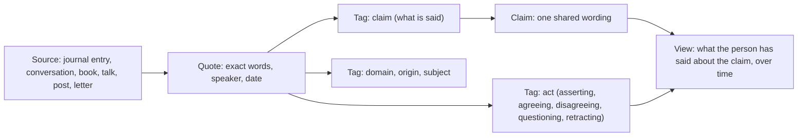

# Quotes and their tags: the schema for claims and beliefs

Torian, 2026-11-20 05:30Z: "claims, instances, or these other things are actually just tags on a quote. Let's look at schema.org and other standards." 05:38Z, on the proposal below: "Yes, sounds good."

This is the design. Step 1 (the core) is built; steps 2 to 4 are not (see "Built" at the end). Each point says Decided (Torian said so) or Proposed (my recommendation, standing until he says otherwise).

## The idea

A quote is the record. A claim, a belief, a stance, a domain, an origin: each is a tag on a quote. This keeps Reflect on its side of the boundary (see `REFLECT_FRAMEWORK_2026-11-19.md`, "Reflect and NTS"). Reflect keeps what was said, by whom, where and when. What the words do (assert, agree, deny, ask) is read from the words, not guessed from the mind. A belief as a state of mind belongs to NTS.



## The standards, and what each gives

| Standard | What we take | Where |
|---|---|---|
| schema.org `Quotation` (a `CreativeWork`) | the quote record: `text`, `creator` (who said it), `isPartOf` (the source), `dateCreated` (when it was said) | Quote |
| W3C Web Annotation Data Model (2017), as Hypothesis uses it | a tag is an annotation: a `target` (the quote, with a `TextQuoteSelector` of `exact`, `prefix` and `suffix` for the words it is about), a `body` (the tag's value), a `purpose` (`tagging`, `classifying`, `assessing`, `identifying`, `linking`), a `creator` and `created` | Tag |
| W3C SKOS | each set of tag values is a `ConceptScheme` of `Concept`s with a `prefLabel` and a `definition`, so tags come from closed lists of standard terms | Vocabularies |
| schema.org `Claim` | a claim is one wording that many quotes can say; its `appearance` is the quotes that say it and `firstAppearance` the earliest | Claim |
| Inference Anchoring Theory and the Argument Interchange Format (Budzynska, Reed and others) | a locution (the words said) is anchored to a proposition (the claim) by an illocutionary connection (asserting, agreeing, disagreeing, questioning, challenging, restating, retracting). This is the act tag. `ACTS` in `packages/core/src/argument-practice.ts` already names them | Act tag |
| W3C PROV | who recorded a quote or tag and how (`wasAttributedTo`, `wasDerivedFrom`); we use Reflect's own `SOURCE_KINDS` for it | Recorded by |

## The records

### Quote (Proposed)

In a vault, `quotes/<id>.json`. In the app, a `quote` table.

```json
{
  "text": "Marriage is a covenant, not a contract.",
  "speaker": { "self": true },
  "source": { "kind": "journal", "ref": "journal/2026-11-19.md", "title": "Thursday", "locator": "para 3" },
  "said_at": "2026-11-19",
  "recorded_at": "2026-11-20T05:40:00Z",
  "recorded_by": "stated",
  "status": "confirmed"
}
```

- `text` is the exact words, never a paraphrase. A paraphrase belongs in a claim's wording.
- `speaker` is the person (`self: true`), or another person by name, with a link to a person record when there is one. Another speaker's quote, such as a line from a book, is something the person read, not something they said.
- `source.kind` is a closed list: `journal`, `conversation` (a chat with an assistant), `book`, `talk`, `post`, `letter`, `reflect` (said inside Reflect, for example a stance given on a claim page), `other`. `ref` points at the source record or work, and `locator` at the place in it (page, paragraph, timestamp).
- `recorded_by` uses `SOURCE_KINDS` (stated, journal, conversation, import, noticed). As with person fields, anything not stated by the person starts `proposed` and counts only once the person confirms it.
- A quote is never edited. A correction is a new quote, and the old one is withdrawn by a tag.

### Tag (Proposed)

A Web Annotation, kept in the quote's file as an append-only list (in the app, an append-only `quote_tag` table).

```json
{
  "id": "t1",
  "target": { "quote": "q-7f3a", "selector": { "type": "TextQuoteSelector", "exact": "a covenant", "prefix": "Marriage is ", "suffix": ", not" } },
  "purpose": "classifying",
  "scheme": "act",
  "value": "asserting",
  "created": "2026-11-20T05:41:00Z",
  "creator": "person",
  "status": "confirmed"
}
```

- `target.quote` is required. The `selector` is optional: without it the tag is about the whole quote.
- `scheme` names the vocabulary and `value` is a concept in it. A `claim` tag's value is a claim id instead. A `relation` tag also names the quote or claim it points at (`object`).
- `creator` is `person` or `assistant`. An assistant's tag starts `proposed`.
- A tag is withdrawn by a later tag (`scheme: "status"`, `value: "withdrawn"`, pointing at its id). Nothing is deleted.

**One exception (Proposed).** Some tags describe the claim itself, not one saying of it: its domain, whether it is an ideal or a practical belief, and which ideal a practical belief serves. Web Annotation lets a target be any resource, so these tags target a claim (`target.claim`) instead of a quote. Without this, the same domain would have to be repeated on every quote that says the claim.

### Claim (Proposed)

In a vault, `claims/<id>.json`. In the app, the existing `learn_claim` table.

```json
{ "text": "Marriage is a covenant.", "subject": "marriage", "created": "2026-11-20T05:41:00Z" }
```

- A claim has no stance, holder or note of its own. Those come from its quotes.
- A claim is made the first time a claim tag names it, and it is never stored without one.
- Its `appearance`, its holders (the speakers of its quotes) and its first appearance are all derived from the claim tags, never typed in.

## The vocabularies (Proposed)

Each is a SKOS concept scheme in core, with a label, a definition and its source.

| Scheme | Concepts | Source | Exists today |
|---|---|---|---|
| `act` | asserting, pure-questioning, assertive-questioning, rhetorical-questioning, challenging, agreeing, disagreeing, restating, retracting, none | IAT; Walton and Krabbe for retracting | `ACTS` in `argument-practice.ts` |
| `relation` | supports, rebuts, undermines, undercuts, rephrases | AIF; Prakken 2010 | `RELATIONS` |
| `domain` | needs, learn, work, belonging, line, household, community, polis, legacy | the Ventures of a Lifetime chart | `DOMAINS` in `book.ts` |
| `origin` | chance, nature, compulsion, habit, reasoning, spirit, anger, appetite | Rhetoric I.10 | `claim_origin` check |
| `kind` | ideal, practical (a practical belief names the ideal it serves) | NE III.2-4, VI.1 | `BELIEF_KINDS` |
| `subject` | the person's Learn subjects | Learn | `learn_subject` |
| `status` | withdrawn | Reflect | |

## What the person sees: a view, not a record (Proposed)

"What I hold" is worked out from the person's own quotes about a claim. The latest act tag wins:

| Latest act on one of their own quotes | Shown as | SEP's doxastic attitude |
|---|---|---|
| asserting, agreeing, assertive-questioning, rhetorical-questioning | You said so | belief |
| disagreeing | You said not | disbelief |
| pure-questioning | You asked | suspension (Friedman 2013) |
| retracting | You took it back | none |

The view is labelled "you said", never "you believe". It shows every quote with its date, so "I said this in March and again in October" is visible. Quotes from other people (an author, a friend) show as who else says it, never as the person's own.

## How today's tables map (Proposed)

| Today | Becomes |
|---|---|
| `learn_claim` (text, subject, holders) | the Claim. Holders become quotes by those speakers when there is a citation, otherwise stay as read-only history |
| `learn_claim_stance` (belief/disbelief/suspension, note) | a quote by the person with `source.kind: "reflect"`, text = the note (or the claim's wording when there is no note), an act tag (belief to asserting, disbelief to disagreeing, suspension to pure-questioning) and a claim tag |
| `claim_source` (work, passage) | a quote from that work (the passage as `text`) with a claim tag. This is what "Send to Learn" writes today |
| `claim_domain`, `claim_kind`, `claim_origin` | tags targeting the claim |
| `learn_item_claim` | claim tags on quotes whose source is that item |
| `learn_item_note.quote_ct` and highlighted excerpts | quotes from that item, with a note as a `commenting` tag |
| `published_quote` | stays the published copy; a quote reaches it only through the presentation gate |

The old tables are append-only and stay readable. Nothing is deleted. The plan:

1. **Core first.** `packages/core/src/quotes.ts` (records, vocabularies, the view, problems), `quote.schema.json`, `claim.schema.json`, vault folders `quotes/` and `claims/`, CLI `reflect quote` and `reflect tag`, MCP tools through the action registry, and a Lean file (every tag's target exists; a proposed tag never counts in the view; the view reads only the person's own quotes).
2. **App tables.** One migration adds `quote` and `quote_tag` (append-only triggers, text encrypted like the rest). New writes go there. Dev first; preview and production only on Torian's yes.
3. **Backfill.** A script turns each old row into quotes and tags as in the table above, idempotent, run on dev and checked before anything else.
4. **Screens.** Learn's claim page and "Send to Learn" read and write quotes and tags; the claim page shows the view.

## Open questions

- **Degree.** Should a stance carry how strongly it was said ("I'm fairly sure")? Proposed: no field. The words carry it, and a `hedging` act could be added to the act scheme later if needed.
- **Deeds against words.** Should Reflect show a deed that goes against a stated claim (says thrift matters, spends freely)? Proposed: later, only as a question the person is shown, never a verdict.
- **Shared claims.** Are claims private to each person, or in a catalog people share, so two people can see they say the same thing? Proposed: private for now. A shared catalog belongs to the village and polis side.

## Built

Torian, 2026-11-20 06:51Z: "go". Step 1, the core:

- `packages/core/src/quotes.ts`: records, tags, vocabularies (`SCHEMES`), checks, `quoteStatus`, `liveTags`, `claimView`, `appearances`, `appendOnlyProblems`.
- `packages/core/schemas/quote.schema.json` and `claim.schema.json`.
- `packages/core/src/files-quotes.ts`: `quotes/` and `claims/` in a vault, with references checked; `reflect check` checks them.
- CLI: `reflect quote`, `quotes`, `tag`, `claims`, `claim <id>`.
- MCP: `keep_quote`, `tag_quote`, `read_quotes`. An assistant's quote and tags come in proposed; only the person confirms or withdraws.
- Lean: `lean/Reflect/Quotes.lean`.

One change from the shape above: a tag's target is the quote or claim whose file holds it, so a tag carries no `target` field.
