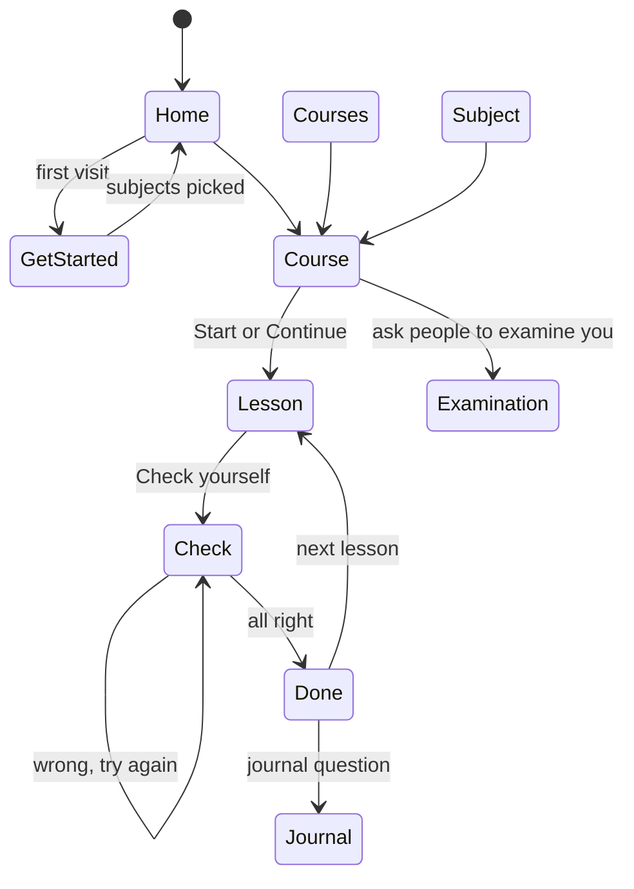

# Scholē rebuilt after Uxcel, with Aristotle's works as courses (2026-11-21)

Torian asked (2026-11-21): rework Reflect and Scholē using Mobbin, with Uxcel as the reference, and courses for Aristotle's works broken down by subject.

Reading taken: the rework is Scholē inside Reflect, rebuilt as its own full-screen app. The Making door and crafts stay in Work (`/life/work`).

## Method

Screen inventory first (Virtu format, design-system-theory#48): `web/src/components/schole/schole.inventory.json` lists every screen (S0 to S12, L1 to L4), its parts (callout numbers such as L2.3), its components (C1 to C14) and the Uxcel screens on Mobbin it follows. `/schole/map` shows the inventory, and the Numbers toggle in the sidebar shows callout numbers on every screen.

## Courses

Subjects follow Aristotle's own division: the instrument (logic); theoretical knowing (nature, soul, life, first philosophy); practical (ethics, politics); productive (rhetoric, poetics). Each subject has a path of courses in order, and each course names the courses to take before it.

Every lesson has a short summary, a passage quoted verbatim from a public-domain translation (published before 1931, linked on the course), its Bekker reference, Greek terms, at least two questions with the reason for the right answer, and one journal question. `packages/core/src/aristotle.test.ts` checks all of it.

25 courses, about 285 lessons: Organon (6), Physics and the nature works (4), soul and life (6), Metaphysics, Nicomachean, Eudemian and Magna Moralia, Politics, Constitution of the Athenians (cited by chapter, no Bekker pages), Rhetoric, Poetics.

Known soft spots: some line numbers inside a Bekker column were given from memory and should be checked against a Bekker edition (logged in the PR). The Eudemian Ethics, Magna Moralia, On the Soul (Hicks) and Generation of Animals passages come from OCR scans cleaned by hand.

## Left out of Uxcel on purpose

Points, streak pressure, leagues, scores and certificates. Questions are tried again until right and nothing is graded. Examiners are people (existing examinations). Writing happens only in the journal.

## Not built

Progress in the database (kept in the browser for now), server-side onboarding answers, audio for lessons, and the Uxcel skill graph beyond the Your growth radar.
