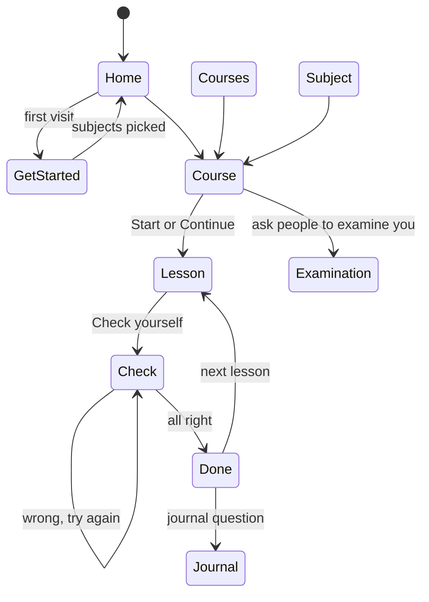

# Scholē rebuilt after Uxcel, with Aristotle's works as courses (2026-11-21)

Torian asked (2026-11-21): rework Reflect and Scholē using Mobbin, with Uxcel as the reference, and courses for Aristotle's works broken down by subject.

Reading taken: the rework is Scholē inside Reflect, rebuilt as its own full-screen app. The Making door and crafts stay in Work (`/life/work`).

## Method

Screen inventory first (Virtu format, design-system-theory#48): `web/src/components/schole/schole.inventory.json` lists every screen (S0 to S12, L1 to L4), its parts (callout numbers such as L2.3), its components (C1 to C14) and the Uxcel screens on Mobbin it follows. `/schole/map` shows the inventory, and the Numbers toggle in the sidebar shows callout numbers on every screen.

## Courses

Subjects follow Aristotle's own division: the instrument (logic); theoretical knowing (nature, soul, life, first philosophy); practical (ethics, politics); productive (rhetoric, poetics). Each subject has a path of courses in order, and each course names the courses to take before it.

Every lesson has a short summary, a passage quoted verbatim from a public-domain translation (published before 1931, linked on the course), its Bekker reference, Greek terms, at least two questions with the reason for the right answer, and one journal question. `packages/core/src/aristotle.test.ts` checks all of it.

25 courses, about 285 lessons: Organon (6), Physics and the nature works (4), soul and life (6), Metaphysics, Nicomachean, Eudemian and Magna Moralia, Politics, Constitution of the Athenians (cited by chapter, no Bekker pages), Rhetoric, Poetics.

Known soft spots: some line numbers inside a Bekker column were given from memory and should be checked against a Bekker edition (logged in the PR). The Eudemian Ethics, Magna Moralia, On the Soul (Hicks) and Generation of Animals passages come from OCR scans cleaned by hand.

## Left out of Uxcel on purpose

Points, streak pressure, leagues, scores and certificates. Questions are tried again until right and nothing is graded. Examiners are people (existing examinations). Writing happens only in the journal.

## Not built

Progress in the database (kept in the browser for now), server-side onboarding answers, audio for lessons, and the Uxcel skill graph beyond the Your growth radar.

## Second pass: Listen, Learn and Shelf (2026-11-21, later)

Torian, 18:55Z and 19:03Z: Uxcel is a starting point but not enough. Scholē is a multimedia site with broad subjects: it is as much a podcast and audiobook platform (Audible, Snipd) as a course app (Brilliant, MasterClass, Uxcel). Books are kept mainly for reference and to show a person's knowledge and interests; reading in the app is not a primary focus. The Aristotle work was closer to lessons than courses. He then said: go with the recommendations.

Decided (recommendations he accepted):

- Scholē has three parts of equal weight on one catalog: Listen (podcasts, audiobooks, people, snips), Learn (courses, subjects, lectures, glossary, examination) and Shelf (your library, highlights, saved). Talk is the dialectic; You is growth and the journal. The sidebar is grouped that way.
- Home leads with listening: Continue listening (the last thing played, the rest under way) and new episodes from your shows, then Continue learning and recommended courses.
- A course is built around one work and uses every medium: the whole work as a LibriVox audiobook, and in each unit the chapters for that part (played in Scholē's player), podcast episodes and lectures on it (`packages/core/src/aristotle/media.ts`, every link checked on 2026-11-21). The lessons are the reading.
- Practice goes past multiple choice, after Brilliant: after the questions, the person matches the lesson's Greek terms to their meanings (L3.4).
- Snips, after Snipd: a scissors button in the player keeps the moment playing (episode or audiobook, and the second). There is no transcript and no AI summary, so a snip holds no words; Snips (A16) plays it from that moment or opens a journal entry about it. Kept as `snip/<id>` in `person_fact`, so no migration.
- The model for the catalog is IFLA's Library Reference Model: a work (the Nicomachean Ethics), its expressions (Ross's translation) and their manifestations (a LibriVox recording). Not built as records yet.

The screen inventory now lists every Scholē route (85 screens in five areas), each with Mobbin references or a note saying why there are none. Snipd, Pocket Casts and Kindle are not on Mobbin; the nearest real flows are used and named.

Not built: Up next as its own page (A17, the player's queue menu does it today), courses for other authors (Aquinas next), unit media on the lesson page, the dead Doing and Knowing doors removed.
