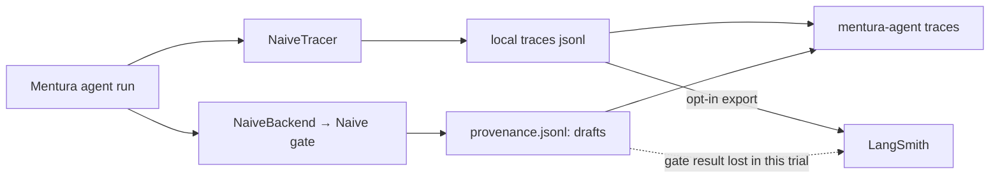

# LangSmith export trial (2026-11-26)

Trial date: 26 November 2026, about 3:43–3:45 AM America/Chicago (CST).
This is a findings and recommendation record, not a change to the export code. Mentura3 is public, so this note omits account IDs, API keys, and share URLs.

## What was tried

A throwaway Naive venture named `kettle` was created on the assistant's computer. Three real Mentura3 agent runs were sent through NaiveBackend (the router and the gate) and NaiveTracer, then exported to LangSmith with the existing opt-in path and no code changes:

| Session | Agent | Local trace events | Local result |
|---|---|---:|---|
| demo-1 | strategy | 26 | One pricing write landed, a later pricing write was held as a draft, a write to `governance/board` was refused |
| demo-2 | growth-lead | 18 | Three operations writes landed (two handoffs and a lead record) |
| demo-3 | strategy (read-heavy) | 118 | Reads only; all spans ok |

That is 162 local spans in all. LangSmith received the exported steps. The model on those runs was the repository's scripted test model (`fake:scripted`), not a live paid model. Token counts in LangSmith were therefore made up, and there was no cost data.

The LangSmith project used for the trial was `mentura-dev-demo`. A leftover probe project, `mentura-dev-demo-probe`, and a scratch dataset named `mentura-dev-demo: strategy runs` were also created and can be deleted. A public share link was created during the trial and should be revoked.

## What LangSmith added

These features were tried and worked:

- a nested step tree with timing
- slow-run stats
- share links that can be revoked
- building a dataset from runs
- feedback scores
- search across runs

LangSmith traces are short-lived (about 14 days on the tier used here). Datasets do not expire, which is why eval examples should live in git first and be uploaded as a versioned dataset, not stored only in traces.

## What LangSmith lost

The thing that matters most to Naive did not survive the export of this vintage:

- A write the gate held as a draft showed up as a normal success. Local provenance recorded it as activity `draft` on `_drafts/decisions__pricing.decision.json.draft`. The local `mentura-agent traces` summary listed that draft. LangSmith tagged both pricing writes `success` and did not link the held write to the draft or to `mentura accept`.
- A refused write (`governance/board`) did show up as an error, so hard failures were not invisible — but "held" and "written" were not distinguished.
- Prompts and replies were missing on the Naive tool spans (inputs and outputs were empty). Some chat and file-tool spans had payload fields; the top-level agent runs did not.
- The task and the answer were missing on the top-level run (root `inputs` and `outputs` were empty).

## Decision (Torian, 26 November 2026)

Keep the LangSmith export **opt-in**. It can become the default after three fixes, which were opened as Mentura3 pull requests stacked on #353 and were not merged when this note was written:

1. **#354** — copy prompts and replies into the fields LangSmith displays, and run all exported text through the redactor (not only the new copy).
2. **#355** — tag each write as held, refused, or written. A held draft includes its `mentura accept` command.
3. **#356** — record the task and the answer on the top-level run, only when the venture allows content in traces.

#357 only corrects the traces README. The export still runs only when it is started on purpose.

A later run with a real model key would be needed before anyone trusts token or cost numbers.

## Limits of this trial

- Scripted model, so no real tokens, costs, or model-quality signal.
- One writer, one throwaway venture, three short runs.
- Raw LangSmith API dumps from the trial stay off the repository. They can contain run payloads and must not be committed.
