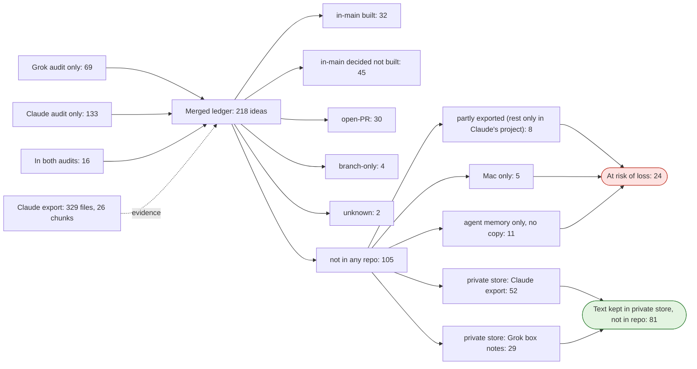

# Merged preservation ledger: Grok Bot audit, Claude memory audit and Claude's export (public copy)

## What this is

One source-of-truth table for every Naive idea that Grok Bot and Claude remember, so nothing lives only in an agent's memory. It is a record, not a plan. New ideas are paused. The order and owners for moving rows into the repo are Torian's decisions and are not made here.

## Sources

- Grok Bot's audit `ledger.md` (64 ideas, M1 to M37 and R1 to R27) plus 20 rows Grok found in its merge pass (G-BOX-*, G-Q-*, G-C-*).
- Claude's memory audit (140 rows, C-001 to C-140, plus pointer-only items C-S1-* and C-S3-*). It is chunk 1 of Claude's export and is byte-identical to the copy audited earlier.
- Claude's export of 2026-11-03: one Markdown file, 26 chunks, 329 files, each byte size checked, sha256 `ca1de14f6b3e...d4d5`. Left out by Claude: code prototypes, private folders, lead records, cached web pages and private note copies (export header).
- Repo check through the GitHub connector on 2026-11-03 at about 12:35 PM CT: `main` at `f478100` (only `docs/decisions/decisions.json` changed since the `d1171fc` baseline, for EE-111), 20 open PRs. Every open-PR row still points at an open PR. EE-095's `schema/terms/` and `lean/Naive/` are on main.

## How to read a row

- **repo status** is where the least-preserved part of the idea is in the repo: in-main built, in-main decided not built, open-PR, branch-only, or not in any repo.
- `on main` (added 2026-11-04) means stage 1 preserved the source the row names on main, as-is and not reconciled. It is an exception to the least-preserved rule: parts that the pointer before stage 1 names elsewhere (other files, other PRs, notes outside the repo) may still be off main.
- **where it lives** names the memory notes, the audit ids, and a location class for rows not on main. `private store: Claude export` means the text is preserved verbatim in the export, held at `preserve/claude-export/` in the private store and on the box. `private store: Grok box notes` means Grok copied the note into `preserve/sources/`. At risk means no verbatim copy exists in the repo or the private store: `Claude project only (not exported)`, `partly exported`, `Mac only`, `agent memory only, no copy`, `unknown`.
- **verbatim text** is Claude's quoted excerpt when it gave one; otherwise the row points at the file that holds the text.

Confidential rows are pointers only: id, a short neutral title, and the private store path. Their text and their export paths are not in this file.

## Counts

Unique ideas: 218. In both audits: 16. Grok only: 69. Claude only: 133.
Not yet safely on main (open PR, branch, or not in any repo): 141. Not in any repo: 105. At risk of loss: 24. Rows where the sources disagree: 16 (every conflict is listed under Conflicts). Confidential rows: 15. Rows withheld from this copy as private or out of scope: 0.

Update of 2026-11-04 (S1-PR6): 32 rows that S1-PR1 to S1-PR5d landed now read `on main`, with the new path, the unit and the PR first in the repo pointer, then the status and the pointer each row had before stage 1. The counts and tables in this section are still those of the 2026-11-03 audit and do not count `on main`.

| repo status | rows |
|---|---|
| not in any repo | 105 |
| unknown | 2 |
| branch-only | 4 |
| open-PR | 30 |
| in-main decided not built | 45 |
| in-main built | 32 |

| where a not-in-any-repo row lives | rows | at risk? |
|---|---|---|
| Claude project only (not exported) | 0 | yes |
| partly exported (rest only in Claude's project) | 8 | yes |
| Mac only | 5 | yes |
| agent memory only, no copy | 11 | yes |
| unknown | 0 | yes |
| private store: Claude export | 52 | no |
| private store: Grok box notes | 29 | no |

## Diagram

## Ledger

| id | Grok id(s) | Claude id(s) | idea | where it lives | date learned | repo status | repo pointer | verbatim text | conflict |
|---|---|---|---|---|---|---|---|---|---|
| N-001 | R1 | C-084 | Auto ontology, part 1: the term-harvest skill and founder glossary (harvest terms, run each through the engine, Lean-mirror confirmed relations, usage notes) | Claude memory: knowledge-convention-code; Grok audit: R1; location class: partly exported (rest only in Claude's project); export: `preserve/claude-export/` memory/knowledge-convention-code.md, `preserve/claude-export/` project-files/naive-design/prototypes/architecture/GLOSSARY.agent.md, `preserve/claude-export/` project-files/naive-design/prototypes/architecture/README.md, `preserve/claude-export/` project-files/naive-design/prototypes/roles/README.md; not in the export: usage.json | 2026-11-01 | on main | `docs/design/term-harvest/claude-2026-11-03/TERM_LIST_2026-11-01.json` (S1-PR3, #175); `docs/design/preserved/claude-2026-11-03/prototypes/architecture/GLOSSARY.agent.md` (S1-PR4c, #180); preserved as-is, not reconciled; status before stage 1: not in any repo; pointer before stage 1: docs/design/term-harvest/TERM_LIST_2026-11-01.json on main (seed list); usage.json and GLOSSARY.agent.md in /mnt/project-files/naive-design/prototypes/ | "usage notes written for all terms (usage.json, 72/72); GLOSSARY.agent.md regenerated" | **yes.** Location: Grok said usage.json does not exist and guessed the Mac; Claude read it in its project files. Counts: Claude says usage notes for 72 of 72 terms; Grok counted 199 seed terms, 36 run, 0 of them admitted to schema/terms/admitted.json (9 terms). Export evidence: Claude's project copy of TERM_LIST_2026-11-01.json (53,741 bytes) holds 340 terms with 146 run; main's copy holds 199 terms with 36 run. Same _about and created stamp, so Claude's copy is a later revision that never reached main. usage.json is not in the export (code prototypes left out). |
| N-002 | R2 | C-S3-sandbox | Auto ontology, part 2: sandbox prototypes `proof-vocab.ts` (30/30), `anatomy-vocab.ts` (25/25), `s1-vocab.ts`, `S1.lean`, `offering-vocab.ts`, `placement.ts`, `Placement.lean` (20 theorems), `generator-vocab.ts`, about 60 proposed terms, results of the 36 runs | Grok audit: R2; location class: partly exported (rest only in Claude's project); export: `preserve/claude-export/` project-files/naive-design/prototypes/architecture/GLOSSARY.agent.md, `preserve/claude-export/` project-files/naive-design/prototypes/architecture/README.md, `preserve/claude-export/` project-files/naive-design/prototypes/roles/README.md; not in the export: /mnt/project-files/naive-design/prototypes/ code files | 2026-11-03 (audit; first date not recorded) | not in any repo | /mnt/project-files/naive-design/prototypes/ (Claude's project); cited by EE-096, EE-098, EE-099 | see the export file named in where it lives | **yes.** Location: Grok guessed Torian's Mac; Claude's audit reads it in Claude's project files. Claude's audit is first-hand, so the rescue moves from Torian's Mac to a Claude export. Export evidence: the export left out code prototypes, so stage.ts, the vocab .ts runs and the prototype Lean files are still only in Claude's project. Only prototypes/architecture/GLOSSARY.agent.md and two READMEs were exported. |
| N-003 | R3 | C-087, C-S3-archcheck | Draft architecture record (sha256 `133c4e1b824c`) and `gen-statechart.py` that generate the write-chain statechart | Claude memory: architecture-record; master-architecture; Grok audit: R3; location class: private store: Claude export; export: `preserve/claude-export/` memory/architecture-record.md, `preserve/claude-export/` memory/master-architecture.md, `preserve/claude-export/` project-files/naive-design/architecture/check-outcome.schema.draft.json, `preserve/claude-export/` project-files/naive-design/architecture/everything-ecosystem.architecture.json, `preserve/claude-export/` project-files/naive-design/architecture/ideas.json, `preserve/claude-export/` project-files/naive-design/architecture/naive.architecture.json | 2026-10-31, 11-01 | on main | `docs/design/preserved/claude-2026-11-03/architecture/everything-ecosystem.architecture.json` (S1-PR4b, #179); `docs/design/preserved/claude-2026-11-03/architecture/naive.architecture.json` (S1-PR4d, #182); preserved as-is, not reconciled; status before stage 1: not in any repo; pointer before stage 1: /mnt/project-files/naive-design/architecture/naive.architecture.json; verification/write-chain/README.md on main says the record is kept outside the repo | "RULE (Torian 06:13Z): designs AMEND the master architecture, never new files" | **yes.** Location: Grok guessed the Mac; Claude names the file. Content: Claude adds the rule 'designs amend the master architecture, never new files' and arch-check A1 to A14, which Grok did not have. |
| N-004 |  | C-004 | Naive as built is a framework, not a platform; only the hosted library plus tenants passes "platform", so it goes under Mentura. | Claude memory: master-architecture; location class: partly exported (rest only in Claude's project); export: `preserve/claude-export/` memory/master-architecture.md, `preserve/claude-export/` project-files/naive-design/ventures/moses-david/placement.json; not in the export: framework-proof.ts, Products.lean | 2026-11-01 | not in any repo | /mnt/project-files/naive-design/ (framework-proof.ts, Products.lean); ventures/moses-david/placement.json (proposed) | "framework-proof.ts + Products.lean: Naive as built = framework not platform (same facts as Next.js); only hosted library+tenants passes platform -> placed under Mentura (ventures/moses-david/placement.json, proposed)." |  |
| N-005 |  | C-011 | Top goal: release a stable Naive that Torian uses daily and others can depend on. | Claude memory: MEMORY.md TOP GOAL; location class: private store: Claude export; export: `preserve/claude-export/` artifacts/RrM6rsuXAGjk8Wvh9Lv33i.md, `preserve/claude-export/` memory/MEMORY.md | 2026-10-30 | not in any repo | artifact RrM6rsuXAGjk8Wvh9Lv33i | "TOP GOAL (Torian 10-30): release a STABLE Naive he uses daily and others can depend on." |  |
| N-006 |  | C-012 | Confidential Mentura item | confidential, held in private store at `preserve/claude-export/` | 2026-11-01 | not in any repo | pointer only | | |
| N-007 |  | C-018 | A "README theorem" decides which folders need a README (boundary, 5+ children, top level, hubs). | Claude memory: knowledge-convention-code; location class: partly exported (rest only in Claude's project); export: `preserve/claude-export/` artifacts/7f8K6ryc8qGj6ejqSN7DrA.md, `preserve/claude-export/` memory/knowledge-convention-code.md; not in the export: readme-theorem.py | 2026-11-01 | not in any repo | artifact 7f8K6ryc8qGj6ejqSN7DrA; readme-theorem.py (sandbox) | "readme-theorem.py (R1 boundary, R2 5+ children, R3 top-level; H1 hub = 5+ outside users; F1 a file needing its own README gets a folder). Main 840fcf6: 104 folders need README, 65 missing" |  |
| N-008 |  | C-023 | Functions are defined like code (reads, writes, actions by agent or person) and compose with explicit authority; `naive check` throws on unclear authority, double owner, agent overreach, circular calls. | Claude memory: ee-venture-top-level; location class: private store: Claude export; export: `preserve/claude-export/` artifacts/JzodSs3wxHfS4BMaQydXFV.md, `preserve/claude-export/` memory/ee-venture-top-level.md | 2026-10-29 | not in any repo | master article artifact JzodSs3wxHfS4BMaQydXFV; no "unclear-authority" on main | "Article \"Composing functions\": calls{fn:{authority: caller\|callee}}; errors unclear-authority, double-owner, agent-overreach, unknown-function, circular-call, orphan-folder." |  |
| N-009 |  | C-027 | Venture identity (id, founding, founders, essential why, name history, lineage) is separate from legal entities, linked by roles; use GLEIF field names. | Claude memory: venture-identity-legal-entity; location class: private store: Claude export; export: `preserve/claude-export/` artifacts/6PbSQ93sHw2hKxDJcx5YJH.md, `preserve/claude-export/` memory/venture-identity-legal-entity.md | 2026-10-31 | not in any repo | artifact 6PbSQ93sHw2hKxDJcx5YJH | "Files proposed: identity/venture.json, identity/entities/<id>.json, identity/links.json. MVP needs only venture.json." |  |
| N-010 |  | C-028 | Venture meta-schema and property suite: type becomes a preset of axes, all 13 functions declared, bitemporal phase, market to segment to ICP, conversations as parent records, properties P1-P10. | Claude memory: naive-phases-functions; location class: private store: Claude export; export: `preserve/claude-export/` memory/naive-phases-functions.md, `preserve/claude-export/` project-files/naive-design/VENTURE_META_SCHEMA_2026-10-31.md | 2026-10-31 | on main | `docs/design/preserved/claude-2026-11-03/VENTURE_META_SCHEMA_2026-10-31.md` (S1-PR4a, #177); preserved as-is, not reconciled; status before stage 1: not in any repo; pointer before stage 1: /mnt/project-files/naive-design/VENTURE_META_SCHEMA_2026-10-31.md (not on main) | "type -> preset of independent axes; all 13 functions always declared (covered / derived not-applicable / missing -> E_MODULE_MISSING); bitemporal phase; market->segment->ICP records; research record with fetch manifest; conversations as parent records with inputs.jsonl, \"triaged\" = thread resolved; obligations() pure function + properties P1-P10 (fast-check), Lean for P1/P4/P6/P8." |  |
| N-011 |  | C-034 | Missing modules: business formation, monetization, policies, compliance; publishing is a function ("communications"); gated actions carry error codes. | Claude memory: naive-phases-functions; location class: private store: Claude export; export: `preserve/claude-export/` artifacts/P8JrRHjZwqp6ZfV6ZXPE48.md, `preserve/claude-export/` memory/naive-phases-functions.md | 2026-10-31 | not in any repo | artifact P8JrRHjZwqp6ZfV6ZXPE48 | "Missing modules: business formation, monetization, policies (all types), compliance (SOC 2 etc., jurisdiction/activity-based, via library/app)... Publishing is a function (proposed standard name: communications)... Gated actions with error codes (cap table needs formed entity + legal docs; hiring needs proof)." |  |
| N-012 |  | C-035 | Compliance gates use a rule model (Catala, LegalRuleML, OPA deny sets as error codes); Naive's edge is deriving which frameworks apply from facts. | Claude memory: naive-phases-functions; location class: private store: Claude export; export: `preserve/claude-export/` memory/naive-phases-functions.md, `preserve/claude-export/` project-files/naive-design/RESEARCH_COMPLIANCE_PRIOR_ART_FOR_GATES_2026-10-31.md | 2026-10-31 | not in any repo | /mnt/project-files/naive-design/RESEARCH_COMPLIANCE_PRIOR_ART_FOR_GATES_2026-10-31.md; related EE-055 in-main | "Naive differentiator: deriving which frameworks apply from facts. Rules need versioning (gate records rules revision). Open: resolver in TS, embed OPA, or Lean." |  |
| N-013 |  | C-038 | A five-PR Mac build brief for the MVP: identity rename, declare functions, naive next, commitment gate, naive export. | Claude memory: naive-phases-functions; location class: private store: Claude export; export: `preserve/claude-export/` memory/naive-phases-functions.md, `preserve/claude-export/` project-files/naive-design/HANDOFF_MVP_JUDGMENT_LAYER_TO_MAC_2026-10-31.md | 2026-10-31 | not in any repo | /mnt/project-files/naive-design/HANDOFF_MVP_JUDGMENT_LAYER_TO_MAC_2026-10-31.md | "Mac build brief (5 PRs: identity rename+research rename, declare functions, naive next, commitment gate, naive export; README docs-as-code every PR; no npm)" |  |
| N-014 |  | C-039 | The gap hunt found the MVP mostly exists (docket.mjs, premise-lint, assess-problem --preflight); R-31 joins `naive check` instead of a new command. | Claude memory: naive-phases-functions; location class: private store: Claude export; export: `preserve/claude-export/` memory/naive-phases-functions.md, `preserve/claude-export/` project-files/naive-design/GAP_HUNT_MVP_JUDGMENT_LAYER_2026-10-31.md | 2026-10-31 | not in any repo | /mnt/project-files/naive-design/GAP_HUNT_MVP_JUDGMENT_LAYER_2026-10-31.md | "MVP mostly exists on main (docket.mjs EE-075, premise-lint.mjs, assess-problem.mjs --preflight); `naive check` already = run all checks, so R-31 joins it, no new command." |  |
| N-015 |  | C-066 | The pipeline runs on System 1 primitives (Choice, Noul, Score); a "help" switch in venture.json turns off decision help with no anchoring. | Claude memory: ee-system1-pipeline; location class: private store: Claude export; export: `preserve/claude-export/` artifacts/Jh4pQmq1ZtgeukjP2EwGs8.md, `preserve/claude-export/` memory/ee-system1-pipeline.md | 2026-10-28 | not in any repo | artifact Jh4pQmq1ZtgeukjP2EwGs8; see #155 (EE-101) | "Help: one Noul per option. Recommend the top option if it is at or above 0.7, otherwise say \"your call\". When help is switched off, nothing is computed, so there is no anchoring. The setting lives in `venture.json`." |  |
| N-016 |  | C-069 | A tiny clock stays in Naive core; the calendar is an installable headless library component, not part of Naive by default. | Claude memory: ee-venture-calendar; location class: private store: Claude export; export: `preserve/claude-export/` artifacts/UN4dLQn4Fq2ySzT9UA3S3q.md, `preserve/claude-export/` memory/ee-venture-calendar.md | 2026-10-29 | not in any repo | artifact UN4dLQn4Fq2ySzT9UA3S3q | "Torian DECIDED: the calendar belongs in the library as an installable headless component, NOT inside Naive by default." |  |
| N-017 |  | C-091 | Ideas move through computed stages (captured to retired) with illegal states checked. | Claude memory: master-architecture; location class: partly exported (rest only in Claude's project); export: `preserve/claude-export/` memory/master-architecture.md, `preserve/claude-export/` project-files/naive-design/architecture/ideas.json; not in the export: stage.ts, Stage.lean | 2026-11-01 | not in any repo | stage.ts, Stage.lean, architecture/ideas.json in /mnt/project-files/naive-design/ | "Idea pipeline = stage.ts (captured, sketched, designed, architected, implemented, verified, proved, retired; computed from evidence; 672 illegal states in 4 kinds) + Stage.lean built (10 thms)" |  |
| N-018 |  | C-092 | Terms are nodes that design-process steps call; provenance-tracking is a capability, provenance is information. | Claude memory: master-architecture; location class: partly exported (rest only in Claude's project); export: `preserve/claude-export/` memory/master-architecture.md; not in the export: capability-vocab.ts | 2026-11-01 | not in any repo | \| "capability-vocab.ts 15/15: provenance = information (W3C PROV), NOT a capability; provenance-tracking is_a capability held by naive-core" | see the export file named in where it lives |  |
| N-019 |  | C-093 | Log every check outcome now, train later. | Claude memory: ai-labs-anatomy; location class: private store: Claude export; export: `preserve/claude-export/` memory/ai-labs-anatomy.md, `preserve/claude-export/` project-files/naive-design/architecture/check-outcome.schema.draft.json | 2026-11-01 | not in any repo | /mnt/project-files/naive-design/architecture/check-outcome.schema.draft.json | "DECIDED 04:49Z: log every check outcome now, train later" |  |
| N-020 |  | C-095 | Candidate RL pipelines P0-P4 (offline from check log, RLVR with checks as rewards, Brier, DPO on decision cards, process reward); generation gated behind records. | Claude memory: ai-labs-anatomy; location class: private store: Claude export; export: `preserve/claude-export/` artifacts/YLQnmD6SqAqXHar2o7ebBF.md, `preserve/claude-export/` memory/ai-labs-anatomy.md | 2026-11-01 | not in any repo | artifact YLQnmD6SqAqXHar2o7ebBF | "Candidate pipelines (not locked): P0 offline from check log, P1 RLVR+GRPO (checks as rewards), P2 + Brier scoring rule (calibrated decisions), P3 DPO on decision-card choices (not RL), P4 process reward on agent traces" |  |
| N-021 |  | C-097 | A problem loop agents always run (set out, did, found, solving), forming a problem graph from the root problem. | Claude memory: problem-loop; location class: private store: Claude export; export: `preserve/claude-export/` artifacts/5sWFAuBtJv2KJqc7iyXjJE.md, `preserve/claude-export/` memory/problem-loop.md | 2026-10-31 | not in any repo | artifact 5sWFAuBtJv2KJqc7iyXjJE; issues #139, #141 | "Proposed next (unbuilt): issue template, problem-record.schema.json as provenance entries, loop skill for building threads." |  |
| N-022 |  | C-098 | Conversations belong to the workspace; ventures and the founder suite hold only receipts routed by triage. | Claude memory: workspace-owned-conversations; location class: private store: Claude export; export: `preserve/claude-export/` artifacts/5sZmpViNPfLHNmXAigeVrs.md, `preserve/claude-export/` memory/workspace-owned-conversations.md | 2026-11-01 | not in any repo | artifact 5sZmpViNPfLHNmXAigeVrs | "\"The conversation thread does not belong to the venture. The venture receives the conversation thread.\"" |  |
| N-023 |  | C-099 | A conversation theorem picks the frame and next question from relationship, history, facts and goal (no interview scripts). | Claude memory: founder-suite; location class: private store: Claude export; export: `preserve/claude-export/` artifacts/3KvPSmfE7C4eyQHNFYc1bv.md, `preserve/claude-export/` memory/founder-suite.md | 2026-10-31 | not in any repo | artifact 3KvPSmfE7C4eyQHNFYc1bv; prototypes/conversation/ | "NO interview scripts (except cold calls). Keep the 8 questions as considerations; want a \"conversation theorem\"" |  |
| N-024 |  | C-101 | Roles are derived by tests over relationship facts (employee, contractor, advisor, coach). | Claude memory: mentor-coach-definitions; location class: private store: Claude export; export: `preserve/claude-export/` memory/mentor-coach-definitions.md, `preserve/claude-export/` project-files/naive-design/prototypes/roles/README.md | 2026-10-31 | not in any repo | /mnt/project-files/naive-design/prototypes/roles/ | "store relationship facts, DERIVE roles by tests" |  |
| N-025 |  | C-102 | A people glossary (mentor, coach, sacred trust, role) as glossary/<package>.json. | Claude memory: mentor-coach-definitions; location class: partly exported (rest only in Claude's project); export: `preserve/claude-export/` memory/mentor-coach-definitions.md; not in the export: /mnt/project-files/naive-design/glossary/glossary-people.patch | 2026-10-31 | not in any repo | patch /mnt/project-files/naive-design/glossary/glossary-people.patch; branch claude/project-thread-02bm1d never pushed | "glossary record = glossary/<package>.json (Y-2)" |  |
| N-026 |  | C-103 | Confidential Mentura item | confidential, held in private store at `preserve/claude-export/` | 2026-10-30 | not in any repo | pointer only | | |
| N-027 |  | C-105 | Confidential Mentura item | confidential, held in private store at `preserve/claude-export/` | 2026-10-31 | not in any repo | pointer only | | |
| N-028 |  | C-107 | Confidential Mentura item | confidential, held in private store at `preserve/claude-export/` | 2026-10-31 | not in any repo | pointer only | | |
| N-029 |  | C-112 | A record can become an artifact, but a record is not an artifact; artifacts are composed from records by script. | Claude memory: ee-records-vs-artifacts; master-architecture; location class: private store: Claude export; export: `preserve/claude-export/` memory/ee-records-vs-artifacts.md, `preserve/claude-export/` memory/master-architecture.md | 2026-10-29, 11-01 | not in any repo | \| "A record can be turned into an artifact, but a record is not an artifact." | see the export file named in where it lives |  |
| N-030 |  | C-116 | Naive docs mirror Next.js Getting Started (humans are the server, agents the client), with Next.js references kept out of Naive's docs. | Claude memory: ee-demo-scope-four-pages; location class: private store: Claude export; export: `preserve/claude-export/` artifacts/JormQSRjkoHF8Mt2MFdFRX.md, `preserve/claude-export/` artifacts/JzodSs3wxHfS4BMaQydXFV.md, `preserve/claude-export/` memory/ee-demo-scope-four-pages.md | 2026-10-29 | not in any repo | artifacts JzodSs3wxHfS4BMaQydXFV, JormQSRjkoHF8Mt2MFdFRX; docs/master/naive-docs.md on main may be partial | "Core concept: Next.js server/client = Naive humans/agents (person is the server/authority, agent is the client)." |  |
| N-031 |  | C-121 | Research the whole industry as one venture; the venture library and industry graph belong to Mentura. | Claude memory: industry-as-one-venture; ai-labs-anatomy; location class: private store: Claude export; export: `preserve/claude-export/` artifacts/GGoCgRehUWfGZm9UoykeDP.md, `preserve/claude-export/` artifacts/KeKBoHoaX8cUa3ubqKSxT8.md, `preserve/claude-export/` memory/ai-labs-anatomy.md, `preserve/claude-export/` memory/industry-as-one-venture.md | 2026-10-30, 11-01 | not in any repo | artifacts KeKBoHoaX8cUa3ubqKSxT8, GGoCgRehUWfGZm9UoykeDP | "Open Qs: NAICS vs GICS anchor; library owner (Mentura); BEA weights." |  |
| N-032 |  | C-125 | Founder interviews, podcasts and surveys become kits and decision models; the "naive and ignorant" principle behind the name. | Claude memory: ee-founder-interviews; location class: private store: Claude export; export: `preserve/claude-export/` artifacts/U4RxAdER9CHEZ3k9ZAxAaD.md, `preserve/claude-export/` memory/ee-founder-interviews.md | 2026-10-28 | not in any repo | artifact U4RxAdER9CHEZ3k9ZAxAaD | "Memento/Mentura embody \"naive and ignorant\" (Orson Welles quote, James March 1991 \"maintaining an influx of the naive and ignorant\"...)... Not yet logged as an EE decision" |  |
| N-033 |  | C-126 | Confidential Mentura item | confidential, held in private store at `preserve/claude-export/` | 2026-10-29 | not in any repo | pointer only | | |
| N-034 |  | C-127 | Hosting founder websites: start with a platform API, keep storage behind an interface; architect only, post-MVP. | Claude memory: naive-phases-functions; location class: private store: Claude export; export: `preserve/claude-export/` artifacts/DzLx13KioDW1bexKyKtmn5.md, `preserve/claude-export/` memory/naive-phases-functions.md | 2026-10-31 | not in any repo | artifact DzLx13KioDW1bexKyKtmn5 | "Rec: architect only (Mentura, post-MVP); start A, storage behind an interface for B later" |  |
| N-035 |  | C-135 | Confidential Mentura item | confidential, held in private store at `preserve/claude-export/` | 2026-11-01 | not in any repo | pointer only | | |
| N-036 |  | C-138 | A gate chain before building: G0 vocabulary, G1 design, G2 conformance, G3 verification, G4 proof. | Claude memory: architecture-record; location class: private store: Claude export; export: `preserve/claude-export/` artifacts/C52hTMWrqDoxvSJm1MPqtR.md, `preserve/claude-export/` memory/architecture-record.md | 2026-10-31 | not in any repo | artifact C52hTMWrqDoxvSJm1MPqtR | "Proposed gate chain in architecture doc: G0 vocabulary (meaning) -> G1 design -> G2 conformance (design=build) -> G3 verification -> G4 proof; validation = person." |  |
| N-037 |  | C-S3-research | Confidential Mentura item | confidential, held in private store at `preserve/claude-export/` | 2026-11-03 (audit; first date not recorded) | not in any repo | pointer only | | |
| N-038 |  | C-S3-artifacts | Claude artifacts named by memory (claude.ai links); contents not re-read in the audit | location class: private store: Claude export; export: `preserve/claude-export/` artifacts/3KvPSmfE7C4eyQHNFYc1bv.md, `preserve/claude-export/` artifacts/3L1nAHbBaVKWjHED61RJv1.md, `preserve/claude-export/` artifacts/5sWFAuBtJv2KJqc7iyXjJE.md, `preserve/claude-export/` artifacts/5sZmpViNPfLHNmXAigeVrs.md, `preserve/claude-export/` artifacts/6Bzp6sc4bf7W9VL3L86Xcq.md, `preserve/claude-export/` artifacts/6PbSQ93sHw2hKxDJcx5YJH.md (+18 more); 2 confidential export file(s), private store only | 2026-11-03 (audit; first date not recorded) | not in any repo | claude.ai artifacts | see the export file named in where it lives |  |
| N-039 |  | C-S3-dogfood | naive-dogfood ventures on the Mac | location class: Mac only | 2026-11-03 (audit; first date not recorded) | not in any repo | ~/workspace/naive-dogfood | none saved |  |
| N-040 |  | C-S3-fpworktree | Founder puzzle worktree on the Mac | location class: Mac only | 2026-11-03 (audit; first date not recorded) | not in any repo | ~/workspace/.worktrees/everything-ecosystem/founder-puzzle | none saved |  |
| N-041 |  | C-S3-docshandoff | Naive docs handoff work on the Mac | location class: Mac only | 2026-11-03 (audit; first date not recorded) | not in any repo | ~/ee-cleanup-work/naive-docs-handoff | none saved |  |
| N-042 |  | C-S3-eegate | Merge queue on the Mac | location class: Mac only | 2026-11-03 (audit; first date not recorded) | not in any repo | ~/code/ee-gate | none saved |  |
| N-043 |  | C-S1-macmemory | Claude Code memory on the Mac (~/.claude/CLAUDE.md, ~/.claude/projects/*/memory/), not yet audited | location class: Mac only | 2026-11-03 (audit; first date not recorded) | not in any repo | ~/.claude/ | none saved |  |
| N-044 | R11 | C-083 | One glossary with three facets (ontology standard/status, package scope/export, engine properties/proofs) and a coverage check | Claude memory: knowledge-convention-code; Grok audit: R11; location class: private store: Claude export; export: `preserve/claude-export/` memory/knowledge-convention-code.md | 2026-11-01 | not in any repo | issue #143 (open); no repo file | "FOUND: three glossaries unaware of each other... Plan: one glossary with three facets, ontology.md + agent glossary as views; migrate ontology into engine records." | **yes.** Status: Grok called it DOCS (open issue); Claude called it memory-only. Resolved as memory-only, because an issue is not a repo file. |
| N-045 | M20 | C-136 | Intake: transcripts and conversations become records (thread as parent record, inputs with provenance); the Lead splits components, a deterministic route table resolves the path, a stateful action-item store holds EE-061 states plus unsure | Claude memory: naive-phases-functions; Grok audit: M20; location class: private store: Claude export; export: `preserve/claude-export/` artifacts/NXGKHQxfVRpTwBoYiaMeNw.md, `preserve/claude-export/` memory/naive-phases-functions.md | 2026-10-31 | not in any repo | pieces on main (interface/router.mjs, schema/docket.mjs); design only in memory, sources/intake.mmd and a Claude artifact NXGKHQxfVRpTwBoYiaMeNw | "pipeline from generated docs/conversations into records (thread = parent record; inputs stored with provenance; resolving threads = turning transcripts into records; local or hosted storage; \"Deluminator\"" | **yes.** Content conflict: Claude's memory calls the transcript-to-records pipeline 'Deluminator', but EE-104 (#158) gives Deluminator to anticipation. Grok's version adds the route table, action-item store and EE-061 plus unsure states; Claude's adds thread as parent record and inputs with provenance. |
| N-046 |  | C-088 | Architecture views must be pstack statecharts (TLA+, TLC, Mermaid), not the map. | Claude memory: master-architecture; MEMORY.md FEEDBACK; location class: private store: Claude export; export: `preserve/claude-export/` memory/MEMORY.md, `preserve/claude-export/` memory/master-architecture.md | 2026-11-01 | not in any repo | verification/write-chain/ on main (WriteChain.tla, .cfg); generator outside the repo | "He wants the architecture record to PRODUCE A PSTACK STATECHART (TLA+ -> TLC -> Mermaid), as in everything-ecosystem verification/<name>/." | **yes.** Status: Claude section 3 lists the write-chain TLA+ statechart as sandbox-only, but main has verification/write-chain/WriteChain.tla and WriteChain.cfg (checked in the main tree at d1171fc). What is off-repo is the generator and the rule that architecture views must be pstack statecharts. Settled by export evidence: the export's naive-design/verification/write-chain/WriteChain.tla is byte-identical to main's (4,546 bytes). Only gen-statechart.py and the architecture record stay off-repo. |
| N-047 | M1 |  | Three ontology layers: metamodel, upper ontology, catalog of name@function ontologies; built one at a time, metamodel first | Grok audit: M1; location class: private store: Grok box notes | 2026-11-03 (audit; first date not recorded) | on main | `docs/design/ONTOLOGY_LAYERS_2026-11-02.md` (S1-PR1, #174); preserved as-is, not reconciled; status before stage 1: not in any repo; pointer before stage 1: Named only, in `docs/reviews/2026-11-02-five-step-review.md` step 1 ("Glossary labels, metamodel, upper ontology and catalog. Torian's decisions, kept, but on hold"). The metamodel build stopped with nothing committed (` | Grok copy: at-risk.md s1 (verbatim from memory-facts.md) |  |
| N-048 | M2 |  | Metamodel in JSON Schema with SKOS and OWL names mapped; models only propose schema-valid change lines; changing it is a one-way-door amend | Grok audit: M2; location class: private store: Grok box notes | 2026-11-03 (audit; first date not recorded) | on main | `docs/design/ONTOLOGY_LAYERS_2026-11-02.md` (S1-PR1, #174); preserved as-is, not reconciled; status before stage 1: not in any repo; pointer before stage 1: No file on main or any branch. `docs/ontology.json` has no metamodel; its keys are version, note, check, nouns | Grok copy: at-risk.md s1 (verbatim from memory-facts.md) |  |
| N-049 | M3 |  | Upper ontology: own top categories each mapped to BFO; every noun traces to one top category via broader (code-checked); models propose, Jev checks | Grok audit: M3; location class: private store: Grok box notes | 2026-11-03 (audit; first date not recorded) | on main | `docs/design/ONTOLOGY_LAYERS_2026-11-02.md` (S1-PR1, #174); preserved as-is, not reconciled; status before stage 1: not in any repo; pointer before stage 1: Fragments only. BFO mappings proposed for function, record and identity in `docs/design/NAIVE_SYSTEMS_2026-11-01.md` L94, L138, L233 (DOCS). `broader` relation code only in open PR #157 (framework). EE-108 says "the mapp | Grok copy: at-risk.md s1 (verbatim from memory-facts.md) |  |
| N-050 | M4 |  | Catalog: one versioned catalog file per name@function scope (owner, status, imports); imports acyclic; terms defined or imported, fail-closed; models route missing terms to the owning scope | Grok audit: M4; location class: private store: Grok box notes | 2026-11-03 (audit; first date not recorded) | on main | `docs/design/ONTOLOGY_LAYERS_2026-11-02.md` (S1-PR1, #174); preserved as-is, not reconciled; status before stage 1: not in any repo; pointer before stage 1: Scoping exists elsewhere. EE-089 (term@scope, main), package glossary scoping (`schema/glossary.schema.json`), EE-103 scoped-sense rule (PR #157). No catalog file or check | Grok copy: at-risk.md s1 (verbatim from memory-facts.md) |  |
| N-051 | M5 |  | Term labels: scope, origin (adopted, adapted, narrowed, broadened, borrowed, operationally coined), grade (standard + regulatory/codified; convention + seminal; none). "Scoped sense" and "invention" dropped | Grok audit: M5; location class: private store: Grok box notes; not in the export: glossary-loop-harness.md, term-grade-names-premise.md | 2026-11-03 (audit; first date not recorded) | on main | `docs/design/TERM_LABELS_2026-11-02.md` (S1-PR2, #189); preserved as-is, not reconciled; status before stage 1: not in any repo; pointer before stage 1: Box only: `/workspace/naive-research/glossary-loop-harness.md` rev 4, decision G14 and section 7; `/workspace/naive-research/term-grade-names-premise.md` sections 3 to 6 | Grok copy: at-risk.md s2.1, s2.2; sources/glossary-loop-harness.md, sources/term-grade-names-premise.md |  |
| N-052 | M6 |  | Fourth label `designation` (ISO 1087:2019: term, proper-name, appellation, symbol); proper names have exactly one referent, linked by instance_of | Grok audit: M6; location class: private store: Grok box notes; not in the export: glossary-loop-harness.md, term-grade-names-premise.md | 2026-11-03 (audit; first date not recorded) | on main | `docs/design/TERM_LABELS_2026-11-02.md` (S1-PR2, #189); preserved as-is, not reconciled; status before stage 1: not in any repo; pointer before stage 1: `glossary-loop-harness.md` G23 and section 7; `term-grade-names-premise.md` section 7 | Grok copy: at-risk.md s2.1, s2.2; sources/glossary-loop-harness.md, sources/term-grade-names-premise.md |  |
| N-053 | M7 |  | Product names are appellations; venture and company names are proper names; both outside the 10% cap | Grok audit: M7; location class: private store: Grok box notes; not in the export: glossary-loop-harness.md | 2026-11-03 (audit; first date not recorded) | on main | `docs/design/TERM_LABELS_2026-11-02.md` (S1-PR2, #189); preserved as-is, not reconciled; status before stage 1: not in any repo; pointer before stage 1: `glossary-loop-harness.md` G24 | Grok copy: at-risk.md s2.1, s2.2; sources/glossary-loop-harness.md, sources/term-grade-names-premise.md |  |
| N-054 | M8 |  | Origin "adopted" only with a quoted source definition, otherwise "adapted" | Grok audit: M8; location class: private store: Grok box notes; not in the export: glossary-loop-harness.md, term-grade-names-premise.md | 2026-11-03 (audit; first date not recorded) | on main | `docs/design/TERM_LABELS_2026-11-02.md` (S1-PR2, #189); preserved as-is, not reconciled; status before stage 1: not in any repo; pointer before stage 1: `glossary-loop-harness.md` G14; `term-grade-names-premise.md` update header (T2) | Grok copy: at-risk.md s2.1, s2.2; sources/glossary-loop-harness.md, sources/term-grade-names-premise.md |  |
| N-055 | M9 |  | Operationally coined and borrowed terms count toward a 10% cap; proper names do not | Grok audit: M9; location class: private store: Grok box notes; not in the export: glossary-loop-harness.md, own-meaning.json | 2026-11-03 (audit; first date not recorded) | on main | `docs/design/TERM_LABELS_2026-11-02.md` (S1-PR2, #189); preserved as-is, not reconciled; status before stage 1: not in any repo; pointer before stage 1: `glossary-loop-harness.md` G17 and section 9.3 (`docs/glossary/own-meaning.json` ratchet, not in repo) | Grok copy: at-risk.md s2.1, s2.2; sources/glossary-loop-harness.md, sources/term-grade-names-premise.md |  |
| N-056 | M10 |  | Standards preferred, conventions accepted, inventions rare; intake pulls candidates from cited standards; a draft fails unless its standard resolves to a reference record with a typed SKOS match | Grok audit: M10; location class: private store: Grok box notes | 2026-11-03 (audit; first date not recorded) | on main | `docs/design/TERM_LABELS_2026-11-02.md` (S1-PR2, #189); preserved as-is, not reconciled; status before stage 1: not in any repo; pointer before stage 1: Built: EE-014 standards-first (main), a free-text `standard` on every noun in `docs/ontology.json` (11 of 112 are "ours"), `schema/check-nouns.mjs` wired at `test.mjs` L25. Not in repo: the standards intake and the draft | Grok copy: at-risk.md s2.1, s2.2; sources/glossary-loop-harness.md, sources/term-grade-names-premise.md |  |
| N-057 | M14 |  | Glossary loop and harness: backlog to vocabulary objects, kept current and used; backfill plan; Claude Code builds after design approval | Grok audit: M14; location class: private store: Grok box notes; not in the export: glossary-loop-harness.md, harvest.py, backlog_raw.json | 2026-11-03 (audit; first date not recorded) | not in any repo | `/workspace/naive-research/glossary-loop-harness.md` rev 4 (81 KB, 21-PR build spec, G1 to G24, 310-term backlog, 389 unparented subjects). Harvest script and output only in `/tmp/g/harvest.py`, `/tmp/g/backlog_raw.json` | Grok copy: at-risk.md s2.1, s2.5; sources/glossary-loop-harness.md, sources/tmp-g-harvest/ |  |
| N-058 | M17 |  | Architecture ontology decides folder and file naming | Grok audit: M17; location class: private store: Grok box notes | 2026-11-03 (audit; first date not recorded) | not in any repo | EE-108 on main (top level = product + company records; folder names and BFO mapping open). `scripts/architecture-inventory.ts` + `docs/reviews/2026-11-03-architecture-inventory.md` (PR #167, merged). The rule that the on | Grok copy: at-risk.md s1 (verbatim from memory-facts.md) |  |
| N-059 | M18 |  | Considering: scope agents and subagent channels like vocabulary nouns; foreground graph and ranked background objects | Grok audit: M18; location class: private store: Grok box notes; not in the export: declared-records-links-triggers.md | 2026-11-03 (audit; first date not recorded) | not in any repo | `/workspace/naive-research/declared-records-links-triggers.md` rev 4 section 7 (scope object `competitor-research@strategy`, foreground and background nouns) | Grok copy: at-risk.md s2.3; sources/declared-records-links-triggers.md |  |
| N-060 | M21 |  | Durable hook: transactional outbox, durable subscriptions, idempotent ids, DLQ (proposed) | Grok audit: M21; location class: private store: Grok box notes; not in the export: declared-records-links-triggers.v1.md | 2026-11-03 (audit; first date not recorded) | not in any repo | Memory only. `/workspace/naive-research/declared-records-links-triggers.v1.md` mentions an outbox | Grok copy: at-risk.md s1 (verbatim from memory-facts.md) |  |
| N-061 | M22 |  | Records link through routes with functions attached, so code (not an LM) triggers agents on change (leaning) | Grok audit: M22; location class: private store: Grok box notes; not in the export: declared-records-links-triggers.md | 2026-11-03 (audit; first date not recorded) | not in any repo | `declared-records-links-triggers.md` rev 4 sections 2 and 3. Related, on main: EE-100 declarative route chains | Grok copy: at-risk.md s2.3; sources/declared-records-links-triggers.md |  |
| N-062 | M35 |  | Ontology work starts from user accounts and profiles, then ventures with users and roles, multi-tenant constraints | Grok audit: M35; location class: private store: Grok box notes | 2026-11-03 (audit; first date not recorded) | not in any repo | The order is memory only. The content of step 1 is in PR #161 | Grok copy: at-risk.md s1 (verbatim from memory-facts.md) |  |
| N-063 | M37 |  | Palantir 8 (on hold) | Grok audit: M37; location class: private store: Grok box notes; not in the export: palantir-ontology.md, nouns-verbs-vs-palantir.md | 2026-11-03 (audit; first date not recorded) | not in any repo | `/workspace/naive-research/palantir-ontology.md`, `nouns-verbs-vs-palantir.md`. EE-109 mentions "the halted Palantir items" without listing them | Grok copy: at-risk.md s1; sources/palantir-ontology.md, sources/nouns-verbs-vs-palantir.md |  |
| N-064 | R21 |  | Only function agents are standing; every other agent is temporary under a scope; data-rate clock and premise rate (approved Nov 2) | Grok audit: R21; location class: private store: Grok box notes; not in the export: declared-records-links-triggers.md | 2026-11-03 (audit; first date not recorded) | not in any repo | `declared-records-links-triggers.md` rev 4 sections 7 and 8 | Grok copy: at-risk.md s2.3; sources/declared-records-links-triggers.md |  |
| N-065 | R22 |  | Questions as typed theorem objects, meta-questions, question-run log, blind reproduction, theorem forking | Grok audit: R22; location class: private store: Grok box notes; not in the export: declared-records-links-triggers.md | 2026-11-03 (audit; first date not recorded) | not in any repo | `declared-records-links-triggers.md` rev 4 sections 3 to 6 | Grok copy: at-risk.md s2.3; sources/declared-records-links-triggers.md |  |
| N-066 | R27 |  | Research notes that open decision PRs cite as their basis (Jev vs LLM, coalition and transaction cost, symbolic-system ontology, agent runtime, venture vs organization) | Grok audit: R27; location class: private store: Grok box notes; not in the export: typesafe-jev-vs-llm.md, agent-spawn-coalition-research.md, symbolic-system-ontology.md, agent-runtime.md, venture-org-ontology.md | 2026-11-03 (audit; first date not recorded) | on main | `docs/design/preserved/framework/pr-162/pr-162.patch` (S1-PR5d, #186); preserved as-is, not reconciled; status before stage 1: not in any repo; pointer before stage 1: `/workspace/naive-research/typesafe-jev-vs-llm.md`, `agent-spawn-coalition-research.md`, `symbolic-system-ontology.md`, `agent-runtime.md`, `venture-org-ontology.md`. Cited by PR #155, #156, #161, #162 | Grok copy: at-risk.md s2.6; sources/*.md research notes |  |
| N-067 | G-BOX-competitor |  | Who owns competitor research, and the objects it fetches and produces (Nov 2) | Grok audit: G-BOX-competitor; location class: private store: Grok box notes | 2026-11-02 | not in any repo | none (box note) | Grok copy: sources/competitor-research-owner-and-objects.md (copied Nov 3 from /workspace/naive-research/) | Missed by Grok's first audit; found in this merge pass. |
| N-068 | G-BOX-xy |  | Directional pair agents X@Y (lenses), design and research (Nov 2) | Grok audit: G-BOX-xy; location class: private store: Grok box notes | 2026-11-02 | not in any repo | none (box note) | Grok copy: sources/directional-pair-agents.md (copied Nov 3 from /workspace/naive-research/) | Missed by Grok's first audit; found in this merge pass. |
| N-069 | G-BOX-fn-agents |  | The 13 functions and the agents that serve them (Nov 2) | Grok audit: G-BOX-fn-agents; location class: private store: Grok box notes | 2026-11-02 | not in any repo | none (box note) | Grok copy: sources/functions-to-agents.md (copied Nov 3 from /workspace/naive-research/) | Missed by Grok's first audit; found in this merge pass. |
| N-070 | G-BOX-precog |  | What precog should mean in the Naive ontology (Nov 2 research behind EE-104) | Grok audit: G-BOX-precog; location class: private store: Grok box notes | 2026-11-03 (audit; first date not recorded) | not in any repo | none (box note) | Grok copy: sources/precog-definition.md (copied Nov 3 from /workspace/naive-research/) | Missed by Grok's first audit; found in this merge pass. |
| N-071 | G-BOX-puzzle-host |  | Puzzle chat: where the question-writing model should run (Nov 2) | Grok audit: G-BOX-puzzle-host; location class: private store: Grok box notes | 2026-11-02 | not in any repo | none (box note) | Grok copy: sources/puzzle-model-hosting.md (copied Nov 3 from /workspace/naive-research/) | Missed by Grok's first audit; found in this merge pass. |
| N-072 | G-BOX-readme-book |  | READMEs as the docs: a book-shaped convention (Nov 2) | Grok audit: G-BOX-readme-book; location class: private store: Grok box notes | 2026-11-02 | not in any repo | none (box note) | Grok copy: sources/readme-docs-conventions.md (copied Nov 3 from /workspace/naive-research/) | Missed by Grok's first audit; found in this merge pass. |
| N-073 | G-BOX-rl-router |  | Reinforcement learning method router research (Nov 1) | Grok audit: G-BOX-rl-router; location class: private store: Grok box notes | 2026-11-01 | not in any repo | none (box note) | Grok copy: sources/rl-method-router-research.md (copied Nov 3 from /workspace/naive-research/) | Missed by Grok's first audit; found in this merge pass. |
| N-074 | G-BOX-worktrees |  | Worktrees and branches for Naive's agents (Nov 1) | Grok audit: G-BOX-worktrees; location class: private store: Grok box notes | 2026-11-01 | not in any repo | none (box note) | Grok copy: sources/worktrees-branches-research.md (copied Nov 3 from /workspace/naive-research/) | Missed by Grok's first audit; found in this merge pass. |
| N-075 | G-BOX-bbmodel |  | Blackboard cost model script behind the storage and cached-read numbers | Grok audit: G-BOX-bbmodel; location class: private store: Grok box notes | 2026-11-03 (audit; first date not recorded) | not in any repo | none (box note) | Grok copy: sources/blackboard-model/model.py (copied Nov 3 from /workspace/naive-research/) | Missed by Grok's first audit; found in this merge pass. |
| N-076 | G-Q-01 |  | Queued decision record (title only): Jev calibration | Grok audit: G-Q-01; location class: agent memory only, no copy | 2026-11-03 (audit; first date not recorded) | not in any repo | Grok Bot todo dr-queue; basis in the box notes in sources/ | none saved | Missed by Grok's first audit; found in this merge pass. |
| N-077 | G-Q-02 |  | Queued decision record (title only): Storage and retention | Grok audit: G-Q-02; location class: agent memory only, no copy | 2026-11-03 (audit; first date not recorded) | not in any repo | Grok Bot todo dr-queue; basis in the box notes in sources/ | none saved | Missed by Grok's first audit; found in this merge pass. |
| N-078 | G-Q-03 |  | Queued decision record (title only): Cached reads | Grok audit: G-Q-03; location class: agent memory only, no copy | 2026-11-03 (audit; first date not recorded) | not in any repo | Grok Bot todo dr-queue; basis in the box notes in sources/ | none saved | Missed by Grok's first audit; found in this merge pass. |
| N-079 | G-Q-04 |  | Queued decision record (title only): X@Y lenses and finance@engineering gating | Grok audit: G-Q-04; location class: agent memory only, no copy | 2026-11-03 (audit; first date not recorded) | not in any repo | Grok Bot todo dr-queue; basis in the box notes in sources/ | none saved | Missed by Grok's first audit; found in this merge pass. |
| N-080 | G-Q-05 |  | Queued decision record (title only): Engineering agent | Grok audit: G-Q-05; location class: agent memory only, no copy | 2026-11-03 (audit; first date not recorded) | not in any repo | Grok Bot todo dr-queue; basis in the box notes in sources/ | none saved | Missed by Grok's first audit; found in this merge pass. |
| N-081 | G-Q-06 |  | Queued decision record (title only): Sentinels, and the Lead owns capabilities | Grok audit: G-Q-06; location class: agent memory only, no copy | 2026-11-03 (audit; first date not recorded) | not in any repo | Grok Bot todo dr-queue; basis in the box notes in sources/ | none saved | Missed by Grok's first audit; found in this merge pass. |
| N-082 | G-Q-07 |  | Queued decision record (title only): Facts and pricing | Grok audit: G-Q-07; location class: agent memory only, no copy | 2026-11-03 (audit; first date not recorded) | not in any repo | Grok Bot todo dr-queue; basis in the box notes in sources/ | none saved | Missed by Grok's first audit; found in this merge pass. |
| N-083 | G-Q-08 |  | Queued decision record (title only): Router | Grok audit: G-Q-08; location class: agent memory only, no copy | 2026-11-03 (audit; first date not recorded) | not in any repo | Grok Bot todo dr-queue; basis in the box notes in sources/ | none saved | Missed by Grok's first audit; found in this merge pass. |
| N-084 | G-Q-09 |  | Queued decision record (title only): Worktrees, branches and verbs | Grok audit: G-Q-09; location class: agent memory only, no copy | 2026-11-03 (audit; first date not recorded) | not in any repo | Grok Bot todo dr-queue; basis in the box notes in sources/ | none saved | Missed by Grok's first audit; found in this merge pass. |
| N-085 | G-Q-10 |  | Queued decision record (title only): Decision rule | Grok audit: G-Q-10; location class: agent memory only, no copy | 2026-11-03 (audit; first date not recorded) | not in any repo | Grok Bot todo dr-queue; basis in the box notes in sources/ | none saved | Missed by Grok's first audit; found in this merge pass. |
| N-086 | G-Q-11 |  | Queued decision record (title only): CI head-of-queue | Grok audit: G-Q-11; location class: agent memory only, no copy | 2026-11-03 (audit; first date not recorded) | not in any repo | Grok Bot todo dr-queue; basis in the box notes in sources/ | none saved | Missed by Grok's first audit; found in this merge pass. |
| N-087 |  | C-014 | Naive is closed source; Discovery is a free tier through a waitlist; no more npm publishing (0.6.0 stays MIT). | Claude memory: naive-docs-not-public; naive-phases-functions; location class: private store: Claude export; export: `preserve/claude-export/` memory/naive-docs-not-public.md, `preserve/claude-export/` memory/naive-phases-functions.md | 2026-10-31 | not in any repo | No EE record found; LICENSE on main is still MIT | "05:30Z DECIDED (card): Naive closed, not open source; Discovery free via waitlist; stop publishing to npm (0.6.0 stays MIT)." |  |
| N-088 |  | C-030 | Confidential Mentura item | confidential, held in private store at `preserve/claude-export/` | 2026-10-31 | not in any repo | pointer only | | |
| N-089 |  | C-031 | Publishing drafts are Portable Text JSON with provenance fields. | Claude memory: naive-phases-functions; location class: private store: Claude export; export: `preserve/claude-export/` memory/naive-phases-functions.md | 2026-10-31 | not in any repo | "Portable Text" appears in REQUIREMENTS doc; the edited R-52 was unpushed | "DECIDED (card): publishing drafts = Portable Text JSON + provenance fields (R-52 edited locally, unpushed)." |  |
| N-090 |  | C-032 | The first writing frameworks are the three-point essay and the short social post (X, LinkedIn, Substack). | Claude memory: naive-phases-functions; location class: private store: Claude export; export: `preserve/claude-export/` memory/naive-phases-functions.md | 2026-10-31 | not in any repo | \| "06:34Z DECIDED (card): first writing frameworks = three-point essay + short social post (X, LinkedIn, Substack). Not yet in requirements file." | see the export file named in where it lives |  |
| N-091 |  | C-037 | Confidential Mentura item | confidential, held in private store at `preserve/claude-export/` | 2026-10-31 | not in any repo | pointer only | | |
| N-092 |  | C-048 | Open design question: the docket's "talk to users first" miss, since product decisions fail open in Discovery. | Claude memory: ee-demo-plan; ee-packages-kits-clock; location class: private store: Claude export; export: `preserve/claude-export/` memory/ee-demo-plan.md, `preserve/claude-export/` memory/ee-packages-kits-clock.md | 2026-10-29 | not in any repo | \| "Remaining miss: talk-to-users-first (product decisions fail open, so MVP scope isn't held behind validation in Discovery) is a design question for Torian." | see the export file named in where it lives |  |
| N-093 |  | C-061 | Ritual records: founder-critical records shown daily, type-to-confirm to edit, completion unlocks delegation. | Claude memory: ee-self-validation; location class: private store: Claude export; export: `preserve/claude-export/` memory/ee-self-validation.md | 2026-10-28 | not in any repo | \| "Torian's 'rituals' idea: founder-critical records always visible, reviewed daily to muscle memory, danger-zone (type-to-confirm) to write/edit/delete, completing them unlocks delegation to agents/team." | see the export file named in where it lives |  |
| N-094 |  | C-068 | A package at enough completion unlocks a kit, and a kit unlocks automation; no automation runs before the package is complete. | Claude memory: ee-packages-kits-clock; ee-venture-pipeline; location class: private store: Claude export; export: `preserve/claude-export/` memory/ee-packages-kits-clock.md, `preserve/claude-export/` memory/ee-venture-pipeline.md | 2026-10-29 | not in any repo | \| "a package at a certain completion unlocks a kit; a kit unlocks automation (market research, marketing automations, ICP outreach, CRMs, agent calls, email, text)." | see the export file named in where it lives |  |
| N-095 |  | C-080 | Rename the knowledge layer to "source of truth layer". | Claude memory: ee-framework-platform-split; location class: private store: Claude export; export: `preserve/claude-export/` memory/ee-framework-platform-split.md | 2026-10-28 | not in any repo | \| "Torian 03:12Z: rename knowledge layer -> \"source of truth layer\"" | see the export file named in where it lives |  |
| N-096 |  | C-086 | "Layer" is reserved for the technical sense; our purpose, knowledge, operations groupings are "areas". | Claude memory: architecture-record; location class: private store: Claude export; export: `preserve/claude-export/` memory/architecture-record.md | 2026-10-31 | not in any repo | \| "DECIDED 22:29Z (card): \"layer\" reserved for the technical sense; our purpose/knowledge/operations/governance/evidence/interface/system groupings are \"areas\" in records and docs; folders + layer.json keep names until a later cleanup." | see the export file named in where it lives |  |
| N-097 |  | C-094 | Trigger rules live in our records; LangSmith keeps traces and evaluators only. | Claude memory: ai-labs-anatomy; location class: private store: Claude export; export: `preserve/claude-export/` memory/ai-labs-anatomy.md | 2026-11-01 | not in any repo | \| "DECIDED 04:48Z: trigger rules live in our records; LangSmith = traces/evaluators only." | see the export file named in where it lives |  |
| N-098 |  | C-100 | AI is never a mentor, at best a coach, and never speaks for a human. | Claude memory: ai-never-speaks-for-human; location class: private store: Claude export; export: `preserve/claude-export/` memory/ai-never-speaks-for-human.md | 2026-10-31 | not in any repo | \| "we do not want the AI to speak for a human. That is a very bad alignment flaw. That is one of our must never do requirements." | see the export file named in where it lives |  |
| N-099 |  | C-109 | "Next decision" keeps its name; "Stream" is a future layer streaming next decisions, with function-owned agenda modules. | Claude memory: idea-decision-stream; location class: private store: Claude export; export: `preserve/claude-export/` memory/idea-decision-stream.md | 2026-10-30 | not in any repo | \| "the console's **\"Next decision\" keeps that name for good**. **Stream** will be its own feature, an interface layer that streams the next decisions and other things." | see the export file named in where it lives |  |
| N-100 |  | C-111 | Naive returns data and routes only; any rendered view is Mentura's or a visualization skill. | Claude memory: feedback-views-are-platform; location class: private store: Claude export; export: `preserve/claude-export/` memory/feedback-views-are-platform.md | 2026-10-28 | not in any repo | \| "Never add pages or HTML to framework code." | see the export file named in where it lives |  |
| N-101 |  | C-118 | Navigating the venture lifecycle is a key offering; an exit-criteria check before a phase change. | Claude memory: ee-demo-scope-four-pages; location class: private store: Claude export; export: `preserve/claude-export/` memory/ee-demo-scope-four-pages.md | 2026-10-29 | not in any repo | \| "Not built: exit-criteria check before `mentura phase`, a lifecycle view." | see the export file named in where it lives |  |
| N-102 |  | C-128 | Mentura services: headshots, scholarships for waitlisted founders, banking and legal, merch. | Claude memory: naive-phases-functions; location class: private store: Claude export; export: `preserve/claude-export/` memory/naive-phases-functions.md | 2026-10-31 | not in any repo | \| "Mentura services: headshots via photographers, scholarship for waitlisted founders, banking/legal (Rho/Ramp/Mercury), stores/merch" | see the export file named in where it lives |  |
| N-103 |  | C-129 | Confidential Mentura item | confidential, held in private store at `preserve/claude-export/` | 2026-10-31 | not in any repo | pointer only | | |
| N-104 |  | C-137 | Verbs: sketch, architect and design are distinct; detail design follows architecture. | Claude memory: master-architecture; location class: private store: Claude export; export: `preserve/claude-export/` memory/master-architecture.md | 2026-11-01 | on main | `docs/design/preserved/framework/pr-163/pr-163.patch` (S1-PR5b, #184); preserved as-is, not reconciled; status before stage 1: not in any repo; pointer before stage 1: #163 (EE-107 verbs) | "sketch (drawing, not checkable) disjoint architect (blueprint: decides structure, writes record, checkable) is_a design" |  |
| N-105 |  | C-140 | Venture types should split into independent axes instead of one mixed list. | Claude memory: naive-phases-functions; location class: private store: Claude export; export: `preserve/claude-export/` memory/naive-phases-functions.md | 2026-10-31 | not in any repo | \| "9 venture-types (mix industry/legal form/ambition/model -> split into axes)" | see the export file named in where it lives |  |
| N-106 | R20 | C-075 | EE-081 port, migrate, upgrade (three nouns) and the bring-in plan | Claude memory: ee-packages-kits-clock; ee-venture-top-level; Grok audit: R20; location class: repo; export: `preserve/claude-export/` memory/ee-packages-kits-clock.md, `preserve/claude-export/` memory/ee-venture-top-level.md | 2026-10-29 | branch-only | branch claude/mac-migrate-wip 2c6cc83 (EE-081); EE-076 and schema/port-venture.mjs on main use the older meaning | see the export file named in where it lives | **yes.** Status: Claude says in-main (EE-076 plus port, migrate, upgrade scripts) with a different port meaning; Grok says EE-081 is branch-only. Both are true: the decision text is branch-only, the scripts on main follow the old meaning. |
| N-107 | G-C-fpc | C-104 | Mentor modes, starting with puzzle-to-problem, as an evolvable framework that may belong to Mentura. | Claude memory: founder-puzzle-skill; Grok audit: G-C-fpc; location class: repo; export: `preserve/claude-export/` memory/founder-puzzle-skill.md | 2026-10-30 | branch-only | claude/founder-puzzle-connector 8442cee | "mentor mode = what to do after the puzzle; start with puzzle-to-problem. Must be a callable, evolvable \"framework/type\" NOT set in stone in Naive" | Settled: Claude left it unchecked; Grok's branch scan confirms 8442cee is on the remote with unique commits. |
| N-108 | R26 |  | Confidential Mentura item | confidential, held in private store at `preserve/claude-export/` | 2026-11-03 (audit; first date not recorded) | branch-only | pointer only | | |
| N-109 | G-C-vs3 |  | Venture structure v3 work on a closed PR, superseded by EE-086/EE-090 | Grok audit: G-C-vs3; location class: repo | 2026-11-03 (audit; first date not recorded) | branch-only | claude/mac-venture-structure-3 (#41 closed) | see the PR or branch | **yes.** Grok only: Claude did not list this branch. |
| N-110 | R25, M26 | C-026 | Provenance is a separate append-only, hash-chained log linked to records by id (EE-031), with one route table (EE-030), and a separate redaction path for history | Claude memory: naive-phases-functions; Grok audit: R25, M26; location class: repo; export: `preserve/claude-export/` memory/naive-phases-functions.md | 2026-10-30 | on main | `docs/design/preserved/framework/pr-162/pr-162.patch` (S1-PR5d, #186); preserved as-is, not reconciled; status before stage 1: open-PR; pointer before stage 1: EE-031, interface/provenance.mjs on main; redaction path only in PR #162 (EE-106 decision 3) | see the export file named in where it lives | **yes.** Content: Claude records the append-only log as done; Grok adds that the redaction path is only in open PR #162. |
| N-111 | M25 | C-013 | Agents only propose statements; a gate or person accepts; one write path | Claude memory: ai-labs-anatomy; Grok audit: M25; location class: repo; export: `preserve/claude-export/` artifacts/3L1nAHbBaVKWjHED61RJv1.md, `preserve/claude-export/` memory/ai-labs-anatomy.md | 2026-11-01 | on main | `docs/design/preserved/framework/pr-162/pr-162.patch` (S1-PR5d, #186); preserved as-is, not reconciled; status before stage 1: open-PR; pointer before stage 1: PR #162 EE-106 decision 17; Claude artifact 3L1nAHbBaVKWjHED61RJv1 | "records-first-system (PROPOSED name for Naive+Mentura: only symbolic part decides; models propose)... rule: no neural write edge to a record store except via a symbolic check." | **yes.** Status: Grok says open-PR #162; Claude says memory-only in an artifact. Content: Claude adds the proposed name 'records-first-system' and the rule 'no neural write edge to a record store except via a symbolic check', which #162 does not use. |
| N-112 | R13 | C-096 | Confidential Mentura item | confidential, held in private store at `preserve/claude-export/` | 2026-11-01 | open-PR | pointer only | | |
| N-113 | M11 |  | Each organization can extend the framework vocabulary with its own SKOS terms | Grok audit: M11; location class: repo | 2026-11-03 (audit; first date not recorded) | on main | `docs/design/preserved/framework/pr-162/pr-162.patch` (S1-PR5d, #186); preserved as-is, not reconciled; status before stage 1: open-PR; pointer before stage 1: PR #162 (base framework), EE-106 decision 10 | see the PR or branch |  |
| N-114 | M12 |  | Vocabulary objects (nouns, verbs, kinds) with stable ids and shapes; nothing without a vocabulary parent; code check fails otherwise (EE-107, "most important kernel") | Grok audit: M12; location class: repo; not in the export: vocabulary.json, vocabulary.ts | 2026-11-03 (audit; first date not recorded) | on main | `docs/design/preserved/framework/pr-163/pr-163.patch` (S1-PR5b, #184); `docs/design/preserved/framework/pr-164/pr-164.patch` (S1-PR5c, #185); preserved as-is, not reconciled; status before stage 1: open-PR; pointer before stage 1: Decision text: PR #163 (base framework), EE-107 item 7. Code: PR #164 (base framework, 16 files, `schema/vocabulary.json`, `schema/vocabulary.ts`, `schema/check-vocabulary.mjs`, 389-gap baseline). Verbs and kinds as data | see the PR or branch |  |
| N-115 | M13 |  | Each record type in the data model links to the noun it stands for | Grok audit: M13; location class: repo | 2026-11-03 (audit; first date not recorded) | on main | `docs/design/preserved/framework/pr-163/pr-163.patch` (S1-PR5b, #184); `docs/design/preserved/framework/pr-164/pr-164.patch` (S1-PR5c, #185); preserved as-is, not reconciled; status before stage 1: open-PR; pointer before stage 1: PR #163 EE-107 item 4; PR #164 adds `vocabulary_parent` to `schema/data-model.json` and its schema | see the PR or branch |  |
| N-116 | M15 |  | Business and company are labels, not records; enterprise reserved for a level above organizations | Grok audit: M15; location class: repo | 2026-11-03 (audit; first date not recorded) | open-PR | PR #161 (base framework), EE-105 glossary: Business, Company, Enterprise entries | see the PR or branch |  |
| N-117 | M23 |  | Basic unit is a sourced statement; documents are sources; outside sources referenced, not copied | Grok audit: M23; location class: repo | 2026-11-03 (audit; first date not recorded) | on main | `docs/design/preserved/framework/pr-162/pr-162.patch` (S1-PR5d, #186); preserved as-is, not reconciled; status before stage 1: open-PR; pointer before stage 1: PR #162 EE-106 decisions 2 and 11 | see the PR or branch |  |
| N-118 | M24 |  | Judgment is its own record type linked to the statement it assesses | Grok audit: M24; location class: repo | 2026-11-03 (audit; first date not recorded) | on main | `docs/design/preserved/framework/pr-162/pr-162.patch` (S1-PR5d, #186); preserved as-is, not reconciled; status before stage 1: open-PR; pointer before stage 1: PR #162 EE-106 decision 8. Main has `schema/judgment.schema.json`, but that is a model-step output (EE-073) with no statement link | see the PR or branch |  |
| N-119 | M27 |  | Change-line tier = max of severity, reversibility, time to detect, blast radius | Grok audit: M27; location class: repo | 2026-11-03 (audit; first date not recorded) | on main | `docs/design/preserved/framework/pr-163/pr-163.patch` (S1-PR5b, #184); preserved as-is, not reconciled; status before stage 1: open-PR; pointer before stage 1: `operations/operating-rules.json` `questions.impact` on main (`tier_of: max`, "Not enforced yet", PR #151). Decision text in PR #163 EE-107 item 2 | see the PR or branch |  |
| N-120 | M28 |  | Policies stored as data, one policy engine | Grok audit: M28; location class: repo | 2026-11-03 (audit; first date not recorded) | on main | `docs/design/preserved/framework/pr-162/pr-162.patch` (S1-PR5d, #186); preserved as-is, not reconciled; status before stage 1: open-PR; pointer before stage 1: PR #162 EE-106 decision 7 | see the PR or branch |  |
| N-121 | M29 |  | No branching or merging of knowledge yet; draft and accepted are enough | Grok audit: M29; location class: repo | 2026-11-03 (audit; first date not recorded) | on main | `docs/design/preserved/framework/pr-162/pr-162.patch` (S1-PR5d, #186); preserved as-is, not reconciled; status before stage 1: open-PR; pointer before stage 1: PR #162 EE-106 decision 13 | see the PR or branch |  |
| N-122 | M30 |  | Knowledge graph in Postgres with RDF/JSON-LD export (one database) | Grok audit: M30; location class: repo | 2026-11-03 (audit; first date not recorded) | on main | `docs/design/preserved/framework/pr-162/pr-162.patch` (S1-PR5d, #186); preserved as-is, not reconciled; status before stage 1: open-PR; pointer before stage 1: PR #162 EE-106 decision 9; one database in PR #161 EE-105 | see the PR or branch |  |
| N-123 | M31 |  | MCP main interface, REST beside it | Grok audit: M31; location class: repo | 2026-11-03 (audit; first date not recorded) | on main | `docs/design/preserved/framework/pr-162/pr-162.patch` (S1-PR5d, #186); preserved as-is, not reconciled; status before stage 1: open-PR; pointer before stage 1: Built: `interface/mcp/server.mjs`, `interface/api/server.mjs` (EE-030). "MCP is the main interface" only in PR #162 EE-106 decision 6 | see the PR or branch |  |
| N-124 | M32 |  | Memberships per organization; roles org-wide or per venture; team; project; only a person holds an account; ventures move by transfer | Grok audit: M32; location class: repo | 2026-11-03 (audit; first date not recorded) | open-PR | PR #161 (base framework), EE-105 glossary + decisions 1 to 10 | see the PR or branch |  |
| N-125 | M33 |  | Naive holds knowledge, agent config, tasks, chat history, and runs agents; Vercel Workflow, AI SDK, Sandbox, AI Gateway; Run record; triggers; per-org Gateway key | Grok audit: M33; location class: repo | 2026-11-03 (audit; first date not recorded) | on main | `docs/design/preserved/framework/pr-162/pr-162.patch` (S1-PR5d, #186); preserved as-is, not reconciled; status before stage 1: open-PR; pointer before stage 1: PR #162 EE-106 decisions 4, 5, 12, 14 to 25 | see the PR or branch |  |
| N-126 | M36 |  | Naive may be mostly a symbolic system of record for knowledge and agent config | Grok audit: M36; location class: repo | 2026-11-03 (audit; first date not recorded) | on main | `docs/design/preserved/framework/pr-162/pr-162.patch` (S1-PR5d, #186); preserved as-is, not reconciled; status before stage 1: open-PR; pointer before stage 1: PR #162 EE-106 decision 1 | see the PR or branch |  |
| N-127 | R12 |  | EE-103 typed noun relations (SKOS broader, narrower, related, plus part-of, derived-from), generated noun graph, scoped sense only when meaning differs | Grok audit: R12; location class: repo; not in the export: noun-relations.ts | 2026-11-03 (audit; first date not recorded) | on main | `docs/design/preserved/framework/pr-157/pr-157.patch` (S1-PR5a, #183); preserved as-is, not reconciled; status before stage 1: open-PR; pointer before stage 1: PR #157 (base framework; decision + `schema/noun-relations.ts` + 90 seed relations). Five-step review proposes closing #157 as a parallel vocabulary check | see the PR or branch |  |
| N-128 | R14 |  | EE-101 language models write, Jev judges and routes, code checks; Jev never computes | Grok audit: R14; location class: repo | 2026-11-03 (audit; first date not recorded) | open-PR | PR #155 (base framework) | see the PR or branch |  |
| N-129 | R15 |  | EE-102 coordinate through typed provenance records routed by the Lead; temporary relationship child agents only | Grok audit: R15; location class: repo | 2026-11-03 (audit; first date not recorded) | open-PR | PR #156 (stacked on #155). EE-109 on main keeps the medium and the Lead, not the child-agent rule | see the PR or branch |  |
| N-130 | R16 |  | Question type = verb + noun + asking function; most specific rule wins; standing answer rules with Wilson bounds, never for deletes or one_way_door | Grok audit: R16; location class: repo | 2026-11-03 (audit; first date not recorded) | on main | `docs/design/preserved/framework/pr-163/pr-163.patch` (S1-PR5b, #184); preserved as-is, not reconciled; status before stage 1: open-PR; pointer before stage 1: `operations/operating-rules.json` `questions.type`, `routing`, `standing` (data, not enforced); `lean/Naive/StandingRules.lean` (PR #152). Decision text in PR #163 EE-107 item 3 | see the PR or branch |  |
| N-131 | R17 |  | Security as label nouns inherited through provenance; removing a label is a one_way_door amend | Grok audit: R17; location class: repo | 2026-11-03 (audit; first date not recorded) | on main | `docs/design/preserved/framework/pr-163/pr-163.patch` (S1-PR5b, #184); preserved as-is, not reconciled; status before stage 1: open-PR; pointer before stage 1: PR #163 EE-107 item 6 | see the PR or branch |  |
| N-132 |  | C-017 | READMEs for interface, packages, purpose, knowledge, operations, evidence and governance, written onto the template. | Claude memory: readmes-docs-as-code; location class: repo; export: `preserve/claude-export/` memory/readmes-docs-as-code.md | 2026-11-01 | open-PR | #148 (claude/readmes-onto-template) | see the export file named in where it lives |  |
| N-133 |  | C-050 | Confidential Mentura item | confidential, held in private store at `preserve/claude-export/` | 2026-10-29 | open-PR | pointer only | | |
| N-134 |  | C-051 | A viability ladder (possible, available, acceptable, confirmed), where "0 available" reads as unknown and says how to find out. | Claude memory: ee-decision-library; location class: repo; export: `preserve/claude-export/` memory/ee-decision-library.md | 2026-10-29 | open-PR | #34 | see the export file named in where it lives |  |
| N-135 |  | C-052 | LinkedIn outreach: the agent prepares, the founder sends; never log in as him. | Claude memory: ee-decision-library; location class: repo; export: `preserve/claude-export/` memory/ee-decision-library.md | 2026-10-29 | open-PR | #34 (platform/agents/outreach/send.mjs) | see the export file named in where it lives |  |
| N-136 |  | C-053 | Seed cases come from reconstructed public deals, never from Torian's own projects. | Claude memory: feedback-seed-cases; location class: repo; export: `preserve/claude-export/` memory/feedback-seed-cases.md | 2026-10-29 | open-PR | #34 (platform/agents/cases/reconstruct.mjs) | see the export file named in where it lives |  |
| N-137 |  | C-106 | Confidential Mentura item | confidential, held in private store at `preserve/claude-export/` | 2026-10-31 | open-PR | pointer only | | |
| N-138 |  | C-130 | We plan and push a PR; Grokbot reviews with pstack, fixes, and loops to green. | Claude memory: grokbot-owns-prs; location class: repo; export: `preserve/claude-export/` memory/grokbot-owns-prs.md | 2026-11-01 | open-PR | #144 (pr-review-gate handoff) | see the export file named in where it lives |  |
| N-139 |  | C-131 | Use pstack by default, especially for architecture. | Claude memory: pstack-default; location class: repo; export: `preserve/claude-export/` memory/pstack-default.md | 2026-11-01 | open-PR | #166, #171 | see the export file named in where it lives |  |
| N-140 |  | C-074 | Next.js is recommended only for a marketing site when the founder has none; the starter lives in Naive's marketing package. | Claude memory: ee-venture-top-level; location class: private store: Claude export; export: `preserve/claude-export/` memory/ee-venture-top-level.md | 2026-10-29 | unknown | \| "Next.js is RECOMMENDED by default only if the founder has no web setup; it is for the marketing site, not product engineering" | see the export file named in where it lives |  |
| N-141 |  | C-120 | The agent router lives in Naive beside delegation. | Claude memory: mad-maturity; location class: private store: Claude export; export: `preserve/claude-export/` memory/mad-maturity.md | 2026-10-31 | unknown | \| "B agent router lives in Naive beside delegation" | see the export file named in where it lives |  |
| N-142 | R4 | C-041 | EE-089 knowledge base and code base meet only at the glossary; term ids cited, never redefined; term@scope; a changed term hash marks citers stale | Claude memory: knowledge-convention-code; Grok audit: R4; location class: repo; export: `preserve/claude-export/` memory/knowledge-convention-code.md; not in the export: stale.ts | 2026-11-01 | in-main decided not built | EE-089 on main; schema/terms/stale.ts missing | see the export file named in where it lives | **yes.** Status: Claude marks it in-main without 'not built'; Grok found schema/terms/stale.ts is not built. |
| N-143 | R6 | C-090 | EE-100 generative endpoints: an unknown record type opens a research item that proposes schema, generator and route; a person admits; endpoints create endpoints | Claude memory: master-architecture; Grok audit: R6; location class: repo; export: `preserve/claude-export/` memory/master-architecture.md | 2026-11-01 | in-main decided not built | EE-100 on main; not in the router | see the export file named in where it lives | **yes.** Status: Claude marks it in-main without 'not built'; Grok found the router does not do it (TLA+ model only). |
| N-144 | R18 | C-122 | Venture records and relationship theorems (competitor as a role, complementor, supplier, partner; 13-part venture anatomy; unknown and contested cells) | Claude memory: ai-labs-anatomy; Grok audit: R18; location class: repo; export: `preserve/claude-export/` memory/ai-labs-anatomy.md | 2026-11-01 | in-main decided not built | docs/design/HANDOFF_GROK_VENTURE_RECORDS_AND_RELATIONSHIPS_2026-11-01.md; open #107 | see the export file named in where it lives | **yes.** Content: Claude's conflict 12 says the handoff's competitor is demand side only, and a later ai-labs thread changed 'not competitors' to 'competition not established' and narrowed partner. Grok's row says competitor as a role. |
| N-145 | R23 | C-117 | EE-073 vocabulary additions (layout chain, use model, private, uncertain, the gate, typegen) | Claude memory: ee-nextjs-translation; ee-venture-structure; Grok audit: R23; location class: repo; export: `preserve/claude-export/` memory/ee-nextjs-translation.md, `preserve/claude-export/` memory/ee-venture-structure.md | 2026-10-28 | in-main decided not built | EE-073 (proposed) | see the export file named in where it lives |  |
| N-146 |  | C-042 | Decisions carry a typed `affects` field, and a conformance check should fail until the repo matches every in-force decision. | Claude memory: knowledge-convention-code; location class: repo; export: `preserve/claude-export/` memory/knowledge-convention-code.md | 2026-11-01 | in-main decided not built | EE-089 to EE-093 affects field on main; schema/decision-affects-test.mjs checks grammar only | "Next: conformance check that fails until repo matches in-force decisions with affects." | Settled: claude/decision-records-handshake is 4 commits ahead, but its test file is identical to main's, so #142 squash-merged it. The conformance check was never built. |
| N-147 | M19 |  | EE-109 ping pong: records on blackboards are the only medium; typed decision step returns answer + probability; null goes to a person; the Lead writes every conversation to its record; routing via EE-095 | Grok audit: M19; location class: repo | 2026-11-03 (audit; first date not recorded) | in-main decided not built | `docs/decisions/decisions.json` EE-109 (in force, PR #169 merged). Not built | in repo |  |
| N-148 | M34 |  | Company records split from the product | Grok audit: M34; location class: repo | 2026-11-03 (audit; first date not recorded) | in-main decided not built | EE-108 on main (PR #168). No folders moved | in repo |  |
| N-149 | R19 |  | Per-system ontology (OntoClean/UFO rigidity, BFO and IAO proposals, PROV six questions at two scales) | Grok audit: R19; location class: repo | 2026-11-03 (audit; first date not recorded) | in-main decided not built | `docs/design/NAIVE_SYSTEMS_2026-11-01.md` | in repo |  |
| N-150 | R24 |  | EE-061 destination stages (routed, drafted, yours, waiting, done) | Grok audit: R24; location class: repo | 2026-11-03 (audit; first date not recorded) | in-main decided not built | EE-061 (proposed) on main; docket uses the stages | in repo |  |
| N-151 |  | C-001 | The framework is named Naive and the platform is Mentura. | Claude memory: ee-framework-platform-split; location class: repo; export: `preserve/claude-export/` memory/ee-framework-platform-split.md | 2026-10-28 | in-main decided not built | EE-043 (superseded by EE-098) | see the export file named in where it lives |  |
| N-152 |  | C-003 | Names: Moses David is the parent, Mentura is a model plus app and console, Naive is the framework, precog is a capability. | Claude memory: MEMORY.md NAMES; master-architecture; location class: repo; export: `preserve/claude-export/` memory/MEMORY.md, `preserve/claude-export/` memory/master-architecture.md | 2026-11-01 | in-main decided not built | EE-098 | see the export file named in where it lives |  |
| N-153 |  | C-005 | The genus is "venture development framework", with the tagline "An AI-native venture development framework for builders". | Claude memory: ee-spheres-model; location class: repo; export: `preserve/claude-export/` memory/ee-spheres-model.md | 2026-10-27 | in-main decided not built | EE-024 (proposed); README | see the export file named in where it lives |  |
| N-154 |  | C-006 | Naive's scaffolding is a central data management structure for solo founders and small early teams, not a software engineering framework (that is MAD). | Claude memory: ee-venture-top-level; location class: repo; export: `preserve/claude-export/` memory/ee-venture-top-level.md | 2026-10-29 | in-main decided not built | EE-085 | see the export file named in where it lives |  |
| N-155 |  | C-007 | Naive's candidate tagline is "What you need when you need it". | Claude memory: ee-framework-platform-split; location class: repo; export: `preserve/claude-export/` memory/ee-framework-platform-split.md | 2026-10-28 | in-main decided not built | EE-048 (proposed) | see the export file named in where it lives |  |
| N-156 |  | C-019 | Phases are Discovery, Validation, Beachhead, Scale, Platform. | Claude memory: ee-spheres-model; location class: repo; export: `preserve/claude-export/` memory/ee-spheres-model.md | 2026-10-27 | in-main decided not built | EE-012 | see the export file named in where it lives |  |
| N-157 |  | C-020 | Functions are always true of a venture even when null; phases are not; product development is a function in every phase; "Idea" is Discovery's first sub-phase; sub-phases are markers, not gates. | Claude memory: naive-phases-functions; location class: repo; export: `preserve/claude-export/` memory/naive-phases-functions.md | 2026-10-30 | in-main decided not built | docs/design/REQUIREMENTS_IDENTITY_FUNCTIONS_PHASES_PROVENANCE_2026-10-30.md (#125) | see the export file named in where it lives |  |
| N-158 |  | C-021 | Every venture has a top-level functions/ folder with the 13 catalog functions; departments are an optional add-on. | Claude memory: knowledge-convention-code; location class: repo; export: `preserve/claude-export/` memory/knowledge-convention-code.md | 2026-11-01 | in-main decided not built | EE-090; no functions/ folder on main; operations/departments.json still present | see the export file named in where it lives |  |
| N-159 |  | C-022 | Functions are declared in venture.json (flat org chart by default); optional (group)/ folders mirror it; `naive group` command. | Claude memory: ee-venture-top-level; location class: repo; export: `preserve/claude-export/` memory/ee-venture-top-level.md | 2026-10-29 | in-main decided not built | docs/design/VENTURE_STRUCTURE_2026-10-29.md; EE-086 | see the export file named in where it lives |  |
| N-160 |  | C-024 | A "function module" is the function's code file (functions/<id>.ts, possibly with Lean); packages answer "what", function modules answer "how". | Claude memory: naive-phases-functions; location class: repo; export: `preserve/claude-export/` memory/naive-phases-functions.md | 2026-10-30 | in-main decided not built | REQUIREMENTS doc | see the export file named in where it lives |  |
| N-161 |  | C-025 | foundation/ becomes identity/; "foundation" is retired as a folder, package and noun everywhere. | Claude memory: foundation-retired; naive-phases-functions; location class: repo; export: `preserve/claude-export/` memory/foundation-retired.md, `preserve/claude-export/` memory/naive-phases-functions.md | 2026-10-30, 11-01 | in-main decided not built | EE-091 (text says "Not built yet"); #149 claude/retire-foundation (codemod, 257 files, to-identity.mjs) | see the export file named in where it lives |  |
| N-162 |  | C-029 | Requirements R-01 to R-61 (identity, functions, phases, provenance, MVP re-cut, research, publishing). | Claude memory: naive-phases-functions; location class: repo; export: `preserve/claude-export/` memory/naive-phases-functions.md | 2026-10-30 to 10-31 | in-main decided not built | REQUIREMENTS doc (ends at R-61) | see the export file named in where it lives |  |
| N-163 |  | C-033 | Publishing is a chain of ordered code gates ending in a per-file certificate; writing modules go through a gate; a destination module decides founder vs venture presence. | Claude memory: naive-phases-functions; location class: repo; export: `preserve/claude-export/` artifacts/9BrcaCxu9S9Loaqmr72cp5.md, `preserve/claude-export/` memory/naive-phases-functions.md | 2026-10-31 | in-main decided not built | R-47 to R-61; artifact 9BrcaCxu9S9Loaqmr72cp5 | see the export file named in where it lives |  |
| N-164 |  | C-036 | The MVP is anchored on the judgment layer: records, a `naive next` docket, `naive check` gating commitments, and agent export. | Claude memory: industry-as-one-venture; location class: repo; export: `preserve/claude-export/` memory/industry-as-one-venture.md | 2026-10-30 | in-main decided not built | R-30, R-31, R-32; `naive next` and `naive export` appear only in docs on main | see the export file named in where it lives |  |
| N-165 |  | C-040 | A venture is born from ideas as a venture draft and becomes a venture once it is a minimally viable venture. | Claude memory: knowledge-convention-code; location class: repo; export: `preserve/claude-export/` memory/knowledge-convention-code.md | 2026-11-01 | in-main decided not built | EE-092 | see the export file named in where it lives |  |
| N-166 |  | C-044 | Decision records carry provenance, outcomes and the activities they unlock. | Claude memory: ee-decisions-file-type; location class: repo; export: `preserve/claude-export/` memory/ee-decisions-file-type.md | 2026-10-28 | in-main decided not built | EE-058 | see the export file named in where it lives |  |
| N-167 |  | C-045 | Firmness depends on the phase; decide for the current phase and render later decisions when needed. | Claude memory: ee-decisions-file-type; location class: repo; export: `preserve/claude-export/` memory/ee-decisions-file-type.md | 2026-10-28 | in-main decided not built | EE-057 | see the export file named in where it lives |  |
| N-168 |  | C-055 | Alignment is its own record (6 accepted principles), replacing must-not. | Claude memory: ee-self-validation; location class: repo; export: `preserve/claude-export/` memory/ee-self-validation.md | 2026-10-28 | in-main decided not built | EE-053 | see the export file named in where it lives |  |
| N-169 |  | C-060 | The "whether" review (persevere, pivot, pause, stop) is an open question only, not a design. | Claude memory: ee-self-validation; location class: repo; export: `preserve/claude-export/` memory/ee-self-validation.md | 2026-10-28 | in-main decided not built | EE-052 text | see the export file named in where it lives |  |
| N-170 |  | C-063 | Packages belong to Naive (schemas, templates, checks); kits belong to Mentura and extend exactly one package; the deliverable is a "release". | Claude memory: ee-venture-structure; location class: repo; export: `preserve/claude-export/` memory/ee-venture-structure.md | 2026-10-28 | in-main decided not built | EE-071 | see the export file named in where it lives |  |
| N-171 |  | C-064 | Data packages (customers, investors, money) hold master records plus append-only _streams. | Claude memory: ee-observations-evidence; location class: repo; export: `preserve/claude-export/` memory/ee-observations-evidence.md | 2026-10-28 | in-main decided not built | EE-070 | see the export file named in where it lives |  |
| N-172 |  | C-067 | The founder's pipeline has seven stages: capture, understand, route, decide, write, confirm, package. | Claude memory: ee-venture-pipeline; location class: repo; export: `preserve/claude-export/` memory/ee-venture-pipeline.md | 2026-10-28 | in-main decided not built | EE-069 | see the export file named in where it lives |  |
| N-173 |  | C-070 | A venture holds only what it uses, imported on demand (`naive add <dept>`). | Claude memory: ee-framework-platform-split; location class: repo; export: `preserve/claude-export/` memory/ee-framework-platform-split.md | 2026-10-28 | in-main decided not built | EE-048 | see the export file named in where it lives |  |
| N-174 |  | C-071 | Venture layout: venture.json and README at the root, k-base/, codebase/, meta/, public.json where publishable, a README per k-base folder. | Claude memory: ee-venture-top-level; location class: repo; export: `preserve/claude-export/` memory/ee-venture-top-level.md | 2026-10-29 | in-main decided not built | EE-086; docs/design/VENTURE_STRUCTURE_2026-10-29.md | see the export file named in where it lives |  |
| N-175 |  | C-072 | A route is the file path inside k-base/ minus (group) folders and extension, with no router config. | Claude memory: ee-venture-top-level; location class: repo; export: `preserve/claude-export/` memory/ee-venture-top-level.md | 2026-10-29 | in-main decided not built | VENTURE_STRUCTURE doc | see the export file named in where it lives |  |
| N-176 |  | C-077 | A venture has a type, and setup asks role and hats; people/ holds roles and founders. | Claude memory: ee-setup-roles-venture-type; location class: repo; export: `preserve/claude-export/` memory/ee-setup-roles-venture-type.md | 2026-10-29 | in-main decided not built | EE-082 | see the export file named in where it lives |  |
| N-177 |  | C-079 | Update a fact once and deliver it to every child (where-used list in the framework, propagation on the platform). | Claude memory: ee-framework-platform-split; location class: repo; export: `preserve/claude-export/` memory/ee-framework-platform-split.md | 2026-10-28 | in-main decided not built | EE-042 | see the export file named in where it lives |  |
| N-178 |  | C-085 | "Harness" takes its industry sense; our tool is a "workbench". | Claude memory: MEMORY.md VOCAB; location class: repo; export: `preserve/claude-export/` memory/MEMORY.md | 2026-11-01 | in-main decided not built | EE-096 (EE-093 superseded) | see the export file named in where it lives |  |
| N-179 |  | C-113 | Anything published goes through a gate with a publication policy per venture. | Claude memory: ee-publication-gate; location class: repo; export: `preserve/claude-export/` memory/ee-publication-gate.md | 2026-10-27 | in-main decided not built | EE-025 | see the export file named in where it lives |  |
| N-180 |  | C-115 | Docs site framework (Nextra, then Fumadocs, then back to Nextra). | Claude memory: ee-interfaces; naive-docs-handoff; readmes-docs-as-code; location class: repo; export: `preserve/claude-export/` memory/ee-interfaces.md, `preserve/claude-export/` memory/naive-docs-handoff.md, `preserve/claude-export/` memory/readmes-docs-as-code.md | 2026-10-27 to 10-30 | in-main decided not built | EE-034, EE-080, EE-088 (proposed) | see the export file named in where it lives |  |
| N-181 |  | C-124 | Idea dump, then idea map, idea graph and roadmap, with async vs sync lanes. | Claude memory: ee-hackathon-aitx-2026; location class: repo; export: `preserve/claude-export/` memory/ee-hackathon-aitx-2026.md | 2026-10-28 | in-main decided not built | EE-059, EE-060 | see the export file named in where it lives |  |
| N-182 |  | C-132 | Naive is written in TypeScript. | Claude memory: MEMORY.md LANGUAGE; location class: repo; export: `preserve/claude-export/` memory/MEMORY.md | 2026-10-30 | in-main decided not built | EE-087; #170 (EE-110) | see the export file named in where it lives |  |
| N-183 |  | C-133 | One repo now, split after the demo; platform/ then moves to a private Mentura repo. | Claude memory: ee-decision-library; location class: repo; export: `preserve/claude-export/` memory/ee-decision-library.md | 2026-10-29 | in-main decided not built | EE-108 (product vs company split) | "one repo now, split after the demo; then platform/ moves to a private Mentura repo that depends on Naive as a package." |  |
| N-184 |  | C-134 | Confidential Mentura parts (library, research engine, precog, frame pipeline) stay out of Grok PRs; _private is never sent to a model. | Claude memory: master-architecture; MEMORY.md CONFIDENTIAL; location class: repo; export: `preserve/claude-export/` memory/MEMORY.md, `preserve/claude-export/` memory/master-architecture.md | 2026-11-01 | in-main decided not built | EE-073 | see the export file named in where it lives |  |
| N-185 |  | C-139 | The 13 "departments" in operations/departments.json are functions by definition. | Claude memory: knowledge-convention-code; location class: repo; export: `preserve/claude-export/` memory/knowledge-convention-code.md | 2026-11-01 | in-main decided not built | operations/departments.json | see the export file named in where it lives |  |
| N-186 |  | C-S3-ijynnm | Audience evidence integrations and Jev routing (EE-039/EE-040) and MAD's business question, on a stale branch | location class: repo | 2026-11-03 (audit; first date not recorded) | in-main decided not built | EE-039 and EE-040 on main (proposed); older wording on claude/project-thread-ijynnm e970477 (verified 1 ahead, 726 behind) | in repo | **yes.** Claude only: Grok's branch scan missed this branch. Settled: EE-039 and EE-040 are already on main, so only the branch's older wording is unique. |
| N-187 | R5 | C-089 | EE-099 record generators (glossary, reference, bug) | Claude memory: master-architecture; Grok audit: R5; location class: repo; export: `preserve/claude-export/` memory/master-architecture.md | 2026-11-01 | in-main built | EE-099; schema/generators/ (3 of 128 record types) | see the export file named in where it lives |  |
| N-188 | M16 | C-082 | Symbolic layer verified in code and proven in Lean through EE-095; never bypass | Claude memory: MEMORY.md RULE; founder-suite; Grok audit: M16; location class: repo; export: `preserve/claude-export/` memory/MEMORY.md, `preserve/claude-export/` memory/founder-suite.md | 2026-10-31 | in-main built | EE-095; schema/terms/, lean/Naive/ | see the export file named in where it lives |  |
| N-189 |  | C-114, C-S3-c6ek0b | Naive is a Claude Code plugin; a public tchjhnsn/naive-plugins repo is the install path. | Claude memory: naive-plugins-and-proving; location class: repo; export: `preserve/claude-export/` memory/naive-plugins-and-proving.md | 2026-10-29 | in-main built | .claude-plugin/ on main (EE-084); plugins/naive design on claude/project-thread-c6ek0b | see the export file named in where it lives | **yes.** Content conflict (Claude conflict 8): memory says plugins/naive copied to a public naive-plugins repo; EE-084 on main says the repo itself is the plugin. The older design survives only on the c6ek0b branch, which Grok's branch scan missed. |
| N-190 | R7 |  | Ontology membership gate for handoff packages (G1 to G5) | Grok audit: R7; location class: repo | 2026-11-03 (audit; first date not recorded) | in-main built | `schema/ontology-gate.ts`, `test.mjs` L26 (PR #150) | in repo |  |
| N-191 | R8 |  | Retired-noun check and generated `docs/ontology.md` | Grok audit: R8; location class: repo | 2026-11-03 (audit; first date not recorded) | in-main built | `schema/check-nouns.mjs`, `test.mjs` L25 and L173 | in repo |  |
| N-192 | R9 |  | Internal terms dictionary and leak checks | Grok audit: R9; location class: repo | 2026-11-03 (audit; first date not recorded) | in-main built | `schema/internal-terms.json`, `test.mjs` L89 | in repo |  |
| N-193 | R10 |  | Package glossaries, local unless exported | Grok audit: R10; location class: repo | 2026-11-03 (audit; first date not recorded) | in-main built | `schema/glossary.schema.json`, `schema/generators/glossary.mjs`, export clashes in `schema/brand.mjs`. No `glossary/<package>.json` file exists | in repo |  |
| N-194 |  | C-002 | Framework and platform are split like Next.js and Vercel, in one repo with a hard no-import boundary. | Claude memory: ee-framework-platform-split; location class: repo; export: `preserve/claude-export/` memory/ee-framework-platform-split.md | 2026-10-28 | in-main built | EE-041 (proposed); schema/check-boundary.mjs | see the export file named in where it lives |  |
| N-195 |  | C-008 | Confirmed mission: "We help founders who can build know the right next decision, prove it, and grow the skills to carry it out." | Claude memory: ee-self-validation; location class: repo; export: `preserve/claude-export/` memory/ee-self-validation.md | 2026-10-28 | in-main built | instance/ventures/everything-ecosystem/venture.json | see the export file named in where it lives |  |
| N-196 |  | C-009 | Marketing mission and ethos: "Naive helps solo founders and small teams navigate the venture development lifecycle"; "If you have an idea, you are a founder." | Claude memory: MEMORY.md MARKETING; location class: repo; export: `preserve/claude-export/` memory/MEMORY.md | 2026-10-31 | in-main built | site/content/marketing/about.mdx | see the export file named in where it lives |  |
| N-197 |  | C-010 | Venture ethos "more people realize that they are founders", sub-ethos "Now what?", stealth until stable. | Claude memory: MEMORY.md TOP GOAL; location class: repo; export: `preserve/claude-export/` memory/MEMORY.md | 2026-10-30 | in-main built | "Now what" in site/content/marketing/index.mdx | see the export file named in where it lives |  |
| N-198 |  | C-015 | Docs and templates live behind the waitlist, not on the public site. | Claude memory: naive-docs-not-public; location class: repo; export: `preserve/claude-export/` memory/naive-docs-not-public.md | 2026-10-31 | in-main built | #153 (site/proxy.ts redirects to /waitlist, R-45) | see the export file named in where it lives |  |
| N-199 |  | C-016 | READMEs are the docs: plain Markdown beside code; a PR touching code updates the nearest README or says "No docs change: why". | Claude memory: readmes-docs-as-code; location class: repo; export: `preserve/claude-export/` memory/readmes-docs-as-code.md | 2026-10-30 | in-main built | #122 (docs/readme-template.md, .github/workflows/docs-required.yml) | see the export file named in where it lives |  |
| N-200 |  | C-043 | Decisions are a core file type (*.decision.json beside what they decide) with fail-closed and fail-open boundaries. | Claude memory: ee-decisions-file-type; location class: repo; export: `preserve/claude-export/` memory/ee-decisions-file-type.md | 2026-10-28 | in-main built | EE-054; schema/decision-record.schema.json, schema/decisions.mjs | see the export file named in where it lives |  |
| N-201 |  | C-046 | The decision docket ranks within and across functions; one decision can outweigh a whole function. | Claude memory: feedback-demo-emphasis-decisions; ee-demo-plan; location class: repo; export: `preserve/claude-export/` memory/ee-demo-plan.md, `preserve/claude-export/` memory/feedback-demo-emphasis-decisions.md | 2026-10-29 | in-main built | EE-074, EE-075; schema/docket.mjs | see the export file named in where it lives |  |
| N-202 |  | C-047 | A docket evidence set of 8 cited scenarios, whose right-order labels are Claude's draft awaiting Torian. | Claude memory: ee-demo-plan; location class: repo; export: `preserve/claude-export/` memory/ee-demo-plan.md | 2026-10-29 | in-main built | schema/examples/docket-scenarios.json | see the export file named in where it lives |  |
| N-203 |  | C-049 | A decision library of "frames": problem templates per function that encode the goal, hidden decisions and premises, and never the answer. | Claude memory: ee-decision-library; location class: repo; export: `preserve/claude-export/` memory/ee-decision-library.md | 2026-10-29 | in-main built | schema/frames.mjs | see the export file named in where it lives |  |
| N-204 |  | C-054 | The founder-critical records were named "strategic foundation" (EE-052); this name is now retired in favour of "identity statements". | Claude memory: ee-self-validation; foundation-retired; location class: repo; export: `preserve/claude-export/` memory/ee-self-validation.md, `preserve/claude-export/` memory/foundation-retired.md | 2026-10-28, 11-01 | in-main built | EE-052; purpose/strategic-foundation.json, schema/foundation.mjs | see the export file named in where it lives |  |
| N-205 |  | C-056 | Confidential Mentura item | confidential, held in private store at `preserve/claude-export/` | 2026-10-28 | in-main built | pointer only | | |
| N-206 |  | C-057 | The beachhead is Austin (Luma meetups, Capital Factory, Antler); the GTM path is build-first. | Claude memory: ee-self-validation; location class: repo; export: `preserve/claude-export/` memory/ee-self-validation.md | 2026-10-28 | in-main built | go-to-market.json in the instance venture | see the export file named in where it lives |  |
| N-207 |  | C-058 | Validation starts lean: problem only, no single score, and the Founders Bay ladder (explore, prototype, charge, raise). | Claude memory: ee-self-validation; location class: repo; export: `preserve/claude-export/` memory/ee-self-validation.md | 2026-10-28 | in-main built | EE-050; schema/assess-problem.mjs | see the export file named in where it lives |  |
| N-208 |  | C-059 | Agent-drafted claims count as missing until the owner confirms. | Claude memory: ee-self-validation; location class: repo; export: `preserve/claude-export/` memory/ee-self-validation.md | 2026-10-28 | in-main built | EE-051 (confirmed/agent/draft from provenance) | see the export file named in where it lives |  |
| N-209 |  | C-062 | A founder development suite (curriculum, own audiobooks) as a product. | Claude memory: ee-self-validation; location class: repo; export: `preserve/claude-export/` memory/ee-self-validation.md | 2026-10-28 | in-main built | products founder-development in instance venture | see the export file named in where it lives |  |
| N-210 |  | C-065 | raw/ is venture-wide and immutable; copyrighted sources keep link, note and quotes in git and full copies private; transcription is a platform job. | Claude memory: ee-ideas-raw; location class: repo; export: `preserve/claude-export/` artifacts/Jh4pQmq1ZtgeukjP2EwGs8.md, `preserve/claude-export/` memory/ee-ideas-raw.md | 2026-10-28 | in-main built | artifact Jh4pQmq1ZtgeukjP2EwGs8 | see the export file named in where it lives |  |
| N-211 |  | C-073 | Installing Naive gives a workspace (naive-workspace.json) holding several ventures. | Claude memory: ee-venture-top-level; location class: repo; export: `preserve/claude-export/` memory/ee-venture-top-level.md | 2026-10-29 | in-main built | interface/cli/naive.mjs | see the export file named in where it lives |  |
| N-212 |  | C-076 | Setup runs through the model harness's own features (artifacts), not a local dev server. | Claude memory: ee-setup-sources-of-truth; location class: repo; export: `preserve/claude-export/` memory/ee-setup-sources-of-truth.md | 2026-10-29 | in-main built | EE-083; schema/setup.mjs; interface/skills/naive-setup | see the export file named in where it lives |  |
| N-213 |  | C-078 | A source-of-truth matrix (MDM style) routes reads and writes per record type and context. | Claude memory: ee-framework-platform-split; location class: repo; export: `preserve/claude-export/` memory/ee-framework-platform-split.md | 2026-10-28 | in-main built | EE-042; knowledge/connectors/resolve.mjs | see the export file named in where it lives |  |
| N-214 |  | C-081 | Founders sit in a top-level founders/ folder above ventures; several founders allowed; disclosure tiers none, ethos, thesis, secret. | Claude memory: founder-suite; location class: repo; export: `preserve/claude-export/` memory/founder-suite.md | 2026-10-31 | in-main built | EE-094; schema/founders.ts | see the export file named in where it lives |  |
| N-215 |  | C-108 | The venture console is Mentura's hosted app; its MVP is Better Auth orgs, one repo per venture, and a sandbox. | Claude memory: venture-console-plan; location class: repo; export: `preserve/claude-export/` artifacts/AqbpH2Qi93URhZp6H6tX9V.md, `preserve/claude-export/` memory/venture-console-plan.md | 2026-10-30 | in-main built | console/ (#121); artifact AqbpH2Qi93URhZp6H6tX9V; branches claude/console-* | see the export file named in where it lives |  |
| N-216 |  | C-110 | Decision analytics start as data only. | Claude memory: ee-venture-structure; location class: repo; export: `preserve/claude-export/` memory/ee-venture-structure.md | 2026-10-28 | in-main built | EE-072; schema/decision-analytics.mjs | see the export file named in where it lives |  |
| N-217 |  | C-119 | Naive owns the SDLC catalog (knowledge/sdlc); MAD reads a pinned version through a method-request and method-plan contract. | Claude memory: mad-maturity; location class: repo; export: `preserve/claude-export/` memory/mad-maturity.md | 2026-10-30 | in-main built | knowledge/sdlc/ (EE#132); MAD#24 (not checked) | see the export file named in where it lives |  |
| N-218 |  | C-123 | Product Anatomy Matrix runs every product against the core promise; Naive and Mentura each need their own anatomy. | Claude memory: core-product-framework; ee-self-validation; location class: repo; export: `preserve/claude-export/` memory/core-product-framework.md, `preserve/claude-export/` memory/ee-self-validation.md | 2026-10-26, 10-28 | in-main built | purpose/frameworks/product-anatomy/ (incl. examples/ai-labs) | see the export file named in where it lives |  |

## Conflicts

Each conflict row carries **yes** in the last column with both versions. Summary of all conflicts, old and new:

### A. Where the two audits disagree

Each of these rows carries **yes** in the last column of the ledger, with both versions.

1. **Where the auto-ontology sandbox lives (N-001, N-002, N-003).** Grok guessed Torian's Mac. Claude read `naive-design/prototypes/` and `naive-design/architecture/naive.architecture.json` in its own project files. Claude's reading is first-hand, so the rescue becomes a Claude export, not a Mac job.
2. **Usage notes count (N-001).** Claude: usage notes for 72 of 72 terms. Grok: 199 seed terms, 36 run, none admitted to `schema/terms/admitted.json`.
3. **Write-chain statechart (C-088).** Claude lists it as sandbox-only. Main has `verification/write-chain/WriteChain.tla` and `.cfg`. Only the generator and the architecture record are off-repo.
4. **Three glossaries, issue #143 (R11, C-083).** Grok: DOCS. Claude: memory-only. Resolved as memory-only, since an issue is not a repo file.
5. **EE-089 and EE-100 (R4/C-041, R6/C-090).** Claude marks both in-main with no "not built". Grok found `schema/terms/stale.ts` missing and EE-100 absent from the router.
6. **Port, migrate, upgrade (R20, C-075).** Grok: EE-081 is branch-only. Claude: in-main through EE-076 and the scripts, with a different meaning of port. Both hold.
7. **Records-first rule (M25, C-013).** Grok: open PR #162. Claude: memory-only in an artifact, with the extra name "records-first-system".
8. **Precog vs anticipation (R13, C-096).** EE-104 (#158) replaces precog with anticipation. Claude's memory keeps precog as a Mentura capability.
9. **"Deluminator" means two things (R13, M20, C-136).** EE-104 gives it to anticipation. Claude's memory gives it to the transcript-to-records pipeline, which is Grok's intake design.
10. **Venture relationships (R18, C-122).** Claude's memory says competitor and partner were narrowed after the handoff. Grok's row still reads "competitor as a role".
11. **Provenance (R25, M26, C-026).** Claude records it as done. Grok adds that the redaction path is only in #162.
12. **Plugin form (C-114).** The older `plugins/naive` design is only on `claude/project-thread-c6ek0b`, which Grok's branch scan missed.
13. **Stale branches.** Claude lists `ijynnm`, `c6ek0b` and `decision-records-handshake`. Grok listed none of them. Checked through the connector: `ijynnm` is 1 ahead, but EE-039 and EE-040 are already on main. `c6ek0b` is 5 ahead and unique. `handshake` is 4 ahead, but its test file matches main's byte for byte, so #142 squash-merged it.
14. **Grok's own gaps.** Grok's first audit missed 8 box research notes and the blackboard cost model (rows G-BOX-*), and it listed the 11 queued decision titles nowhere (G-Q-*). All of them are now copied into `sources/`.
15. **Timing, not a conflict.** Claude counted 159 branches and 21 open PRs. Grok counted 156 and 19. The difference is the EE-111 work (#171, #172) that opened between the two audits.

### B. Conflicts between memory and the repo (from Claude's section 1, still open)

Licence (memory says closed source, main ships MIT `LICENSE`, checked). The docs gate (memory says 404, main redirects to /waitlist). Foundation vs identity (EE-091 vs files on main, #149 is still a draft). The functions/ folder (EE-090) vs functions declared in venture.json. "who" = ICP vs identity. "Research function" naming. The meaning of port. Plugin form. Docs site framework (EE-034, EE-080, EE-088). Precog vs anticipation. Views vs the console location. Competitor and partner definitions. The MVP done criterion. "A mentor for your journey" (EE-046) vs "AI is never a mentor". "Strategic foundation" vs "identity statements". Interface, harness and workbench (EE-093, EE-096).

New in this merge: the name collision above ("Deluminator"). Also two gate chains share the G-numbers: the ontology gate G1 to G5 on main (R7) and Claude's proposed G0 to G4 build gates (C-138).

### C. Found with the export (new this pass)

1. **Term list revision (N-001).** Claude's project copy of `TERM_LIST_2026-11-01.json` has 340 terms with 146 run. Main has 199 terms with 36 run. Same file name and created stamp. Claude's copy is newer and never reached main.
2. **Write-chain statechart (C-088).** Settled. The exported `WriteChain.tla` is byte-identical to main's.
3. **What the export could not carry.** Claude left out code prototypes, the two patch files (`founder-puzzle.patch`, `glossary-people.patch`) and `usage.json`. Rows that need them stay at risk as `partly exported` or `Claude project only`.

## Export files no row points to

These 113 exported files are kept verbatim in the private store, but no ledger row cites them yet. Indexing them is not a new idea; it is the next preservation check. `on main by name` means a file with the same name is on main.

| export path | chunk | bytes | on main by name |
|---|---|---|---|
| `memory/anthropic-directory-overlap.md` | 3 | 2439 | no |
| `memory/anthropic-s1-study.md` | 3 | 3857 | no |
| `memory/blog-posts.md` | 3 | 1258 | no |
| `memory/ee-icp.md` | 3 | 770 | no |
| `memory/ee-knowledge-connectors.md` | 3 | 5422 | no |
| `memory/ee-merge-queue.md` | 3 | 1296 | no |
| `memory/ee-scope-solo-founders.md` | 4 | 1202 | no |
| `memory/ee-telos-vision.md` | 4 | 5101 | no |
| `memory/ee-venture-package.md` | 4 | 1746 | no |
| `memory/feedback-decision-docket.md` | 4 | 1309 | no |
| `memory/feedback-decisions-as-cards.md` | 4 | 1127 | no |
| `memory/feedback-one-session-voice.md` | 4 | 1662 | no |
| `memory/feedback-standard-nouns.md` | 4 | 1019 | no |
| `memory/founder-is-own-icp.md` | 5 | 956 | no |
| `memory/km-roles-sad-mad.md` | 5 | 5041 | no |
| `memory/methodology-consultancy.md` | 5 | 1306 | no |
| `memory/naive-systems-doc.md` | 5 | 1754 | no |
| `memory/venture-folder-knowledge-beside-code.md` | 6 | 2067 | no |
| `memory/workflow-review-2026-10-26.md` | 6 | 1466 | no |
| `project-files/ARCHITECTURE_MEETING_INTELLIGENCE_AND_BUILD_GATE_2026-10-30.md` | 12 | 4921 | no |
| `project-files/DISCOVERY_NEXT_ACTIONS_2026-10-30.md` | 12 | 3590 | no |
| `project-files/DYNAMIC_DECISION_INDEX_2026-10-30-20261030T005020-f72c.md` | 12 | 6564 | no |
| `project-files/DYNAMIC_DECISION_INDEX_2026-10-30.md` | 12 | 4151 | no |
| `project-files/HANDOFF_CURSOR_PLAYBOOKS_AND_LINT_SUITES_2026-10-29.md` | 12 | 6097 | yes |
| `project-files/MEETING_INTELLIGENCE_MARKET_RESEARCH_2026-10-30.md` | 12 | 9676 | no |
| `project-files/NAIVE_MAD_ARCHITECTURE_AND_SUBSTRATES_2026-10-29.md` | 12 | 4809 | yes |
| `project-files/ROLES_DELEGATION_AND_VERIFICATION_PLAN_2026-10-29.md` | 12 | 5481 | yes |
| `project-files/THINKING_FRAMEWORKS_OVER_THE_SCHEMA_2026-10-30.md` | 12 | 3601 | no |
| `project-files/TRANSCRIPT_DIAGNOSIS_V2_2026-10-30.md` | 12 | 3446 | no |
| `project-files/VALIDATION_STUDY_DESIGN_2026-10-30.md` | 12 | 5120 | no |
| `project-files/HANDOFF_CURSOR_PR_REVIEW_AGENT_COMPANION_2026-10-29-20261029T231222-e262.md` | 13 | 7864 | no |
| `project-files/HANDOFF_CURSOR_PR_REVIEW_AGENT_COMPANION_2026-10-29.md` | 13 | 5256 | yes |
| `project-files/HANDOFF_CURSOR_PUBLISHING_GATE_AND_LINTING_2026-10-29.md` | 13 | 6022 | yes |
| `project-files/PR_CATCHUP_PLAN_2026-10-29.md` | 13 | 3447 | yes |
| `project-files/README.md` | 13 | 1827 | yes |
| `project-files/REPORT-20261030T000440-d570.md` | 13 | 2223 | no |
| `project-files/REPORT.md` | 13 | 2354 | no |
| `project-files/playbook.md` | 13 | 3270 | no |
| `project-files/naive-design/REQUIREMENTS_IDENTITY_FUNCTIONS_PHASES_PROVENANCE_2026-10-30.md` | 14 | 26094 | yes |
| `project-files/naive-design/inquiries/agent-org-chart.json` | 17 | 6991 | no |
| `project-files/naive-design/term-harvest/TERM_LIST_2026-11-01.json` | 18 | 53741 | yes |
| `project-files/naive-design/ventures/moses-david/anatomy/answers.reasoned.json` | 18 | 964 | yes |
| `project-files/naive-design/ventures/moses-david/anatomy/archive/answers.reasoned.json` | 18 | 1356 | yes |
| `project-files/naive-design/ventures/moses-david/anatomy/archive/input.json` | 18 | 4043 | no |
| `project-files/naive-design/ventures/moses-david/anatomy/archive/matrix.md` | 18 | 3553 | no |
| `project-files/naive-design/ventures/moses-david/anatomy/matrix.json` | 18 | 5387 | yes |
| `project-files/naive-design/ventures/moses-david/anatomy/matrix.md` | 18 | 2564 | no |
| `project-files/naive-design/ventures/moses-david/archive/mentura.2026-11-01T0645Z.json` | 18 | 700 | no |
| `project-files/naive-design/ventures/moses-david/archive/naive.2026-11-01T0645Z.json` | 18 | 776 | no |
| `project-files/naive-design/ventures/moses-david/capabilities.json` | 18 | 1089 | yes |
| `project-files/naive-design/ventures/moses-david/products/mentura-app.json` | 18 | 775 | no |
| `project-files/naive-design/ventures/moses-david/records.json` | 18 | 1025 | no |
| `project-files/naive-design/ventures/moses-david/research.json` | 18 | 2427 | no |
| `project-files/naive-design/ventures/moses-david/safety.json` | 18 | 663 | no |
| `project-files/naive-design/ventures/moses-david/template.json` | 18 | 2220 | no |
| `project-files/naive-design/ventures/moses-david/venture.json` | 18 | 2797 | yes |
| `project-files/naive-design/ventures/moses-david/products/mentura-console.json` | 19 | 809 | no |
| `project-files/naive-design/ventures/moses-david/products/mentura.json` | 19 | 3502 | yes |
| `project-files/naive-design/ventures/moses-david/products/naive.json` | 19 | 1262 | yes |
| `project-files/naive-design/verification/write-chain/README.md` | 19 | 2601 | yes |
| `project-files/naive-design/verification/write-chain/WriteChain.cfg` | 19 | 196 | yes |
| `project-files/naive-design/verification/write-chain/WriteChain.tla` | 19 | 4546 | yes |
| `project-files/naive-design/verification/write-chain/out/report.md` | 19 | 303 | yes |
| `project-files/everything-ecosystem/GOVERNANCE_LAYER_VS_TIER_2026-10-27.md` | 24 | 9595 | yes |
| `project-files/everything-ecosystem/LAYERS_AND_KITS_2026-10-27.md` | 24 | 10058 | yes |
| `project-files/handoffs/pr-review-gate/pr-review-gate.json` | 24 | 2456 | no |
| `project-files/handoffs/pr-review-gate/pr-review-gate.md` | 24 | 8274 | no |
| `project-files/readmes-docs-as-code/HANDOFF_READMES_DOCS_AS_CODE_2026-10-30.md` | 24 | 20312 | no |
| `project-files/readmes-docs-as-code/HANDOFF_READMES_ONTO_TEMPLATE_2026-11-01.md` | 24 | 1412 | no |
| `project-files/venture-console/HANDOFF_PR121_VENTURE_CONSOLE_TO_MAC_CATCHUP_2026-10-30.md` | 24 | 5884 | no |
| `project-files/naive-docs-handoff/DEV_DOCS_SITE_RESEARCH_2026-10-28.md` | 25 | 50313 | yes |
| `project-files/naive-docs-handoff/MDX_MARKETING_AND_BRAND_2026-10-28.md` | 25 | 8019 | yes |
| `project-files/naive-docs-handoff/PR22_REVIEW_2026-10-28.md` | 25 | 4004 | no |
| `project-files/naive-docs-handoff/README.md` | 25 | 743 | yes |
| `project-files/naive-docs-handoff/naive-docs-and-marketing-site.contract.md` | 25 | 4762 | yes |
| `project-files/naive-docs-handoff/naive-docs-and-marketing-site.json` | 25 | 3590 | yes |
| `project-files/hackathon/kept-venture-package/README.md` | 26 | 3161 | yes |
| `project-files/hackathon/kept-venture-package/foundation.md` | 26 | 2225 | no |
| `project-files/hackathon/kept-venture-package/product.md` | 26 | 2103 | yes |
| `project-files/hackathon/kept-venture-package/validation.md` | 26 | 1233 | no |
| `project-files/naive-docs-handoff/naive-docs-and-marketing-site.md` | 26 | 19545 | yes |
| `project-files/naive-docs-handoff/naive-docs-and-marketing-site.review.md` | 26 | 42640 | yes |

31 more are confidential and listed only in the private copy.

Section B names memory-versus-repo conflicts only by topic. Their detail is in the full ledger in the private store.

