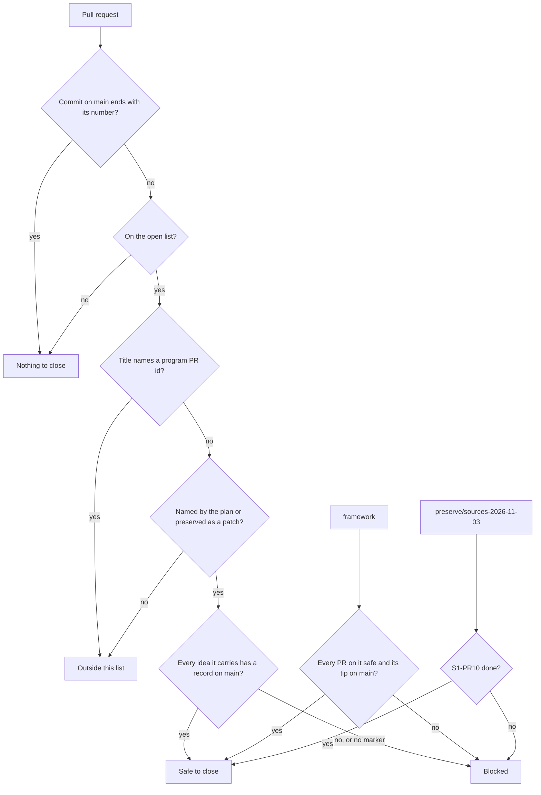

# Closure list, 2026-11-05

This file is generated by `scripts/closure-check.ts`. From the repository root, `node scripts/closure-check.ts > docs/reviews/2026-11-05-closure.md` writes it. A fresh run matches it byte for byte while main and the open pull request list stay the same.

It is a list for Torian. Claude closes no pull request and deletes no branch. Torian, or Grok Bot on his explicit go, acts on it.

## Inputs

- The open pull requests are in `docs/reviews/ontology-program/open-prs.tsv`, listed on GitHub at 2026-11-05T19:25:53Z. A pull request opened after that time is missing here, and one merged since then reads merged.
- The program's pull requests are the plan's list in `docs/design/CLAUDE_HANDOFF_ONTOLOGY_PROGRAM.md` and every patch preserved under `docs/design/preserved/framework/`.
- An idea is on main when a file under `instance/people/p-54697df9/ideas/` names its ledger row in `source`. Labels (settled, proposed only, unlabelled) are information and do not gate.
- The check compares ideas, not bytes. A file that only a closed pull request or a retired branch holds goes with it.

## Gate G7

Gate G7 asks: "Whether `framework` is rebased onto `main` before closure." It is open, so its default holds. The default is no rebase, since stage 1 preserves its PRs from their own diffs. The framework line below reads the branch as it stands, not rebased onto main.

## How a verdict is reached

## Safe to close

- #34 not merged: safe to close. Ideas N-133, N-134, N-135, N-136. Labels: 4 proposed only.
- #130 not merged: safe to close. Ideas N-137. Labels: 1 proposed only.
- #155 not merged: safe to close. Ideas N-015, N-066, N-128, N-129. Labels: 4 proposed only.
- #156 not merged: safe to close. Ideas N-066, N-129. Labels: 2 proposed only.
- #157 not merged: safe to close. Ideas N-049, N-050, N-127. Labels: 3 proposed only.
- #158 not merged: safe to close. Ideas N-112. Labels: 1 proposed only.
- #161 not merged: safe to close. Ideas N-062, N-066, N-116, N-122, N-124. Labels: 5 proposed only.
- #162 not merged: safe to close. Ideas N-066, N-110, N-111, N-113, N-117, N-118, N-120, N-121, N-122, N-123, N-125, N-126. Labels: 12 proposed only.
- #163 not merged: safe to close. Ideas N-104, N-114, N-115, N-119, N-130, N-131. Labels: 6 proposed only.
- #164 not merged: safe to close. Ideas N-114, N-115. Labels: 2 proposed only.
- framework: safe to close. Recorded tip cb502f9. PRs #155 (N-015, N-066, N-128, N-129), #156 (N-066, N-129), #157 (N-049, N-050, N-127), #158 (N-112), #161 (N-062, N-066, N-116, N-122, N-124), #162 (N-066, N-110, N-111, N-113, N-117, N-118, N-120, N-121, N-122, N-123, N-125, N-126), #163 (N-104, N-114, N-115, N-119, N-130, N-131), #164 (N-114, N-115). Labels: 28 proposed only.
- preserve/sources-2026-11-03: safe to retire, since S1-PR10 is done and every ledger row within reach has a copy on main. 36 ledger rows stay out of reach under Torian's ruling of Nov 4, 2026 at 18:52Z that closed stage 1 (5 Mac only; 11 agent memory only, no copy; 2 confidential, private store; 18 private store: Grok box notes).

## Blocked

None.

## Nothing to close

- #41 not merged and not open on GitHub: nothing to close.
- #173 merged into main as 6ffe4cf: nothing to close.
- #174 merged into main as 0328959: nothing to close.

## Outside this list

- #107 not part of this program: ledger row N-144 names it, but the plan does not, and main holds no copy of its diff, so this list gives it no verdict.
- #108 not part of this program: no ledger row names it, so this list gives it no verdict.
- #144 not part of this program: ledger row N-138 names it, but the plan does not, and main holds no copy of its diff, so this list gives it no verdict.
- #148 not part of this program: ledger row N-132 names it, but the plan does not, and main holds no copy of its diff, so this list gives it no verdict.
- #149 not part of this program: ledger row N-161 names it, but the plan does not, and main holds no copy of its diff, so this list gives it no verdict.
- #154 not part of this program: no ledger row names it, so this list gives it no verdict.
- #160 not part of this program: no ledger row names it, so this list gives it no verdict.
- #166 not part of this program: ledger row N-139 names it, but the plan does not, and main holds no copy of its diff, so this list gives it no verdict.
- #170 not part of this program: ledger row N-182 names it, but the plan does not, and main holds no copy of its diff, so this list gives it no verdict.
- #210 not part of this program: no ledger row names it, so this list gives it no verdict.
- #211 not part of this program: no ledger row names it, so this list gives it no verdict.
- #220 not part of this program: no ledger row names it, so this list gives it no verdict.
- #243 not part of this program: no ledger row names it, so this list gives it no verdict.
- #244 not part of this program: no ledger row names it, so this list gives it no verdict.
- #245 is this program's own pull request (S4-PR2): it lands by merging, so there is nothing to close.
