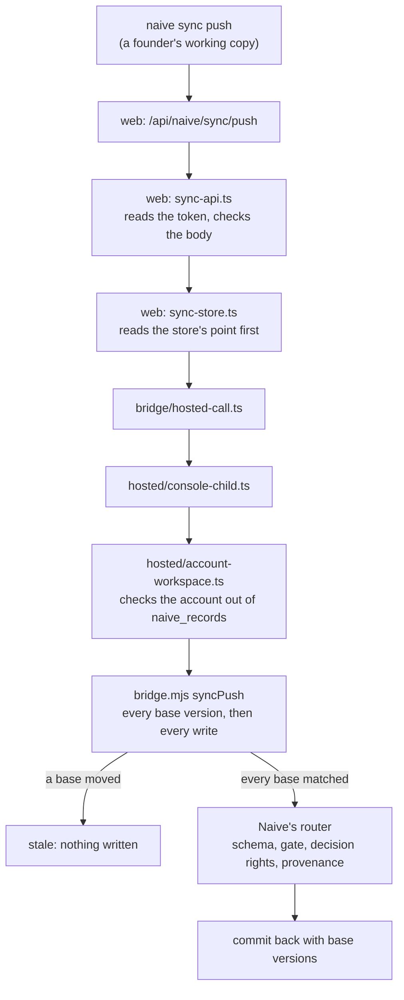

# Platform

The system has two sides, the way Next.js and Vercel do (EE-041): the framework Naive and the platform Mentura.

- **The framework**, Naive (EE-043), is the conventions. It works offline, with no account, and names no vendor. It covers record schemas and the data model, kits, the router and the CLI, MCP server and local API over it, routes, provenance, the checks, need-now priors, validation scoring, `init-venture`, the connector contract with the filesystem connector, and the docs. It has its own repository, tchjhnsn/naive, and this package depends on it as the `naive-framework` package, pinned to one commit (EE-118, EE-119).
- **The platform** hosts, connects and integrates. It holds connectors that reach a vendor over the network with credentials, the connect flow, integrations that call outside services (analytics, Listen Labs, Jev routing, treg), a hosted catalog and search, the operator console, and a gallery of templates. That is this folder.

This folder came from tchjhnsn/mentura's `platform/` with its history, when this repository became Mentura's (2026-11-24). Mentura's outside host (`outside/`) and the console's bridge into Naive (`bridge/`, from `console/lib/`) came with it. The old console and Mentura's identity package did not: the web app's sign-in is the one account. The business console in `web/` (`/studio`) reaches Naive through `bridge/`.

A template is framework, the way `create-next-app --example` is. The gallery that hosts templates is platform.

## Running it

- `npm install` here. naive-framework comes from tchjhnsn/naive, which is private, so git needs read access: your own credentials, or a read-only token in `NAIVE_READ_TOKEN` given to git by `sh naive-git-auth.sh` (CI does this, `.github/workflows/platform.yml`).
- `npm test` (`node test.ts`) runs every test here and reports each one. Tests that need Postgres skip without `MENTURA_EVAL_DATABASE_URL` or their own database URL, except in CI, where the workflow starts a throwaway Postgres and a missing URL fails.
- `naive.data-model.json` at the repository root declares this library's record types to Naive: `adapter.json`, each `kits/*/kit.json`, and the research engine's records, whose schemas are in `research/schemas/`.
- `naive.ts` says where the installed Naive sits (`naivePath`, `naiveCode`, `naivePhases`).

## The boundary

The platform builds on the framework, and never the other way round. The platform imports Naive by package name (`naive-framework/src/store/connectors/contract.mjs`), never by relative path, and by the module's `.mjs` name, which runs Naive's compiled `dist/` file and is typed from its `.ts` source, so no loader is needed. Naive's own boundary check, run in its repository, fails when Naive names a platform or console module, or registers a connector that reaches the network or names credentials.

The platform hands its parts to Naive through Naive's hooks. That is inversion of control, like a Next.js deployment adapter: the framework defines the contract, and the platform implements it for a vendor.

| Hook | What the platform passes |
|---|---|
| `registerConnector` (`naive-framework/src/store/connectors/index.mjs`) | The GitHub and Postgres connectors, from `connectors/register.mjs`. A Naive checker run as its own process gets it with `node --import ./connectors/preload.mjs` |
| `NAIVE_KITS` | This folder's `kits/`. Without it Naive has no kits |
| `NAIVE_PLATFORM_ADAPTER` | `adapter.json`. Its `verify` paths are relative to this folder |
| `NAIVE_SYNC_RHO` | `node integrations/rho.mjs sync`, when a deployment syncs money from Rho. Naive runs it as `<command> --venture <dir>`; nothing sets it by default |
| `NAIVE_TRACE_CMD`, `NAIVE_JUDGE_CMD`, `NAIVE_RESEARCH_MCP`, `NAIVE_SITE_CMD` | The LangSmith exporter, the judge, the research MCP server and the site reader, when a deployment names them |

## What is here

| Path | Holds |
|---|---|
| `connectors/github.mjs` | The GitHub connector: reads from a branch, writes by draft pull request (EE-037) |
| `connectors/fake-github.mjs` | A fake of the GitHub REST API for offline evals |
| `connectors/postgres.ts` | The Postgres connector: a tenant's records in Postgres, Neon in production (EE-118 step 9). Append-only: each write is a new row, a trigger refuses UPDATE and DELETE, and each row's hash chains to the tenant's previous one (`verify`). A read takes the newest row by numeric `seq`. The text form of `seq` is not the sort key, so a seq past 99 is still the newest. A write takes Naive's `base` and `append` options, checked under the tenant's lock: a stale `base` is refused with the current version, and an append adds whole lines, so a host can commit a working copy back safely. The table holds text, so a write given bytes takes them only when they are valid UTF-8 and otherwise is refused. The connection string is read from the variable `url` names (default `MENTURA_DATABASE_URL`) and never stored. `MENTURA_DB_DRIVER` picks the driver: `pg` (default, TCP to 5432) or `neon-ws`, Neon's serverless driver over a WebSocket on 443, which goes through `HTTPS_PROXY` when it is set, for a cloud container where raw TCP is blocked. A path is removed by a tombstone: a new row whose version is `REMOVED` (`"removed"`, never a 40 character blob SHA) with empty content, chained like any other row. Reads, lists and searches skip a path whose newest row is a tombstone, and a write after one starts the path again. The contract has no delete; only `hosted/move-business.ts` writes tombstones. `SCHEMA` did not change |
| `connectors/store-import.ts` | Loads a folder into a tenant's store through the Postgres connector, skipping dot files except `.gitkeep` (which keeps an empty folder Naive expects, such as a layer folder), reads every file back and checks the chain: `node connectors/store-import.ts <folder> --tenant <id> [--check]`. Running it again appends nothing. This is how the company's records, once `instance/`, moved to Neon (EE-118 step 9c) |
| `connectors/store-export.ts` | Writes a tenant's records back out of its store into a missing or empty folder, the newest content of every path, and checks each file against the store's version: `node connectors/store-export.ts <folder> --tenant <id> [--root <path>]`. Tools that read a folder of records, such as the ontology program's scripts, read an export. Keep an export out of git |
| `connectors/postgres-eval.ts` | The Postgres connector against the contract suite, the append-only trigger, tenant isolation, the import of Naive's example workspace and the export, on a real Postgres named by `MENTURA_EVAL_DATABASE_URL` (a service in CI); without it, it skips |
| `connectors/mcp.ts` | The `mcp` connector: reads one kind of a business's records from a service the person connected in Mentura (Stripe customers first), read-only. It never holds the service's tokens: each call is a signed request (HMAC-SHA256 with the bridge key, a minute to live) to the web app's `/api/naive/mcp` route, which checks the connection is connected and open to the business, calls the service's MCP tool and turns the result into records with an adapter. The bridge sets who is acting (`actAs`) from its assertion; `NAIVE_MCP_URL` names the route. A source entry is `{id, connector: "mcp", api: <service>, writes: "none"}` |
| `connectors/mcp-test.ts` | The `mcp` connector against a fake route: signed bodies, list, read, version, search and a refused write |
| `connectors/register.mjs`, `connectors/preload.mjs` | Register the GitHub, Postgres and MCP connectors with Naive, in this process or preloaded into a Naive checker |
| `connectors/eval.mjs` | The GitHub connector against the framework's contract suite (`naive-framework/src/store/connectors/suite.mjs`), its registration, the router over a GitHub source, the catalog (the source map checked with Naive's `validate.mjs`, no Python), and an optional live run |
| `intake/` | Raw intake for triage (Naive `docs/design/RAW_TRIAGE_2026-11-09.md`): an append-only claims table, a trigger that notifies when a raw entry lands in `naive_records`, and a worker that claims each entry once and hands it to triage. See `intake/README.md` |
| `hosted/working-copy.ts` | The host side of Naive's hosted working copy (Naive `docs/design/HOSTED_WORKING_COPY_2026-11-07.md`): checks a tenant's records out of its store into a folder, runs Naive there with `NAIVE_RUNTIME=hosted`, and commits what changed with each path's base version. A record is written whole, a log only by appending its new lines, and a derived file never (each run rebuilds it). A rewritten log or a removed record refuses the commit before anything is written. On a version conflict the copy is refreshed and the request runs again, twice by default. `refresh` brings a kept copy up to date by version. Not built: a per-request sandbox and the registered hooks (`judge`, `site`, `trace`, `sandbox`, `git`) |
| `hosted/account-workspace.ts` | The hosted console's account workspace. One `naive_records` tenant per team (a personal team's id is its person's Better Auth user id). A request checks that tenant out to a temporary folder, runs `bridge/bridge.mjs` there, and commits only when the bridge accepts the operation. The folder is removed afterwards, including when the bridge times out or exits non-zero. The Next server does not import this file; it starts `hosted/console-child.ts`, and the signed assertion is stdin, not an argument. The console file trace lists that child, the modules it imports, the bridge sources, and the `naive-framework` and `pg` packages, and it does not list `console/.data` or an env file. A process failure, including a database the connection cannot open, returns one fixed sentence, with no command, assertion, path, host, role name, or database URL. Production identity and outside databases are sealed separately. This package does not grant this role on them and does not change their grants. A code issued for a venture on disk is refused: the hosted console does not redeem it and does not migrate it. A `https` `MENTURA_PUBLIC_ORIGIN` uses this and does not read `console/.data`. The connector schema is applied by the database owner; the runtime role does not create the table (`schema: false`). SHA-256 of `SCHEMA` in `connectors/postgres.ts` is `e0e22be5167e5d1b31bd37e47de39f7ed21dddddcac20a5b8337731d73c017d4`. The runtime role is not `mentura_console_tenant_guard`. It is a separate role, named here `mentura_console_tenant`, with `connect` on the tenant database, `usage` on `public`, `select` and `insert` on `naive_records`, and `usage` and `select` on `naive_records_seq_seq`. No `update` and no `delete`. It is not granted `select` on identity tables or `outside_log`. This package does not revoke `connect` on those other databases, and a role can still see table names in the catalog. It does not change a shared database's grants. `CONNECT` on another database is a default Postgres grant to `PUBLIC`, not a row read. The console's tenant is the team id inside the signed assertion (`identity.organizationId`, else `identity.userId`): the web server checks the person's membership of that team before it signs (web/src/server/naive.ts), and a personal team's id is its person's, so the tenants made before teams are those people's personal teams. A different person on the call is refused and commits nothing. `sql/003-team-tenant.sql` replaces `mentura_authorize` so the row policy binds the same team id, and `sql/003-team-tenant-rollback.sql` puts 002's function back; neither reads, moves or deletes a row. The shared runtime login is not a per-tenant principal by itself. `sql/002-tenant-isolation.sql` adds a row policy the login cannot set aside: a row is visible only when `mentura_authorize` has checked the signed assertion in that transaction. A tenant id, a session variable the login sets, and `set role` do not choose another account. The login cannot read the key or the grant table. `FORCE ROW LEVEL SECURITY` applies the policy to the table owner. A superuser still bypasses it, and the runtime must not be a superuser. SHA-256 of that file is `d88d63805ba9a6f3969ea5ed285a4634ac0bae48ae9d806cd387e9c395d2c12a`. SHA-256 of `sql/002-tenant-isolation-rollback.sql` is `6efd62c50fbd60f6f8fbcb9af8e39d2e61a9a429c990394f47c4989af43b1a4d`. The rollback drops the policy and the grant tables and does not delete `naive_records` rows. It revokes `mentura_console_tenant` only when that role exists, so a rehearsal login with another name can still roll back. Apply both only on a scratch database first. This process does not apply them to a database that holds personal rows. |
| `hosted/setup-store.ts` | Sets up the hosted business store in its own tenant database, as the database owner: the `naive_records` table, the runtime login `mentura_console_tenant` created with SQL (so it has no role that bypasses row security, which a hosting console's roles can have), its grants, `sql/002-tenant-isolation.sql`, `sql/003-team-tenant.sql` and the key: `MENTURA_ADMIN_DATABASE_URL=<owner url> MENTURA_RUNTIME_PASSWORD=<password> NAIVE_BRIDGE_KEY=<key> node hosted/setup-store.ts [--driver neon-ws]`. It prints none of the three values and refuses a runtime login that can bypass row security. Running it again resets the password and key. `hosted/setup-store-test.ts` runs it twice on a throwaway Postgres |
| `hosted/move-business.ts` | Moving a business to another team (D5 in the doc "Mentura console: screens, navigation and teams", 2026-11-25) and removing a team's businesses (D6 Delete team, A4 Delete account). A business is the folder holding its `venture.json`; Naive's walk skips folders starting with `.` or `_`, and so does this. In `naive_records` a move is one transaction on one connection: both tenants' advisory locks (the connector's own keys, in sorted order), the source team's grant (`mentura_authorize` on its signed assertion), a tombstone for every path of the business, then the destination's grant and a copy of every path with the same content and version. Each row is chained onto its own tenant's newest hash, so both chains verify, and the venture's provenance log arrives byte for byte. The source's `naive-workspace.json` drops the folder and the destination's lists it (a team with no workspace file gets one), and each team's `meta/provenance.jsonl` gets a `venture-transfer-out` or `venture-transfer-in` line. A business whose id the destination already has is refused and nothing is written; a folder name the destination uses gets `-2`, `-3`. A business inside another, or holding one, does not move. Removing a team appends a tombstone for every live path of its tenant; the history stays in the append-only table. On disk (next dev) a move renames the folder into the other team's workspace and removing a team deletes its folder |
| `hosted/store-change.ts`, `hosted/store-child.ts` | The door for those changes. The web server signs one assertion per team (`web/src/server/moving.ts`) and starts `hosted/store-child.ts` with them on stdin, as it starts `hosted/console-child.ts`. A move needs two assertions from one person carrying the same request `{op: "transfer", venture, from, to}`, the first for the source team and the second for the destination, each with `organizationRole` `owner`; a removal needs one `{op: "removeTeam", team}` for that team, by an Owner. Anything else is refused before the database is reached, and the row policy checks each assertion again in the database. A hosted origin changes `naive_records` through the runtime login (`tenantPool` in `hosted/account-workspace.ts` proves the database apart first); a local one changes the folders under `NAIVE_CONSOLE_WORKSPACE`. `hosted/move-business-test.ts` runs both, the database half on a throwaway Postgres (`MENTURA_EVAL_DATABASE_URL`) |
| `hosted/run.ts` | Runs one Naive command for a tenant on a fresh working copy and commits: `node hosted/run.ts --tenant <id> -- <command> {dir}`, with `{dir}` replaced by the copy's path. It reads the connection string from `MENTURA_DATABASE_URL` (or `--url`) |
| `hosted/working-copy-test.ts` | Tests the working copy offline, with Naive's filesystem connector as the store; `connectors/postgres-eval.ts` also runs a Naive check on a copy of a Postgres tenant and commits its provenance line |
| `mcp/research.mjs` | Market research for agents through Firecrawl, as an MCP server: search and read a page, every result with its URL (EE-059). Needs `FIRECRAWL_API_KEY` |
| `integrations/jev.mjs` | Jev (TypeSafe) for typed judgments: sends a request the framework built, such as the idea map's tags, and prints the answers (EE-059). Needs `TYPESAFE_API_KEY` |
| `agents/` | Mentura's LangChain side over Naive (EE-121, EE-122): `NaiveBackend`, a deepagents backend over Naive's agent filesystem, and `NaiveTracer`, a callback handler that writes a run as spans in the venture's trace files. Function, lead and researcher specs are Naive's. This folder re-exports them and runs them. `node agents/bin.ts run <function> --venture <id>` runs one function agent in its own process (EE-123), and `bin.ts mcp` offers the staffed agents as MCP tools. Meetings with agents (Naive EE-200): `node agents/bin.ts cmd --venture <id> --by <person>` runs a slash command such as `/meet strategy intake`, which walks that workflow with the function's agent on LangGraph, stops for the person where a step asks, loops back over skipped steps and records the meeting where every agent's memory reads it. Each function's researcher (autoresearch build plan item 13): `node agents/bin.ts research <function> --venture <id or folder>` improves the recipes its research program lists, writing only through Naive's `recipes/<pattern>` route, within the plan's budget. See `agents/README.md` |
| `integrations/langsmith.mjs` | Uploads a harness run's trace, with Naive's evals as feedback, to LangSmith (EE-059). Needs `LANGSMITH_API_KEY` |
| `integrations/langsmith-otel.ts` | Ships a venture's trace files (`traces/<session>.jsonl`, EE-121) to LangSmith's OpenTelemetry endpoint when online: only the spans not yet accepted, each once, remembered in `.naive/langsmith-sync.json`; offline they stay pending. The files stay the record. Needs `LANGSMITH_API_KEY`; `--dry-run` lists what is pending. Sent as OTLP/HTTP JSON. The export has been tried against LangSmith. |
| `integrations/langsmith-otel-test.ts` | Ships trace files to a local stand-in for LangSmith's OTel endpoint, offline |
| `integrations/langsmith-test.mjs` | Ships a Naive trace through the exporter to a local stand-in for LangSmith, offline |
| `integrations/langsmith-docket.mjs` | The docket's evidence as a LangSmith experiment: the scenario states as a dataset, and one scored run of the docket and the judge (Jev) as an experiment over it (EE-075). Needs `LANGSMITH_API_KEY` |
| `integrations/rho.mjs` | Rho, the founder's bank and spend suite, as the venture's money source: syncs `money/` (accounts, a sensitive append-only transactions stream, and a summary) over Rho's MCP server, calling only read-only tools (EE-070). Rho's sandbox by default; `--live` needs `RHO_API_TOKEN` |
| `integrations/remote-image.mjs`, `integrations/remote-image-test.mjs` | Fetches a remote image into a venture's register (only allowed hosts, images only, originals private in `raw/`, copies by license) and its offline test, which checks the note in `raw/` with Naive's `validate.mjs` |
| `integrations/site.mjs` | Reads a venture's website: the home page and the pages it links to, as text, with where each sits (EE-062). Uses `FIRECRAWL_API_KEY` when set, a plain fetch otherwise |
| `adapter.json` | Mentura as Naive's first adapter, as Vercel is for Next.js: with `NAIVE_PLATFORM_ADAPTER` naming it, `mentura adapters verify mentura` runs the connector contract suite, the webhooks and the kits (Z-4) |
| `adapter-test.mjs` | Mentura is listed, refused as a venture adapter, and verified by those tests |
| `research/research-test.mjs` | Tests for the research engine, offline: its schemas in `research/schemas/` are checked in process by Naive's validator (`naive-framework/src/records/validate.mjs`), with no Python. A schema without an `$id` is registered by its file name |
| `kits/agent-upgrade/` | The agent-run upgrade behind `naive upgrade --agent`: an agent does the guides' by-hand steps on a staged copy, and the framework's checks decide (U-3). `stand-in-agent.mjs` runs offline |
| `kits/validation-kickoff/` | An automation over the validation package: once the foundation is complete, it proposes the decision to start validating (M-12) |
| `kits/test.mjs` | Tests for the kits, with the stand-in agent |
| `webhooks/server.mjs` | Signed webhooks from systems of record: a change marks the summaries that read it stale (V-9). Secrets come from `NAIVE_WEBHOOK_SECRET_<SOURCE>` |
| `webhooks/test.mjs` | Tests for the webhooks, offline |

## The bridge

| Path | Holds |
|---|---|
| `bridge/bridge.mjs` | The one door from a web server into Naive. The server runs it in a child process with one operation as JSON and reads one JSON answer back, so Naive is never bundled into the web build. Each call carries a signed identity (`bridge/assertion.ts`) and works only in that account's workspace. Its `venture` operation answers the venture's id, name, phase, founder, `departments` (the functions it has turned on, from venture.json, which the console's sidebar lists), `industry` (NAICS code and label), `regulation` (exposure) and `funding` (each null when venture.json does not say, for the console's integrations recommender) and its folder tree. `sources` answers the venture's source map (`knowledge/sources.json`, EE-042) wherever its layout keeps it, and `source` is a person choosing where one record type is kept: it replaces that type's whole-business rule with one naming a connected service's `mcp` source entry, or removes it for the venture's own folder, drops an `mcp` entry no rule names, and writes the map through the router as the person; an agent is refused |
| `bridge/bridge.mjs`, operations `needs` and `briefing`, `bridge/needs-test.ts` | The read path for "Needs you", the bottom bar's Stream and the briefings (round 5). `needs` answers the open decisions a person can settle now (render now, overdue or stale) in the order of Naive's decision index (`system/decision-index`, `packages/naive/src/engine/decision-index.ts`), each with its function (from the index's `by_function`), what it unlocks and how many decisions it holds (from the decision matrix), its due time and the index's reasons; `held` counts the active decisions that wait on another first, and `last_decided` is the newest decision a person approved. The index is recomputed on each read and its cache files (`.naive/decision-index.json` and its history) are put back as they were, so the read changes nothing in the business, which matters on the hosted store, where every changed file is committed. `briefing` answers levels 1 and 2 (`packages/naive/src/engine/activity-briefing.ts`, `naive activities briefing`, EE-180) for every function the business lists, or, with `function`, for that one function whether or not it is listed, with its activities that have a rule (`packages/naive/src/engine/agents/assignments.ts`: assigned in `operations/activity-assignments.json`, or the default from the activity's kind, EE-179). Neither writes, so a Viewer reads both. The briefing counts and names who performs each activity; what agents did is not in it (Naive: not built) |
| `bridge/claims.ts`, `bridge/claim-code.ts` | One-time codes that let an account claim a venture no account owns. `node bridge/claim-code.ts` lists those ventures, and `node bridge/claim-code.ts <venture>` issues a code good for 24 hours |
| `bridge/phase.ts`, `bridge/record-forms.ts` | Plain wording for phase gates and the forms a person fills for statement records |
| `bridge/hosted-call.ts` | The server's call into the hosted workspace (`hosted/console-child.ts`), with the signed assertion on stdin, and `runStoreChild`, its call into `hosted/store-child.ts` for a move between teams or a team's removal |
| `bridge/naive-file.mjs` | The same path rule as `naive.ts`, kept apart so a web build can copy the bridge alone |
| `bridge/files.ts` | Each venture's own storage (venture console spec, 2026-11-24): a private `files` folder where the venture's layout puts that logical path (`k-base/files` by default). The bridge's `files`, `fileRead`, `fileWrite`, `fileFolder`, `fileMove` and `fileDelete` operations list, read, upload (up to 20 MB, never overwriting unless asked), make folders, move and delete inside it, and log each change in the venture's provenance as the person's act, with an upload's bytes in the blob store. Paths with a leading dot, a slash out or a link are refused. Hosted storage is not built |
| `bridge/bridge.mjs`, operation `syncPush` | A working copy's offline changes, pushed back (the offline sync contract, 2026-11-25; Naive `docs/design/OFFLINE_SYNC_2026-11-25.md`, EE-174). All or none: every change's base version is checked against the checked-out copy first, and one base that no longer matches answers `{ stale: [...] }` with the paths that moved and writes nothing. Each accepted change then goes through the router as the person the sync token names, so the schema, the gate, decision rights and the provenance log apply as they do for a write from the console; a refused write throws, so the hosted workspace commits nothing. A venture-relative path becomes a route from the route table's own `files` patterns, with a named pattern winning over a collection's wildcard, so `money/_summary.json` is `purpose/money/summary` and not an item of `money/[id]`. A path no record type owns, `venture.json` (which has no route) and a removal are refused. It answers with every change it wrote and that change's new version, and a write the gate holds refuses the push rather than report the version the record already had, because a working copy moves its base versions from that answer. Paths are logical, as a working copy names them, and are found on disk with Naive's `ventureFile`, so a structured or src business works. The working copy's own provenance lines arrive as `provenance` with the `working_copy` they came from: they are checked with Naive's `rechain` (EE-177) before anything is written, so an edited or already re-chained line refuses the push, and after every write has landed they are written again on top of the store's log, from the tip the router's own lines for this push left (`bridge/sync-push-test.ts`) |
| `bridge/venture-layout.ts`, `bridge/venture-layout-test.ts` | Naive's layout rules (`physical` and `logical` in `naive-framework/src/core/venture-paths.ts`) said over a list of paths instead of a folder, for the hosted store, which keeps rows at physical paths and has no disk: the layout from venture.json, the knowledge-base folder (`k-base/`, or `knowledge/` in a business made by 0.3.0) and any `(group)/` folders from the paths the business holds, then `physicalPath`, `logicalPath`, and `recordAt`, which gives a file's logical path only when Naive would read that record from there. It imports nothing, so the web app's sync pull (`web/src/server/sync-records.ts`) uses it without resolving the framework. It is a copy of Naive's rules, so the test lays out a real business in each layout (flat, structured, structured under `knowledge/`, structured with `(group)/` folders, src), places every path the route table and the venture template name with Naive's `physical`, and requires the same physical path for every logical one and the same logical path for every file |
| `bridge/sync-paths.ts`, `bridge/sync-paths-test.ts` | The path a working copy pushes, turned into the route the router writes, from the route table's own `files` patterns rather than a rule written out again. Pure, so the test proves it against Naive's real table: every writable record pattern must map to a route `resolve()` knows, a named record beats a collection's wildcard, and a path that leaves the business folder is refused |
| `bridge/bridge-test.ts` | Signed identity, path guard, claims, setup and judge errors |
| `bridge/files-test.ts` | The files folder round trip and every way out of it |

## Tenant boundary

The console does not choose the account from the request body. The database does not trust a tenant id or a session variable from the runtime login.

```
signed session
    |
    |  assertion: account id inside the HMAC
    v
hosted child  -- verifies the signature, refuses a different id
    |
    |  select mentura_authorize(assertion)
    v
owner function -- key table is hidden from the runtime
    |            writes an unguessable grant for that account only
    |            SET LOCAL, gone when the transaction ends
    v
row policy: tenant = mentura_account()
    |
    v
runtime login sees and appends only that account
```

A second request on the same pooled connection starts a new transaction and a new grant. `CONNECT` on the identity and outside databases is still the default `PUBLIC` grant. That is not a row read. This package does not revoke it and does not change those databases.

## Offline sync

The sync API in `web/src/app/api/naive/sync/` writes through this package, on the path the console already uses.



A pull does not take this path: `web/src/server/sync-records.ts` reads the account's rows straight out of
`naive_records`, in a transaction the database binds to that account (Tenant boundary, above). Files go to the
assets bucket by their sha256, outside this package, in `web/src/server/sync-files.ts`.

## Not yet moved

Each layer's `tooling/integrations.json` stays in Naive for now. Most entries are opinionated defaults with references (EE-014), plain data that calls nothing, like a framework's docs recommending a host. An entry moves here once it carries code that calls a vendor.
