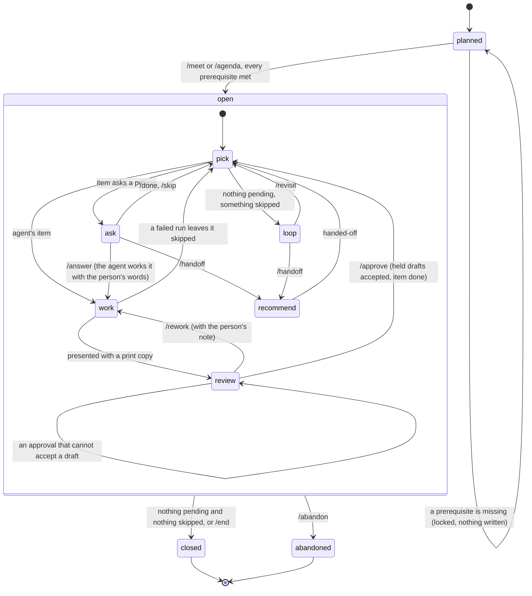

# Agents

Mentura's LangChain side over Naive (EE-121, EE-122). Mentura builds its function agents with LangChain deepagents and any harness runs them: Claude Code, Cursor, Codex, a trigger or Mentura's own interface, with any model LangChain can load. The backend and the tracer make such an agent work through Naive's deterministic layers and leave its run in the venture's own files; the function agents (EE-123) are built on them. Naive imports nothing from LangChain; everything that names LangChain is here.

| File | What it does |
|---|---|
| `naive-backend.ts` | `NaiveBackend`, a deepagents backend (`BackendProtocolV2`) over Naive's agent filesystem (`naive-framework/src/router/agent-files.ts`). A deep agent's `ls`, `read_file`, `write_file`, `edit_file`, `glob` and `grep` become Naive router calls on the venture's records, so every write meets the schema, the gate, decision rights and provenance. A gated write is held as a draft, and the agent is told the record did not change. Given the run's tracer, each file operation's span hangs from the tool call that made it |
| `naive-tracer.ts` | `NaiveTracer`, a LangChain callback handler that writes each agent run, model call and tool call as a span in `<venture>/traces/<session>.jsonl` through Naive's `span()`, so the hash chain, the content rule (inputs and outputs only with `traces.content`) and `check-traces.ts` hold. The run id is the span id; LangGraph's inner node runs are not spans. The session comes from the option or `MENTURA_SESSION`, so a harness's turn, its function agents and their provenance lines share one trace. Nothing leaves the machine; `../integrations/langsmith-otel.ts` ships the files to LangSmith |
| `agents-test.ts` | A deep agent built with `createDeepAgent`, a scripted model, the backend and the tracer, against a made-up venture, offline |
| `function-spec.ts` | Re-exports Naive's function agent and researcher specs (`naive-framework/src/engine/agents/function-spec.ts`). Naive owns the definitions. Every id in `departments.json` is one function agent, acting in the team-plan role `<function>-agent`. Its write globs are `functionWrites` in Naive's `reach.ts`, the same list the router enforces, never a second list computed here. Each function's researcher (`functionResearcher`) is that same spec: the role `<function>-researcher`, the projected patterns it works, and the write routes `recipes/<pattern>` |
| `function-agent.ts` | One function agent run: checks the venture's team plan, locks the venture (`.naive/agent-run.lock`), answers a repeated run id from the files, loads the model, runs the deep agent with the function's module mounted read-only at `/function/` and the run's identity set in the process environment, and reports the answer, what it wrote and the drafts held for a person, each with its `mentura accept` command |
| `lead-spec.ts` | Re-exports Naive's lead specs and `routeFor` (`naive-framework/src/engine/agents/lead-spec.ts`). Every role template with a `portfolio` is one lead, with its template's skill and the write routes `operations/lead/<id>`, `decisions/*` and `operations/handoff/*`. `routeFor` applies Naive's routing rule (`naive-framework/src/engine/route-task.ts`) |
| `lead-agent.ts` | One lead run, mirroring the function agent run (same process claim, venture lock, run id, trace join and outcome): the deep agent reads every record, has its role's skill mounted read-only at `/lead/`, and writes a lead plan entry and one handoff per function involved, each addressed to `<function>-agent` with `requested_by` set to the lead. Any other write, or a handoff for someone else, is refused before Naive sees it. The result adds whether the plan changed and the handoffs written |
| `research.ts` | One researcher run (autoresearch build plan item 13): for each pattern the venture's research program lists, one deep agent proposes one change to `/<pattern>.recipe.ts` per turn, written only through Naive's `recipes/<pattern>` route, which scores it; the loop stops at the plan's budget, the run's limit or a turn with no experiment, and reads only as of the plan's cut |
| `cli.ts`, `bin.ts` | `mentura-agent`, the one way to start a run: `node platform/agents/bin.ts cmd --venture <id> [--by <person>]` with a slash command on stdin, `node platform/agents/bin.ts run <function> --venture <id> [--run-id <uuid>]` with the task on stdin, `node platform/agents/bin.ts lead <lead> --venture <id> [--run-id <uuid>]` with the task on stdin, `node platform/agents/bin.ts research <function> --venture <id or folder> [--run-id <uuid>] [--max-experiments <n>]`, or `node platform/agents/bin.ts mcp`. One process per run |
| `jev.ts` | Jev (TypeSafe System 1) as a LangChain runnable: takes the request Naive's triage builds (`state`, `model`, `questions`), sends it in chunks to TypeSafe with `TYPESAFE_API_KEY` and returns the answers. It decides nothing. With no key, `jevRunnable` returns null and the caller holds every label for a person; it never falls back to another model |
| `triage-ledger.ts` | Founder corrections in the detection ledger (raw triage item 7). Each Noul label Jev answers is a trial of the `triage-accept` detector, scored by Jev's certainty (max(p, 1 − p)), a yes call (needs a person) below the line. The graph appends the trials when it files, given a `ledger`; a held label the founder answers as Jev guessed resolves as a false alarm, the other way as a hit. `correctFiled` resolves a filed label the founder later changes as a miss, or confirms as a correct rejection. `routerLedger` appends through Naive's router (`governance/detector-trial/triage-accept`) as `triage-agent` for trials and as the person for resolutions |
| `triage-graph.ts` | The triage graph (Naive `docs/design/RAW_TRIAGE_2026-11-09.md`, item 4), a LangGraph `StateGraph` over one raw entry: load, ask Jev, decide with Naive's `decide()`, hold with `interrupt()` when a label is below the `triage-accept` line (or always, with `confirmAll`), file, route with Naive's `routeTask`. A held run is a checkpoint and resumes with `Command({ resume })` carrying the founder's yes or no per label; each answer is kept beside Jev's guess (`person` on that label). It files an idea (`people/<person>/ideas/<id>.json`) per fragment or a reference (`people/<person>/references/<id>.json`), and one triage record (`raw/triage/<id>.json`) with every label, the model and the line. The test checks all three against Naive's schemas (`founder-idea`, `founder-reference`, `triage`). It never writes raw. The checkpointer and the writer are injected: `MemorySaver` and an in-memory writer in the test |
| `mcp.ts` | The MCP shim for any MCP harness: one `agent_<function>` tool per function the venture has staffed and one `lead_<id>` tool per lead it has staffed, each call a `bin.ts run` or `bin.ts lead` child process, a cancel sent to it as SIGTERM, `route_task`, which applies the routing rule, and `command`, which runs one slash command as a `bin.ts cmd` child |
| `meetings.ts` | Meetings with agents over Naive's meeting record (EE-200, route `operations/meeting/[id]`): a meeting built from a function workflow (one pending agenda item per step, owned by `<function>-agent`) or from a person's own agenda, the outcome and takeaways derived at close (`closeOf`), the stable run id of each item's agent run (`itemRunId`), and the record read and written through Naive's router as the role `meeting-facilitator` (`routerStore`) |
| `meeting-graph.ts` | The meeting graph, a LangGraph `StateGraph` that works a meeting's agenda in order: an item that asks a person stops the graph with `interrupt()`, an agent's item is worked by the worker and waits for a person's approval, a skipped item is looped back to or handed to its agent to recommend, and the meeting closes with a derived outcome. Every change is written to the record before the graph moves on |
| `meeting-worker.ts` | The production worker: each agenda item is worked, or recommended on, by its owner as a function agent run, with a task that names the meeting's goal and the workflow step's skill, writes and decision classes |
| `prerequisites.ts`, `prerequisites.json` | What must be finished before a workflow may start, for people and agents alike, and whether it is: Mentura's policy plus a workflow's own `requires` in Naive, failing closed |
| `review.ts` | The print copy of what an agent drafted for an agenda item, and accepting its held drafts once a person approves |
| `commands.ts`, `command-host.ts` | The slash commands (`/next`, `/meet`, `/agenda`, `/answer`, `/approve`, `/rework`, `/blocked`, `/done`, `/skip`, `/handoff`, `/revisit`, `/end`, `/abandon`, `/meetings`, `/skipped`, `/memory`, `/tools`, `/help`), parsed pure and run against one venture; the host wires the router store, the function-agent worker, `<venture>/.naive/meeting-checkpoints.sqlite`, Naive's `due` ranked by the phase's function weights, and Naive's run log on close |
| `memory.ts` | Each agent's memory, rendered from the business's closed meetings into `<venture>/.naive/agent-memory/<role>/MEMORY.md` before each run and loaded as deepagents memory from a read-only mount at `/memory/` |
| `skills/` | Mentura's own skills, mounted read-only at `/mentura/skills/` for every function and lead agent: `ownership` (an agent runs every gate on what it executes, the publishing gate and internal-terms lint included, and hands off between writing and building), `information-hierarchy` (answer first, top-down stages, best practice named at each stage), `meetings` (how to work an agenda item, recommend on a handed-off one, and start a temporary specialist with the `task` tool), `documents` (the record, then a print copy a person approves, then a PDF, deck or document for outsiders, HTML last) and `tooling` (choose tools that let the business see every activity and own its data) |
| `tool-policy.json`, `tool-policy.ts` | The tooling skill's rubric: visibility and ownership are gates (a 0 rules a tool out), then fit, cost and learning, weighted; `scoreTools` does the arithmetic and never chooses |
| `meetings-test.ts` | The meeting graph, approval, the prerequisite locks, the slash commands, memory and the tool rubric, offline, with a scripted worker against a made-up venture and Naive's meeting schema |
| `function-agent-test.ts` | The strategy agent run offline with a scripted model, through the CLI and through the shim |
| `lead-agent-test.ts` | The growth lead run offline with a scripted model: a plan entry and one handoff per function, no function record; the routing rule; the CLI and the shim |
| `research-test.ts` | The strategy researcher run offline with a scripted model: it keeps, discards, and stops at the run's limit and at the plan's budget; every other write is refused; the cut is the plan's; through the CLI too |

```ts
const tracer = new NaiveTracer(ventureDir, { session, agents: ["strategy"] });
const agent = createDeepAgent({ model, name: "strategy", backend: new NaiveBackend({ venture: "kettle" }, tracer) });
await agent.invoke(input, { callbacks: [tracer] });
```

From `packages/platform`, run the tests with `node agents/agents-test.ts`, `node agents/function-agent-test.ts`, `node agents/lead-agent-test.ts`, `node agents/research-test.ts` and `node agents/meetings-test.ts`. Outside a function, lead or researcher run, the venture needs `"traces": true` in `naive.config.json` for spans to be written.

## Function agents (EE-123)

A function agent runs one task on one venture in its own process. The process is the run, so its environment carries the run's session, trace, role and model, and every Naive reader (the tracer, the router's acting check, provenance) agrees on them. It does not call the outside host. That host admits only a person, and a function agent is not given its keys. A run is always traced, whatever the venture's `traces` setting, and LangChain's own tracing is off: the spans stay in `<venture>/traces/<session>.jsonl` beside `provenance.jsonl`.

```sh
MENTURA_WORKSPACE=~/workspace/ventures MENTURA_MODEL=anthropic:claude-opus-4-5 \
  node platform/agents/bin.ts run strategy --venture kettle <<< "Tighten the pricing decision."
```

It prints one JSON result and exits 0 (done, or already ran), 1 (failed), 2 (refused or usage), 75 (busy: another run holds the venture, try again with the same `--run-id`) or 130 (cancelled by SIGTERM or SIGINT). The result names the run, the agent's answer, what it wrote, and each draft held for a person with the command that accepts it, such as `mentura accept decisions/pricing --venture kettle`. Only a person runs that command.

A function run and a lead run save the graph in `<venture>/.naive/agent-checkpoints.sqlite`. The same `--run-id` continues that graph when the process stopped before the run's root span was written. Once the span is written, the same id reports the first result and does not run again. A researcher run does not use this file. Its experiment log and the plan's budget are what a later run reads.

`mentura-agent traces --venture <id> [--session <name>] [--trace <id>]` prints one JSON summary of the files in `<venture>/traces/`. Each run lists its span counts, tool calls, router writes and the provenance lines with activity `draft` that name that run. It does not upload anything. `node integrations/langsmith-otel.ts <venture dir>` is the separate export, and it runs only when you start it.

The environment it reads, once, at the start:

| Variable | What it is |
|---|---|
| `MENTURA_WORKSPACE` | The folder that holds the ventures |
| `MENTURA_MODEL` | The model as `provider:model`, passed to LangChain's `initChatModel`. The provider's LangChain package must be installed (`npm install @langchain/anthropic`, which is not a dependency here) and reads its own key from its own variable (`ANTHROPIC_API_KEY`). Nothing here reads, logs or stores a key |
| `MENTURA_SESSION`, `MENTURA_TRACE_ID`, `MENTURA_SPAN_ID` | The caller's trace. The run's spans go to that session's file, and its root span (whose id is the run id) hangs from the caller's span. Unset, the run starts its own trace |
| `MENTURA_HARNESS` | Who started the run, for provenance |

A venture staffs a function agent by listing its role in its team plan. Until then a run is refused, and the refusal carries the entry to add, with write routes derived for that function. The role must be an agent's, must list routes (a role without routes could reach every route) and must not be able to write the team plan. The agent never writes the team plan itself.

### Record-writing runs

`mentura-agent harness` is the command to put in `NAIVE_AGENT_CMD`. It reads the prompt on stdin, takes the role from `MENTURA_ACTOR_ID`, and runs in the venture folder, which is what `naive agent run` does. The task is the `## Task` section of that prompt. The run is the function or lead agent above, so file tools go through NaiveBackend and the gate. It has no shell.

```sh
NAIVE_AGENT_CMD="node platform/agents/bin.ts harness" naive agent run strategy-agent "Tighten the pricing decision."
```

A command in `NAIVE_AGENT_CMD` that grants Write, Edit or Bash can change files without the gate. Dogfood's `run/bin/harness` is that command. Point `NAIVE_AGENT_CMD` at `mentura-agent harness` instead.

The agent-upgrade kit is a different path. It edits a staged copy, Naive's checks run after it, and nothing lands until a person accepts. `MENTURA_AGENT_CMD` replaces that kit's command. It is not this harness.

### From a harness

Any harness that speaks MCP adds the shim to its MCP config. Nothing here depends on which harness or which model: the harness's own model only calls the tools, and the agents run on whatever `MENTURA_MODEL` names. The trace variables name the harness's session, trace and the span of its turn. The example is a Claude Code config, where the key is a reference Claude Code expands from its own environment, so the file holds no key; another harness sets the same variables its own way:

```json
{
  "mcpServers": {
    "mentura-agents": {
      "command": "node",
      "args": ["<everything-ecosystem>/platform/agents/bin.ts", "mcp"],
      "env": {
        "MENTURA_WORKSPACE": "<the folder that holds the ventures>",
        "MENTURA_VENTURE": "kettle",
        "MENTURA_SESSION": "<the harness's session>",
        "MENTURA_TRACE_ID": "<the harness's trace id>",
        "MENTURA_SPAN_ID": "<the span of this turn>",
        "MENTURA_MODEL": "anthropic:claude-opus-4-5",
        "MENTURA_HARNESS": "claude-code",
        "ANTHROPIC_API_KEY": "${ANTHROPIC_API_KEY}"
      }
    }
  }
}
```

The calling model sees one tool per function the venture has staffed (`agent_strategy` for kettle), one per lead it has staffed (`lead_growth-lead`), and `route_task`. A run tool takes the input `{ task, venture?, run_id? }`. `venture` defaults to `MENTURA_VENTURE`, and `run_id` (a UUID) makes a retry safe: the same id again reports the first run without running it twice. Each call starts one `bin.ts run` process with the shim's environment unchanged, and a cancel stops that process with SIGTERM, which ends its open spans and releases the venture's lock. The tool result is the run's JSON, as text and as `structuredContent`; `isError` is true for anything other than done or already ran. Node must be 22.18 or later.

`route_task` is how any harness decides who takes a task. Whatever model the harness runs, or a person, labels the task with `{ functions, measure?, classes?, venture? }`, and code decides by Naive's routing rule: one function goes to `agent_<function>`; several functions in one lead's portfolio go to that lead's `lead_<id>`; functions across portfolios go to the lead accountable for the measure (the one lead plan that binds it, else the one lead whose default measure kinds hold its kind); a one-way door, a never-redelegated class, or functions across portfolios with no measure or no single accountable lead go to a person, with no tool. The answer carries the rule and the reason, and when the target is not staffed, the team-plan entry a person would add.

Not built yet: filesystem triggers that start a function agent (they would call the same `bin.ts run`), a chat model provider package as a dependency here, and appends that two processes can share, so a venture runs one function agent at a time.

## Meetings and slash commands (Naive EE-200)

The founder works through each function's workflow with its agent the way one runs a meeting: a goal and the outcome that shows it was reached are stated first, the agenda is worked in order, and what was decided is recorded where every agent reads it. A meeting is a Naive record, `operations/meetings/<id>.json`, so the record a person reads and the state the graph works from are one thing. The graph's checkpoint only says where it stopped.

```sh
MENTURA_WORKSPACE=~/workspace/ventures MENTURA_MODEL=anthropic:<model> MENTURA_PERSON=torian \
  node agents/bin.ts cmd --venture mentura <<< "/meet strategy intake"
```



- **Locked until ready (fails closed).** A meeting on a workflow does not open, for a person or an agent, until every prerequisite is met (`prerequisites.ts`). Mentura's policy is `prerequisites.json`: strategy's intake comes first, every other intake needs it closed with the problem, the customer and the goals approved, every other workflow needs its own function's intake, marketing work needs an approved brand and publication policy, and investor work needs approved goals and exit criteria. A workflow's own `requires` in Naive is added to these. A meeting counts only when closed with its outcome reached, a record only when live (a held draft is not), a decision only when decided, and anything that cannot be checked counts as missing. `/meet` on a locked workflow is refused before anything is written and says what to finish first; the graph checks again on open. `/blocked` lists every locked workflow, and `/next` marks the due ones that are locked.
- **Nothing an agent does counts until a person approves it.** Each item an agent works stops in review with a print copy, a Markdown file at `.naive/presentations/<meeting>/<item>.md` that a person can read or print (`review.ts`). `/approve` accepts the drafts the gate held, in the person's name, and marks the item done; a foundation record is accepted only when named (`/approve <meeting> foundation/problem`), as Naive's own accept asks. `/rework <meeting> <note>` sends it back to its agent. The `documents` skill fixes the order of forms: the record, the print copy, then a PDF, deck or document for someone outside, and HTML last.
- **Order.** `/next` lists what is due across the business's functions from Naive's `due`: workflows the phase lists as active first, a function's intake before its other workflows, then the phase's weight of each function. `/meet <function>` with no workflow opens the function's due workflow, else its intake.
- **Who works an item.** The item's owner, `<function>-agent`, as an ordinary function agent run through Naive's gate (`meeting-worker.ts`). Its run id comes from the meeting, the item and the attempt, so a meeting resumed after a crash finds the run it already made.
- **Skipped steps.** `/skip` passes an item over. When nothing is pending, the meeting asks to loop back: `/revisit` puts items back, `/handoff` asks their agent to recommend (the agent writes an open decision that keeps every option open when a person must choose), and `/end` closes the meeting with the outcome partly or no.
- **Close.** The outcome (reached yes, partly or no), the follow-up and each attendee's takeaways are derived from the agenda, never asked of a model. A meeting that walked a workflow is logged in Naive's run log (`.naive/workflow-runs.jsonl`), so `naive due` knows it ran.
- **Durable.** The graph saves to `<venture>/.naive/meeting-checkpoints.sqlite`, a file of its own because agent runs in the same process save to `agent-checkpoints.sqlite`. A meeting stopped for a person is answered hours later, from any process, with the next command.
- **Memory.** Before each function or lead run, the agent's memory is rendered from closed meetings (its own takeaways, the meetings still open that it attends, and every closed meeting's outcome) and loaded from `/memory/MEMORY.md`. A record wins over memory.
- **Specialists.** deepagents gives every agent the `task` tool and a general-purpose subagent. An agent starts a temporary specialist for a narrow piece of work; the specialist uses the same backend, so its writes meet the same gate, and it ends when it answers.
- **Tools.** The `tooling` skill makes every agent opinionated: a tool must let the business's agents read what happened (recorded and transcribed meetings, events, an API or MCP server) and let the business own its account and data. `/tools <need>` asks the IT agent for one tool and a runner-up, scored with `tool-policy.json`.
- **From a harness.** The MCP shim's `command` tool runs any slash command (`{ text, by?, venture? }`), one `bin.ts cmd` child per call. A Claude Code slash command file can call `bin.ts cmd` the same way.

A business staffs the facilitator by adding `{ "id": "meeting-facilitator", "occupant": "agent", "routes": { "write": ["operations/meeting/*"] } }` to its team plan, and each function it meets with by its `<function>-agent` entry. A meeting the gate would hold for a person is refused with that entry, since a meeting the business cannot record is not run.

Not built yet: the same locks in Naive's own router, so a person writing a record directly (not through a meeting) is held too (Naive owns the rule; asked of that thread); rendering a print copy to PDF or a deck automatically; meetings started by a schedule or a trigger (Naive's loop could start `/meet` in auto mode), a person's meeting tool (a recorder's transcript filed into the meeting record), several people in one meeting answering in turn, and a view of meetings in Mentura's web app.

## Lead agents (lead agents build plan item 4)

A lead plans and verifies cross-function work (Naive's lead agents design, `docs/design/LEAD_AGENTS_2026-11-08.md` in Naive). The leads are Naive's role templates with a portfolio: finance-lead, growth-lead, product-lead and strategy-lead today.

```sh
MENTURA_WORKSPACE=~/workspace/ventures MENTURA_MODEL=anthropic:claude-opus-4-5 \
  node platform/agents/bin.ts lead growth-lead --venture kettle <<< "Launch the paid tier with support."
```

A venture staffs a lead by listing its role in its team plan with write routes that keep to `operations/lead/<id>`, `decisions/*` and `operations/handoff/*`. Until then a run is refused, and the refusal carries the entry to add. A role with no write routes, or with one that reaches a function's records or the team plan, is refused too. The lead writes a bet in its lead plan citing measure and handoff ids, and one draft handoff per function involved. Each handoff is addressed to that function's agent, names the lead as `requested_by` and has the lead as reviewer. The function agent claims and works it through Naive's handoff claim, and the lead verifies it. The exit codes, the lock, the run id and the trace variables are those of `bin.ts run`. The result adds `plan` (whether the lead plan changed or is held) and `handoffs` (each one's id, role and requester).

Not built yet: a lead verifying done work (it is the same run against the handoff's verification field, with no code here yet), and leads that a venture defines in its own `governance/roles/` (only Naive's templates are leads here).

## Researchers (autoresearch build plan item 13)

A function's researcher improves the recipes of the projected records its function works (everything-ecosystem docs/design/AUTORESEARCH_RECORDS_2026-11-06.md). Naive does everything that needs no model: plans, scoring inside the write, the experiment log, the held drafts. This is the unattended loop it leaves to Mentura.

```sh
MENTURA_WORKSPACE=~/workspace/ventures MENTURA_MODEL=anthropic:claude-opus-4-5 \
  node platform/agents/bin.ts research strategy --venture kettle
```

`--venture` takes a venture's id, found in `MENTURA_WORKSPACE`, or its folder. There is no task: the venture's research program (`programs/<function>.md`, which only a person writes) is the task. A run:

1. Checks the team plan for `<function>-researcher`. The role must be an agent's, must list routes, and may write only `recipes/<pattern>`. A missing role is refused with the entry to add.
2. Reads the program live and works each pattern its Patterns section lists that the researcher works, the team plan lets it write, and that has an eval plan (`<pattern>.plan.json`, a person's). Any other listed pattern is reported as skipped, with the reason.
3. Reads every record as of the cut: the earliest `read_cut` among those plans, or `MENTURA_READS_AS_OF` when that is earlier. A caller can narrow the cut but never widen it. The cut is set in the backend's context and in the process environment, so Naive's read clamp holds for every read in the run.
4. Gives each pattern its own deep agent, the pattern's subagent, with Naive's research skill mounted read-only at `/research/` and the program's notes for that pattern in its prompt. Each turn the agent edits `/<pattern>.recipe.ts`. Naive's agent files send that to `recipes/<pattern>` with the tip's sha as its base, and Naive scores it inside the write. A keep is held as a draft that becomes the tip. A discard or a fail is refused with its verdict. Any other write is refused here before Naive sees it.
5. Stops a pattern at the first of these:
   - the plan's dev evaluations are spent, as Naive counts them (`budget`)
   - the run wrote `--max-experiments` experiments on it, by default the dev evaluations the plan had left when the run started (`limit`). A failed experiment uses the run's count but not the plan's budget
   - a turn wrote no experiment (`stopped`)
   - an error (`failed`)

   No model is loaded when no pattern has budget left.

It prints one JSON result with each pattern's stop, why, its budget, and each experiment as Naive's evaluator logged it (verdict, `kept_as`, the dev aggregate, the reason). It also lists the drafts held for a person, each with its `mentura accept recipes/<pattern> --venture <id>` command. The exit codes, the lock, the run id and the trace variables are those of `bin.ts run`. The run's root span is `invoke_agent <function>-researcher`, and each turn hangs from it.

Not built yet: scheduling runs, spend limits in tokens or money (the limits are counts), and accepting a kept recipe with the holdout check, which is Naive's (build plan item 8). The run needs a Naive with the recipe route (Naive#42).

### Triage

`triage-graph.ts` is what a raw intake worker (`../intake/raw-intake.ts`) hands each claimed entry to. `node platform/agents/triage-graph-test.ts` runs it offline with a scripted Jev.

Not built yet: the command that starts a worker with this graph, LangGraph's Postgres checkpointer on the tenant's database (it is not a dependency here; any `BaseCheckpointSaver` can be passed), and a writer that writes through Naive's router as `triage-agent` with that role in the team plan.
