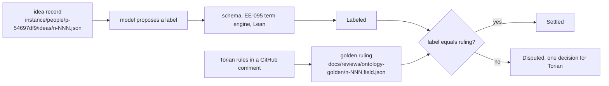

# ontology-golden

Up: [the ontology program](../../design/CLAUDE_HANDOFF_ONTOLOGY_PROGRAM.md)

## What this is

This folder holds Torian's rulings on the idea records in [`instance/people/p-54697df9/ideas/`](../../../instance/people/p-54697df9/ideas/) (EE-114). Only Torian's rulings go here. A model, an agent or a checker never writes one. Each ruling is a golden record: the answer a gated label is measured against.

A ruling settles one field of one idea. It records the idea id, the field (status, importance, relation or scope), Torian's value, the URL of the GitHub comment where he gave it and the date. The comment URL is required, so every ruling points back to Torian's own words. The value has the shape that field takes in an idea record, so a label and a ruling compare as equal values. A relation ruling gives the idea's whole relations list, and an empty list rules that it has none.

## Where things are

| Path | Holds |
|---|---|
| `<idea>.<field>.json` | One ruling, such as `n-001.scope.json`. A new ruling on the same idea and field replaces the file, and git keeps the earlier one. No ruling is here yet. |
| [`schema/golden-ruling.schema.json`](../../../schema/golden-ruling.schema.json) | The ruling format. Status and importance take the idea record's values. Relation and scope reuse its relation and attachment lists, the ones `schema/terms/relations.ts` defines. |
| [`schema/examples/ontology-golden/n-001.scope.json`](../../../schema/examples/ontology-golden/n-001.scope.json) | A sample ruling. It is an example of the format, not a ruling, so it lives outside this folder. |

A ruling looks like this.

```json
{
  "idea": "n-001",
  "field": "scope",
  "value": { "scope": "naive@capabilities", "via": "appends_to" },
  "comment": "https://github.com/tchjhnsn/everything-ecosystem/issues/1#issuecomment-1",
  "ruled": "2026-11-05"
}
```

## Run and test

- `python3 schema/validate.py --schema golden-ruling.schema.json --file <ruling>` prints `valid`, or each error, and exits 1 on an error.
- `python3 schema/validate.py` checks every ruling in this folder and the sample.
- `node scripts/reconcile-ideas.ts [--root <dir>] [--proposals <file>]` gates the proposals file (JSON Lines, one `{idea, field, value, terms}` per line, by default `proposals.jsonl` in the runner's folder, which no file holds yet) and prints each transition. `node scripts/reconcile-ideas-test.ts` drives every transition of the statechart once. `node test.mjs` runs it as the reconcile runner group.
- `node scripts/golden-ruling-test.ts` checks that the sample validates. It checks that a ruling without its comment URL, with a field outside the four or with a value from another field is rejected. It also checks that each ruling here is named for its idea and field and names an idea that exists. `node test.mjs` runs it as the golden rulings group.

## How it connects



- Reads: the idea records, by id.
- Read by: the reconcile runner, `node scripts/reconcile-ideas.ts` (S3-PR3). It moves each proposed label through the idea record statechart and compares a Labeled label with the ruling for its idea and field. A match settles the label. A difference makes it Disputed and puts one line on Torian's queue, and so does a label with no ruling. A new ruling on a disputed field settles it at Torian's value. The runner reads this folder and never writes to it. Its state and the queue are JSON Lines files in `docs/reviews/ontology-program/reconcile/`, written only when they change. The agreement report (S3-PR4) is not built.

## Not built

- Nothing measures how often gated labels agree with rulings yet (S3-PR4).
- Nothing checks that a ruling's comment was written by Torian. The comment URL lets a reader check it by hand.
