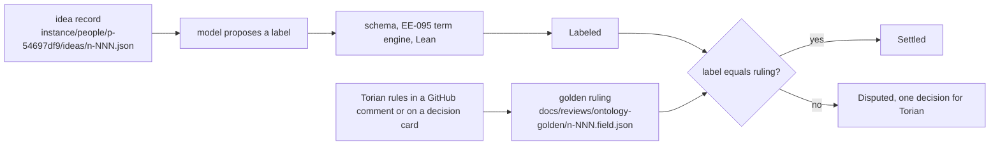

# ontology-golden

Up: [the ontology program](../../design/CLAUDE_HANDOFF_ONTOLOGY_PROGRAM.md)

## What this is

This folder holds Torian's rulings on the idea records in [`instance/people/p-54697df9/ideas/`](../../../instance/people/p-54697df9/ideas/) (EE-114). Only Torian's rulings go here. A model, an agent or a checker never writes one. Each ruling is a golden record: the answer a gated label is measured against.

A ruling settles one field of one idea. It records the idea id, the field (status, importance, relation or scope), Torian's value, its source and the date. Rulings come from Torian's GitHub comments or his decision cards, nothing else. A ruling cites exactly one source, so every ruling points back to Torian's own words. A `comment` source is the URL of the GitHub issue or pull request comment where he gave it. A `card` source is the decision card he tapped in the project thread: `thread` and `message` are the thread id and the card message id, each `cmsg_` followed by letters and digits, and `chosen_at` is the UTC time of the tap. The platform verifies that a tap came from Torian's own client. The value has the shape that field takes in an idea record, so a label and a ruling compare as equal values. A relation ruling gives the idea's whole relations list, and an empty list rules that it has none.

## Where things are

| Path | Holds |
|---|---|
| `<idea>.<field>.json` | One ruling, such as `n-001.scope.json`. A new ruling on the same idea and field replaces the file, and git keeps the earlier one. No ruling is here yet. |
| [`schema/golden-ruling.schema.json`](../../../schema/golden-ruling.schema.json) | The ruling format. Status and importance take the idea record's values. Relation and scope reuse its relation and attachment lists, the ones `schema/terms/relations.ts` defines. |
| `AGREEMENT_<date>.md` | The agreement report, generated by `node scripts/agreement-report.ts`. It is not a ruling. The date is the newest ruling's day, or the newest captured day of the idea records while no ruling exists. A new run replaces it, and git keeps the earlier one. |
| [`schema/examples/ontology-golden/n-001.scope.json`](../../../schema/examples/ontology-golden/n-001.scope.json) | A sample ruling. It is an example of the format, not a ruling, so it lives outside this folder. |

A ruling looks like this.

```json
{
  "idea": "n-001",
  "field": "scope",
  "value": { "scope": "naive@capabilities", "via": "appends_to" },
  "card": { "thread": "cmsg_01SampleThread", "message": "cmsg_01SampleCard", "chosen_at": "2026-11-05T16:10:00Z" },
  "ruled": "2026-11-05"
}
```

A ruling from a GitHub comment replaces `card` with `"comment": "https://github.com/tchjhnsn/everything-ecosystem/issues/1#issuecomment-1"`.

## Run and test

- `node node_modules/naive-framework/packages/naive/src/records/validate.mjs --schema golden-ruling.schema.json --file <ruling>` prints `valid`, or each error, and exits 1 on an error. It is Naive's validator, in JavaScript, with no Python.
- `node scripts/reconcile-ideas.ts [--root <dir>] [--proposals <file>]` gates the proposals file (JSON Lines, one `{idea, field, value, terms}` per line, by default `docs/reviews/ontology-program/reconcile/proposals.jsonl`) and prints each transition. `node scripts/reconcile-ideas-test.ts` drives every transition of the statechart once. `node test.mjs` runs it as the reconcile runner group.
- `node scripts/agreement-report.ts [--root <dir>] [--check]` writes `AGREEMENT_<date>.md`: per field, how often a ruling matches the raw proposal (without the symbolic checks) and the label that reached Labeled or later (with them), each with its sample size, the spread across proposed scopes, and what limits the number. It reads a ruling's idea, field, value and ruled day, not the comment or card it cites. With no ruling the report says trust is not measured yet, every sample size is 0 and no percentage is given. `--check` writes nothing and exits 1 when the committed report differs from a fresh run. Both modes exit 1 and name the labels when the runner's state is stale: a label at Labeled or later whose proposal line changed (the runner prints HELD) or left `proposals.jsonl`, a line the runner has not taken, or a Labeled label with a ruling the runner has not compared. `node scripts/agreement-report-test.ts` checks that 3 of 4 matches give 75 percent and that zero rulings give no percentage. It checks that each of those stale cases makes `--check` exit 1 and name the label while the report text is unchanged, and that the committed report is fresh. `node test.mjs` runs it as the agreement report group.
- `node scripts/golden-ruling-test.ts` checks that the sample validates. It checks that a ruling citing a comment and one citing a card both validate, and that a ruling with no source, with both sources, with a malformed card id or tap time, with a field outside the four or with a value from another field is rejected. It also checks that each ruling here is named for its idea and field and names an idea that exists. `node test.mjs` runs it as the golden rulings group.

## How it connects



- Reads: the idea records, by id.
- Read by: the reconcile runner, `node scripts/reconcile-ideas.ts` (S3-PR3). It moves each proposed label through the idea record statechart and compares a Labeled label with the ruling for its idea and field. A match settles the label. A difference makes it Disputed and puts one line on Torian's queue, with the ruling's source, and so does a label with no ruling. A new ruling on a disputed field settles it at Torian's value. The runner reads this folder and never writes to it. Its state and the queue are JSON Lines files in `docs/reviews/ontology-program/reconcile/`, written only when they change. The agreement report (S3-PR4), `node scripts/agreement-report.ts`, reads the rulings, the proposals and the runner's state and never writes a ruling.

## Not built

- Nothing in this repo checks that a ruling's comment was written by Torian. The comment URL lets a reader check it by hand. For a card, the platform checks the tap came from his client when he taps, and nothing here checks it again.
